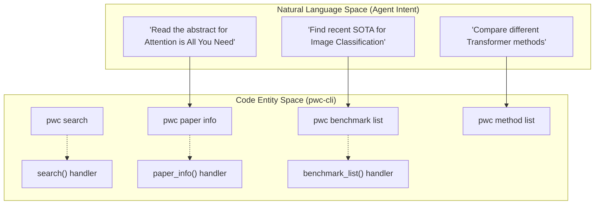
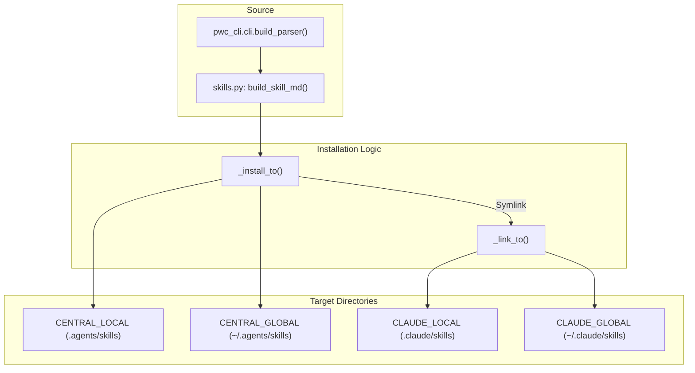

<!-- source: DeepWiki mcp.deepwiki.com · repo huggingface/pwc-cli · page 4 Agent Skills Integration · fetched 2026-10-26 -->

# Agent Skills Integration

Relevant source files

The following files were used as context for generating this wiki page:

- [README.md](README.md)
- [standalone_cli/SKILL.md](standalone_cli/SKILL.md)
- [standalone_cli/src/pwc_cli/skills.py](standalone_cli/src/pwc_cli/skills.py)

The `pwc-cli` includes a dedicated **Skills** subsystem designed to bridge the gap between a standard Command Line Interface and LLM-based coding agents (such as Claude Code, Cursor, or OpenCode). By exporting its command tree and research workflows as a structured "Skill," the CLI enables agents to perform grounded AI/ML research, discover state-of-the-art models, and browse the Papers With Code catalog autonomously.

### System Purpose
The skills integration serves three primary functions:
1.  **Context Injection**: Provides agents with a comprehensive `SKILL.md` file containing descriptions, research workflows, and command signatures [standalone_cli/SKILL.md:1-150]().
2.  **Version Parity**: Ensures that the agent's understanding of available flags and subcommands exactly matches the locally installed version of `pwc` [standalone_cli/src/pwc_cli/skills.py:133-149]().
3.  **Standardized Installation**: Automates the placement of skill definitions into specific agent directories like `.agents/skills` or `.claude/skills` [standalone_cli/src/pwc_cli/skills.py:13-17]().

### Conceptual Bridge: Natural Language to Code
The following diagram illustrates how natural language research requests are mapped to specific code entities and CLI commands within the skills subsystem.

**Agent Intent to Command Mapping**

**Sources:** [standalone_cli/SKILL.md:37-120](), [standalone_cli/src/pwc_cli/skills.py:19-28]()

---

### Skill Generation
The CLI generates its own documentation by introspecting the `argparse` tree defined in the core application. This ensures that every flag, positional argument, and help string is accurately reflected in the agent's context.

*   **Introspection**: Uses `_command_entries()` to recursively walk the parser tree [standalone_cli/src/pwc_cli/skills.py:114-130]().
*   **Signature Extraction**: The `_command_signature()` function converts internal `argparse` actions into readable Markdown syntax (e.g., `[--limit 1-100]`) [standalone_cli/src/pwc_cli/skills.py:89-111]().
*   **Workflow Guidance**: Embeds a specific "Research workflow" that instructs agents on the optimal sequence of commands (e.g., starting with benchmarks before reading papers) [standalone_cli/src/pwc_cli/skills.py:44-75]().

For a deep dive into the introspection logic, see [Skill Generation (skills.py)](#4.1).

---

### Skill Installation and Agent Targets
The `pwc skills add` command manages the physical installation of the generated skill. It supports multiple installation modes to accommodate different agent environments.

**Skill Distribution Architecture**

**Sources:** [standalone_cli/src/pwc_cli/skills.py:14-17](), [standalone_cli/src/pwc_cli/skills.py:165-186]()

The installation process is designed to be atomic using temporary directories [standalone_cli/src/pwc_cli/skills.py:170-176]() and safe, requiring a `--force` flag to overwrite existing installations [standalone_cli/src/pwc_cli/skills.py:152-163]().

For details on directory paths and installation flags, see [Skill Installation and Agent Directories](#4.2).

---

### Summary of Agent Commands
The skill exposes a wide range of commands to the agent, summarized below:

| Command Group | Purpose | Primary Code Entity |
| :--- | :--- | :--- |
| `search` | Discovery via keyword/semantic search | `search` |
| `paper` | Metadata, reading, and lineage | `paper info`, `paper read`, `paper lineage` |
| `benchmark` | SOTA discovery and leaderboards | `benchmark list`, `benchmark --name` |
| `taxonomy` | Exploring Tasks, Methods, and Areas | `task list`, `method list` |
| `meta` | Organizations, Conferences, Frameworks | `organization`, `conference`, `framework` |

**Sources:** [standalone_cli/SKILL.md:35-125](), [standalone_cli/src/pwc_cli/skills.py:114-130]()

---

