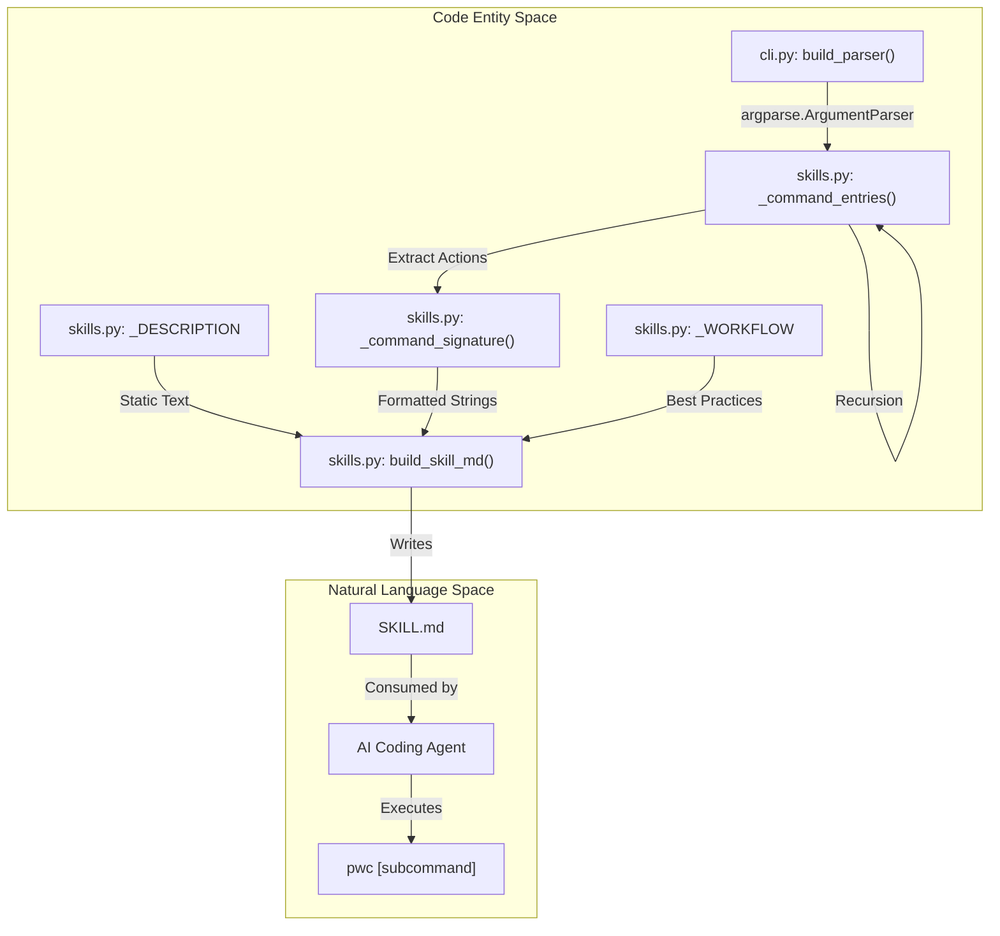
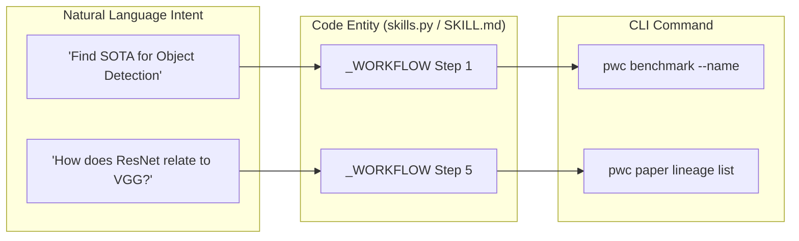

<!-- source: DeepWiki mcp.deepwiki.com · repo huggingface/pwc-cli · page 4.1 Skill Generation (skills.py) · fetched 2026-10-26 -->

# Skill Generation (skills.py)

Relevant source files

The following files were used as context for generating this wiki page:

- [standalone_cli/SKILL.md](standalone_cli/SKILL.md)
- [standalone_cli/src/pwc_cli/skills.py](standalone_cli/src/pwc_cli/skills.py)

The `pwc-cli` includes a specialized subsystem for generating and installing "Skills" for AI coding agents (such as Claude Code). This system enables agents to understand the CLI's capabilities, command signatures, and research workflows by introspecting the `argparse` tree at runtime.

### Overview

The skill generation logic resides in `standalone_cli/src/pwc_cli/skills.py`. It bridges the gap between the static command-line interface and the natural language requirements of LLM agents. Instead of maintaining a separate manual documentation file for agents, the system programmatically generates `SKILL.md` to ensure perfect parity with the installed version of the CLI.

Sources: [standalone_cli/src/pwc_cli/skills.py:1-28]()

---

### Introspection Engine

The core of the skill generation is the introspection of the `argparse.ArgumentParser` object created by `build_parser()` in `cli.py`.

#### Command Discovery (`_command_entries`)
The `_command_entries()` function performs a depth-first search (DFS) through the `argparse` tree. It identifies valid subcommands by checking for the presence of a `handler` in the parser's defaults, which indicates a terminal command that can be executed.

#### Signature Generation (`_command_signature`)
For every discovered command, `_command_signature()` reconstructs a human-readable (and agent-readable) usage string. It iterates through `parser._actions` to:
- Convert positional arguments to uppercase (e.g., `PAPER`).
- Format optional flags in brackets (e.g., `[--json]`).
- Extract valid choices for flags (e.g., `[--mode hybrid|keyword|semantic]`).
- Distinguish between boolean flags (`nargs=0`) and value-based arguments.

#### Natural Language to Code Mapping

| Agent Concept | Code Entity | Purpose |
| :--- | :--- | :--- |
| **Skill Name** | `SKILL_NAME` | The identifier used by agent harnesses (`pwc-cli`). |
| **Command Help** | `_subcommand_help()` | Extracts the `help` string defined in `argparse` for the skill description. |
| **Command Path** | `prefix: tuple[str, ...]` | Tracks the nesting level (e.g., `paper`, `lineage`, `list`) to build the full invocation string. |
| **Registry** | `build_parser()` | The source of truth for all available commands and flags. |

Sources: [standalone_cli/src/pwc_cli/skills.py:82-130](), [standalone_cli/src/pwc_cli/cli.py:34-50]()

---

### Skill Structure and Data Flow

The `build_skill_md()` function assembles the final Markdown document. It combines static guidance with the dynamically generated command list.

#### Components of SKILL.md
1.  **Frontmatter**: Contains the name and a high-level description (`_DESCRIPTION`) instructing the agent when to use the tool.
2.  **Introduction**: Basic usage rules, such as title matching logic and the authoritative nature of the `--help` flag.
3.  **Commands**: The list generated by `_command_entries()`.
4.  **Research Workflow**: A hand-written guide (`_WORKFLOW`) that teaches the agent how to chain commands (e.g., finding a benchmark, then inspecting the leaderboard, then reading the source paper).
5.  **Output and Limits**: Documentation on exit codes and the differences between interactive TTY output and programmatic JSON output.

#### Data Flow Diagram: CLI to Skill

Sources: [standalone_cli/src/pwc_cli/skills.py:19-75](), [standalone_cli/src/pwc_cli/skills.py:133-150](), [standalone_cli/SKILL.md:1-63]()

---

### Research Workflow Logic

The skill embeds a specific "Research Workflow" to prevent agents from hallucinating flags or using inefficient search patterns.

| Step | Recommended Command | Reasoning |
| :--- | :--- | :--- |
| **Discovery** | `pwc benchmark list --task` | Identifies active evaluation targets for a specific field. |
| **Inspection** | `pwc paper info --include-resources` | Gathers metadata and official repository links. |
| **Expansion** | `pwc paper related` | Uses embedding-based similarity to find work not caught by keyword search. |
| **Lineage** | `pwc paper lineage list` | Traces model ancestry (predecessors and successors). |
| **Evidence** | `pwc paper read` | Extracts Markdown content for primary source analysis. |

#### Workflow Association Diagram

Sources: [standalone_cli/src/pwc_cli/skills.py:44-60](), [standalone_cli/SKILL.md:65-79]()

---

### Output Modes for Agents

The generated skill explicitly instructs agents on how to handle CLI output:
- **Compact/Interactive**: Agents are told to use this for general discovery. Benchmark lists remain aligned in these modes.
- **TSV (Lossless)**: Default for captured output, providing tab-separated values for easy parsing.
- **JSON**: Recommended for "programmatic filtering, joining, or schema-dependent processing." The skill notes that JSON includes the `evaluations` table as structured data when `--include-evals` is used.

Sources: [standalone_cli/src/pwc_cli/skills.py:61-72](), [standalone_cli/SKILL.md:22-27]()

---

