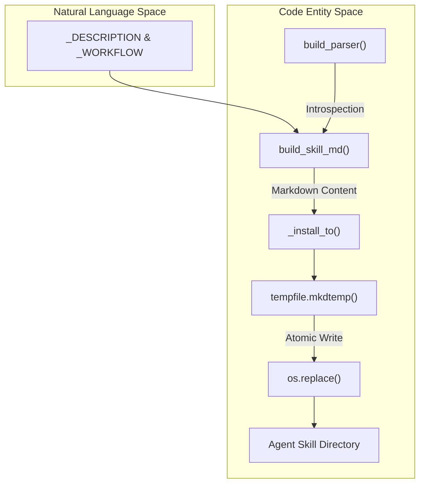
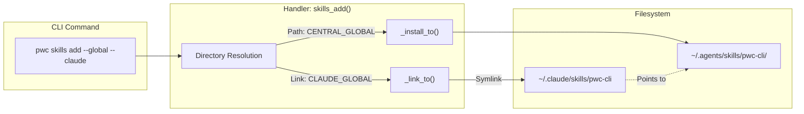

<!-- source: DeepWiki mcp.deepwiki.com · repo huggingface/pwc-cli · page 4.2 Skill Installation and Agent Directories · fetched 2026-10-26 -->

# Skill Installation and Agent Directories

Relevant source files

The following files were used as context for generating this wiki page:

- [standalone_cli/src/pwc_cli/skills.py](standalone_cli/src/pwc_cli/skills.py)
- [standalone_cli/tests/test_cli.py](standalone_cli/tests/test_cli.py)

The `pwc-cli` includes a specialized subsystem for exporting its functionality as a "Skill" for AI coding agents (such as Claude Desktop or other agentic harnesses). This process involves generating a `SKILL.md` file that describes the CLI's capabilities and installing it into specific directories where agents expect to find tool definitions.

## Installation Targets and Scopes

The system supports four primary installation targets, defined as `Path` constants in [standalone_cli/src/pwc_cli/skills.py:14-17](). These targets allow for both local (project-specific) and global (user-wide) integration.

| Target Constant | Default Path | Purpose |
|:---|:---|:---|
| `CENTRAL_LOCAL` | `.agents/skills` | Project-local directory for general agent frameworks. |
| `CENTRAL_GLOBAL` | `~/.agents/skills` | User-global directory for general agent frameworks. |
| `CLAUDE_LOCAL` | `.claude/skills` | Project-local directory specifically for Claude Desktop/harnesses. |
| `CLAUDE_GLOBAL` | `~/.claude/skills` | User-global directory specifically for Claude Desktop/harnesses. |

### Logic Flow for Target Selection
The `skills_add()` function [standalone_cli/src/pwc_cli/skills.py:189-207]() determines the destination based on CLI flags:
1. **Custom Destination**: If `--dest` is provided, the skill is installed only to that path. This cannot be combined with `--global` [standalone_cli/src/pwc_cli/skills.py:190-195]().
2. **Standard Installation**: By default, the skill is installed to a "Central" location (Local or Global).
3. **Claude Integration**: If `--claude` is specified, the system first installs to the Central location and then creates a symlink in the Claude-specific directory [standalone_cli/src/pwc_cli/skills.py:207]().

**Sources:** [standalone_cli/src/pwc_cli/skills.py:13-17](), [standalone_cli/src/pwc_cli/skills.py:189-207]()

## Atomic Installation Process

To prevent corrupted skill definitions, the CLI uses an atomic installation pattern in `_install_to()` [standalone_cli/src/pwc_cli/skills.py:165-178]().

### Data Flow: Installation to Filesystem
The following diagram illustrates how the `SKILL.md` content moves from the generator to the final agent directory.

**Skill Persistence Pipeline**

### Key Functions
- **`_install_to(skills_dir, force)`**: Creates a temporary directory within the destination to write `SKILL.md`, then performs an atomic `os.replace()` to move the temporary directory to the final `pwc-cli` name [standalone_cli/src/pwc_cli/skills.py:165-178]().
- **`_remove_existing(path, force)`**: Safety check that raises `SkillInstallError` if a skill already exists, unless the `--force` flag is present [standalone_cli/src/pwc_cli/skills.py:152-163]().
- **`_link_to(skills_dir, installed, force)`**: Creates a relative symlink from a secondary location (like a Claude directory) to the primary installed skill [standalone_cli/src/pwc_cli/skills.py:180-187]().

**Sources:** [standalone_cli/src/pwc_cli/skills.py:152-187](), [standalone_cli/src/pwc_cli/skills.py:78-79]()

## Entrypoint: skills_add()

The `skills_add()` function is the handler for the `pwc skills add` command. It orchestrates the directory resolution and calling of installation helpers.

### Command Execution Flow
This diagram maps the CLI command execution to the underlying skill management functions.

**Command Dispatch to Skill Management**

### Error Handling
- **`SkillInstallError`**: A custom exception raised when an installation is attempted over an existing directory without `--force` [standalone_cli/src/pwc_cli/skills.py:78-79](), [standalone_cli/src/pwc_cli/skills.py:156-158]().
- **Argument Validation**: The handler explicitly rejects combining `--dest` with `--global` to maintain clear scope boundaries [standalone_cli/src/pwc_cli/skills.py:192-195]().

**Sources:** [standalone_cli/src/pwc_cli/skills.py:189-207](), [standalone_cli/tests/test_cli.py:125-140](), [standalone_cli/tests/test_cli.py:142-153]()

## Verification and Testing

The installation logic is verified in `test_cli.py` to ensure correct directory creation and symlinking behavior:
- **Project-Local Install**: Verifies `SKILL.md` is created in `.agents/skills/pwc-cli/` [standalone_cli/tests/test_cli.py:98-106]().
- **Global & Claude Symlinks**: Verifies that `--global --claude` creates a real directory in the central path and a symlink in the Claude path [standalone_cli/tests/test_cli.py:108-123]().
- **Force Flag**: Confirms that existing files (e.g., `old.txt`) are preserved if `--force` is missing and purged if it is present [standalone_cli/tests/test_cli.py:125-140]().

**Sources:** [standalone_cli/tests/test_cli.py:98-153]()

---

