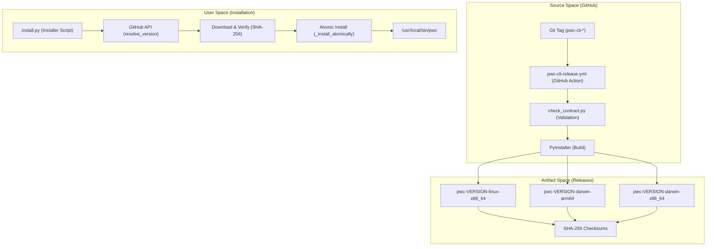
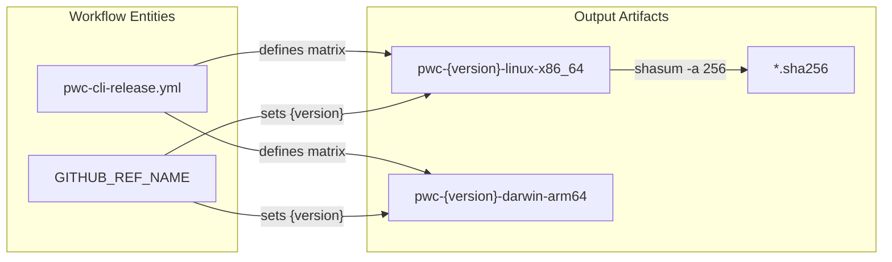

<!-- source: DeepWiki mcp.deepwiki.com · repo huggingface/pwc-cli · page 5 Distribution and Release · fetched 2026-10-26 -->

# Distribution and Release

Relevant source files

The following files were used as context for generating this wiki page:

- [.github/workflows/pwc-cli-release.yml](.github/workflows/pwc-cli-release.yml)
- [standalone_cli/install.py](standalone_cli/install.py)
- [standalone_cli/pyproject.toml](standalone_cli/pyproject.toml)
- [standalone_cli/src/pwc_cli/transport.py](standalone_cli/src/pwc_cli/transport.py)

This section provides a high-level overview of how the `pwc-cli` tool is packaged, distributed, and updated. The project supports two primary installation methods: a **standalone binary** for ease of use without a Python environment, and **source installation** via standard Python package managers.

## Release Ecosystem Overview

The release process is automated to ensure that every versioned tag results in verified, platform-specific binaries. The following diagram illustrates the relationship between the source code, the CI/CD pipeline, and the end-user installation process.

### Distribution Lifecycle

**Sources:** [.github/workflows/pwc-cli-release.yml:1-61](), [standalone_cli/install.py:1-212]()

## Binary Distribution
The preferred method for most users is the standalone binary. These are generated using **PyInstaller** and packaged as single-file executables that include all necessary dependencies.

*   **Platform Support:** Binaries are currently produced for `linux-x86_64`, `darwin-x86_64` (Intel Macs), and `darwin-arm64` (Apple Silicon) [standalone_cli/install.py:199-203]().
*   **Verification:** Every binary is accompanied by a `.sha256` checksum file generated during the build process [.github/workflows/pwc-cli-release.yml:41-41]().
*   **Automation:** The `install.py` script automates the detection of the user's operating system and architecture, fetches the appropriate artifact, and verifies its integrity before installation.

For technical details on the installation script logic, platform mapping, and atomic file operations, see [Binary Installer (install.py)](#5.1).

## Source Installation
For developers or users who prefer managing their own Python environments, `pwc-cli` is a standard Python package defined in `pyproject.toml` [standalone_cli/pyproject.toml:1-18]().

| Method | Command | Description |
| :--- | :--- | :--- |
| **uv** | `uv tool install pwc-cli` | Recommended for modern Python environments. |
| **pipx** | `pipx install pwc-cli` | Standard way to install Python CLIs in isolated environments. |
| **pip** | `pip install ./standalone_cli` | Manual installation from a local clone of the repository. |

The package entrypoint is mapped to the `pwc` command, which invokes `pwc_cli.cli:main` [standalone_cli/pyproject.toml:10-11]().

## CI/CD Release Pipeline
The release pipeline is hosted on GitHub Actions and is triggered by tags matching the pattern `pwc-cli-*` [.github/workflows/pwc-cli-release.yml:3-6]().

The pipeline performs several critical steps before publishing:
1.  **Contract Validation:** Runs `check_contract.py` to ensure the CLI structure matches the internal API registry [standalone_cli/scripts/check_contract.py]().
2.  **Matrix Build:** Parallel builds across Linux and macOS runners [.github/workflows/pwc-cli-release.yml:15-24]().
3.  **Attestation:** Generates build-provenance attestations to verify the authenticity of the artifacts [.github/workflows/pwc-cli-release.yml:42-44]().

For details on the build matrix, environment setup, and artifact naming conventions, see [CI/CD Release Pipeline](#5.2).

### Release Entity Mapping
The following diagram bridges the CI/CD configuration to the resulting filesystem entities.

**Sources:** [.github/workflows/pwc-cli-release.yml:17-24](), [.github/workflows/pwc-cli-release.yml:37-41]()

---

