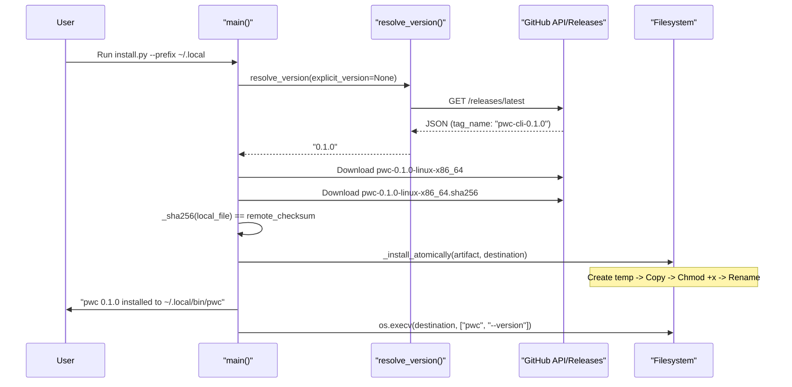
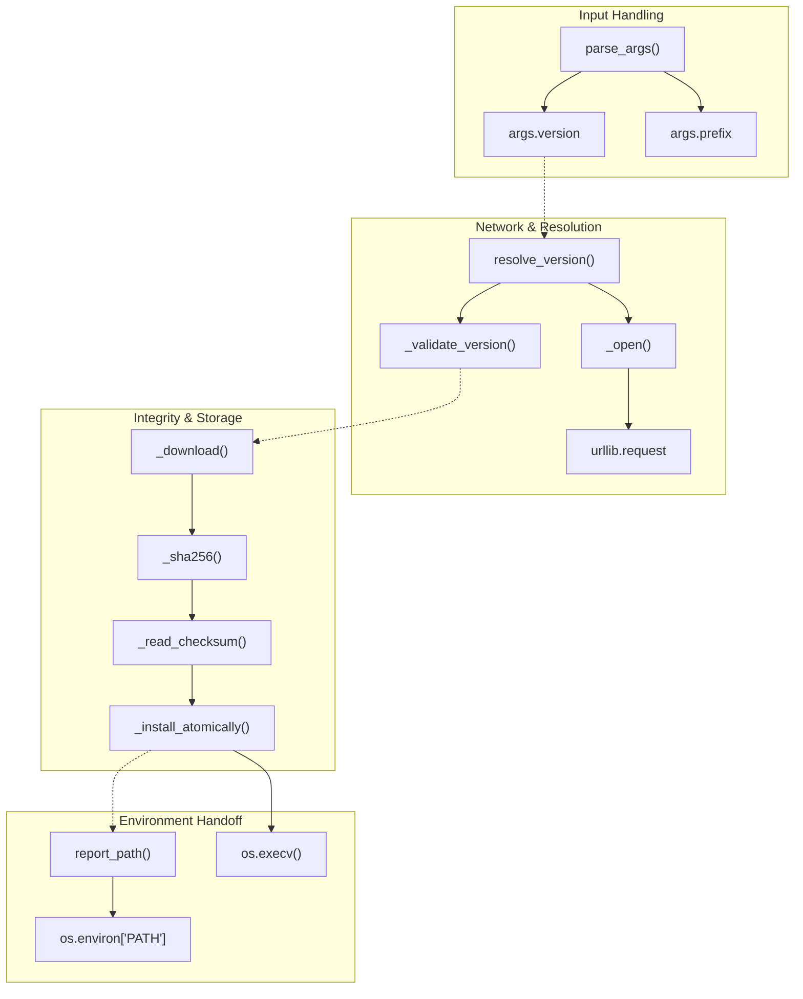

<!-- source: DeepWiki mcp.deepwiki.com · repo huggingface/pwc-cli · page 5.1 Binary Installer (install.py) · fetched 2026-10-26 -->

# Binary Installer (install.py)

Relevant source files

The following files were used as context for generating this wiki page:

- [standalone_cli/install.py](standalone_cli/install.py)

The `install.py` script is a standalone, zero-dependency Python utility designed to bootstrap the `pwc` CLI by downloading, verifying, and installing platform-specific prebuilt binaries. It handles version resolution via the GitHub API, platform detection, SHA-256 integrity checks, and atomic filesystem operations.

## Installer Workflow

The installer follows a linear execution path to ensure the binary is correctly placed and executable.

### 1. Version Resolution
The script first determines which version of the CLI to fetch. If a specific version is not provided via the `--version` flag, it queries the GitHub Releases API to find the latest tag.
*   **API Endpoint**: `https://api.github.com/repos/huggingface/pwc-cli/releases/latest` [standalone_cli/install.py:23-25]()
*   **Validation**: The script ensures the tag matches the expected `pwc-cli-` prefix and conforms to a standard version regex `[A-Za-z0-9][A-Za-z0-9._-]*$` [standalone_cli/install.py:26,94-98]().

### 2. Platform and Architecture Mapping
The installer detects the host environment using the `platform` module and maps it to the artifact naming convention used in the release pipeline.
*   **Supported Combinations**: `linux-x86_64`, `darwin-x86_64`, and `darwin-arm64` [standalone_cli/install.py:199-203]().
*   **Normalization**: Architecture strings like `amd64` are normalized to `x86_64`, and `aarch64` to `arm64` [standalone_cli/install.py:198]().

### 3. Verification and Integrity
To prevent corruption or malicious tampering, the script performs mandatory checksum verification.
*   **Checksum Retrieval**: It downloads the `.sha256` file corresponding to the binary [standalone_cli/install.py:115-127]().
*   **Local Calculation**: It computes the SHA-256 hash of the downloaded artifact in 1MB chunks to manage memory usage [standalone_cli/install.py:129-134]().
*   **Comparison**: If the computed hash does not match the remote checksum, the installation is aborted [standalone_cli/install.py:213-216]().

### 4. Atomic Installation
To avoid leaving a broken binary in the destination path (e.g., if the process is interrupted or the disk is full), the script uses an atomic replacement strategy in `_install_atomically`.

| Step | Operation | Code Reference |
| :--- | :--- | :--- |
| 1 | Create temporary file | `tempfile.mkstemp` [standalone_cli/install.py:139-141]() |
| 2 | Copy artifact | `shutil.copy2` [standalone_cli/install.py:145]() |
| 3 | Set permissions | `chmod` (adds `+x` for User, Group, Others) [standalone_cli/install.py:146-148]() |
| 4 | Atomic Move | `os.replace` (overwrites target binary) [standalone_cli/install.py:149]() |

**Sources:** [standalone_cli/install.py:1-216]()

## Logic and Data Flow

The following diagram illustrates the flow from user input to the final execution of the installed binary.

### Installation Sequence

**Sources:** [standalone_cli/install.py:83-101](), [standalone_cli/install.py:137-152](), [standalone_cli/install.py:188-216]()

## Key Functions

### `resolve_version(explicit_version, latest_release_url)`
Handles the logic for determining which binary version to fetch. It either validates a user-provided string or performs a network request to the GitHub API to fetch the latest release metadata [standalone_cli/install.py:83-101]().

### `_download(url, destination)`
Streams the binary from the `release-origin` to a local path. It uses a `while True` loop with `response.read(1024 * 1024)` to ensure large binaries do not cause memory exhaustion [standalone_cli/install.py:103-113]().

### `report_path(bin_directory, path_value)`
Checks if the installation directory is currently in the user's `$PATH`. If not, it prints a warning to `stderr` and provides the specific `export` command needed for the user's `.profile` [standalone_cli/install.py:154-181]().

### `_install_atomically(artifact, destination)`
Ensures that the `pwc` binary is never in a partially-written state. It leverages `os.replace`, which is an atomic operation on POSIX systems, to swap the verified temporary file into the final location [standalone_cli/install.py:137-152]().

**Sources:** [standalone_cli/install.py:83-101](), [standalone_cli/install.py:103-113](), [standalone_cli/install.py:137-152](), [standalone_cli/install.py:154-181]()

## Entity Mapping

This diagram bridges the conceptual installation steps to the specific functions and variables in `install.py`.

### Code Entity Relationship

**Sources:** [standalone_cli/install.py:33-49](), [standalone_cli/install.py:52-65](), [standalone_cli/install.py:83-101](), [standalone_cli/install.py:129-134](), [standalone_cli/install.py:137-152](), [standalone_cli/install.py:154-181]()

---

