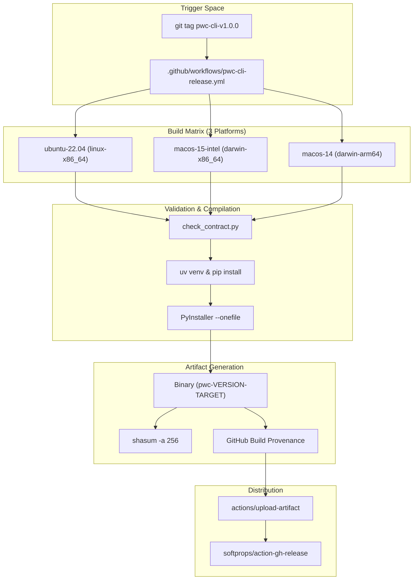
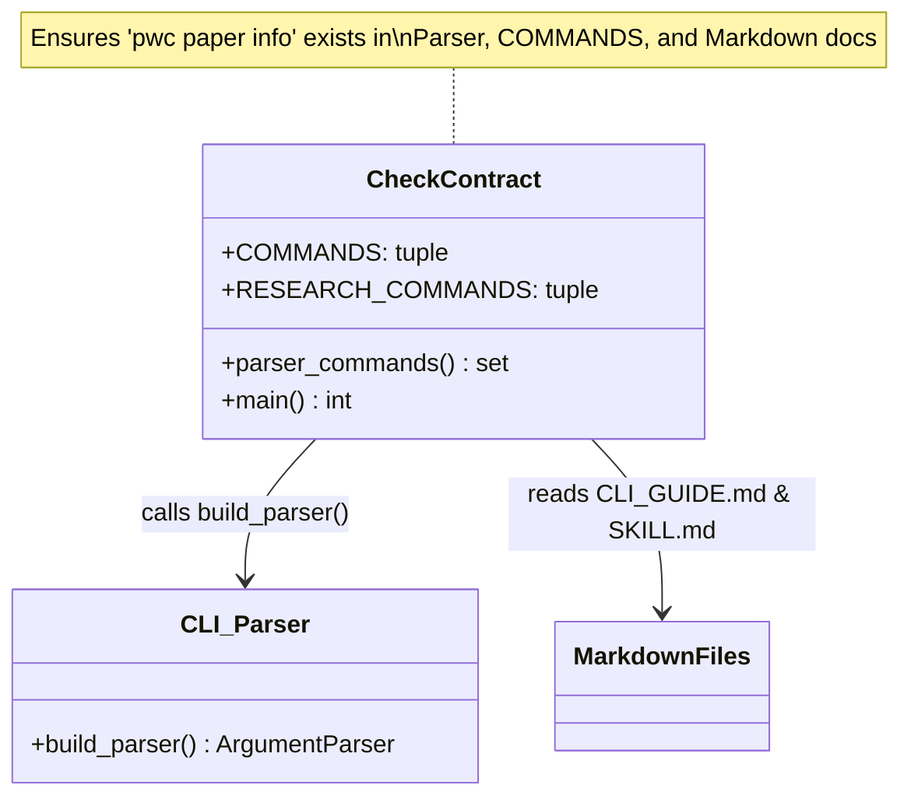

<!-- source: DeepWiki mcp.deepwiki.com · repo huggingface/pwc-cli · page 5.2 CI/CD Release Pipeline · fetched 2026-10-26 -->

# CI/CD Release Pipeline

Relevant source files

The following files were used as context for generating this wiki page:

- [.github/workflows/pwc-cli-release.yml](.github/workflows/pwc-cli-release.yml)
- [standalone_cli/scripts/check_contract.py](standalone_cli/scripts/check_contract.py)
- [standalone_cli/src/pwc_cli/transport.py](standalone_cli/src/pwc_cli/transport.py)

The `pwc-cli` release pipeline is a fully automated GitHub Actions workflow designed to produce cross-platform standalone binaries. The pipeline ensures that every release is validated against the API contract, cryptographically signed via build provenance attestations, and distributed with SHA-256 checksums for integrity verification.

## Workflow Overview

The release process is defined in `.github/workflows/pwc-cli-release.yml` and is triggered exclusively by the creation of a tag following the `pwc-cli-*` pattern [ .github/workflows/pwc-cli-release.yml:3-6](). The pipeline consists of two primary stages: a parallelized **Build** matrix and a centralized **Release** job.

### Data Flow and Pipeline Architecture

The following diagram illustrates the flow from code push to the final GitHub Release asset.

**Release Pipeline Data Flow**

**Sources:** [ .github/workflows/pwc-cli-release.yml:13-62]()

---

## Build Matrix and Environment Setup

The pipeline uses a `strategy.matrix` to build binaries for three target environments concurrently [ .github/workflows/pwc-cli-release.yml:15-24]():

| Target | Runner | Architecture |
| :--- | :--- | :--- |
| `linux-x86_64` | `ubuntu-22.04` | x86_64 Linux |
| `darwin-x86_64` | `macos-15-intel` | x86_64 macOS (Intel) |
| `darwin-arm64` | `macos-14` | ARM64 macOS (Apple Silicon) |

### Environment Provisioning
The workflow utilizes `astral-sh/setup-uv` to manage Python dependencies efficiently [ .github/workflows/pwc-cli-release.yml:28](). The build process creates a virtual environment within `standalone_cli/.venv` and installs both `pyinstaller` and the local `./standalone_cli` package to ensure all internal modules are available during the freezing process [ .github/workflows/pwc-cli-release.yml:33-34]().

---

## Pre-Build Validation: check_contract.py

Before any compilation occurs, the workflow executes `standalone_cli/scripts/check_contract.py` [ .github/workflows/pwc-cli-release.yml:32](). This script serves as a gatekeeper to prevent "documentation drift" or command inventory regressions.

### Implementation Details
The script performs a depth-first search (DFS) on the `argparse` tree generated by `build_parser()` to discover all active CLI commands [ standalone_cli/scripts/check_contract.py:42-65](). It then validates these against a hardcoded `COMMANDS` registry [ standalone_cli/scripts/check_contract.py:14-37]().

Furthermore, it ensures that every research-related command is documented in:
1. `backend/chat_sandbox_worker/CLI_GUIDE.md` (for internal sandbox use) [ standalone_cli/scripts/check_contract.py:72-73]().
2. `standalone_cli/SKILL.md` (for external agent integration) [ standalone_cli/scripts/check_contract.py:75]().

**Contract Validation Logic**

**Sources:** [ standalone_cli/scripts/check_contract.py:1-86](), [ standalone_cli/src/pwc_cli/cli.py:12-12]()

---

## Compilation and Artifact Naming

The binary is generated using PyInstaller with the `--onefile` flag, targeting `standalone_cli/entrypoint.py` as the main script [ .github/workflows/pwc-cli-release.yml:35-39](). 

### Artifact Naming Convention
To support the automated installer (see `install.py`), the pipeline follows a strict naming convention:
`pwc-{VERSION}-{TARGET}`

Example: `pwc-1.0.0-darwin-arm64`

The version is extracted from the GitHub tag using `${GITHUB_REF_NAME#pwc-cli-}` [ .github/workflows/pwc-cli-release.yml:37]().

### Security and Integrity
1. **Checksums**: Immediately after the build, a SHA-256 hash is generated for the binary: `shasum -a 256 "$artifact" > "$artifact.sha256"` [ .github/workflows/pwc-cli-release.yml:41]().
2. **Build Provenance**: The workflow uses `actions/attest-build-provenance` to generate a non-forgeable Sigstore attestation, linking the binary artifact to the specific GitHub Actions run [ .github/workflows/pwc-cli-release.yml:42-44]().

---

## Release Dispatch

Once the build matrix completes, the `release` job downloads all artifacts and merges them into a single directory [ .github/workflows/pwc-cli-release.yml:54-57](). It then uses `softprops/action-gh-release` to create the GitHub Release and upload the following files for each platform [ .github/workflows/pwc-cli-release.yml:58-61]():
* The standalone binary (e.g., `pwc-1.0.0-linux-x86_64`)
* The checksum file (e.g., `pwc-1.0.0-linux-x86_64.sha256`)

These assets are subsequently consumed by the `install.py` script for end-user installations.

**Sources:**
* Workflow configuration: [ .github/workflows/pwc-cli-release.yml:1-62]()
* Validation logic: [ standalone_cli/scripts/check_contract.py:1-86]()
* CLI Entrypoint: [ standalone_cli/src/pwc_cli/cli.py:12-12]()

---

