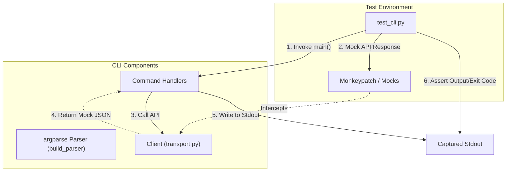
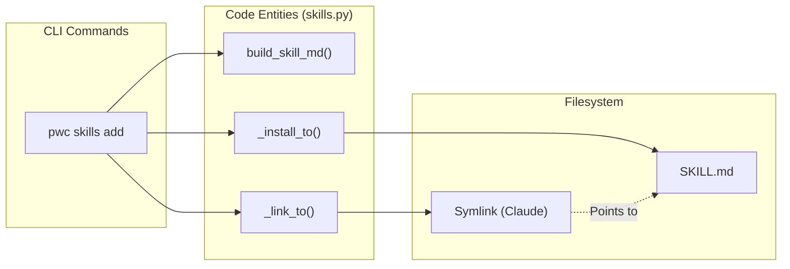

<!-- source: DeepWiki mcp.deepwiki.com · repo huggingface/pwc-cli · page 6.1 Test Suite (test_cli.py) · fetched 2026-10-26 -->

# Test Suite (test_cli.py)

Relevant source files

The following files were used as context for generating this wiki page:

- [standalone_cli/tests/test_cli.py](standalone_cli/tests/test_cli.py)

The `pwc-cli` test suite, primarily located in `standalone_cli/tests/test_cli.py`, provides comprehensive coverage for command-line parsing, skill generation, installer logic, and the interaction between the CLI and the Papers with Code (PWC) API. It ensures that the CLI adheres to its versioned JSON contract and maintains consistent output behavior across different terminal environments.

### Test Architecture and Mocking

The test suite uses `monkeypatch` to isolate the CLI from the network and the host filesystem. This allows for deterministic testing of API interactions and installation procedures without requiring a live backend or polluting the user's home directory.

#### Client Transport Mocking
To verify API-dependent commands, the suite mocks the `Client.request` method or the underlying `urllib.request.urlopen` calls. This ensures that the CLI's logic for processing API responses—such as benchmark leaderboard filtering and Pareto frontier selection—can be verified against controlled JSON payloads.

#### TTY and Output Capturing
The suite utilizes `contextlib.redirect_stdout` and `contextlib.redirect_stderr` alongside `capsys` to verify terminal output. It specifically tests the dual-mode output system by simulating TTY and piped environments to ensure the correct switch between Markdown tables and TSV formats.

**Diagram: Test Execution Data Flow**

**Sources:**
- [standalone_cli/tests/test_cli.py:8-16]()
- [standalone_cli/tests/test_cli.py:168-181]()
- [standalone_cli/tests/test_cli.py:98-106]()

---

### Command Verification Patterns

Each command group is tested for correct argument parsing, flag combinations, and expected exit codes.

#### Parser Integrity
The function `test_complete_parser_omits_catalog_mutation_and_auth_commands` verifies that the CLI correctly exposes only the intended public subcommands while hiding internal or administrative commands like `auth` or `cron`.

| Command Group | Verification Focus | Code Reference |
| :--- | :--- | :--- |
| **Paper** | Identifier resolution (`2501.1`), inclusion flags (`--include-evals`), and complex filters (task, method, conference). | [standalone_cli/tests/test_cli.py:34-60]() |
| **Taxonomy** | Area filtering for tasks/methods, group-by flags, and organization featured-only filters. | [standalone_cli/tests/test_cli.py:61-81]() |
| **Benchmark** | Leaderboard processing, metric filtering, and Pareto selection. | [standalone_cli/tests/test_cli.py:94-94]() |
| **Skills** | Installation path resolution and symlink creation. | [standalone_cli/tests/test_cli.py:98-153]() |

**Sources:**
- [standalone_cli/tests/test_cli.py:26-82]()
- [standalone_cli/tests/test_cli.py:98-153]()

---

### Skill and Agent Integration Tests

The `pwc-cli` provides a `skills` command group to export its functionality to LLM-based coding agents. The test suite verifies the integrity of these skills.

*   **Skill Content:** `test_generated_skill_matches_installed_cli_version_and_commands` ensures that `build_skill_md()` produces a document containing the correct CLI version and all mandatory command signatures [standalone_cli/tests/test_cli.py:84-96]().
*   **Installation Logic:** Tests verify the four installation targets (Local/Global Central and Local/Global Claude). It checks for atomic file writes and symlink creation using `is_symlink()` and `resolve()` [standalone_cli/tests/test_cli.py:108-123]().
*   **Conflict Handling:** `test_skills_add_protects_existing_install_and_force_replaces_it` ensures the CLI exits with code `2` if a skill already exists, unless the `--force` flag is provided [standalone_cli/tests/test_cli.py:125-140]().

**Diagram: Skill Installation Logic Mapping**

**Sources:**
- [standalone_cli/tests/test_cli.py:84-153]()

---

### Installer Script Testing

Since `install.py` is a standalone script, the test suite imports it dynamically using `importlib.util` to verify its logic without executing it as a subprocess.

*   **Version Resolution:** Tests verify that `resolve_version` correctly handles explicit version pins and fetches the `latest` tag from the GitHub API when no version is specified [standalone_cli/tests/test_cli.py:160-181]().
*   **Error Handling:** The suite simulates network failures (e.g., `urllib.error.URLError`) to ensure the installer provides clean, one-line error messages and exits with code `3` [standalone_cli/tests/test_cli.py:184-194]().
*   **Origin Validation:** `test_installer_downloads_from_this_repository_release_origin` ensures the installer is hardcoded to the correct GitHub repository (`huggingface/pwc-cli`) to prevent supply chain confusion [standalone_cli/tests/test_cli.py:154-158]().

**Sources:**
- [standalone_cli/tests/test_cli.py:18-23]()
- [standalone_cli/tests/test_cli.py:154-194]()

---

