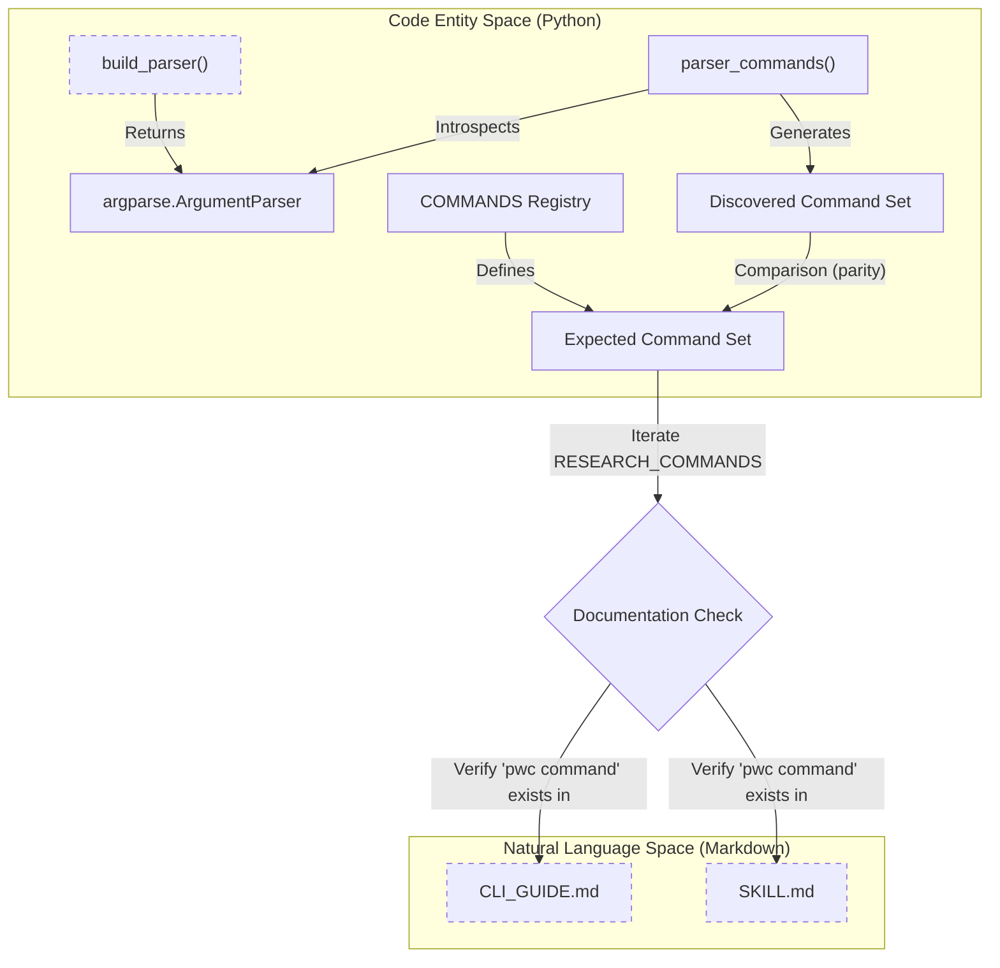
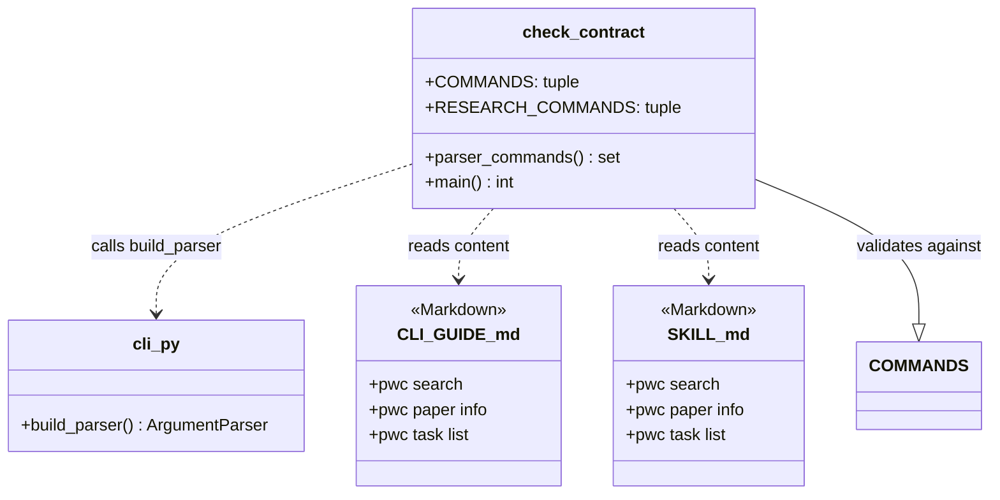

<!-- source: DeepWiki mcp.deepwiki.com · repo huggingface/pwc-cli · page 6.2 Contract Checker (check_contract.py) · fetched 2026-10-26 -->

# Contract Checker (check_contract.py)

Relevant source files

The following files were used as context for generating this wiki page:

- [backend/chat_sandbox_worker/CLI_GUIDE.md](backend/chat_sandbox_worker/CLI_GUIDE.md)
- [standalone_cli/scripts/check_contract.py](standalone_cli/scripts/check_contract.py)

The `check_contract.py` script is a validation utility designed to prevent "documentation drift" between the actual CLI implementation and its various public-facing definitions. It ensures that the `argparse` tree, the agent-facing `SKILL.md`, and the sandbox `CLI_GUIDE.md` remain perfectly synchronized.

## Overview and Purpose

The script acts as a gatekeeper in the CI/CD pipeline to ensure that any changes to the command-line interface are reflected in the documentation provided to LLMs and users. It validates three distinct areas:
1.  **Parser Parity**: The actual `argparse.ArgumentParser` object must exactly match the hardcoded `COMMANDS` registry.
2.  **Guide Coverage**: Every research-oriented command must be documented in `backend/chat_sandbox_worker/CLI_GUIDE.md` [standalone_cli/scripts/check_contract.py:72-74]().
3.  **Skill Inventory**: Every research-oriented command must be present in `standalone_cli/SKILL.md` [standalone_cli/scripts/check_contract.py:75-75]().

### Integration in CI
The script is executed during the GitHub Actions release workflow (`pwc-cli-release.yml`) as a pre-build validation step. If the script exits with a non-zero code, the build process terminates, preventing the distribution of mismatched binaries and documentation.

---

## Technical Implementation

### Command Registries
The script maintains two internal registries that define the "Source of Truth" for the expected CLI surface:

| Registry | Description | Contents |
| :--- | :--- | :--- |
| `COMMANDS` | The complete list of all supported subcommands. | Includes `search`, `paper info`, `task list`, `skills add`, `version`, etc. [standalone_cli/scripts/check_contract.py:14-37]() |
| `RESEARCH_COMMANDS` | A subset of `COMMANDS` excluding administrative/meta tasks. | Derived by filtering out `skills add` from the main list. [standalone_cli/scripts/check_contract.py:39-39]() |

### The `parser_commands()` Discovery Logic
To validate the `argparse` tree, the script performs a Depth-First Search (DFS) on the parser object returned by `build_parser()` [standalone_cli/scripts/check_contract.py:43]().

The `visit()` inner function [standalone_cli/scripts/check_contract.py:46-60]() traverses the tree by:
1.  Iterating through `_actions` of the current parser level.
2.  Identifying `choices` (which indicate subcommands in `argparse`).
3.  Distinguishing between leaf commands (executable) and intermediate command groups (e.g., `paper` is a group, while `paper info` is a command).
4.  Checking for the presence of a `handler` in `_defaults` to confirm if a node is an executable entry point [standalone_cli/scripts/check_contract.py:58-59]().

**Sources:**
- [standalone_cli/scripts/check_contract.py:14-40]() (Registries)
- [standalone_cli/scripts/check_contract.py:42-65]() (`parser_commands` implementation)

---

## Validation Data Flow

The following diagram illustrates how `check_contract.py` bridges the gap between the Python implementation and the Markdown documentation files.

### Natural Language to Code Entity Mapping: Validation Flow

**Sources:**
- [standalone_cli/scripts/check_contract.py:68-82]() (`main` validation logic)
- [backend/chat_sandbox_worker/CLI_GUIDE.md:1-27]() (Guide content)

---

## Detailed Execution Logic

The `main()` function [standalone_cli/scripts/check_contract.py:68-82]() executes the validation in two distinct stages:

### Stage 1: Parser Integrity
The script compares the set of commands discovered by `parser_commands()` against the `COMMANDS` tuple. If there is any discrepancy (missing commands or undocumented commands added to the parser), the script raises `SystemExit("standalone parser command inventory drifted")` [standalone_cli/scripts/check_contract.py:70-71]().

### Stage 2: Documentation Coverage
The script iterates through `RESEARCH_COMMANDS`. For each command (excluding `version`):
1.  It constructs an invocation string (e.g., `pwc paper info`) [standalone_cli/scripts/check_contract.py:79]().
2.  It verifies the string exists within `CLI_GUIDE.md`. This file is used by the sandbox environment to guide the LLM on available tools [backend/chat_sandbox_worker/CLI_GUIDE.md:6-27]().
3.  It verifies the string exists within `SKILL.md`. This file is the primary interface for coding agents like Claude Desktop [standalone_cli/scripts/check_contract.py:75]().

If a command is missing from either file, the script fails with a descriptive error: `missing read-only inventory entry: pwc <command>` [standalone_cli/scripts/check_contract.py:81]().

### Structural Relationship Diagram

**Sources:**
- [standalone_cli/scripts/check_contract.py:12-12]() (Importing `build_parser`)
- [standalone_cli/scripts/check_contract.py:68-82]() (Validation steps)
- [backend/chat_sandbox_worker/CLI_GUIDE.md:1-34]() (Target file)

---

