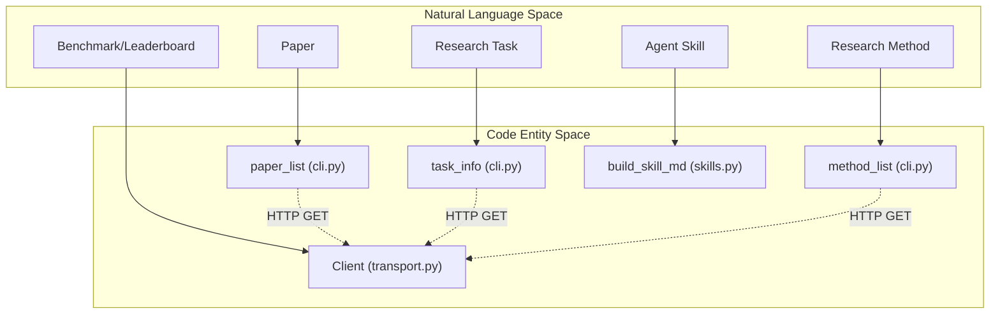
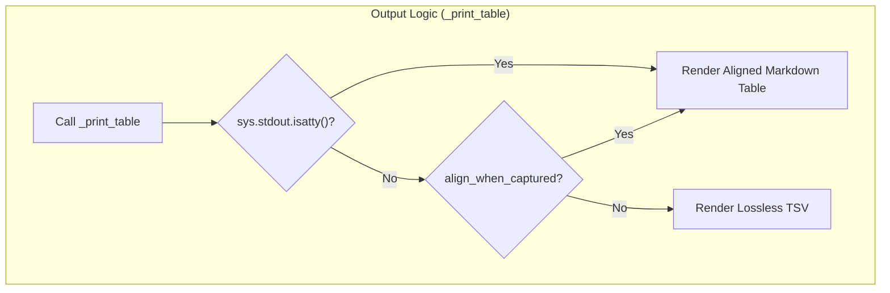

<!-- source: DeepWiki mcp.deepwiki.com · repo huggingface/pwc-cli · page 7 Glossary · fetched 2026-10-26 -->

# Glossary

Relevant source files

The following files were used as context for generating this wiki page:

- [.github/workflows/pwc-cli-release.yml](.github/workflows/pwc-cli-release.yml)
- [README.md](README.md)
- [standalone_cli/SKILL.md](standalone_cli/SKILL.md)
- [standalone_cli/install.py](standalone_cli/install.py)
- [standalone_cli/scripts/check_contract.py](standalone_cli/scripts/check_contract.py)
- [standalone_cli/src/pwc_cli/cli.py](standalone_cli/src/pwc_cli/cli.py)
- [standalone_cli/src/pwc_cli/skills.py](standalone_cli/src/pwc_cli/skills.py)
- [standalone_cli/src/pwc_cli/transport.py](standalone_cli/src/pwc_cli/transport.py)
- [standalone_cli/tests/test_cli.py](standalone_cli/tests/test_cli.py)

This glossary defines technical terms, domain-specific jargon, and internal architectural concepts used within the `pwc-cli` codebase.

## System Entities and Mapping

The following diagram maps natural language research concepts to their corresponding implementation entities within the `pwc-cli` codebase.

### Entity Relationship Mapping

**Sources:** [standalone_cli/src/pwc_cli/cli.py:19-23](), [standalone_cli/src/pwc_cli/transport.py:39-47](), [standalone_cli/src/pwc_cli/skills.py:133-135]()

---

## Terms and Definitions

### API Contract Version
A version string defined in the package metadata used to ensure compatibility between the CLI client and the backend API.
*   **Implementation:** Stored as `API_CONTRACT_VERSION` in `pwc_cli/__init__.py` and referenced during dispatch.
*   **Sources:** [standalone_cli/src/pwc_cli/cli.py:15]()

### Area
A top-level categorization in the Papers With Code taxonomy (e.g., "Computer Vision", "Natural Language Processing"). Tasks and Methods are grouped by Area.
*   **Implementation:** Used as a filter in `task_list` and `method_list` handlers.
*   **Sources:** [standalone_cli/SKILL.md:68-74](), [standalone_cli/src/pwc_cli/cli.py:65-67]()

### ArXiv ID (Modern vs. Legacy)
The CLI supports two formats of ArXiv identifiers for paper resolution:
*   **Modern:** `YYMM.NNNNN` (e.g., `2501.01234`).
*   **Legacy:** Subject-class/number (e.g., `cs.CL/9905001`).
*   **Implementation:** Defined via regex patterns `MODERN_ARXIV_ID` and `LEGACY_ARXIV_ID`.
*   **Sources:** [standalone_cli/src/pwc_cli/cli.py:21-22]()

### Benchmark Leaderboard
A collection of evaluations for a specific task and dataset, ranking models by performance metrics.
*   **Implementation:** The `benchmark_info` handler processes evaluation data, including Pareto frontier selection and metric filtering.
*   **Sources:** [standalone_cli/SKILL.md:118-122](), [standalone_cli/src/pwc_cli/cli.py:53-55]()

### Pareto Frontier (Pareto Selection)
A multi-metric optimization technique used in leaderboards to find models that are not strictly outperformed by any other model across all selected metrics (e.g., Accuracy vs. Latency).
*   **Implementation:** Handled via the `_pareto_objectives` type validator and internal processing logic in the benchmark subcommand.
*   **Sources:** [standalone_cli/src/pwc_cli/cli.py:88-99]()

### Skill
A Markdown document (`SKILL.md`) that describes the CLI's capabilities in a format optimized for Large Language Model (LLM) coding agents like Claude Code.
*   **Implementation:** Generated by `build_skill_md()` which introspects the `argparse` tree.
*   **Sources:** [standalone_cli/src/pwc_cli/skills.py:133-150](), [standalone_cli/SKILL.md:1-4]()

---

## Technical Components

### Transport Layer
The communication bridge between the CLI and the Papers With Code API.

| Component | Description | File Reference |
| :--- | :--- | :--- |
| `Client` | Manages base URL, environment variables (`PWC_API_URL`), and HTTP requests. | [standalone_cli/src/pwc_cli/transport.py:39-43]() |
| `Response` | A dataclass wrapping raw bytes and headers, providing a `.json()` helper. | [standalone_cli/src/pwc_cli/transport.py:27-37]() |
| `MAX_RESPONSE_BYTES` | A safety limit (2MB) to prevent OOM errors from large API payloads. | [standalone_cli/src/pwc_cli/transport.py:16]() |

**Sources:** [standalone_cli/src/pwc_cli/transport.py:1-83]()

### Output Formatting
The CLI uses a dual-mode output system based on TTY detection.

**Sources:** [standalone_cli/src/pwc_cli/cli.py:114-139]()

---

## Internal Error Codes

The system uses specific exit codes to signal failure modes to agents and shell scripts:

| Exit Code | Meaning | Source |
| :--- | :--- | :--- |
| `0` | Success | [standalone_cli/src/pwc_cli/skills.py:67]() |
| `2` | Invalid usage or syntax error | [standalone_cli/src/pwc_cli/cli.py:32]() |
| `3` | Network or server failure | [standalone_cli/install.py:192-194]() |
| `4` | Invalid API response (Contract breach) | [standalone_cli/src/pwc_cli/skills.py:67]() |

**Sources:** [standalone_cli/src/pwc_cli/skills.py:66-67](), [standalone_cli/src/pwc_cli/cli.py:32](), [standalone_cli/install.py:192-194]()