# Page: Overview

# Overview

<details>
<summary>Relevant source files</summary>

The following files were used as context for generating this wiki page:

- [README.md](README.md)
- [standalone_cli/README.md](standalone_cli/README.md)
- [standalone_cli/src/pwc_cli/__init__.py](standalone_cli/src/pwc_cli/__init__.py)

</details>


The `pwc-cli` is a fast, read-only command-line client designed for exploring the public [Papers with Code](https://paperswithcode.co) catalog. It provides a structured interface for searching papers, browsing benchmarks, and inspecting the research taxonomy (tasks, methods, conferences) without requiring an account, API token, or a full Python environment when using the prebuilt binaries [README.md:1-15]().

Beyond serving human users, the repository includes a "Skills" system that allows coding agents (like Claude Code, Cursor, or Codex) to integrate the CLI into their toolset, enabling them to perform research tasks autonomously [README.md:81-86]().

## System Architecture

The project is divided into a lightweight Python client and a distribution layer. The client communicates with the Papers with Code API using a versioned contract to ensure stability [standalone_cli/src/pwc_cli/__init__.py:4]().

### High-Level Component Mapping

The following diagram maps the logical components of the system to their respective code entities:

**System to Code Mapping**
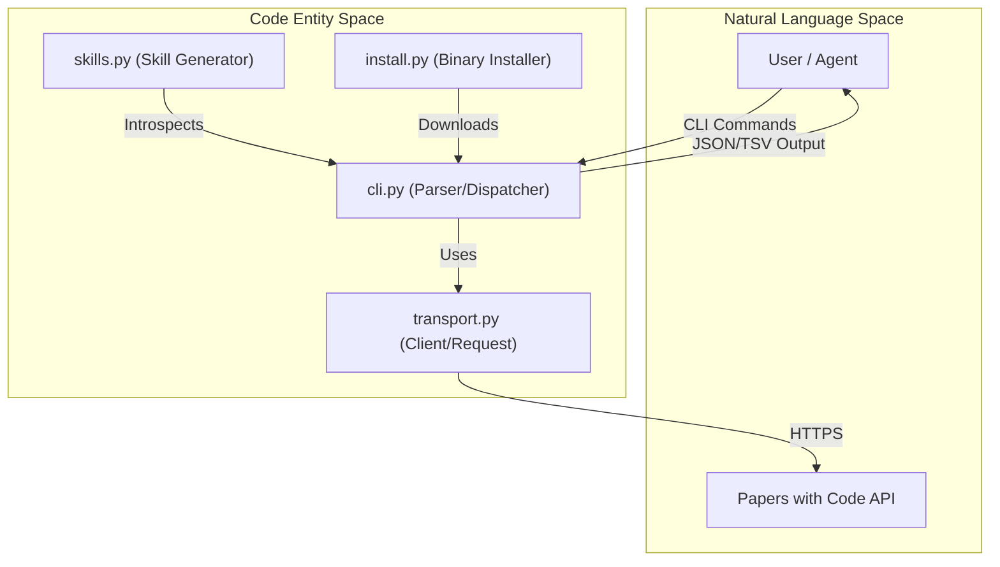
**Sources:** [standalone_cli/src/pwc_cli/cli.py:1-20](), [standalone_cli/src/pwc_cli/transport.py:1-15](), [standalone_cli/src/pwc_cli/skills.py:1-10](), [standalone_cli/install.py:1-20]()

## Key Features

*   **Paper Exploration**: Search by title or arXiv ID, read paper metadata, and access Markdown content [README.md:111-127]().
*   **SOTA Benchmarks**: Browse leaderboards, filter by metrics (e.g., `--min FPS=60`), and identify Pareto-optimal models [standalone_cli/README.md:69-75]().
*   **Research Taxonomy**: Navigate the hierarchy of Tasks, Methods, and Organizations [README.md:149-166]().
*   **Agent Integration**: Export CLI capabilities as a machine-readable skill for LLM-based agents [README.md:87-108]().
*   **Flexible Output**: Automatically switches between aligned Markdown tables for interactive terminals and lossless TSV for piped output/scripts [standalone_cli/README.md:37-48]().

## Repository Organization

The repository is structured to support both source installation and automated binary distribution.

| Directory / File | Responsibility |
| :--- | :--- |
| `standalone_cli/src/pwc_cli/` | The core Python package containing the CLI logic, transport layer, and skill generator. |
| `standalone_cli/install.py` | A standalone script for downloading and verifying prebuilt binaries. |
| `tests/` | The test suite, including `test_cli.py` for functional verification. |
| `scripts/` | Utility scripts, such as `check_contract.py` for ensuring documentation stays in sync with code. |
| `.github/workflows/` | CI/CD pipelines for testing and generating cross-platform releases. |

For a detailed breakdown of the file structure, see [Repository Layout](#1.2).

## Getting Started

Users can install `pwc-cli` via a prebuilt binary or through Python package managers like `uv` or `pipx`.

```bash
# Binary installation
curl -LsSf https://raw.githubusercontent.com/huggingface/pwc-cli/main/standalone_cli/install.py | python3

# Source installation via uv
uv tool install 'git+https://github.com/huggingface/pwc-cli.git#subdirectory=standalone_cli'
```
**Sources:** [README.md:30-33](), [README.md:57-59]()

For detailed installation steps and initial configuration (such as setting `PWC_API_URL`), see [Getting Started](#1.1).

## Internal Workflow

The CLI follows a standard request-response lifecycle, mediated by an internal `Client` class.

**Request Lifecycle**
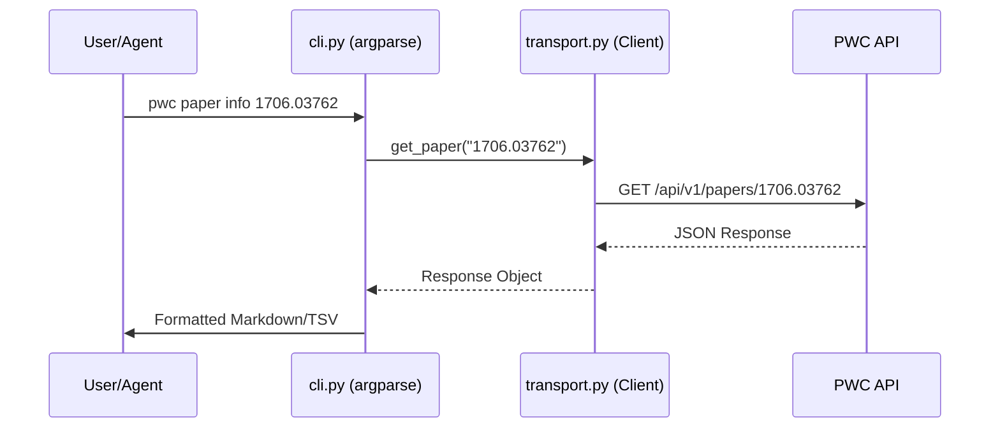
**Sources:** [standalone_cli/src/pwc_cli/cli.py:2465](), [standalone_cli/src/pwc_cli/transport.py:80-83]()

---

# Page: Getting Started

# Getting Started

<details>
<summary>Relevant source files</summary>

The following files were used as context for generating this wiki page:

- [README.md](README.md)
- [standalone_cli/install.py](standalone_cli/install.py)
- [standalone_cli/pyproject.toml](standalone_cli/pyproject.toml)

</details>


The `pwc-cli` is a high-performance, read-only command-line interface designed for researchers and developers to explore the [Papers with Code](https://paperswithcode.co) catalog [README.md:1-12](). It operates without requiring an account or API token for public reads [README.md:14-14]().

## Installation Methods

### 1. Prebuilt Binary (Recommended)
The fastest way to install `pwc-cli` is via the dedicated installer script. This method downloads a platform-specific binary, verifies its SHA-256 checksum, and installs it to `~/.local/bin/pwc` [README.md:25-33]().

**One-liner installation:**
```bash
curl -LsSf "https://raw.githubusercontent.com/huggingface/pwc-cli/main/standalone_cli/install.py" | python3
```

**Installer Logic and Implementation:**
The `install.py` script performs several critical checks to ensure a secure and functional installation:
*   **Version Resolution**: It queries the GitHub API to find the latest release tag unless an explicit version is provided via `--version` [standalone_cli/install.py:83-101]().
*   **Platform Mapping**: It maps system architectures (e.g., `aarch64` to `arm64`) to match release artifact naming conventions [standalone_cli/install.py:196-206]().
*   **Integrity Verification**: It downloads the corresponding `.sha256` file and validates the binary using `hashlib.sha256` [standalone_cli/install.py:115-134]().
*   **Atomic Installation**: It uses `tempfile.mkstemp` and `os.replace` to ensure the binary is updated atomically, preventing partial writes if the process is interrupted [standalone_cli/install.py:137-152]().

### 2. Source Installation (pipx / uv)
For users who prefer managing tools via Python environments, `pwc-cli` can be installed from source. This requires Python 3.10 or newer [README.md:53-53]().

**Using `uv`:**
```bash
uv tool install 'git+https://github.com/huggingface/pwc-cli.git#subdirectory=standalone_cli'
```

**Using `pipx`:**
```bash
pipx install 'git+https://github.com/huggingface/pwc-cli.git#subdirectory=standalone_cli'
```

Sources: [README.md:25-65](), [standalone_cli/install.py:83-152](), [standalone_cli/pyproject.toml:6-8]()

---

## Verification and Configuration

### Verifying Installation
Once installed, verify the version and ensure the binary is reachable in your `PATH`:
```bash
pwc version
```
The installer script automatically checks if `~/.local/bin` is in your `PATH` and provides shell export instructions if it is missing [standalone_cli/install.py:154-180]().

### Configuring the API URL
By default, the CLI connects to the production Papers with Code API. Developers or users of internal mirrors can override this by setting the `PWC_API_URL` environment variable.

| Variable | Description | Default Value |
| --- | --- | --- |
| `PWC_API_URL` | The base URL for the PWC API endpoints. | `https://paperswithcode.com/api/v1` |

**Data Flow: Installation to Execution**
The following diagram illustrates how the installer places the binary and how the CLI initializes its connection settings.

**System Path and Initialization Flow**
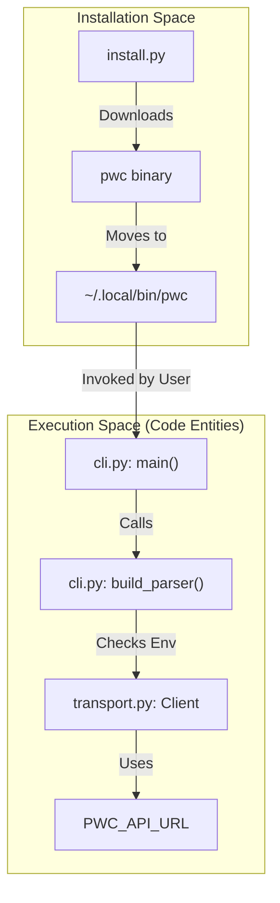

Sources: [README.md:75-79](), [standalone_cli/install.py:154-180](), [standalone_cli/pyproject.toml:10-11]()

---

## First Commands

The `pwc-cli` is organized into entity-based subcommands. Below are the primary entry points for exploring the catalog.

### 1. Searching for Papers
Search uses the `pwc search` command, which supports keyword queries and semantic search modes [README.md:111-117]().
```bash
pwc search "retrieval augmented generation" --limit 5
```

### 2. Inspecting Paper Details
You can retrieve metadata using an arXiv ID, a numeric ID, or a quoted title [README.md:182-185]().
```bash
pwc paper info 1706.03762 --include-resources
```

### 3. Exploring the Taxonomy
The CLI allows browsing by research area, task, or method [README.md:151-166]().
```bash
pwc task list --area Vision
pwc method --name Transformer
```

### Command Dispatch Architecture
The CLI uses a hierarchical parser where each subcommand is mapped to a handler function.

**Natural Language Command to Code Handler Mapping**
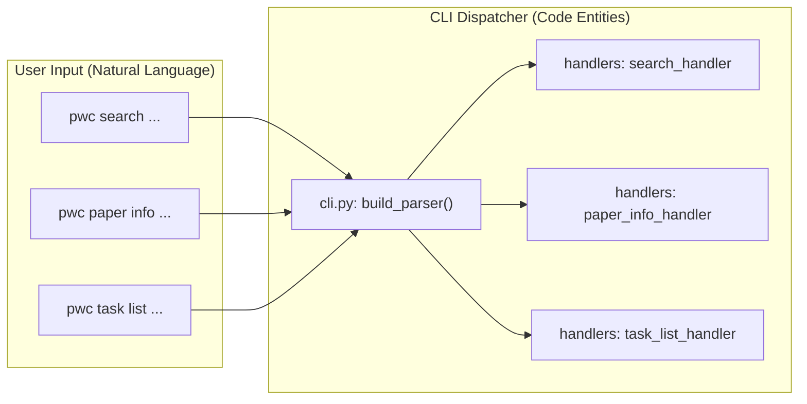

Sources: [README.md:109-178](), [README.md:182-185]()

---

## Integrating Agent Skills

If you use AI coding agents (like Claude Code, Cursor, or GitHub Copilot), you should install the "Skill". This provides the agent with a machine-readable description of the CLI's capabilities [README.md:81-85]().

```bash
# Install for the current project (.agents/skills)
pwc skills add

# Install for Claude Code specifically
pwc skills add --claude
```

The `pwc skills add` command generates a `SKILL.md` file by introspecting the current CLI's `argparse` configuration, ensuring the agent always has documentation that matches your installed version [README.md:83-85]().

Sources: [README.md:81-107]()

---

# Page: Repository Layout

# Repository Layout

<details>
<summary>Relevant source files</summary>

The following files were used as context for generating this wiki page:

- [backend/chat_sandbox_worker/CLI_GUIDE.md](backend/chat_sandbox_worker/CLI_GUIDE.md)
- [standalone_cli/entrypoint.py](standalone_cli/entrypoint.py)
- [standalone_cli/pyproject.toml](standalone_cli/pyproject.toml)
- [standalone_cli/scripts/check_contract.py](standalone_cli/scripts/check_contract.py)
- [standalone_cli/src/pwc_cli/__main__.py](standalone_cli/src/pwc_cli/__main__.py)

</details>


This page details the physical and logical organization of the `pwc-cli` repository. The project is structured to support a standalone Python package, a distribution system for pre-compiled binaries, and integration with AI agent environments.

## Directory Structure Overview

The repository is organized into three primary functional areas: the CLI source code, backend configuration for sandbox environments, and automation scripts for CI/CD and contract validation.

| Directory / File | Responsibility |
|:---|:---|
| `standalone_cli/src/pwc_cli/` | Core Python source code for the CLI. |
| `standalone_cli/tests/` | Unit and integration tests for CLI commands and transport logic. |
| `standalone_cli/scripts/` | Utility scripts for build-time validation and skill generation. |
| `backend/chat_sandbox_worker/` | Configuration and guides for AI agent sandbox environments. |
| `.github/workflows/` | GitHub Actions definitions for testing and multi-platform releases. |
| `standalone_cli/pyproject.toml` | Build system configuration and entry point definitions. |

**Sources:** [standalone_cli/pyproject.toml:1-18](), [standalone_cli/scripts/check_contract.py:9-12]()

---

## Standalone CLI (`standalone_cli/`)

The `standalone_cli` directory contains the primary codebase for the `pwc` tool. It is designed to be self-contained, requiring no external internal dependencies from the rest of the repository.

### Source Code (`src/pwc_cli/`)
This directory follows standard Python packaging conventions. The package is defined in `pyproject.toml` [standalone_cli/pyproject.toml:1-18]() and uses `hatchling` as the build backend.

*   **Entry Points**: The CLI can be invoked via `pwc` (defined in `project.scripts`) [standalone_cli/pyproject.toml:10-11](), `python -m pwc_cli` [standalone_cli/src/pwc_cli/__main__.py:1-3](), or the root-level `entrypoint.py` [standalone_cli/entrypoint.py:1-3]().
*   **Core Modules**:
    *   `cli.py`: Contains `build_parser()` which defines the command hierarchy and `main()` for execution [standalone_cli/src/pwc_cli/cli.py:12-12]().
    *   `skills.py`: Logic for generating `SKILL.md` and installing the CLI as an agent skill.

### Validation Scripts (`scripts/`)
Contains `check_contract.py`, a critical validation tool that prevents "documentation drift." It ensures that every command registered in the `argparse` tree is also documented in the AI sandbox guides and the public skill inventory [standalone_cli/scripts/check_contract.py:68-82]().

**Sources:** [standalone_cli/pyproject.toml:1-18](), [standalone_cli/src/pwc_cli/__main__.py:1-3](), [standalone_cli/scripts/check_contract.py:14-37]()

---

## Backend & Sandbox Integration (`backend/`)

The `backend/chat_sandbox_worker/` directory bridges the CLI with LLM-based coding agents.

*   **CLI_GUIDE.md**: A concise reference used by agents to understand how to invoke `pwc` commands [backend/chat_sandbox_worker/CLI_GUIDE.md:1-27]().
*   **Contract Enforcement**: The `check_contract.py` script specifically verifies that every research command (e.g., `paper info`, `benchmark list`) appears in this guide to ensure agents have up-to-date instructions [standalone_cli/scripts/check_contract.py:72-81]().

**Sources:** [backend/chat_sandbox_worker/CLI_GUIDE.md:1-34](), [standalone_cli/scripts/check_contract.py:72-81]()

---

## Data Flow and Command Discovery

The following diagram illustrates how the repository components interact during a validation cycle (e.g., in CI) to ensure the `argparse` implementation matches the documentation.

### Logic Flow: Contract Validation
"Logic Flow: Contract Validation"
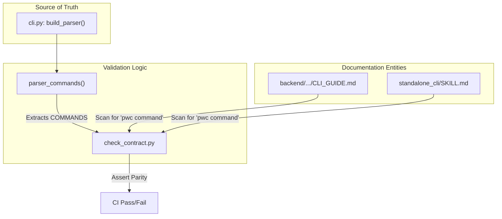
**Sources:** [standalone_cli/scripts/check_contract.py:42-65](), [standalone_cli/scripts/check_contract.py:68-82]()

---

## Code Entity Mapping

This diagram maps high-level repository areas to the specific Python classes and functions that implement their behavior.

### System Mapping: Repository to Code Entities
"System Mapping: Repository to Code Entities"
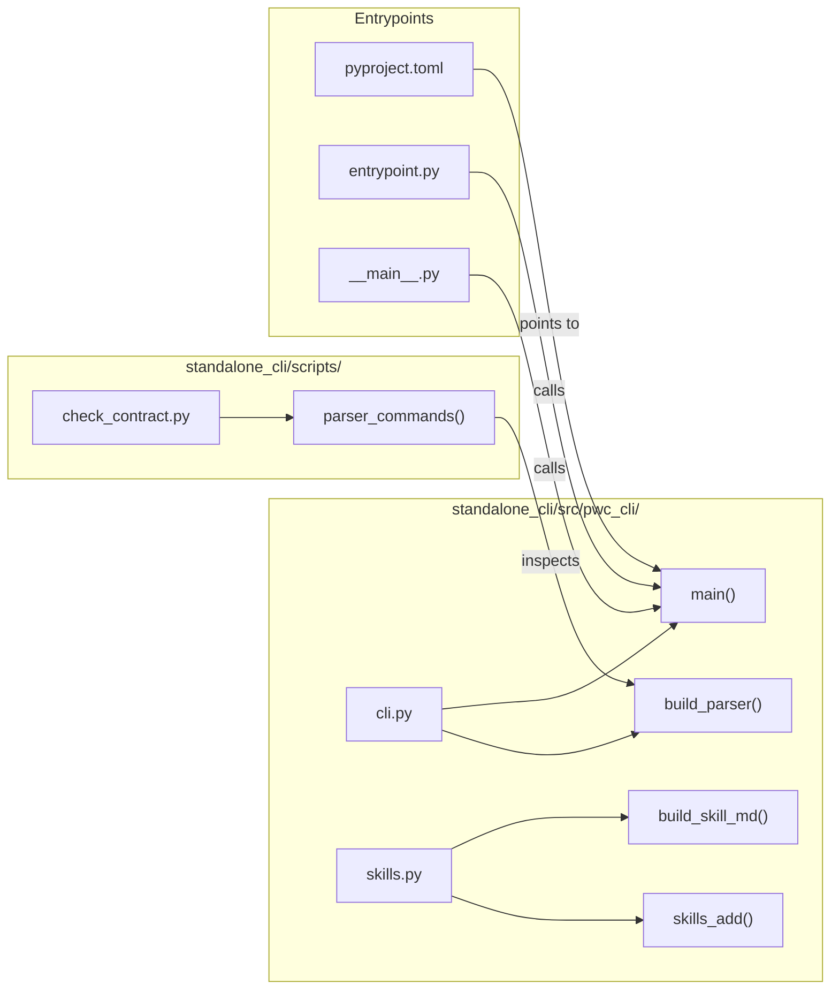
**Sources:** [standalone_cli/pyproject.toml:10-11](), [standalone_cli/entrypoint.py:1-3](), [standalone_cli/src/pwc_cli/__main__.py:1-3](), [standalone_cli/scripts/check_contract.py:42-43]()

---

# Page: Core Architecture

# Core Architecture

<details>
<summary>Relevant source files</summary>

The following files were used as context for generating this wiki page:

- [standalone_cli/entrypoint.py](standalone_cli/entrypoint.py)
- [standalone_cli/src/pwc_cli/__init__.py](standalone_cli/src/pwc_cli/__init__.py)
- [standalone_cli/src/pwc_cli/__main__.py](standalone_cli/src/pwc_cli/__main__.py)
- [standalone_cli/src/pwc_cli/cli.py](standalone_cli/src/pwc_cli/cli.py)

</details>


The `pwc-cli` is structured as a layered command-line application designed for both interactive human use and programmatic consumption by LLM-based coding agents. The architecture prioritizes deterministic output, minimal dependencies, and a strict contract between the CLI and the Papers With Code (PWC) backend.

### Package Structure and Entrypoints

The codebase follows a standard Python package layout. The core logic resides within the `pwc_cli` package, with specific entrypoints defined for different execution contexts.

*   **Package Root**: `standalone_cli/src/pwc_cli/` contains the implementation modules.
*   **Version Metadata**: `__init__.py` defines the package version and the `API_CONTRACT_VERSION`, which ensures compatibility between the client and the data schema [standalone_cli/src/pwc_cli/__init__.py:3-4]().
*   **Execution Entrypoints**:
    *   `pwc_cli/cli.py`: Contains the `main()` function, the primary entrypoint for the application [standalone_cli/src/pwc_cli/cli.py:1088-1111]().
    *   `pwc_cli/__main__.py`: Enables execution via `python -m pwc_cli` [standalone_cli/src/pwc_cli/__main__.py:1-3]().
    *   `entrypoint.py`: A top-level script used for binary builds (e.g., PyInstaller) [standalone_cli/entrypoint.py:1-3]().

### Architectural Layers

The system is divided into three primary functional layers that handle the lifecycle of a command, from parsing to remote execution and final rendering.

#### 1. CLI Dispatcher (Application Layer)
The dispatcher is responsible for command-line argument parsing and routing. It uses a single `argparse.ArgumentParser` tree built by `build_parser()` [standalone_cli/src/pwc_cli/cli.py:848-1085](). Each subcommand is associated with a specific `Handler` function that encapsulates the business logic for that command.

For details on command registration and the dispatch loop, see **[CLI Dispatcher (cli.py)](#2.1)**.

#### 2. Transport Layer (Network Layer)
The `Client` class in `transport.py` handles all HTTP communication with the PWC API. It manages URL construction, header injection (including User-Agent and contract versioning), and response validation. It also enforces safety limits, such as `MAX_RESPONSE_BYTES`, to prevent memory exhaustion when handling large datasets.

For details on request lifecycle and error handling, see **[Transport Layer (transport.py)](#2.2)**.

#### 3. Output Formatting System (Presentation Layer)
The output system is "TTY-aware." It detects whether the output is being sent to a terminal or piped to another process. It supports three primary modes:
*   **Interactive**: Markdown-style tables and headers for readability.
*   **Piped/Scripted**: Lossless Tab-Separated Values (TSV) for easy parsing by standard Unix tools.
*   **Machine-Readable**: Versioned JSON envelopes triggered by the `--json` flag.

For details on the formatting logic and TTY detection, see **[Output Formatting System](#2.3)**.

### Data Flow and Entity Mapping

The following diagram illustrates how a user command traverses the internal layers and maps to specific code entities.

**Command Execution Flow**
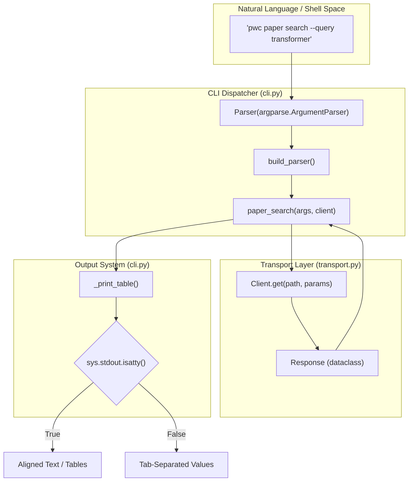
**Sources:** [standalone_cli/src/pwc_cli/cli.py:29-33](), [standalone_cli/src/pwc_cli/cli.py:848-850](), [standalone_cli/src/pwc_cli/cli.py:114-140](), [standalone_cli/src/pwc_cli/transport.py:46-52]().

### Component Interaction Diagram

This diagram bridges the conceptual modules to the specific classes and functions defined in the codebase.

**System Component Map**
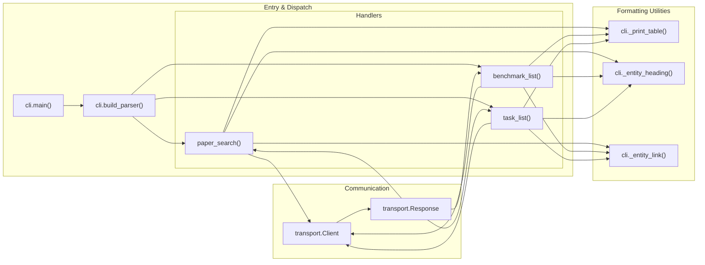
**Sources:** [standalone_cli/src/pwc_cli/cli.py:1088-1111](), [standalone_cli/src/pwc_cli/cli.py:114-140](), [standalone_cli/src/pwc_cli/cli.py:178-184](), [standalone_cli/src/pwc_cli/transport.py:72-83]().

### Module Responsibilities

| Module | Primary Responsibility | Key Entities |
| :--- | :--- | :--- |
| `cli.py` | Command definitions, parsing, and output rendering. | `Parser`, `build_parser`, `_print_table` |
| `transport.py` | API communication and raw data validation. | `Client`, `Response`, `TransportError` |
| `skills.py` | LLM agent integration and skill installation. | `skills_add`, `build_skill_md` |
| `__init__.py` | Global constants and versioning. | `__version__`, `API_CONTRACT_VERSION` |

**Sources:** [standalone_cli/src/pwc_cli/cli.py:1-23](), [standalone_cli/src/pwc_cli/transport.py:1-25](), [standalone_cli/src/pwc_cli/skills.py:1-30]().

---

# Page: CLI Dispatcher (cli.py)

# CLI Dispatcher (cli.py)

<details>
<summary>Relevant source files</summary>

The following files were used as context for generating this wiki page:

- [standalone_cli/src/pwc_cli/cli.py](standalone_cli/src/pwc_cli/cli.py)
- [standalone_cli/tests/test_cli.py](standalone_cli/tests/test_cli.py)

</details>


The `cli.py` module serves as the entry point and command router for the `pwc-cli` application. It is responsible for defining the command-line interface structure, parsing user input, and dispatching execution to specific handler functions. It also manages global error handling and ensures that all JSON outputs conform to the versioned API contract.

## Parser Construction

The CLI uses a hierarchical `argparse` tree constructed by the `build_parser()` function [[standalone_cli/src/pwc_cli/cli.py:657-658]](). It utilizes a custom `Parser` class that overrides the default error behavior to provide more helpful usage hints [[standalone_cli/src/pwc_cli/cli.py:29-33]]().

### Argument Validation
Several internal helper functions validate specific types of command-line inputs:
*   **Bounding**: `_bounded` ensures integers fall within a specific range (e.g., `--limit` between 1-100) [[standalone_cli/src/pwc_cli/cli.py:35-43]]().
*   **Metric Constraints**: `_metric_bound` parses `METRIC=VALUE` strings for leaderboard filtering [[standalone_cli/src/pwc_cli/cli.py:68-77]]().
*   **Pareto Objectives**: `_pareto_objectives` validates the syntax for multi-objective optimization (e.g., `accuracy:higher,params:lower`) [[standalone_cli/src/pwc_cli/cli.py:88-99]]().

### Command Tree Logic
The parser uses `add_subparsers()` to create nested command groups (e.g., `pwc paper list`). Every leaf command in the tree is assigned a `handler` function via `set_defaults(handler=...)`.

| Command Group | Purpose | Handler Example |
| :--- | :--- | :--- |
| `search` | Global search across papers and entities | `search_global` [[standalone_cli/src/pwc_cli/cli.py:255]]() |
| `paper` | Paper metadata, search, and lineage | `paper_list` [[standalone_cli/src/pwc_cli/cli.py:382]]() |
| `benchmark` | Leaderboard and evaluation data | `benchmark_get` [[standalone_cli/src/pwc_cli/cli.py:623]]() |
| `skills` | LLM agent skill installation | `skills_add` [[standalone_cli/src/pwc_cli/cli.py:16]]() |

**Sources:** [[standalone_cli/src/pwc_cli/cli.py:29-99]](), [[standalone_cli/src/pwc_cli/cli.py:657-790]]()

## Dispatcher Workflow

The `main()` function handles the lifecycle of a CLI execution. It initializes the `Client`, parses arguments, and executes the associated handler.

### Execution Flow Diagram

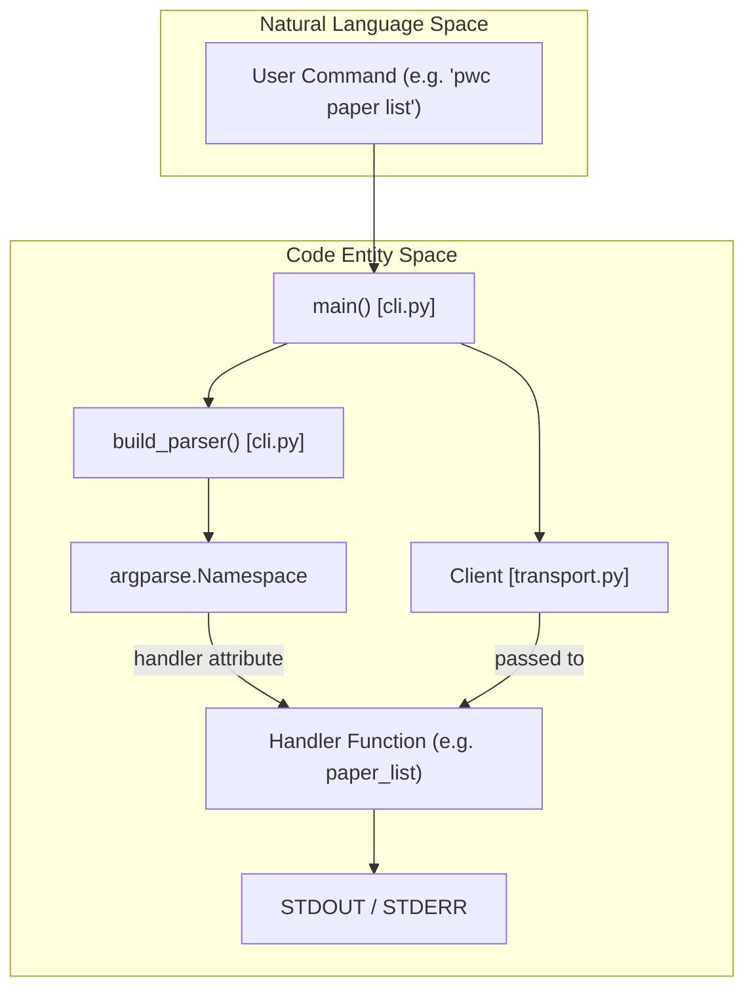
**Sources:** [[standalone_cli/src/pwc_cli/cli.py:811-835]]()

### Error Handling Wrapper
The `main()` function wraps execution in a `try-except` block to provide clean, non-traceback error messages for expected failure modes:
*   **`UsageError`**: Raised when valid syntax is used but options are incompatible [[standalone_cli/src/pwc_cli/cli.py:25-26]]().
*   **`TransportError`**: Handles network-level failures (DNS, timeouts) [[standalone_cli/src/pwc_cli/cli.py:17]]().
*   **`ResponseError`**: Handles API-level issues like 404s or invalid JSON shapes [[standalone_cli/src/pwc_cli/cli.py:17]]().
*   **`SkillInstallError`**: Specific to the `skills add` command [[standalone_cli/src/pwc_cli/cli.py:16]]().

**Sources:** [[standalone_cli/src/pwc_cli/cli.py:823-833]]()

## API Contract and JSON Envelope

When the `--json` flag is provided, the CLI wraps all output in a versioned JSON envelope. This ensures that external tools (and LLM agents) can verify compatibility with the output schema.

### Envelope Structure
The envelope is constructed at the end of handlers using a standard dictionary format:
```python
{
    "schema_version": API_CONTRACT_VERSION,
    "data": payload
}
```
The `API_CONTRACT_VERSION` is imported from the package root [[standalone_cli/src/pwc_cli/cli.py:15]]().

### Paper Identification Logic
A critical part of the dispatcher's role is resolving `PAPER` identifiers. The CLI supports:
1.  **ArXiv IDs**: Validated via `MODERN_ARXIV_ID` and `LEGACY_ARXIV_ID` regex [[standalone_cli/src/pwc_cli/cli.py:21-22]]().
2.  **Internal IDs**: Numeric strings [[standalone_cli/src/pwc_cli/cli.py:201-206]]().
3.  **Title Search**: If a string doesn't match an ID pattern, `_resolve_paper()` performs a search and attempts an exact title match to find the correct ID [[standalone_cli/src/pwc_cli/cli.py:209-231]]().

### Identifier Resolution Diagram

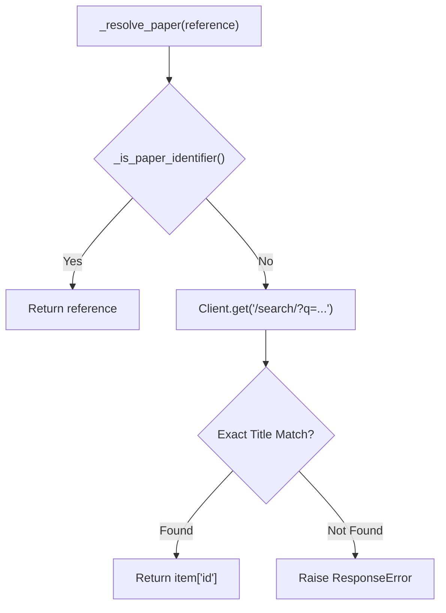
**Sources:** [[standalone_cli/src/pwc_cli/cli.py:201-231]]()

## Key Internal Utilities

| Function | Responsibility |
| :--- | :--- |
| `_print_table` | Renders Markdown-style tables for TTY or TSV for pipes [[standalone_cli/src/pwc_cli/cli.py:114-138]](). |
| `_rows` | Extracts data and total counts from paginated API responses [[standalone_cli/src/pwc_cli/cli.py:141-155]](). |
| `_exact_entity_match` | Performs case-insensitive matching for tasks, methods, and organizations [[standalone_cli/src/pwc_cli/cli.py:157-175]](). |
| `_clean` | Escapes control characters (tabs, newlines) for safe TSV output [[standalone_cli/src/pwc_cli/cli.py:102-112]](). |

**Sources:** [[standalone_cli/src/pwc_cli/cli.py:102-175]]()

---

# Page: Transport Layer (transport.py)

# Transport Layer (transport.py)

<details>
<summary>Relevant source files</summary>

The following files were used as context for generating this wiki page:

- [.github/workflows/pwc-cli-release.yml](.github/workflows/pwc-cli-release.yml)
- [standalone_cli/src/pwc_cli/transport.py](standalone_cli/src/pwc_cli/transport.py)
- [standalone_cli/tests/test_cli.py](standalone_cli/tests/test_cli.py)

</details>


The Transport Layer provides a credential-ready, anonymous-first HTTP client specialized for interacting with the Papers with Code public catalog API. It is implemented in `standalone_cli/src/pwc_cli/transport.py` and is responsible for request lifecycle management, parameter encoding, and safety enforcement via response size limits.

### Core Components

The transport system is built around three primary entities: the `Client` class which manages the connection, the `Response` dataclass for structured output, and a set of custom exceptions for error handling.

| Entity | Type | Description |
| :--- | :--- | :--- |
| `Client` | Class | Main entry point for performing HTTP GET requests. Handles URL construction and header injection. |
| `Response` | Dataclass | A frozen container for `body` (bytes) and `headers` (dict). Includes a `json()` helper. |
| `TransportError` | Exception | Raised for network-level failures or non-200 HTTP status codes. |
| `ResponseError` | Exception | Raised for content-level failures, such as invalid JSON or exceeding size limits. |

**Sources:**
- `Client` definition: [standalone_cli/src/pwc_cli/transport.py:39-43]()
- `Response` definition: [standalone_cli/src/pwc_cli/transport.py:27-37]()
- Exception definitions: [standalone_cli/src/pwc_cli/transport.py:19-24]()

### Request Lifecycle and Configuration

The `Client` determines the target API endpoint by checking the following hierarchy:
1. An explicit `base_url` passed to the constructor [standalone_cli/src/pwc_cli/transport.py:40-41]().
2. The `PWC_API_URL` environment variable [standalone_cli/src/pwc_cli/transport.py:41-41]().
3. The hardcoded `DEFAULT_API_URL` (`https://paperswithcode.co/api/v1`) [standalone_cli/src/pwc_cli/transport.py:15-15](), [standalone_cli/src/pwc_cli/transport.py:41-41]().

#### Data Flow: Natural Language to Transport Entity
The following diagram maps CLI request concepts to the specific code entities in `transport.py`.

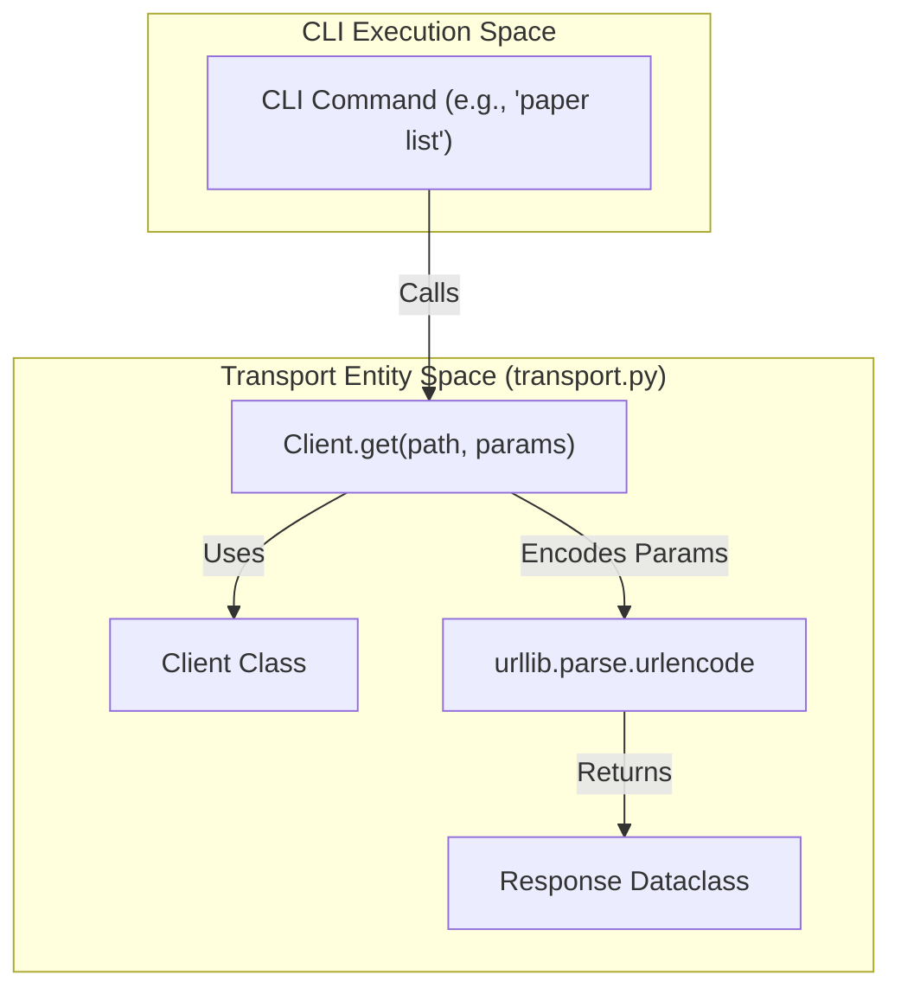
**Sources:**
- `Client` and `get` logic: [standalone_cli/src/pwc_cli/transport.py:39-83]()

### Implementation Details

#### Parameter Encoding
The `get` method performs specific transformations on the `params` dictionary:
- **Null Stripping**: Keys with `None` values are omitted [standalone_cli/src/pwc_cli/transport.py:52-52]().
- **Boolean Normalization**: Python `True`/`False` values are converted to lowercase strings (`"true"`/`"false"`) to match API expectations [standalone_cli/src/pwc_cli/transport.py:50-50]().
- **Stringification**: All other non-null values are cast to strings before encoding [standalone_cli/src/pwc_cli/transport.py:50-50]().

#### Header Injection
Every request includes a `User-Agent` header identifying the CLI version (e.g., `pwc-cli/0.1.14`) and an `Accept` header for JSON [standalone_cli/src/pwc_cli/transport.py:58-61](). If a `credential` is provided during `Client` initialization, it is injected as a `Bearer` token in the `Authorization` header [standalone_cli/src/pwc_cli/transport.py:62-63]().

#### Safety Limits (`MAX_RESPONSE_BYTES`)
To prevent memory exhaustion when handling large catalog exports, the transport layer enforces a strict `MAX_RESPONSE_BYTES` limit of 2MB [standalone_cli/src/pwc_cli/transport.py:16-16](). 
1. **Pre-check**: The `Content-Length` header is inspected before reading [standalone_cli/src/pwc_cli/transport.py:67-69]().
2. **Post-check**: The client attempts to read `MAX_RESPONSE_BYTES + 1`. If the resulting buffer exceeds the limit, a `ResponseError` is raised [standalone_cli/src/pwc_cli/transport.py:70-72]().

### Request Execution Flow
The following diagram illustrates the internal logic of the `get` method, including error handling and safety checks.

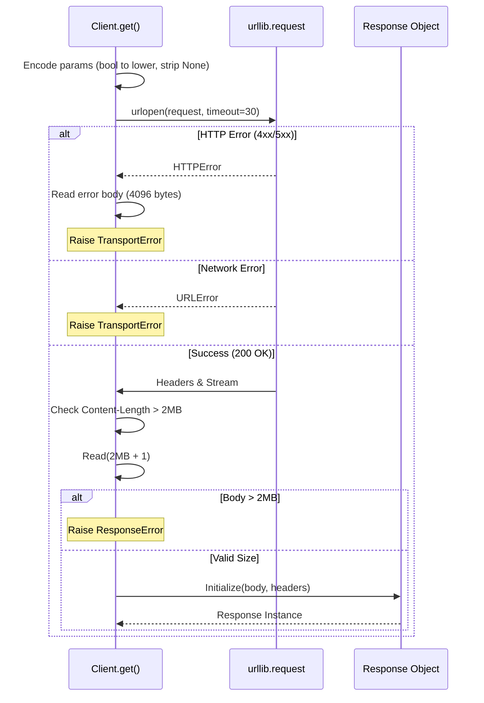

**Sources:**
- Request timeout: [standalone_cli/src/pwc_cli/transport.py:66-66]()
- Size limit enforcement: [standalone_cli/src/pwc_cli/transport.py:68-72]()
- HTTP Error handling: [standalone_cli/src/pwc_cli/transport.py:77-81]()
- URL Error handling: [standalone_cli/src/pwc_cli/transport.py:82-83]()

### Error Handling Summary

| Exception | Cause | Code Pointer |
| :--- | :--- | :--- |
| `TransportError` | Non-200 HTTP status code (includes error body detail). | [transport.py:77-81]() |
| `TransportError` | Connection failures, DNS issues, or timeouts. | [transport.py:82-83]() |
| `ResponseError` | Response body exceeds 2MB limit. | [transport.py:69,72]() |
| `ResponseError` | `json.loads()` fails during `Response.json()` call. | [transport.py:35-36]() |

**Sources:**
- `Response.json` implementation: [standalone_cli/src/pwc_cli/transport.py:32-36]()
- Error wrapping: [standalone_cli/src/pwc_cli/transport.py:77-83]()

---

# Page: Output Formatting System

# Output Formatting System

<details>
<summary>Relevant source files</summary>

The following files were used as context for generating this wiki page:

- [standalone_cli/README.md](standalone_cli/README.md)
- [standalone_cli/src/pwc_cli/cli.py](standalone_cli/src/pwc_cli/cli.py)
- [standalone_cli/tests/test_cli.py](standalone_cli/tests/test_cli.py)

</details>


The `pwc-cli` employs a dual-mode output system designed to maximize readability for human users in interactive terminals while ensuring data integrity for programmatic consumers (scripts, pipes, and LLM agents). The system automatically detects the execution environment and switches between aligned Markdown-style tables, lossless Tab-Separated Values (TSV), and versioned JSON envelopes.

## Terminal Detection and Mode Selection

The formatting logic relies on `sys.stdout.isatty()` to determine if the output is being rendered to a live terminal or captured by a pipe/file [standalone_cli/src/pwc_cli/cli.py:122-125]().

### 1. Interactive TTY Mode
When a TTY is detected, the CLI prioritizes visual alignment. It calculates the maximum width of each column across the entire result set to produce perfectly aligned tables [standalone_cli/src/pwc_cli/cli.py:127-138]().
- **Headers:** Rendered as the first row.
- **Alignment:** Columns are generally left-aligned, but specific numeric columns (like metrics or counts) can be right-aligned via the `right_align` parameter [standalone_cli/src/pwc_cli/cli.py:118-133]().
- **Padding:** Uses two spaces between columns for clear separation [standalone_cli/src/pwc_cli/cli.py:138]().

### 2. Captured/Piped Mode (Lossless TSV)
When output is piped (e.g., `pwc search "..." | grep`), the CLI switches to a "lossless" format [standalone_cli/README.md:47-48]().
- **Delimiter:** Uses a single Tab character (`\t`) [standalone_cli/src/pwc_cli/cli.py:124]().
- **Escaping:** To prevent data corruption, the `_clean` function escapes backslashes, tabs, and newlines within cell values [standalone_cli/src/pwc_cli/cli.py:102-111]().

### 3. Structured JSON Mode
When the `--json` flag is provided, the CLI bypasses table formatting entirely and prints a structured JSON object to `stdout`.
- **Envelope:** Every JSON response includes a `schema_version` to allow clients to handle breaking changes in the API contract [standalone_cli/src/pwc_cli/cli.py:228-232]().
- **Contract:** The version is defined by `API_CONTRACT_VERSION` [standalone_cli/src/pwc_cli/cli.py:15]().

**Sources:** [standalone_cli/src/pwc_cli/cli.py:102-139](), [standalone_cli/README.md:37-48](), [standalone_cli/src/pwc_cli/cli.py:228-232]()

---

## Implementation Details

### Table Rendering Pipeline
The core of the formatting system is the `_print_table` function. It handles the transition between TTY-aligned text and TSV.

**Code Entity Space to Data Flow**
The following diagram illustrates how raw API data is transformed into formatted output.

Table Formatting Logic
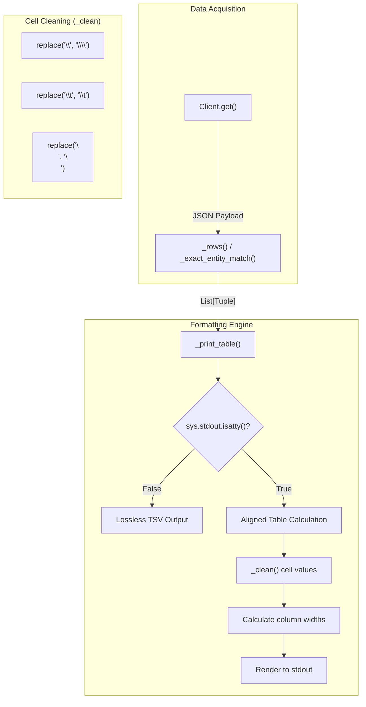
**Sources:** [standalone_cli/src/pwc_cli/cli.py:102-139](), [standalone_cli/src/pwc_cli/cli.py:141-176]()

### Specialized Entity Formatting
Beyond generic tables, certain entities use specific formatting helpers:
- **`_entity_heading`**: Renders a bold name in TTYs or a Markdown H1 (`#`) when piped [standalone_cli/src/pwc_cli/cli.py:178-181]().
- **`_entity_link`**: Renders a raw URL in TTYs or a Markdown link `[label](url)` when piped [standalone_cli/src/pwc_cli/cli.py:183-184]().
- **`_markdown_text`**: Escapes Markdown special characters (like `*` or `_`) to ensure the output doesn't accidentally trigger formatting in Markdown viewers [standalone_cli/src/pwc_cli/cli.py:220-225]().

**Sources:** [standalone_cli/src/pwc_cli/cli.py:178-184](), [standalone_cli/src/pwc_cli/cli.py:220-225]()

---

## Versioned JSON Envelopes

When `--json` is invoked, the CLI wraps the API response in a consistent envelope. This ensures that even if the underlying `paperswithcode.co` API changes, the CLI provides a stable interface for tools like `pwc-cli-installer` or agentic workflows.

**Entity Association Diagram**
Associating CLI components with their JSON output responsibilities.

JSON Output Schema
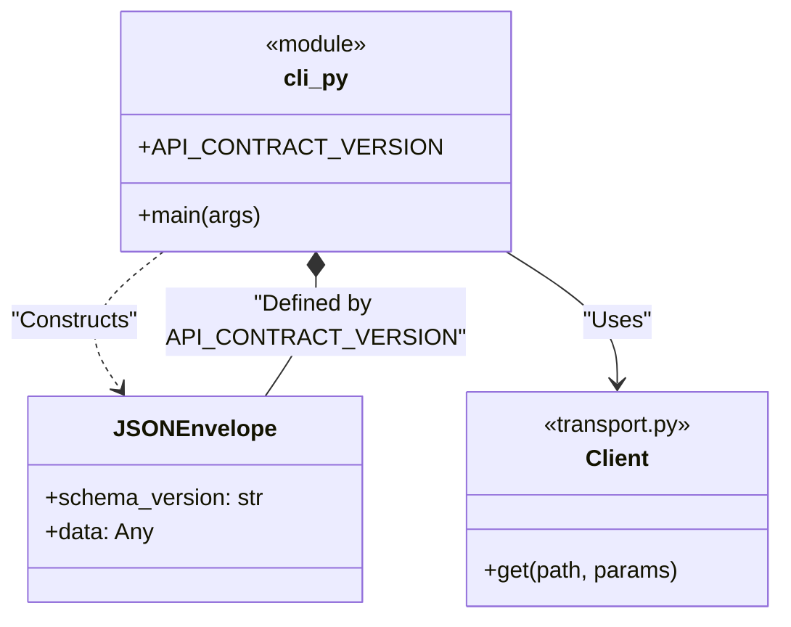
**Sources:** [standalone_cli/src/pwc_cli/cli.py:15](), [standalone_cli/src/pwc_cli/cli.py:228-232](), [standalone_cli/src/pwc_cli/transport.py:34-80]()

### JSON Schema Structure
| Field | Type | Description |
| :--- | :--- | :--- |
| `schema_version` | `string` | The version of the CLI output contract (e.g., `1.0.0`) [standalone_cli/src/pwc_cli/cli.py:230](). |
| `data` | `object/array` | The raw or processed data from the backend [standalone_cli/src/pwc_cli/cli.py:231](). |

---

## Summary of Output Modes

| Feature | Interactive (TTY) | Piped/Captured | JSON (`--json`) |
| :--- | :--- | :--- | :--- |
| **Visuals** | Space-aligned columns | Tab-separated values | Minified JSON |
| **Escaping** | Human readable | `\n`, `\t` escaped | Standard JSON escaping |
| **Headers** | Included | Included | N/A |
| **Links** | Plain text URL | Markdown `[L](U)` | Field in JSON object |
| **Use Case** | Terminal browsing | `grep`, `awk`, `sed` | Programmatic integration |

**Sources:** [standalone_cli/src/pwc_cli/cli.py:121-139](), [standalone_cli/src/pwc_cli/cli.py:183-184](), [standalone_cli/README.md:37-48]()

---

# Page: Command Reference

# Command Reference

<details>
<summary>Relevant source files</summary>

The following files were used as context for generating this wiki page:

- [backend/chat_sandbox_worker/CLI_GUIDE.md](backend/chat_sandbox_worker/CLI_GUIDE.md)
- [standalone_cli/README.md](standalone_cli/README.md)
- [standalone_cli/SKILL.md](standalone_cli/SKILL.md)

</details>


The `pwc-cli` provides a comprehensive command hierarchy for interacting with the Papers With Code catalog. The interface is organized around primary research entities: papers, benchmarks, and a structured taxonomy of tasks, methods, and organizations.

All commands follow a consistent structure: `pwc <entity> <action> [options]`. For example, `pwc paper list` or `pwc benchmark --name IDENTIFIER`.

### Entity Hierarchy Overview

The following diagram maps the logical command structure to the underlying `argparse` implementation in [standalone_cli/src/pwc/cli.py]().

**CLI Command Structure**
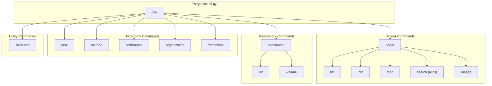
**Sources:** [standalone_cli/src/pwc/cli.py:350-480](), [standalone_cli/SKILL.md:35-130]()

---

### 3.1. Paper Commands
The `paper` command group is the primary entry point for research discovery. It supports various ways to resolve a `PAPER` identifier, which can be a modern arXiv ID (e.g., `2501.01234`), a numeric external-paper ID, or an exact quoted title [standalone_cli/SKILL.md:28-33]().

Key capabilities include:
*   **Search and Discovery**: Hybrid, keyword, and semantic search via `pwc search` [standalone_cli/SKILL.md:37-38]().
*   **Metadata Retrieval**: Detailed info including abstracts, predecessors, and successors via `pwc paper info` [standalone_cli/SKILL.md:39-45]().
*   **Reading Content**: Accessing paper Markdown for modern arXiv records via `pwc paper read` [standalone_cli/SKILL.md:46-47]().
*   **Filtering**: Listing papers by task, method, conference, framework, or organization [standalone_cli/SKILL.md:48-55]().

For details, see [Paper Commands](#3.1).

---

### 3.2. Benchmark Commands and Leaderboard Processing
The `benchmark` command group provides access to State-of-the-Art (SOTA) leaderboards. Unlike simple metadata retrieval, the benchmark system includes a client-side processing pipeline for handling complex evaluation data.

*   **Discovery**: `pwc benchmark list` allows finding benchmarks by task or area, supporting both grouped Markdown views and flat tables [standalone_cli/README.md:37-41]().
*   **Leaderboard Analysis**: `pwc benchmark --name` fetches evaluation results. The CLI performs client-side merging and filtering, allowing users to select Pareto frontiers for multi-metric tradeoffs (e.g., `mAP` vs `FPS`) [standalone_cli/README.md:69-75]().

For details, see [Benchmark Commands and Leaderboard Processing](#3.2).

---

### 3.3. Taxonomy Commands
The taxonomy commands provide structured access to the AI/ML knowledge graph. These entities share a common pattern where `list` provides a catalog view and `--name` provides a detailed entity page [standalone_cli/README.md:60-63]().

| Entity | Primary Actions | Key Features |
| :--- | :--- | :--- |
| **Task** | `list`, `--name` | Area hierarchy (Vision, NLP, etc.), research trends, and subtasks [standalone_cli/SKILL.md:64-77](). |
| **Method** | `list`, `--name` | Filter by area or introduction year; link to source papers [standalone_cli/SKILL.md:78-89](). |
| **Conference** | `list`, `--name` | Filter by year; view venue details and paper counts [standalone_cli/SKILL.md:90-94](). |
| **Organization** | `list`, `--name` | Featured research labs and their trending paper metadata [standalone_cli/SKILL.md:95-98](). |
| **Framework** | `list`, `--name` | Filter by platform (e.g., GPU) or domain [standalone_cli/SKILL.md:99-103](). |

For details, see [Taxonomy Commands (Task, Method, Conference, Organization, Framework)](#3.3).

---

### Mapping Natural Language to Code Entities

The following diagram illustrates how user-facing commands map to specific handler functions and API interactions defined in the codebase.

**Command to Code Mapping**
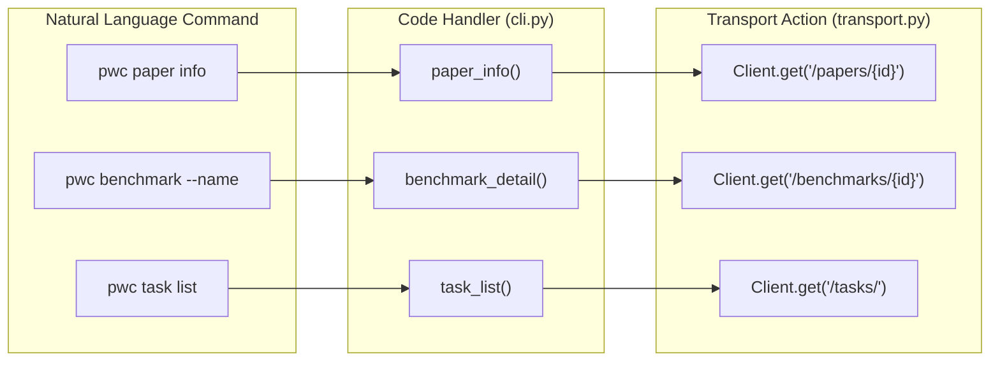
**Sources:** [standalone_cli/src/pwc/cli.py:500-1200](), [standalone_cli/src/pwc/transport.py:60-90]()

---

# Page: Paper Commands

# Paper Commands

<details>
<summary>Relevant source files</summary>

The following files were used as context for generating this wiki page:

- [standalone_cli/SKILL.md](standalone_cli/SKILL.md)
- [standalone_cli/src/pwc_cli/cli.py](standalone_cli/src/pwc_cli/cli.py)
- [standalone_cli/tests/test_cli.py](standalone_cli/tests/test_cli.py)

</details>


The `pwc` CLI provides a comprehensive suite of commands for interacting with the Papers With Code catalog. These commands allow users to search for research, inspect metadata, read abstracts, and explore the lineage of AI/ML papers.

## Paper Identifier Resolution

A core feature of the paper command group is the ability to resolve diverse input strings into a canonical paper identifier. The resolution logic is implemented in `_resolve_paper` [standalone_cli/src/pwc_cli/cli.py:209-232]().

### Resolution Logic
1.  **Direct Identifier**: If the input matches a modern arXiv ID (e.g., `2501.12345`), a legacy arXiv ID (e.g., `cs/0101001`), or a numeric ID, it is used directly [standalone_cli/src/pwc_cli/cli.py:20-22, 201-207, 213-214]().
2.  **Title Lookup**: If the input is not an identifier, the CLI performs a search by title.
    *   It queries the `/papers/` endpoint with the title as a search parameter [standalone_cli/src/pwc_cli/cli.py:216-218]().
    *   It performs a case-insensitive exact match against the returned results [standalone_cli/src/pwc_cli/cli.py:220-222]().
    *   If exactly one match is found, its `arxiv_id` or `id` is returned [standalone_cli/src/pwc_cli/cli.py:223-224]().
    *   If multiple papers share the same title, the command fails with an ambiguity error listing the matching IDs [standalone_cli/src/pwc_cli/cli.py:225-232]().

### Resolution Data Flow
The following diagram illustrates how a user-provided string is transformed into a canonical ID used for subsequent API calls.

**Title to ID Resolution Flow**
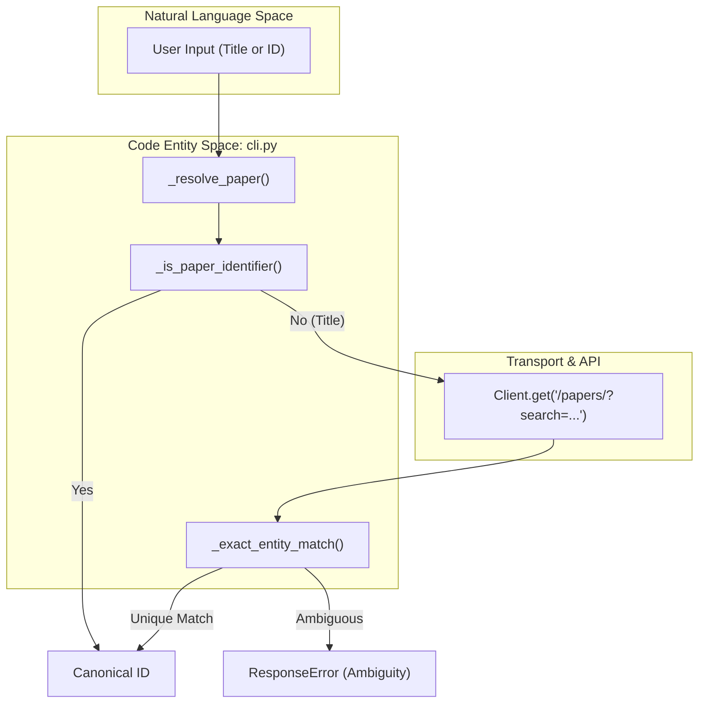
*Sources: [standalone_cli/src/pwc_cli/cli.py:201-232](), [standalone_cli/SKILL.md:28-33]()*

---

## Primary Subcommands

### `pwc search QUERY`
Performs a hybrid keyword and semantic search powered by `pgvector` on the backend [standalone_cli/SKILL.md:37-38]().
*   **Modes**: `hybrid` (default), `keyword`, or `semantic`.
*   **Implementation**: Dispatched to `search_handler` which calls `Client.get("/search/...")` [standalone_cli/src/pwc_cli/cli.py:241-260]().

### `pwc paper info PAPER`
Retrieves detailed metadata for a paper.
*   **Flags**:
    *   `--include-resources`: Adds sections for GitHub repositories, project pages, and Hugging Face artifacts [standalone_cli/SKILL.md:41-42]().
    *   `--include-evals`: Fetches and displays all evaluation results associated with the paper in a Markdown table [standalone_cli/SKILL.md:43-45]().
*   **Implementation**: Uses `_resolve_paper` then calls `Client.get(f"/papers/{paper_id}/")` [standalone_cli/src/pwc_cli/cli.py:346-350]().

### `pwc paper read PAPER`
Displays the Markdown content of a paper. This requires the paper to have a modern arXiv record [standalone_cli/SKILL.md:46-47]().
*   **Implementation**: Dispatched to `paper_read_handler` which calls `Client.get(f"/papers/{paper_id}/read/")` [standalone_cli/src/pwc_cli/cli.py:449-462]().

### `pwc paper list`
A powerful filtering command for the paper catalog.
*   **Filters**: Supports `--task`, `--method`, `--conference`, `--framework`, and `--organization` [standalone_cli/SKILL.md:48-55]().
*   **Pagination**: Uses `--page` and `--page-size` [standalone_cli/SKILL.md:49]().
*   **Sorting**: Supports `trending`, `date_published`, and `citation_count` [standalone_cli/SKILL.md:53]().

### `pwc paper lineage list PAPER`
Renders the "family tree" of a paper, showing its predecessors and successors based on the PWC graph [standalone_cli/SKILL.md:62-63]().
*   **Implementation**: Calls `Client.get(f"/papers/{paper_id}/lineage/")` [standalone_cli/src/pwc_cli/cli.py:537-548]().

---

## Technical Data Flow

The paper commands follow a consistent pattern: Argument parsing -> Identifier resolution -> API Request -> Output formatting.

**Paper Command Execution Pattern**
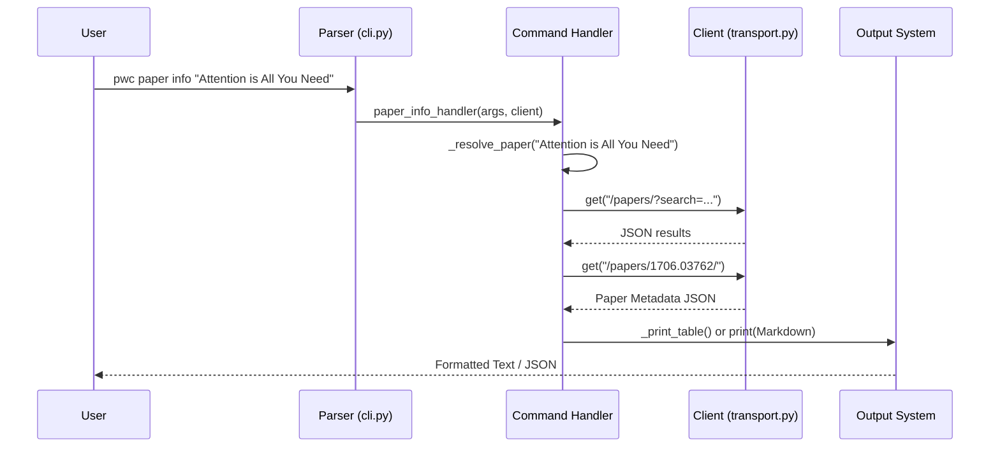
*Sources: [standalone_cli/src/pwc_cli/cli.py:346-447](), [standalone_cli/src/pwc_cli/transport.py:46-83]()*

## Command Summary Table

| Command | Key Flags | Purpose |
| :--- | :--- | :--- |
| `search` | `--mode`, `--limit` | Hybrid semantic/keyword search |
| `paper info` | `--include-evals`, `--include-resources` | Comprehensive metadata and links |
| `paper read` | `--json` | View paper content as Markdown |
| `paper list` | `--task`, `--method`, `--published-after` | Filtered catalog browsing |
| `paper recent` | `--limit` | Latest additions to the catalog |
| `paper trending` | `--max-age-days`, `--min-velocity` | Papers with high repository activity |
| `paper related` | `--limit` | Discovery via embedding similarity |
| `paper lineage list`| `--json` | Navigate research predecessors/successors |

*Sources: [standalone_cli/SKILL.md:37-63](), [standalone_cli/src/pwc_cli/cli.py:234-548]()*

---

# Page: Benchmark Commands and Leaderboard Processing

# Benchmark Commands and Leaderboard Processing

<details>
<summary>Relevant source files</summary>

The following files were used as context for generating this wiki page:

- [standalone_cli/SKILL.md](standalone_cli/SKILL.md)
- [standalone_cli/src/pwc_cli/cli.py](standalone_cli/src/pwc_cli/cli.py)
- [standalone_cli/tests/test_cli.py](standalone_cli/tests/test_cli.py)

</details>


The `pwc-cli` provides a sophisticated client-side pipeline for discovering benchmarks and processing leaderboards. While the API provides raw evaluation data, the CLI implements advanced logic for metric filtering, Pareto frontier selection, and multi-metric merging to produce readable state-of-the-art (SOTA) tables.

## Benchmark Discovery (`pwc benchmark list`)

The `benchmark list` command allows users to navigate the Papers With Code benchmark catalog. It supports two primary display modes: a hierarchical grouped view (default for TTY) and a flat paginated table.

### Implementation Details
The command handler `benchmark_list` [standalone_cli/src/pwc_cli/cli.py:827-868]() dispatches requests based on the provided filters.

*   **Grouped View**: If no specific task or search query is provided, the CLI fetches benchmarks grouped by research area and task [standalone_cli/src/pwc_cli/cli.py:837-838]().
*   **Flat View**: When filters like `--task`, `--search`, or `--flat` are applied, the CLI returns a standard table of benchmarks [standalone_cli/src/pwc_cli/cli.py:851-855]().
*   **Open Models Filter**: The `--is-open` flag allows filtering for benchmarks that specifically track open-source model performance [standalone_cli/src/pwc_cli/cli.py:852]().

### Sources
- [standalone_cli/src/pwc_cli/cli.py:827-868]()
- [standalone_cli/SKILL.md:104-117]()

---

## Leaderboard Processing Pipeline (`pwc benchmark --name`)

When a specific benchmark is requested via `pwc benchmark --name IDENTIFIER`, the CLI performs a multi-stage transformation of the raw evaluation data.

### 1. Data Retrieval and Merging
The CLI first resolves the benchmark metadata and then fetches all associated evaluations [standalone_cli/src/pwc_cli/cli.py:877-885](). Because evaluations for the same paper/model combination may be split across different records in the backend, the `_merged_evaluations` function [standalone_cli/src/pwc_cli/cli.py:706-728]() aggregates them into a single row per result, keyed by the paper and model name.

### 2. Metric Filtering
Users can constrain the leaderboard using several numeric filters:
*   **`--require-metrics`**: Filters out rows that do not contain the specified comma-separated metrics [standalone_cli/src/pwc_cli/cli.py:734-735]().
*   **`--min` / `--max`**: Applies threshold bounds (e.g., `Accuracy=80.0`) to specific metrics [standalone_cli/src/pwc_cli/cli.py:737-744]().

### 3. Pareto Frontier Selection
For benchmarks with multiple objectives (e.g., Accuracy vs. Latency), the `_select_metric_rows` function [standalone_cli/src/pwc_cli/cli.py:755-802]() can calculate the Pareto frontier.
*   It identifies "non-dominated" results based on the `--pareto` flag (e.g., `Accuracy:higher,Params:lower`) [standalone_cli/src/pwc_cli/cli.py:777-802]().
*   A row is dominated if there exists another row that is better in at least one objective and not worse in any other.

### 4. Sorting and Ranking
Finally, the results are sorted using the `--sort` flag. If no sort is provided, it defaults to the benchmark's primary metric in descending order [standalone_cli/src/pwc_cli/cli.py:805-812]().

### Leaderboard Data Flow
The following diagram illustrates the transformation from raw API evaluations to the final CLI table.

**Leaderboard Transformation Logic**
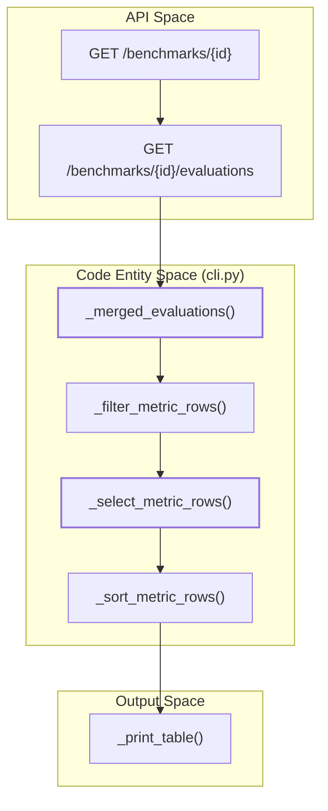

### Sources
- [standalone_cli/src/pwc_cli/cli.py:706-825]()
- [standalone_cli/src/pwc_cli/cli.py:870-917]()

---

## Metric Handling and Validation

The CLI uses specialized argument types to ensure that metric-based queries are well-formed before hitting the network.

| Function | Purpose | Example Syntax |
| :--- | :--- | :--- |
| `_metric_names` | Validates a list of required metrics. | `Accuracy,F1` |
| `_metric_bound` | Parses threshold filters. | `Accuracy=90.0` |
| `_metric_sort` | Parses sort direction. | `Accuracy:asc` |
| `_pareto_objectives` | Validates multi-objective directions. | `Top1:higher,Latency:lower` |

### System Mapping: Arguments to Logic
This diagram maps the CLI flags to the internal processing functions.

**Command Argument Mapping**
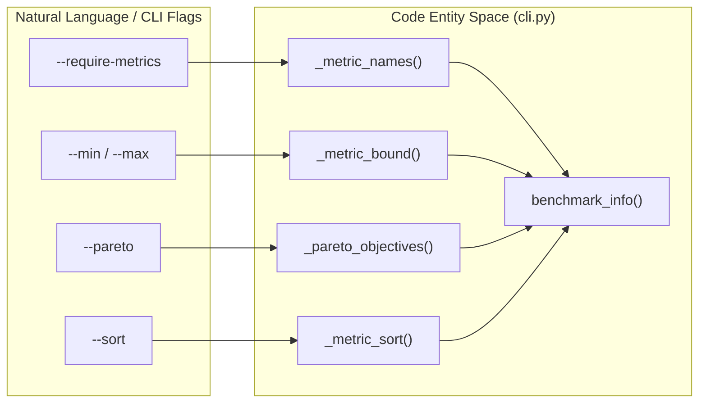

### Sources
- [standalone_cli/src/pwc_cli/cli.py:61-99]()
- [standalone_cli/src/pwc_cli/cli.py:1264-1296]() (Parser definitions)

---

## Technical Constraints
*   **Row Limit**: To prevent client-side performance degradation during Pareto calculation, metric scanning is capped at `MAX_METRIC_SCAN_ROWS = 1_000` [standalone_cli/src/pwc_cli/cli.py:20]().
*   **Numeric Enforcement**: Filters like `--min` and `--max` only operate on values that can be cast to floats; non-numeric evaluation results are ignored during these specific filtering steps [standalone_cli/src/pwc_cli/cli.py:74-75]().

### Sources
- [standalone_cli/src/pwc_cli/cli.py:20]()
- [standalone_cli/src/pwc_cli/cli.py:737-744]()

---

# Page: Taxonomy Commands (Task, Method, Conference, Organization, Framework)

# Taxonomy Commands (Task, Method, Conference, Organization, Framework)

<details>
<summary>Relevant source files</summary>

The following files were used as context for generating this wiki page:

- [standalone_cli/README.md](standalone_cli/README.md)
- [standalone_cli/src/pwc_cli/cli.py](standalone_cli/src/pwc_cli/cli.py)
- [standalone_cli/tests/test_cli.py](standalone_cli/tests/test_cli.py)

</details>


This page documents the CLI commands used to navigate the Papers With Code (PWC) taxonomy. These commands allow users to explore the hierarchical relationships between research areas, tasks, methods, and the entities (organizations, conferences, frameworks) that support them.

## Overview of Taxonomy Entities

The PWC catalog is organized into several primary entities. The CLI provides a consistent interface for querying these entities via `list` subcommands and detail views using the `--name` flag.

| Entity | CLI Command | Key Hierarchical Concept |
| :--- | :--- | :--- |
| **Task** | `pwc task` | Area → Task → Subtask |
| **Method** | `pwc method` | Area → Method |
| **Conference** | `pwc conference` | Proceedings by Year |
| **Organization** | `pwc organization` | Research Labs & Companies |
| **Framework** | `pwc framework` | Libraries by Domain/Platform |

Sources: [standalone_cli/src/pwc_cli/cli.py:533-542](), [standalone_cli/README.md:14-25]()

---

## Tasks and the Area Hierarchy

Tasks are the central node of the PWC taxonomy. They are organized into high-level **Areas** (e.g., Computer Vision, Natural Language Processing).

### Task Listing and Grouping
The `pwc task list` command supports two primary view modes:
1.  **Grouped View**: Uses the `--group-by-area` flag (or defaults to this in a TTY) to render a Markdown-formatted hierarchy [standalone_cli/src/pwc_cli/cli.py:643-646]().
2.  **Flat View**: Uses the `--flat` flag to return a TSV or aligned table of tasks with their associated counts for papers, benchmarks, and evaluations [standalone_cli/src/pwc_cli/cli.py:633-641]().

### Task Detail View
Using `pwc task --name <IDENTIFIER>` (where identifier is a Name, Slug, or ID) retrieves a comprehensive summary of the task, including its description, sister tasks, and trending research [standalone_cli/src/pwc_cli/cli.py:609-631]().

### Data Flow: Task Resolution
```mermaid
graph TD
    subgraph "Natural Language Space"
        Input["'scene-text-recognition'"]
    end

    subgraph "Code Entity Space (cli.py)"
        Parser["build_parser()"]
        Handler["task_handler()"]
        Resolve["_exact_entity_match()"]
    end

    subgraph "Transport Layer (transport.py)"
        Client["Client.get()"]
    end

    Input --> Parser
    Parser --> Handler
    Handler --> Client
    Client -- "Returns List" --> Resolve
    Resolve -- "Matches Name/Slug/ID" --> Display["Display Task Metadata"]
```
Sources: [standalone_cli/src/pwc_cli/cli.py:157-175](), [standalone_cli/src/pwc_cli/cli.py:609-620](), [standalone_cli/src/pwc_cli/transport.py:59-70]()

---

## Methods and Frameworks

Methods represent specific architectural components (e.g., "Transformer", "ResNet"), while Frameworks represent the software implementations (e.g., "PyTorch", "vLLM").

### Method Commands
-   **Filter by Area**: `pwc method list --area <AREA_NAME>` filters methods by their research domain [standalone_cli/src/pwc_cli/cli.py:674-676]().
-   **Detail View**: `pwc method --name <NAME>` provides the method's description and its categorization within the taxonomy [standalone_cli/src/pwc_cli/cli.py:657-670]().

### Framework Commands
Frameworks include metadata regarding their supported platforms and libraries.
-   **Platform Filter**: `pwc framework list --platform <gpu|tpu|cpu>` [standalone_cli/src/pwc_cli/cli.py:779-781]().
-   **Domain Filter**: `pwc framework list --domain <domain>` [standalone_cli/src/pwc_cli/cli.py:782-784]().

Sources: [standalone_cli/src/pwc_cli/cli.py:651-686](), [standalone_cli/src/pwc_cli/cli.py:760-796]()

---

## Conferences and Organizations

These entities provide the institutional and venue context for research papers.

### Conference Listing
Conferences are typically queried by year.
-   **Year Filter**: `pwc conference list --year <YYYY>` [standalone_cli/src/pwc_cli/cli.py:711-713]().
-   **Implementation**: The `conference_handler` uses the `conferences/` API endpoint and applies client-side filtering if a year is provided [standalone_cli/src/pwc_cli/cli.py:711-722]().

### Organization Listing
-   **Featured Filter**: `pwc organization list --featured-only` restricts the list to prominent research entities [standalone_cli/src/pwc_cli/cli.py:748-750]().
-   **Detail View**: Shows the organization's name and associated metadata [standalone_cli/src/pwc_cli/cli.py:732-744]().

Sources: [standalone_cli/src/pwc_cli/cli.py:691-727](), [standalone_cli/src/pwc_cli/cli.py:732-758]()

---

## Implementation Details

### Shared Entity Resolution Logic
Most taxonomy commands utilize the `_exact_entity_match` helper function. This function ensures that when a user provides a string identifier, the CLI correctly maps it to the unique entity in the PWC database by checking multiple fields.

```python
def _exact_entity_match(
    reference: str,
    items: list[dict[str, Any]],
    *,
    label: str,
    fields: tuple[str, ...] = ("name", "slug", "id"),
) -> dict[str, Any]:
    target = reference.strip().casefold()
    for field in fields:
        for item in items:
            if str(item.get(field) or "").strip().casefold() == target:
                return item
    # ... handles suggestions if no match found ...
```
Sources: [standalone_cli/src/pwc_cli/cli.py:157-175]()

### Command Dispatch Mapping
The taxonomy commands are dispatched via the `argparse` subparser system defined in `build_parser()`.

| Command | Handler Function | Endpoint |
| :--- | :--- | :--- |
| `task` | `task_handler` | `/tasks/` |
| `method` | `method_handler` | `/methods/` |
| `conference` | `conference_handler` | `/conferences/` |
| `organization` | `organization_handler` | `/organizations/` |
| `framework` | `framework_handler` | `/frameworks/` |

Sources: [standalone_cli/src/pwc_cli/cli.py:533-580]()

### Entity Relationship Diagram
This diagram illustrates how the CLI views the relationships between different taxonomy entities during a query.

```mermaid
erDiagram
    AREA ||--o{ TASK : contains
    TASK ||--o{ SUBTASK : "parent of"
    TASK ||--o{ METHOD : "uses"
    PAPER }o--|| TASK : "addresses"
    PAPER }o--|| CONFERENCE : "published in"
    PAPER }o--|| ORGANIZATION : "authored by"
    PAPER }o--|| FRAMEWORK : "implemented with"

    TASK {
        string name
        string slug
        string area
    }
    PAPER {
        string title
        string arxiv_id
    }
```
Sources: [standalone_cli/README.md:64-67](), [standalone_cli/src/pwc_cli/cli.py:609-631]()

---

# Page: Agent Skills Integration

# Agent Skills Integration

<details>
<summary>Relevant source files</summary>

The following files were used as context for generating this wiki page:

- [README.md](README.md)
- [standalone_cli/SKILL.md](standalone_cli/SKILL.md)
- [standalone_cli/src/pwc_cli/skills.py](standalone_cli/src/pwc_cli/skills.py)

</details>


The `pwc-cli` includes a dedicated **Skills** subsystem designed to bridge the gap between a standard Command Line Interface and LLM-based coding agents (such as Claude Code, Cursor, or OpenCode). By exporting its command tree and research workflows as a structured "Skill," the CLI enables agents to perform grounded AI/ML research, discover state-of-the-art models, and browse the Papers With Code catalog autonomously.

### System Purpose
The skills integration serves three primary functions:
1.  **Context Injection**: Provides agents with a comprehensive `SKILL.md` file containing descriptions, research workflows, and command signatures [standalone_cli/SKILL.md:1-150]().
2.  **Version Parity**: Ensures that the agent's understanding of available flags and subcommands exactly matches the locally installed version of `pwc` [standalone_cli/src/pwc_cli/skills.py:133-149]().
3.  **Standardized Installation**: Automates the placement of skill definitions into specific agent directories like `.agents/skills` or `.claude/skills` [standalone_cli/src/pwc_cli/skills.py:13-17]().

### Conceptual Bridge: Natural Language to Code
The following diagram illustrates how natural language research requests are mapped to specific code entities and CLI commands within the skills subsystem.

**Agent Intent to Command Mapping**
```mermaid
graph TD
    subgraph "Natural Language Space (Agent Intent)"
        A["'Find recent SOTA for Image Classification'"]
        B["'Read the abstract for Attention is All You Need'"]
        C["'Compare different Transformer methods'"]
    end

    subgraph "Code Entity Space (pwc-cli)"
        direction LR
        cmd_search["pwc search"]
        cmd_paper_info["pwc paper info"]
        cmd_benchmark["pwc benchmark list"]
        cmd_method["pwc method list"]
        
        handler_search["search() handler"]
        handler_paper["paper_info() handler"]
        handler_bench["benchmark_list() handler"]
    end

    A --> cmd_benchmark
    B --> cmd_paper_info
    C --> cmd_method

    cmd_search -.-> handler_search
    cmd_paper_info -.-> handler_paper
    cmd_benchmark -.-> handler_bench
```
**Sources:** [standalone_cli/SKILL.md:37-120](), [standalone_cli/src/pwc_cli/skills.py:19-28]()

---

### Skill Generation
The CLI generates its own documentation by introspecting the `argparse` tree defined in the core application. This ensures that every flag, positional argument, and help string is accurately reflected in the agent's context.

*   **Introspection**: Uses `_command_entries()` to recursively walk the parser tree [standalone_cli/src/pwc_cli/skills.py:114-130]().
*   **Signature Extraction**: The `_command_signature()` function converts internal `argparse` actions into readable Markdown syntax (e.g., `[--limit 1-100]`) [standalone_cli/src/pwc_cli/skills.py:89-111]().
*   **Workflow Guidance**: Embeds a specific "Research workflow" that instructs agents on the optimal sequence of commands (e.g., starting with benchmarks before reading papers) [standalone_cli/src/pwc_cli/skills.py:44-75]().

For a deep dive into the introspection logic, see [Skill Generation (skills.py)](#4.1).

---

### Skill Installation and Agent Targets
The `pwc skills add` command manages the physical installation of the generated skill. It supports multiple installation modes to accommodate different agent environments.

**Skill Distribution Architecture**
```mermaid
graph TD
    subgraph "Source"
        CLI["pwc_cli.cli.build_parser()"]
        GEN["skills.py: build_skill_md()"]
    end

    subgraph "Installation Logic"
        INS["_install_to()"]
        LNK["_link_to()"]
    end

    subgraph "Target Directories"
        CL["CENTRAL_LOCAL (.agents/skills)"]
        CG["CENTRAL_GLOBAL (~/.agents/skills)"]
        CL_L["CLAUDE_LOCAL (.claude/skills)"]
        CL_G["CLAUDE_GLOBAL (~/.claude/skills)"]
    end

    CLI --> GEN
    GEN --> INS
    INS --> CL
    INS --> CG
    INS -- "Symlink" --> LNK
    LNK --> CL_L
    LNK --> CL_G
```
**Sources:** [standalone_cli/src/pwc_cli/skills.py:14-17](), [standalone_cli/src/pwc_cli/skills.py:165-186]()

The installation process is designed to be atomic using temporary directories [standalone_cli/src/pwc_cli/skills.py:170-176]() and safe, requiring a `--force` flag to overwrite existing installations [standalone_cli/src/pwc_cli/skills.py:152-163]().

For details on directory paths and installation flags, see [Skill Installation and Agent Directories](#4.2).

---

### Summary of Agent Commands
The skill exposes a wide range of commands to the agent, summarized below:

| Command Group | Purpose | Primary Code Entity |
| :--- | :--- | :--- |
| `search` | Discovery via keyword/semantic search | `search` |
| `paper` | Metadata, reading, and lineage | `paper info`, `paper read`, `paper lineage` |
| `benchmark` | SOTA discovery and leaderboards | `benchmark list`, `benchmark --name` |
| `taxonomy` | Exploring Tasks, Methods, and Areas | `task list`, `method list` |
| `meta` | Organizations, Conferences, Frameworks | `organization`, `conference`, `framework` |

**Sources:** [standalone_cli/SKILL.md:35-125](), [standalone_cli/src/pwc_cli/skills.py:114-130]()

---

# Page: Skill Generation (skills.py)

# Skill Generation (skills.py)

<details>
<summary>Relevant source files</summary>

The following files were used as context for generating this wiki page:

- [standalone_cli/SKILL.md](standalone_cli/SKILL.md)
- [standalone_cli/src/pwc_cli/skills.py](standalone_cli/src/pwc_cli/skills.py)

</details>


The `pwc-cli` includes a specialized subsystem for generating and installing "Skills" for AI coding agents (such as Claude Code). This system enables agents to understand the CLI's capabilities, command signatures, and research workflows by introspecting the `argparse` tree at runtime.

### Overview

The skill generation logic resides in `standalone_cli/src/pwc_cli/skills.py`. It bridges the gap between the static command-line interface and the natural language requirements of LLM agents. Instead of maintaining a separate manual documentation file for agents, the system programmatically generates `SKILL.md` to ensure perfect parity with the installed version of the CLI.

Sources: [standalone_cli/src/pwc_cli/skills.py:1-28]()

---

### Introspection Engine

The core of the skill generation is the introspection of the `argparse.ArgumentParser` object created by `build_parser()` in `cli.py`.

#### Command Discovery (`_command_entries`)
The `_command_entries()` function performs a depth-first search (DFS) through the `argparse` tree. It identifies valid subcommands by checking for the presence of a `handler` in the parser's defaults, which indicates a terminal command that can be executed.

#### Signature Generation (`_command_signature`)
For every discovered command, `_command_signature()` reconstructs a human-readable (and agent-readable) usage string. It iterates through `parser._actions` to:
- Convert positional arguments to uppercase (e.g., `PAPER`).
- Format optional flags in brackets (e.g., `[--json]`).
- Extract valid choices for flags (e.g., `[--mode hybrid|keyword|semantic]`).
- Distinguish between boolean flags (`nargs=0`) and value-based arguments.

#### Natural Language to Code Mapping

| Agent Concept | Code Entity | Purpose |
| :--- | :--- | :--- |
| **Skill Name** | `SKILL_NAME` | The identifier used by agent harnesses (`pwc-cli`). |
| **Command Help** | `_subcommand_help()` | Extracts the `help` string defined in `argparse` for the skill description. |
| **Command Path** | `prefix: tuple[str, ...]` | Tracks the nesting level (e.g., `paper`, `lineage`, `list`) to build the full invocation string. |
| **Registry** | `build_parser()` | The source of truth for all available commands and flags. |

Sources: [standalone_cli/src/pwc_cli/skills.py:82-130](), [standalone_cli/src/pwc_cli/cli.py:34-50]()

---

### Skill Structure and Data Flow

The `build_skill_md()` function assembles the final Markdown document. It combines static guidance with the dynamically generated command list.

#### Components of SKILL.md
1.  **Frontmatter**: Contains the name and a high-level description (`_DESCRIPTION`) instructing the agent when to use the tool.
2.  **Introduction**: Basic usage rules, such as title matching logic and the authoritative nature of the `--help` flag.
3.  **Commands**: The list generated by `_command_entries()`.
4.  **Research Workflow**: A hand-written guide (`_WORKFLOW`) that teaches the agent how to chain commands (e.g., finding a benchmark, then inspecting the leaderboard, then reading the source paper).
5.  **Output and Limits**: Documentation on exit codes and the differences between interactive TTY output and programmatic JSON output.

#### Data Flow Diagram: CLI to Skill

```mermaid
graph TD
    subgraph "Code Entity Space"
        A["cli.py: build_parser()"] -- "argparse.ArgumentParser" --> B["skills.py: _command_entries()"]
        B -- "Recursion" --> B
        B -- "Extract Actions" --> C["skills.py: _command_signature()"]
        D["skills.py: _DESCRIPTION"] -- "Static Text" --> E["skills.py: build_skill_md()"]
        C -- "Formatted Strings" --> E
        F["skills.py: _WORKFLOW"] -- "Best Practices" --> E
    end

    subgraph "Natural Language Space"
        E -- "Writes" --> G["SKILL.md"]
        G -- "Consumed by" --> H["AI Coding Agent"]
        H -- "Executes" --> I["pwc [subcommand]"]
    end
```

Sources: [standalone_cli/src/pwc_cli/skills.py:19-75](), [standalone_cli/src/pwc_cli/skills.py:133-150](), [standalone_cli/SKILL.md:1-63]()

---

### Research Workflow Logic

The skill embeds a specific "Research Workflow" to prevent agents from hallucinating flags or using inefficient search patterns.

| Step | Recommended Command | Reasoning |
| :--- | :--- | :--- |
| **Discovery** | `pwc benchmark list --task` | Identifies active evaluation targets for a specific field. |
| **Inspection** | `pwc paper info --include-resources` | Gathers metadata and official repository links. |
| **Expansion** | `pwc paper related` | Uses embedding-based similarity to find work not caught by keyword search. |
| **Lineage** | `pwc paper lineage list` | Traces model ancestry (predecessors and successors). |
| **Evidence** | `pwc paper read` | Extracts Markdown content for primary source analysis. |

#### Workflow Association Diagram

```mermaid
graph LR
    subgraph "Natural Language Intent"
        Q1["'Find SOTA for Object Detection'"]
        Q2["'How does ResNet relate to VGG?'"]
    end

    subgraph "Code Entity (skills.py / SKILL.md)"
        W1["_WORKFLOW Step 1"]
        W2["_WORKFLOW Step 5"]
    end

    subgraph "CLI Command"
        C1["pwc benchmark --name"]
        C2["pwc paper lineage list"]
    end

    Q1 --> W1 --> C1
    Q2 --> W2 --> C2
```

Sources: [standalone_cli/src/pwc_cli/skills.py:44-60](), [standalone_cli/SKILL.md:65-79]()

---

### Output Modes for Agents

The generated skill explicitly instructs agents on how to handle CLI output:
- **Compact/Interactive**: Agents are told to use this for general discovery. Benchmark lists remain aligned in these modes.
- **TSV (Lossless)**: Default for captured output, providing tab-separated values for easy parsing.
- **JSON**: Recommended for "programmatic filtering, joining, or schema-dependent processing." The skill notes that JSON includes the `evaluations` table as structured data when `--include-evals` is used.

Sources: [standalone_cli/src/pwc_cli/skills.py:61-72](), [standalone_cli/SKILL.md:22-27]()

---

# Page: Skill Installation and Agent Directories

# Skill Installation and Agent Directories

<details>
<summary>Relevant source files</summary>

The following files were used as context for generating this wiki page:

- [standalone_cli/src/pwc_cli/skills.py](standalone_cli/src/pwc_cli/skills.py)
- [standalone_cli/tests/test_cli.py](standalone_cli/tests/test_cli.py)

</details>


The `pwc-cli` includes a specialized subsystem for exporting its functionality as a "Skill" for AI coding agents (such as Claude Desktop or other agentic harnesses). This process involves generating a `SKILL.md` file that describes the CLI's capabilities and installing it into specific directories where agents expect to find tool definitions.

## Installation Targets and Scopes

The system supports four primary installation targets, defined as `Path` constants in [standalone_cli/src/pwc_cli/skills.py:14-17](). These targets allow for both local (project-specific) and global (user-wide) integration.

| Target Constant | Default Path | Purpose |
|:---|:---|:---|
| `CENTRAL_LOCAL` | `.agents/skills` | Project-local directory for general agent frameworks. |
| `CENTRAL_GLOBAL` | `~/.agents/skills` | User-global directory for general agent frameworks. |
| `CLAUDE_LOCAL` | `.claude/skills` | Project-local directory specifically for Claude Desktop/harnesses. |
| `CLAUDE_GLOBAL` | `~/.claude/skills` | User-global directory specifically for Claude Desktop/harnesses. |

### Logic Flow for Target Selection
The `skills_add()` function [standalone_cli/src/pwc_cli/skills.py:189-207]() determines the destination based on CLI flags:
1. **Custom Destination**: If `--dest` is provided, the skill is installed only to that path. This cannot be combined with `--global` [standalone_cli/src/pwc_cli/skills.py:190-195]().
2. **Standard Installation**: By default, the skill is installed to a "Central" location (Local or Global).
3. **Claude Integration**: If `--claude` is specified, the system first installs to the Central location and then creates a symlink in the Claude-specific directory [standalone_cli/src/pwc_cli/skills.py:207]().

**Sources:** [standalone_cli/src/pwc_cli/skills.py:13-17](), [standalone_cli/src/pwc_cli/skills.py:189-207]()

## Atomic Installation Process

To prevent corrupted skill definitions, the CLI uses an atomic installation pattern in `_install_to()` [standalone_cli/src/pwc_cli/skills.py:165-178]().

### Data Flow: Installation to Filesystem
The following diagram illustrates how the `SKILL.md` content moves from the generator to the final agent directory.

**Skill Persistence Pipeline**
```mermaid
graph TD
    subgraph "Natural Language Space"
        NL["_DESCRIPTION & _WORKFLOW"]
    end

    subgraph "Code Entity Space"
        BSP["build_parser()"]
        BSM["build_skill_md()"]
        INST["_install_to()"]
        TMP["tempfile.mkdtemp()"]
        REPLACE["os.replace()"]
        TARGET["Agent Skill Directory"]
    end

    NL --> BSM
    BSP -- "Introspection" --> BSM
    BSM -- "Markdown Content" --> INST
    INST --> TMP
    TMP -- "Atomic Write" --> REPLACE
    REPLACE --> TARGET
```

### Key Functions
- **`_install_to(skills_dir, force)`**: Creates a temporary directory within the destination to write `SKILL.md`, then performs an atomic `os.replace()` to move the temporary directory to the final `pwc-cli` name [standalone_cli/src/pwc_cli/skills.py:165-178]().
- **`_remove_existing(path, force)`**: Safety check that raises `SkillInstallError` if a skill already exists, unless the `--force` flag is present [standalone_cli/src/pwc_cli/skills.py:152-163]().
- **`_link_to(skills_dir, installed, force)`**: Creates a relative symlink from a secondary location (like a Claude directory) to the primary installed skill [standalone_cli/src/pwc_cli/skills.py:180-187]().

**Sources:** [standalone_cli/src/pwc_cli/skills.py:152-187](), [standalone_cli/src/pwc_cli/skills.py:78-79]()

## Entrypoint: skills_add()

The `skills_add()` function is the handler for the `pwc skills add` command. It orchestrates the directory resolution and calling of installation helpers.

### Command Execution Flow
This diagram maps the CLI command execution to the underlying skill management functions.

**Command Dispatch to Skill Management**
```mermaid
graph LR
    subgraph "CLI Command"
        CMD["pwc skills add --global --claude"]
    end

    subgraph "Handler: skills_add()"
        RES["Directory Resolution"]
        INST["_install_to()"]
        LINK["_link_to()"]
    end

    subgraph "Filesystem"
        G_CENTRAL["~/.agents/skills/pwc-cli/"]
        G_CLAUDE["~/.claude/skills/pwc-cli"]
    end

    CMD --> RES
    RES -- "Path: CENTRAL_GLOBAL" --> INST
    INST --> G_CENTRAL
    RES -- "Link: CLAUDE_GLOBAL" --> LINK
    LINK -- "Symlink" --> G_CLAUDE
    G_CLAUDE -. "Points to" .-> G_CENTRAL
```

### Error Handling
- **`SkillInstallError`**: A custom exception raised when an installation is attempted over an existing directory without `--force` [standalone_cli/src/pwc_cli/skills.py:78-79](), [standalone_cli/src/pwc_cli/skills.py:156-158]().
- **Argument Validation**: The handler explicitly rejects combining `--dest` with `--global` to maintain clear scope boundaries [standalone_cli/src/pwc_cli/skills.py:192-195]().

**Sources:** [standalone_cli/src/pwc_cli/skills.py:189-207](), [standalone_cli/tests/test_cli.py:125-140](), [standalone_cli/tests/test_cli.py:142-153]()

## Verification and Testing

The installation logic is verified in `test_cli.py` to ensure correct directory creation and symlinking behavior:
- **Project-Local Install**: Verifies `SKILL.md` is created in `.agents/skills/pwc-cli/` [standalone_cli/tests/test_cli.py:98-106]().
- **Global & Claude Symlinks**: Verifies that `--global --claude` creates a real directory in the central path and a symlink in the Claude path [standalone_cli/tests/test_cli.py:108-123]().
- **Force Flag**: Confirms that existing files (e.g., `old.txt`) are preserved if `--force` is missing and purged if it is present [standalone_cli/tests/test_cli.py:125-140]().

**Sources:** [standalone_cli/tests/test_cli.py:98-153]()

---

# Page: Distribution and Release

# Distribution and Release

<details>
<summary>Relevant source files</summary>

The following files were used as context for generating this wiki page:

- [.github/workflows/pwc-cli-release.yml](.github/workflows/pwc-cli-release.yml)
- [standalone_cli/install.py](standalone_cli/install.py)
- [standalone_cli/pyproject.toml](standalone_cli/pyproject.toml)
- [standalone_cli/src/pwc_cli/transport.py](standalone_cli/src/pwc_cli/transport.py)

</details>


This section provides a high-level overview of how the `pwc-cli` tool is packaged, distributed, and updated. The project supports two primary installation methods: a **standalone binary** for ease of use without a Python environment, and **source installation** via standard Python package managers.

## Release Ecosystem Overview

The release process is automated to ensure that every versioned tag results in verified, platform-specific binaries. The following diagram illustrates the relationship between the source code, the CI/CD pipeline, and the end-user installation process.

### Distribution Lifecycle
```mermaid
graph TD
    subgraph "Source Space (GitHub)"
        A["Git Tag (pwc-cli-*)"] --> B["pwc-cli-release.yml (GitHub Action)"]
        B --> C["check_contract.py (Validation)"]
        C --> D["PyInstaller (Build)"]
    end

    subgraph "Artifact Space (Releases)"
        D --> E["pwc-VERSION-linux-x86_64"]
        D --> F["pwc-VERSION-darwin-arm64"]
        D --> G["pwc-VERSION-darwin-x86_64"]
        E & F & G --> H["SHA-256 Checksums"]
    end

    subgraph "User Space (Installation)"
        I["install.py (Installer Script)"] --> J["GitHub API (resolve_version)"]
        J --> K["Download & Verify (SHA-256)"]
        K --> L["Atomic Install (_install_atomically)"]
        L --> M["/usr/local/bin/pwc"]
    end
```
**Sources:** [.github/workflows/pwc-cli-release.yml:1-61](), [standalone_cli/install.py:1-212]()

## Binary Distribution
The preferred method for most users is the standalone binary. These are generated using **PyInstaller** and packaged as single-file executables that include all necessary dependencies.

*   **Platform Support:** Binaries are currently produced for `linux-x86_64`, `darwin-x86_64` (Intel Macs), and `darwin-arm64` (Apple Silicon) [standalone_cli/install.py:199-203]().
*   **Verification:** Every binary is accompanied by a `.sha256` checksum file generated during the build process [.github/workflows/pwc-cli-release.yml:41-41]().
*   **Automation:** The `install.py` script automates the detection of the user's operating system and architecture, fetches the appropriate artifact, and verifies its integrity before installation.

For technical details on the installation script logic, platform mapping, and atomic file operations, see [Binary Installer (install.py)](#5.1).

## Source Installation
For developers or users who prefer managing their own Python environments, `pwc-cli` is a standard Python package defined in `pyproject.toml` [standalone_cli/pyproject.toml:1-18]().

| Method | Command | Description |
| :--- | :--- | :--- |
| **uv** | `uv tool install pwc-cli` | Recommended for modern Python environments. |
| **pipx** | `pipx install pwc-cli` | Standard way to install Python CLIs in isolated environments. |
| **pip** | `pip install ./standalone_cli` | Manual installation from a local clone of the repository. |

The package entrypoint is mapped to the `pwc` command, which invokes `pwc_cli.cli:main` [standalone_cli/pyproject.toml:10-11]().

## CI/CD Release Pipeline
The release pipeline is hosted on GitHub Actions and is triggered by tags matching the pattern `pwc-cli-*` [.github/workflows/pwc-cli-release.yml:3-6]().

The pipeline performs several critical steps before publishing:
1.  **Contract Validation:** Runs `check_contract.py` to ensure the CLI structure matches the internal API registry [standalone_cli/scripts/check_contract.py]().
2.  **Matrix Build:** Parallel builds across Linux and macOS runners [.github/workflows/pwc-cli-release.yml:15-24]().
3.  **Attestation:** Generates build-provenance attestations to verify the authenticity of the artifacts [.github/workflows/pwc-cli-release.yml:42-44]().

For details on the build matrix, environment setup, and artifact naming conventions, see [CI/CD Release Pipeline](#5.2).

### Release Entity Mapping
The following diagram bridges the CI/CD configuration to the resulting filesystem entities.

```mermaid
graph LR
    subgraph "Workflow Entities"
        W["pwc-cli-release.yml"]
        T["GITHUB_REF_NAME"]
    end

    subgraph "Output Artifacts"
        B1["pwc-{version}-linux-x86_64"]
        B2["pwc-{version}-darwin-arm64"]
        S["*.sha256"]
    end

    W -- "defines matrix" --> B1
    W -- "defines matrix" --> B2
    T -- "sets {version}" --> B1
    T -- "sets {version}" --> B2
    B1 -- "shasum -a 256" --> S
```
**Sources:** [.github/workflows/pwc-cli-release.yml:17-24](), [.github/workflows/pwc-cli-release.yml:37-41]()

---

# Page: Binary Installer (install.py)

# Binary Installer (install.py)

<details>
<summary>Relevant source files</summary>

The following files were used as context for generating this wiki page:

- [standalone_cli/install.py](standalone_cli/install.py)

</details>


The `install.py` script is a standalone, zero-dependency Python utility designed to bootstrap the `pwc` CLI by downloading, verifying, and installing platform-specific prebuilt binaries. It handles version resolution via the GitHub API, platform detection, SHA-256 integrity checks, and atomic filesystem operations.

## Installer Workflow

The installer follows a linear execution path to ensure the binary is correctly placed and executable.

### 1. Version Resolution
The script first determines which version of the CLI to fetch. If a specific version is not provided via the `--version` flag, it queries the GitHub Releases API to find the latest tag.
*   **API Endpoint**: `https://api.github.com/repos/huggingface/pwc-cli/releases/latest` [standalone_cli/install.py:23-25]()
*   **Validation**: The script ensures the tag matches the expected `pwc-cli-` prefix and conforms to a standard version regex `[A-Za-z0-9][A-Za-z0-9._-]*$` [standalone_cli/install.py:26,94-98]().

### 2. Platform and Architecture Mapping
The installer detects the host environment using the `platform` module and maps it to the artifact naming convention used in the release pipeline.
*   **Supported Combinations**: `linux-x86_64`, `darwin-x86_64`, and `darwin-arm64` [standalone_cli/install.py:199-203]().
*   **Normalization**: Architecture strings like `amd64` are normalized to `x86_64`, and `aarch64` to `arm64` [standalone_cli/install.py:198]().

### 3. Verification and Integrity
To prevent corruption or malicious tampering, the script performs mandatory checksum verification.
*   **Checksum Retrieval**: It downloads the `.sha256` file corresponding to the binary [standalone_cli/install.py:115-127]().
*   **Local Calculation**: It computes the SHA-256 hash of the downloaded artifact in 1MB chunks to manage memory usage [standalone_cli/install.py:129-134]().
*   **Comparison**: If the computed hash does not match the remote checksum, the installation is aborted [standalone_cli/install.py:213-216]().

### 4. Atomic Installation
To avoid leaving a broken binary in the destination path (e.g., if the process is interrupted or the disk is full), the script uses an atomic replacement strategy in `_install_atomically`.

| Step | Operation | Code Reference |
| :--- | :--- | :--- |
| 1 | Create temporary file | `tempfile.mkstemp` [standalone_cli/install.py:139-141]() |
| 2 | Copy artifact | `shutil.copy2` [standalone_cli/install.py:145]() |
| 3 | Set permissions | `chmod` (adds `+x` for User, Group, Others) [standalone_cli/install.py:146-148]() |
| 4 | Atomic Move | `os.replace` (overwrites target binary) [standalone_cli/install.py:149]() |

**Sources:** [standalone_cli/install.py:1-216]()

## Logic and Data Flow

The following diagram illustrates the flow from user input to the final execution of the installed binary.

### Installation Sequence
```mermaid
sequenceDiagram
    participant User
    participant Main as "main()"
    participant Resolver as "resolve_version()"
    participant GitHub as "GitHub API/Releases"
    participant FS as "Filesystem"

    User->>Main: Run install.py --prefix ~/.local
    Main->>Resolver: resolve_version(explicit_version=None)
    Resolver->>GitHub: GET /releases/latest
    GitHub-->>Resolver: JSON (tag_name: "pwc-cli-0.1.0")
    Resolver-->>Main: "0.1.0"
    
    Main->>GitHub: Download pwc-0.1.0-linux-x86_64
    Main->>GitHub: Download pwc-0.1.0-linux-x86_64.sha256
    
    Main->>Main: _sha256(local_file) == remote_checksum
    
    Main->>FS: _install_atomically(artifact, destination)
    Note over FS: Create temp -> Copy -> Chmod +x -> Rename
    
    Main->>User: "pwc 0.1.0 installed to ~/.local/bin/pwc"
    Main->>FS: os.execv(destination, ["pwc", "--version"])
```
**Sources:** [standalone_cli/install.py:83-101](), [standalone_cli/install.py:137-152](), [standalone_cli/install.py:188-216]()

## Key Functions

### `resolve_version(explicit_version, latest_release_url)`
Handles the logic for determining which binary version to fetch. It either validates a user-provided string or performs a network request to the GitHub API to fetch the latest release metadata [standalone_cli/install.py:83-101]().

### `_download(url, destination)`
Streams the binary from the `release-origin` to a local path. It uses a `while True` loop with `response.read(1024 * 1024)` to ensure large binaries do not cause memory exhaustion [standalone_cli/install.py:103-113]().

### `report_path(bin_directory, path_value)`
Checks if the installation directory is currently in the user's `$PATH`. If not, it prints a warning to `stderr` and provides the specific `export` command needed for the user's `.profile` [standalone_cli/install.py:154-181]().

### `_install_atomically(artifact, destination)`
Ensures that the `pwc` binary is never in a partially-written state. It leverages `os.replace`, which is an atomic operation on POSIX systems, to swap the verified temporary file into the final location [standalone_cli/install.py:137-152]().

**Sources:** [standalone_cli/install.py:83-101](), [standalone_cli/install.py:103-113](), [standalone_cli/install.py:137-152](), [standalone_cli/install.py:154-181]()

## Entity Mapping

This diagram bridges the conceptual installation steps to the specific functions and variables in `install.py`.

### Code Entity Relationship
```mermaid
graph TD
    subgraph "Input Handling"
        A["parse_args()"] --> B["args.version"]
        A --> C["args.prefix"]
    end

    subgraph "Network & Resolution"
        D["resolve_version()"] --> E["_open()"]
        E --> F["urllib.request"]
        D --> G["_validate_version()"]
    end

    subgraph "Integrity & Storage"
        H["_download()"] --> I["_sha256()"]
        I --> J["_read_checksum()"]
        J --> K["_install_atomically()"]
    end

    subgraph "Environment Handoff"
        L["report_path()"] --> M["os.environ['PATH']"]
        K --> N["os.execv()"]
    end

    B -.-> D
    G -.-> H
    K -.-> L
```
**Sources:** [standalone_cli/install.py:33-49](), [standalone_cli/install.py:52-65](), [standalone_cli/install.py:83-101](), [standalone_cli/install.py:129-134](), [standalone_cli/install.py:137-152](), [standalone_cli/install.py:154-181]()

---

# Page: CI/CD Release Pipeline

# CI/CD Release Pipeline

<details>
<summary>Relevant source files</summary>

The following files were used as context for generating this wiki page:

- [.github/workflows/pwc-cli-release.yml](.github/workflows/pwc-cli-release.yml)
- [standalone_cli/scripts/check_contract.py](standalone_cli/scripts/check_contract.py)
- [standalone_cli/src/pwc_cli/transport.py](standalone_cli/src/pwc_cli/transport.py)

</details>


The `pwc-cli` release pipeline is a fully automated GitHub Actions workflow designed to produce cross-platform standalone binaries. The pipeline ensures that every release is validated against the API contract, cryptographically signed via build provenance attestations, and distributed with SHA-256 checksums for integrity verification.

## Workflow Overview

The release process is defined in `.github/workflows/pwc-cli-release.yml` and is triggered exclusively by the creation of a tag following the `pwc-cli-*` pattern [ .github/workflows/pwc-cli-release.yml:3-6](). The pipeline consists of two primary stages: a parallelized **Build** matrix and a centralized **Release** job.

### Data Flow and Pipeline Architecture

The following diagram illustrates the flow from code push to the final GitHub Release asset.

**Release Pipeline Data Flow**
```mermaid
graph TD
    subgraph "Trigger Space"
        Tag["git tag pwc-cli-v1.0.0"] --> Workflow[".github/workflows/pwc-cli-release.yml"]
    end

    subgraph "Build Matrix (3 Platforms)"
        Workflow --> B1["ubuntu-22.04 (linux-x86_64)"]
        Workflow --> B2["macos-15-intel (darwin-x86_64)"]
        Workflow --> B3["macos-14 (darwin-arm64)"]
    end

    subgraph "Validation & Compilation"
        B1 & B2 & B3 --> Contract["check_contract.py"]
        Contract --> UV["uv venv & pip install"]
        UV --> PyI["PyInstaller --onefile"]
    end

    subgraph "Artifact Generation"
        PyI --> Bin["Binary (pwc-VERSION-TARGET)"]
        Bin --> Hash["shasum -a 256"]
        Bin --> Attest["GitHub Build Provenance"]
    end

    subgraph "Distribution"
        Attest --> Upload["actions/upload-artifact"]
        Upload --> Release["softprops/action-gh-release"]
    end
```
**Sources:** [ .github/workflows/pwc-cli-release.yml:13-62]()

---

## Build Matrix and Environment Setup

The pipeline uses a `strategy.matrix` to build binaries for three target environments concurrently [ .github/workflows/pwc-cli-release.yml:15-24]():

| Target | Runner | Architecture |
| :--- | :--- | :--- |
| `linux-x86_64` | `ubuntu-22.04` | x86_64 Linux |
| `darwin-x86_64` | `macos-15-intel` | x86_64 macOS (Intel) |
| `darwin-arm64` | `macos-14` | ARM64 macOS (Apple Silicon) |

### Environment Provisioning
The workflow utilizes `astral-sh/setup-uv` to manage Python dependencies efficiently [ .github/workflows/pwc-cli-release.yml:28](). The build process creates a virtual environment within `standalone_cli/.venv` and installs both `pyinstaller` and the local `./standalone_cli` package to ensure all internal modules are available during the freezing process [ .github/workflows/pwc-cli-release.yml:33-34]().

---

## Pre-Build Validation: check_contract.py

Before any compilation occurs, the workflow executes `standalone_cli/scripts/check_contract.py` [ .github/workflows/pwc-cli-release.yml:32](). This script serves as a gatekeeper to prevent "documentation drift" or command inventory regressions.

### Implementation Details
The script performs a depth-first search (DFS) on the `argparse` tree generated by `build_parser()` to discover all active CLI commands [ standalone_cli/scripts/check_contract.py:42-65](). It then validates these against a hardcoded `COMMANDS` registry [ standalone_cli/scripts/check_contract.py:14-37]().

Furthermore, it ensures that every research-related command is documented in:
1. `backend/chat_sandbox_worker/CLI_GUIDE.md` (for internal sandbox use) [ standalone_cli/scripts/check_contract.py:72-73]().
2. `standalone_cli/SKILL.md` (for external agent integration) [ standalone_cli/scripts/check_contract.py:75]().

**Contract Validation Logic**
```mermaid
classDiagram
    class CheckContract {
        +COMMANDS: tuple
        +RESEARCH_COMMANDS: tuple
        +parser_commands() set
        +main() int
    }
    class CLI_Parser {
        +build_parser() ArgumentParser
    }
    CheckContract --> CLI_Parser : calls build_parser()
    CheckContract --> MarkdownFiles : reads CLI_GUIDE.md & SKILL.md
    
    note for CheckContract "Ensures 'pwc paper info' exists in\nParser, COMMANDS, and Markdown docs"
```
**Sources:** [ standalone_cli/scripts/check_contract.py:1-86](), [ standalone_cli/src/pwc_cli/cli.py:12-12]()

---

## Compilation and Artifact Naming

The binary is generated using PyInstaller with the `--onefile` flag, targeting `standalone_cli/entrypoint.py` as the main script [ .github/workflows/pwc-cli-release.yml:35-39](). 

### Artifact Naming Convention
To support the automated installer (see `install.py`), the pipeline follows a strict naming convention:
`pwc-{VERSION}-{TARGET}`

Example: `pwc-1.0.0-darwin-arm64`

The version is extracted from the GitHub tag using `${GITHUB_REF_NAME#pwc-cli-}` [ .github/workflows/pwc-cli-release.yml:37]().

### Security and Integrity
1. **Checksums**: Immediately after the build, a SHA-256 hash is generated for the binary: `shasum -a 256 "$artifact" > "$artifact.sha256"` [ .github/workflows/pwc-cli-release.yml:41]().
2. **Build Provenance**: The workflow uses `actions/attest-build-provenance` to generate a non-forgeable Sigstore attestation, linking the binary artifact to the specific GitHub Actions run [ .github/workflows/pwc-cli-release.yml:42-44]().

---

## Release Dispatch

Once the build matrix completes, the `release` job downloads all artifacts and merges them into a single directory [ .github/workflows/pwc-cli-release.yml:54-57](). It then uses `softprops/action-gh-release` to create the GitHub Release and upload the following files for each platform [ .github/workflows/pwc-cli-release.yml:58-61]():
* The standalone binary (e.g., `pwc-1.0.0-linux-x86_64`)
* The checksum file (e.g., `pwc-1.0.0-linux-x86_64.sha256`)

These assets are subsequently consumed by the `install.py` script for end-user installations.

**Sources:**
* Workflow configuration: [ .github/workflows/pwc-cli-release.yml:1-62]()
* Validation logic: [ standalone_cli/scripts/check_contract.py:1-86]()
* CLI Entrypoint: [ standalone_cli/src/pwc_cli/cli.py:12-12]()

---

# Page: Testing and Contract Validation

# Testing and Contract Validation

<details>
<summary>Relevant source files</summary>

The following files were used as context for generating this wiki page:

- [standalone_cli/scripts/check_contract.py](standalone_cli/scripts/check_contract.py)
- [standalone_cli/tests/test_cli.py](standalone_cli/tests/test_cli.py)

</details>


The `pwc-cli` codebase employs a two-tier validation strategy to ensure functional correctness and documentation synchronization. This system prevents "documentation drift," where the actual CLI capabilities diverge from the instructions provided to users or AI agents.

The validation architecture consists of a comprehensive functional test suite and a specialized contract-checking script that performs static analysis on the CLI's command tree.

### Validation Overview

The testing and validation stack is divided into two primary areas:

1.  **Functional Testing**: A `pytest`-based suite that exercises the `argparse` parser, the `Client` transport, and the `skills` installation logic.
2.  **Contract Enforcement**: A validation script that performs a Deep-First Search (DFS) on the command parser to ensure every executable path is documented in both the human-readable guide and the machine-readable skill manifest.

### System Verification Flow

The following diagram illustrates how the validation tools bridge the gap between the code definitions and the external documentation assets.

**Natural Language to Code Entity Mapping: Validation Flow**
```mermaid
graph TD
    subgraph "Natural Language Space (Documentation)"
        [CLI_GUIDE.md]
        [SKILL.md]
    end

    subgraph "Code Entity Space (Logic)"
        [check_contract.py:main] --> |"DFS Traversal"| [cli.py:build_parser]
        [test_cli.py] --> |"Unit Tests"| [cli.py:main]
        [test_cli.py] --> |"Mocking"| [transport.py:Client]
    end

    [check_contract.py:main] -.-> |"Validates Parity"| [CLI_GUIDE.md]
    [check_contract.py:main] -.-> |"Validates Parity"| [SKILL.md]
    [cli.py:build_parser] -.-> |"Provides Schema"| [SKILL.md]
```
Sources: [standalone_cli/scripts/check_contract.py:68-82](), [standalone_cli/tests/test_cli.py:26-82]()

---

## Test Suite (test_cli.py)

The primary test suite focuses on verifying the `argparse` configuration and the handling of various input/output scenarios. It ensures that all subcommands are correctly wired to their respective handlers and that flags (like `--json`, `--include-evals`, or `--task`) correctly populate the namespace objects.

Key areas covered by the test suite include:
*   **Parser Integrity**: Verifying that internal-only commands (e.g., `auth`) are excluded from the public CLI build while all public commands are present.
*   **Transport Mocking**: Patterns for intercepting `urllib` calls to simulate API responses and network errors.
*   **Skill Installation**: Testing the atomic installation and symlinking logic used to deploy `SKILL.md` to agent directories.

For details, see [Test Suite (test_cli.py)](#6.1).

Sources: [standalone_cli/tests/test_cli.py:26-40](), [standalone_cli/tests/test_cli.py:98-123]()

---

## Contract Checker (check_contract.py)

The contract checker is a critical CI/CD component that ensures the `pwc-cli` remains "self-documenting." It uses a registry-based approach to compare the live code against static documentation files.

| Component | Responsibility |
| :--- | :--- |
| `COMMANDS` Registry | Defines the ground-truth list of expected subcommands. |
| `parser_commands()` | Dynamically discovers all commands in `build_parser()` via DFS. |
| Parity Check | Fails if the parser contains commands not in the registry, or vice versa. |
| Coverage Check | Ensures every research command is mentioned in `CLI_GUIDE.md` and `SKILL.md`. |

**Contract Discovery Logic**
```mermaid
graph LR
    [check_contract.py] -- "calls" --> [parser_commands]
    [parser_commands] -- "inspects" --> [argparse.ArgumentParser]
    [argparse.ArgumentParser] -- "yields" --> [choices]
    [choices] -- "recursive visit" --> [discovered_set]
    [discovered_set] -- "compare" --> [COMMANDS_registry]
```

For details, see [Contract Checker (check_contract.py)](#6.2).

Sources: [standalone_cli/scripts/check_contract.py:14-37](), [standalone_cli/scripts/check_contract.py:42-65]()

---

# Page: Test Suite (test_cli.py)

# Test Suite (test_cli.py)

<details>
<summary>Relevant source files</summary>

The following files were used as context for generating this wiki page:

- [standalone_cli/tests/test_cli.py](standalone_cli/tests/test_cli.py)

</details>


The `pwc-cli` test suite, primarily located in `standalone_cli/tests/test_cli.py`, provides comprehensive coverage for command-line parsing, skill generation, installer logic, and the interaction between the CLI and the Papers with Code (PWC) API. It ensures that the CLI adheres to its versioned JSON contract and maintains consistent output behavior across different terminal environments.

### Test Architecture and Mocking

The test suite uses `monkeypatch` to isolate the CLI from the network and the host filesystem. This allows for deterministic testing of API interactions and installation procedures without requiring a live backend or polluting the user's home directory.

#### Client Transport Mocking
To verify API-dependent commands, the suite mocks the `Client.request` method or the underlying `urllib.request.urlopen` calls. This ensures that the CLI's logic for processing API responses—such as benchmark leaderboard filtering and Pareto frontier selection—can be verified against controlled JSON payloads.

#### TTY and Output Capturing
The suite utilizes `contextlib.redirect_stdout` and `contextlib.redirect_stderr` alongside `capsys` to verify terminal output. It specifically tests the dual-mode output system by simulating TTY and piped environments to ensure the correct switch between Markdown tables and TSV formats.

**Diagram: Test Execution Data Flow**

```mermaid
graph TD
    subgraph "Test Environment"
        T["test_cli.py"]
        MP["Monkeypatch / Mocks"]
    end

    subgraph "CLI Components"
        P["argparse Parser (build_parser)"]
        H["Command Handlers"]
        C["Client (transport.py)"]
    end

    T -->|"1. Invoke main()"| H
    T -->|"2. Mock API Response"| MP
    MP -.->|"Intercepts"| C
    H -->|"3. Call API"| C
    C -.->|"4. Return Mock JSON"| H
    H -->|"5. Write to Stdout"| SO["Captured Stdout"]
    T -->|"6. Assert Output/Exit Code"| SO
```

**Sources:**
- [standalone_cli/tests/test_cli.py:8-16]()
- [standalone_cli/tests/test_cli.py:168-181]()
- [standalone_cli/tests/test_cli.py:98-106]()

---

### Command Verification Patterns

Each command group is tested for correct argument parsing, flag combinations, and expected exit codes.

#### Parser Integrity
The function `test_complete_parser_omits_catalog_mutation_and_auth_commands` verifies that the CLI correctly exposes only the intended public subcommands while hiding internal or administrative commands like `auth` or `cron`.

| Command Group | Verification Focus | Code Reference |
| :--- | :--- | :--- |
| **Paper** | Identifier resolution (`2501.1`), inclusion flags (`--include-evals`), and complex filters (task, method, conference). | [standalone_cli/tests/test_cli.py:34-60]() |
| **Taxonomy** | Area filtering for tasks/methods, group-by flags, and organization featured-only filters. | [standalone_cli/tests/test_cli.py:61-81]() |
| **Benchmark** | Leaderboard processing, metric filtering, and Pareto selection. | [standalone_cli/tests/test_cli.py:94-94]() |
| **Skills** | Installation path resolution and symlink creation. | [standalone_cli/tests/test_cli.py:98-153]() |

**Sources:**
- [standalone_cli/tests/test_cli.py:26-82]()
- [standalone_cli/tests/test_cli.py:98-153]()

---

### Skill and Agent Integration Tests

The `pwc-cli` provides a `skills` command group to export its functionality to LLM-based coding agents. The test suite verifies the integrity of these skills.

*   **Skill Content:** `test_generated_skill_matches_installed_cli_version_and_commands` ensures that `build_skill_md()` produces a document containing the correct CLI version and all mandatory command signatures [standalone_cli/tests/test_cli.py:84-96]().
*   **Installation Logic:** Tests verify the four installation targets (Local/Global Central and Local/Global Claude). It checks for atomic file writes and symlink creation using `is_symlink()` and `resolve()` [standalone_cli/tests/test_cli.py:108-123]().
*   **Conflict Handling:** `test_skills_add_protects_existing_install_and_force_replaces_it` ensures the CLI exits with code `2` if a skill already exists, unless the `--force` flag is provided [standalone_cli/tests/test_cli.py:125-140]().

**Diagram: Skill Installation Logic Mapping**

```mermaid
graph LR
    subgraph "CLI Commands"
        SA["pwc skills add"]
    end

    subgraph "Code Entities (skills.py)"
        BSM["build_skill_md()"]
        I2["_install_to()"]
        L2["_link_to()"]
    end

    subgraph "Filesystem"
        SMD["SKILL.md"]
        SL["Symlink (Claude)"]
    end

    SA --> BSM
    SA --> I2
    I2 --> SMD
    SA --> L2
    L2 --> SL
    SL -.->|"Points to"| SMD
```

**Sources:**
- [standalone_cli/tests/test_cli.py:84-153]()

---

### Installer Script Testing

Since `install.py` is a standalone script, the test suite imports it dynamically using `importlib.util` to verify its logic without executing it as a subprocess.

*   **Version Resolution:** Tests verify that `resolve_version` correctly handles explicit version pins and fetches the `latest` tag from the GitHub API when no version is specified [standalone_cli/tests/test_cli.py:160-181]().
*   **Error Handling:** The suite simulates network failures (e.g., `urllib.error.URLError`) to ensure the installer provides clean, one-line error messages and exits with code `3` [standalone_cli/tests/test_cli.py:184-194]().
*   **Origin Validation:** `test_installer_downloads_from_this_repository_release_origin` ensures the installer is hardcoded to the correct GitHub repository (`huggingface/pwc-cli`) to prevent supply chain confusion [standalone_cli/tests/test_cli.py:154-158]().

**Sources:**
- [standalone_cli/tests/test_cli.py:18-23]()
- [standalone_cli/tests/test_cli.py:154-194]()

---

# Page: Contract Checker (check_contract.py)

# Contract Checker (check_contract.py)

<details>
<summary>Relevant source files</summary>

The following files were used as context for generating this wiki page:

- [backend/chat_sandbox_worker/CLI_GUIDE.md](backend/chat_sandbox_worker/CLI_GUIDE.md)
- [standalone_cli/scripts/check_contract.py](standalone_cli/scripts/check_contract.py)

</details>


The `check_contract.py` script is a validation utility designed to prevent "documentation drift" between the actual CLI implementation and its various public-facing definitions. It ensures that the `argparse` tree, the agent-facing `SKILL.md`, and the sandbox `CLI_GUIDE.md` remain perfectly synchronized.

## Overview and Purpose

The script acts as a gatekeeper in the CI/CD pipeline to ensure that any changes to the command-line interface are reflected in the documentation provided to LLMs and users. It validates three distinct areas:
1.  **Parser Parity**: The actual `argparse.ArgumentParser` object must exactly match the hardcoded `COMMANDS` registry.
2.  **Guide Coverage**: Every research-oriented command must be documented in `backend/chat_sandbox_worker/CLI_GUIDE.md` [standalone_cli/scripts/check_contract.py:72-74]().
3.  **Skill Inventory**: Every research-oriented command must be present in `standalone_cli/SKILL.md` [standalone_cli/scripts/check_contract.py:75-75]().

### Integration in CI
The script is executed during the GitHub Actions release workflow (`pwc-cli-release.yml`) as a pre-build validation step. If the script exits with a non-zero code, the build process terminates, preventing the distribution of mismatched binaries and documentation.

---

## Technical Implementation

### Command Registries
The script maintains two internal registries that define the "Source of Truth" for the expected CLI surface:

| Registry | Description | Contents |
| :--- | :--- | :--- |
| `COMMANDS` | The complete list of all supported subcommands. | Includes `search`, `paper info`, `task list`, `skills add`, `version`, etc. [standalone_cli/scripts/check_contract.py:14-37]() |
| `RESEARCH_COMMANDS` | A subset of `COMMANDS` excluding administrative/meta tasks. | Derived by filtering out `skills add` from the main list. [standalone_cli/scripts/check_contract.py:39-39]() |

### The `parser_commands()` Discovery Logic
To validate the `argparse` tree, the script performs a Depth-First Search (DFS) on the parser object returned by `build_parser()` [standalone_cli/scripts/check_contract.py:43]().

The `visit()` inner function [standalone_cli/scripts/check_contract.py:46-60]() traverses the tree by:
1.  Iterating through `_actions` of the current parser level.
2.  Identifying `choices` (which indicate subcommands in `argparse`).
3.  Distinguishing between leaf commands (executable) and intermediate command groups (e.g., `paper` is a group, while `paper info` is a command).
4.  Checking for the presence of a `handler` in `_defaults` to confirm if a node is an executable entry point [standalone_cli/scripts/check_contract.py:58-59]().

**Sources:**
- [standalone_cli/scripts/check_contract.py:14-40]() (Registries)
- [standalone_cli/scripts/check_contract.py:42-65]() (`parser_commands` implementation)

---

## Validation Data Flow

The following diagram illustrates how `check_contract.py` bridges the gap between the Python implementation and the Markdown documentation files.

### Natural Language to Code Entity Mapping: Validation Flow
```mermaid
graph TD
    subgraph "Code Entity Space (Python)"
        A["build_parser()"] -- "Returns" --> B["argparse.ArgumentParser"]
        C["COMMANDS Registry"] -- "Defines" --> D["Expected Command Set"]
        E["parser_commands()"] -- "Introspects" --> B
        E -- "Generates" --> F["Discovered Command Set"]
    end

    subgraph "Natural Language Space (Markdown)"
        G["CLI_GUIDE.md"]
        H["SKILL.md"]
    end

    F -- "Comparison (parity)" --> D
    D -- "Iterate RESEARCH_COMMANDS" --> I{"Documentation Check"}
    I -- "Verify 'pwc command' exists in" --> G
    I -- "Verify 'pwc command' exists in" --> H

    style A stroke-dasharray: 5 5
    style G stroke-dasharray: 5 5
    style H stroke-dasharray: 5 5
```
**Sources:**
- [standalone_cli/scripts/check_contract.py:68-82]() (`main` validation logic)
- [backend/chat_sandbox_worker/CLI_GUIDE.md:1-27]() (Guide content)

---

## Detailed Execution Logic

The `main()` function [standalone_cli/scripts/check_contract.py:68-82]() executes the validation in two distinct stages:

### Stage 1: Parser Integrity
The script compares the set of commands discovered by `parser_commands()` against the `COMMANDS` tuple. If there is any discrepancy (missing commands or undocumented commands added to the parser), the script raises `SystemExit("standalone parser command inventory drifted")` [standalone_cli/scripts/check_contract.py:70-71]().

### Stage 2: Documentation Coverage
The script iterates through `RESEARCH_COMMANDS`. For each command (excluding `version`):
1.  It constructs an invocation string (e.g., `pwc paper info`) [standalone_cli/scripts/check_contract.py:79]().
2.  It verifies the string exists within `CLI_GUIDE.md`. This file is used by the sandbox environment to guide the LLM on available tools [backend/chat_sandbox_worker/CLI_GUIDE.md:6-27]().
3.  It verifies the string exists within `SKILL.md`. This file is the primary interface for coding agents like Claude Desktop [standalone_cli/scripts/check_contract.py:75]().

If a command is missing from either file, the script fails with a descriptive error: `missing read-only inventory entry: pwc <command>` [standalone_cli/scripts/check_contract.py:81]().

### Structural Relationship Diagram
```mermaid
classDiagram
    class check_contract {
        +COMMANDS: tuple
        +RESEARCH_COMMANDS: tuple
        +parser_commands() set
        +main() int
    }
    class cli_py {
        +build_parser() ArgumentParser
    }
    class CLI_GUIDE_md {
        <<Markdown>>
        +pwc search
        +pwc paper info
        +pwc task list
    }
    class SKILL_md {
        <<Markdown>>
        +pwc search
        +pwc paper info
        +pwc task list
    }

    check_contract ..> cli_py : calls build_parser
    check_contract ..> CLI_GUIDE_md : reads content
    check_contract ..> SKILL_md : reads content
    check_contract --|> COMMANDS : validates against
```

**Sources:**
- [standalone_cli/scripts/check_contract.py:12-12]() (Importing `build_parser`)
- [standalone_cli/scripts/check_contract.py:68-82]() (Validation steps)
- [backend/chat_sandbox_worker/CLI_GUIDE.md:1-34]() (Target file)

---

# Page: Glossary

# Glossary

<details>
<summary>Relevant source files</summary>

The following files were used as context for generating this wiki page:

- [.github/workflows/pwc-cli-release.yml](.github/workflows/pwc-cli-release.yml)
- [README.md](README.md)
- [standalone_cli/SKILL.md](standalone_cli/SKILL.md)
- [standalone_cli/install.py](standalone_cli/install.py)
- [standalone_cli/scripts/check_contract.py](standalone_cli/scripts/check_contract.py)
- [standalone_cli/src/pwc_cli/cli.py](standalone_cli/src/pwc_cli/cli.py)
- [standalone_cli/src/pwc_cli/skills.py](standalone_cli/src/pwc_cli/skills.py)
- [standalone_cli/src/pwc_cli/transport.py](standalone_cli/src/pwc_cli/transport.py)
- [standalone_cli/tests/test_cli.py](standalone_cli/tests/test_cli.py)

</details>


This glossary defines technical terms, domain-specific jargon, and internal architectural concepts used within the `pwc-cli` codebase.

## System Entities and Mapping

The following diagram maps natural language research concepts to their corresponding implementation entities within the `pwc-cli` codebase.

### Entity Relationship Mapping
```mermaid
graph TD
    subgraph "Natural Language Space"
        NL_Paper["Paper"]
        NL_Task["Research Task"]
        NL_Method["Research Method"]
        NL_Bench["Benchmark/Leaderboard"]
        NL_Skill["Agent Skill"]
    end

    subgraph "Code Entity Space"
        C_Paper["paper_list (cli.py)"]
        C_Task["task_info (cli.py)"]
        C_Method["method_list (cli.py)"]
        C_Client["Client (transport.py)"]
        C_Skill["build_skill_md (skills.py)"]
    end

    NL_Paper --> C_Paper
    NL_Task --> C_Task
    NL_Method --> C_Method
    NL_Bench --> C_Client
    NL_Skill --> C_Skill

    C_Paper -.->|"HTTP GET"| C_Client
    C_Task -.->|"HTTP GET"| C_Client
    C_Method -.->|"HTTP GET"| C_Client
```
**Sources:** [standalone_cli/src/pwc_cli/cli.py:19-23](), [standalone_cli/src/pwc_cli/transport.py:39-47](), [standalone_cli/src/pwc_cli/skills.py:133-135]()

---

## Terms and Definitions

### API Contract Version
A version string defined in the package metadata used to ensure compatibility between the CLI client and the backend API.
*   **Implementation:** Stored as `API_CONTRACT_VERSION` in `pwc_cli/__init__.py` and referenced during dispatch.
*   **Sources:** [standalone_cli/src/pwc_cli/cli.py:15]()

### Area
A top-level categorization in the Papers With Code taxonomy (e.g., "Computer Vision", "Natural Language Processing"). Tasks and Methods are grouped by Area.
*   **Implementation:** Used as a filter in `task_list` and `method_list` handlers.
*   **Sources:** [standalone_cli/SKILL.md:68-74](), [standalone_cli/src/pwc_cli/cli.py:65-67]()

### ArXiv ID (Modern vs. Legacy)
The CLI supports two formats of ArXiv identifiers for paper resolution:
*   **Modern:** `YYMM.NNNNN` (e.g., `2501.01234`).
*   **Legacy:** Subject-class/number (e.g., `cs.CL/9905001`).
*   **Implementation:** Defined via regex patterns `MODERN_ARXIV_ID` and `LEGACY_ARXIV_ID`.
*   **Sources:** [standalone_cli/src/pwc_cli/cli.py:21-22]()

### Benchmark Leaderboard
A collection of evaluations for a specific task and dataset, ranking models by performance metrics.
*   **Implementation:** The `benchmark_info` handler processes evaluation data, including Pareto frontier selection and metric filtering.
*   **Sources:** [standalone_cli/SKILL.md:118-122](), [standalone_cli/src/pwc_cli/cli.py:53-55]()

### Pareto Frontier (Pareto Selection)
A multi-metric optimization technique used in leaderboards to find models that are not strictly outperformed by any other model across all selected metrics (e.g., Accuracy vs. Latency).
*   **Implementation:** Handled via the `_pareto_objectives` type validator and internal processing logic in the benchmark subcommand.
*   **Sources:** [standalone_cli/src/pwc_cli/cli.py:88-99]()

### Skill
A Markdown document (`SKILL.md`) that describes the CLI's capabilities in a format optimized for Large Language Model (LLM) coding agents like Claude Code.
*   **Implementation:** Generated by `build_skill_md()` which introspects the `argparse` tree.
*   **Sources:** [standalone_cli/src/pwc_cli/skills.py:133-150](), [standalone_cli/SKILL.md:1-4]()

---

## Technical Components

### Transport Layer
The communication bridge between the CLI and the Papers With Code API.

| Component | Description | File Reference |
| :--- | :--- | :--- |
| `Client` | Manages base URL, environment variables (`PWC_API_URL`), and HTTP requests. | [standalone_cli/src/pwc_cli/transport.py:39-43]() |
| `Response` | A dataclass wrapping raw bytes and headers, providing a `.json()` helper. | [standalone_cli/src/pwc_cli/transport.py:27-37]() |
| `MAX_RESPONSE_BYTES` | A safety limit (2MB) to prevent OOM errors from large API payloads. | [standalone_cli/src/pwc_cli/transport.py:16]() |

**Sources:** [standalone_cli/src/pwc_cli/transport.py:1-83]()

### Output Formatting
The CLI uses a dual-mode output system based on TTY detection.

```mermaid
graph TD
    subgraph "Output Logic (_print_table)"
        Start["Call _print_table"]
        IsTTY{"sys.stdout.isatty()?"}
        AlignCap{"align_when_captured?"}
        
        Markdown["Render Aligned Markdown Table"]
        TSV["Render Lossless TSV"]
        
        Start --> IsTTY
        IsTTY -- "Yes" --> Markdown
        IsTTY -- "No" --> AlignCap
        AlignCap -- "Yes" --> Markdown
        AlignCap -- "No" --> TSV
    end
```
**Sources:** [standalone_cli/src/pwc_cli/cli.py:114-139]()

---

## Internal Error Codes

The system uses specific exit codes to signal failure modes to agents and shell scripts:

| Exit Code | Meaning | Source |
| :--- | :--- | :--- |
| `0` | Success | [standalone_cli/src/pwc_cli/skills.py:67]() |
| `2` | Invalid usage or syntax error | [standalone_cli/src/pwc_cli/cli.py:32]() |
| `3` | Network or server failure | [standalone_cli/install.py:192-194]() |
| `4` | Invalid API response (Contract breach) | [standalone_cli/src/pwc_cli/skills.py:67]() |

**Sources:** [standalone_cli/src/pwc_cli/skills.py:66-67](), [standalone_cli/src/pwc_cli/cli.py:32](), [standalone_cli/install.py:192-194]()