<!-- source: DeepWiki mcp.deepwiki.com · repo huggingface/pytorch-image-models · page 2 Model Creation and Registry System · fetched 2026-10-26 -->

# Model Creation and Registry System

<details>
<summary>Relevant source files</summary>

The following files were used as context for generating this wiki page:

- [README.md](README.md)
- [avg_checkpoints.py](avg_checkpoints.py)
- [clean_checkpoint.py](clean_checkpoint.py)
- [distributed_train.sh](distributed_train.sh)
- [tests/test_models.py](tests/test_models.py)
- [timm/models/__init__.py](timm/models/__init__.py)
- [timm/models/_builder.py](timm/models/_builder.py)
- [timm/models/_factory.py](timm/models/_factory.py)
- [timm/models/_helpers.py](timm/models/_helpers.py)
- [timm/models/_hub.py](timm/models/_hub.py)
- [timm/models/_manipulate.py](timm/models/_manipulate.py)
- [timm/models/_pretrained.py](timm/models/_pretrained.py)
- [timm/models/_prune.py](timm/models/_prune.py)
- [timm/models/_registry.py](timm/models/_registry.py)
- [timm/models/helpers.py](timm/models/helpers.py)
- [timm/models/mlp_mixer.py](timm/models/mlp_mixer.py)
- [timm/models/mobilevit.py](timm/models/mobilevit.py)
- [timm/version.py](timm/version.py)

</details>


## Purpose and Scope

This document describes the model creation and registry system in `timm`, which provides the infrastructure for discovering, instantiating, and loading pretrained weights for the 1000+ model variants in the library. This includes the registration mechanism, model discovery APIs, the `create_model()` pipeline, pretrained configuration management, and weight loading from multiple sources.

For information about specific model architectures, see [Model Architecture System](#3). For training infrastructure, see [Training Scripts and Infrastructure](#4.1).

---

## Registry Architecture

The registry system maintains a central database of all available models using global dictionaries defined in [timm/models/_registry.py:22-30]().

### Core Registry Data Structures

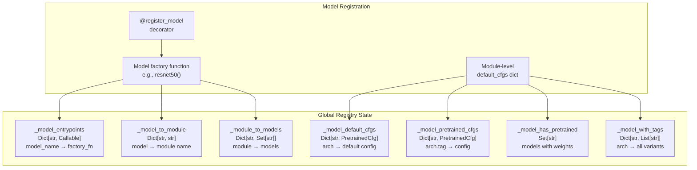

**Registry Components**

| Dictionary | Type | Purpose |
|------------|------|---------|
| `_model_entrypoints` | `Dict[str, Callable]` | Maps model name to factory function |
| `_model_has_pretrained` | `Set[str]` | Models with available pretrained weights |
| `_model_default_cfgs` | `Dict[str, DefaultCfg]` | Default configuration per architecture |
| `_model_pretrained_cfgs` | `Dict[str, PretrainedCfg]` | Configurations for model.tag variants |
| `_model_with_tags` | `Dict[str, List[str]]` | All tagged variants per architecture |

Sources: [timm/models/_registry.py:22-30]()

### Model Registration Process

The `@register_model` decorator registers model factory functions into the global registry:

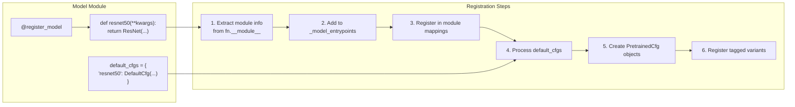

The decorator performs these operations at module import time:

1. **Extract module information** from the function's `__module__` attribute
2. **Register entrypoint** in `_model_entrypoints[model_name] = fn`
3. **Update module mappings** for `_model_to_module` and `_module_to_models`
4. **Process default configurations** from the module's `default_cfgs` dict
5. **Generate PretrainedCfg objects** with auto-completed fields
6. **Register tagged variants** like `model.tag1`, `model.tag2`

Sources: [timm/models/_registry.py:75-136]()

---

## Model Discovery

The library provides APIs to discover and filter available models.

### Discovery Functions

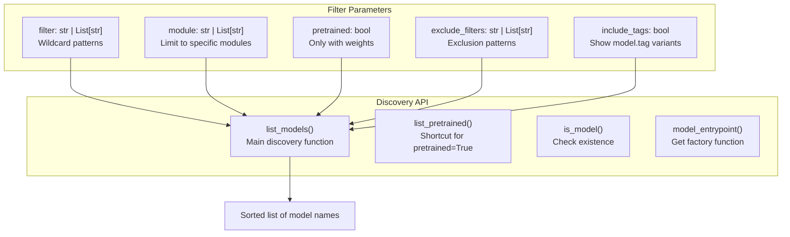

**Filter Examples**

```python
# All ResNet models
list_models('resnet*')

# Vision Transformers with pretrained weights
list_models('vit_*', pretrained=True)

# All models in vision_transformer module
list_models(module='vision_transformer')

# Exclude large models
list_models('*', exclude_filters=['*huge*', '*giant*'])

# Include tagged variants
list_models('resnet50', include_tags=True)
# Returns: ['resnet50', 'resnet50.a1_in1k', 'resnet50.tv_in1k', ...]
```

### Name Matching and Tags

Model names follow the pattern `architecture.tag` where tag identifies a specific pretrained variant:

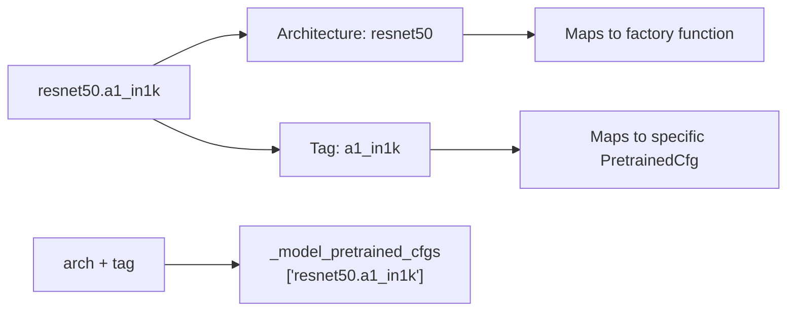

The `split_model_name_tag()` function parses model names:

```python
split_model_name_tag('resnet50.a1_in1k')  # ('resnet50', 'a1_in1k')
split_model_name_tag('resnet50')          # ('resnet50', '')
```

Sources: [timm/models/_registry.py:33-36](), [timm/models/_registry.py:185-265]()

---

## Model Creation Pipeline

The `create_model()` function is the main entry point for model instantiation.

### High-Level Creation Flow

```mermaid
graph TB
    create["create_model(model_name,<br/>pretrained=False, **kwargs)"]
    
    parse["parse_model_name()<br/>Extract source prefix"]
    
    subgraph "Source Detection"
        hf["Source: hf-hub:<br/>Load from Hugging Face"]
        local["Source: local-dir:<br/>Load from local path"]
        standard["Source: None<br/>Use registry"]
    end
    
    parse --> hf
    parse --> local
    parse --> standard
    
    hf --> load_hf["load_model_config_from_hf()<br/>Get config.json from HF"]
    local --> load_local["load_model_config_from_path()<br/>Get config.json from path"]
    standard --> split["split_model_name_tag()<br/>Separate arch from tag"]
    
    split --> lookup["model_entrypoint()<br/>Get factory function"]
    load_hf --> lookup
    load_local --> lookup
    
    lookup --> call["Call factory function:<br/>fn(pretrained=..., **kwargs)"]
    
    call --> build["build_model_with_cfg()<br/>Construct & configure model"]
    
    build --> result["Instantiated model"]
```

### Name Parsing Logic

The `parse_model_name()` function handles three formats:

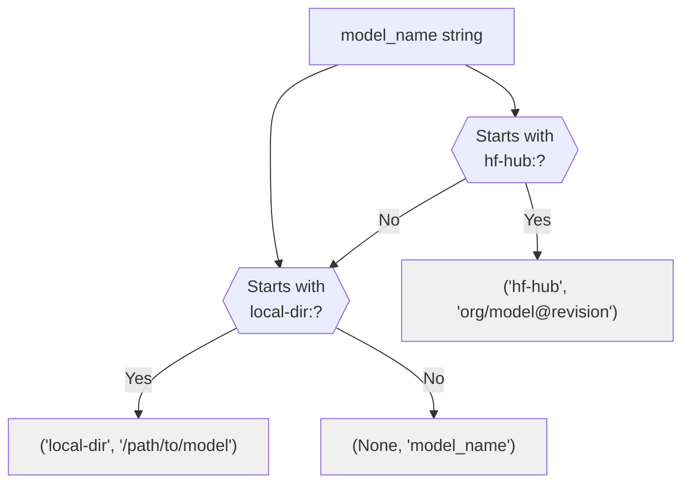

**Example Name Formats**

| Input Format | Source | Model Identifier |
|--------------|--------|------------------|
| `resnet50` | Standard registry | `resnet50` |
| `resnet50.a1_in1k` | Standard registry | `resnet50` with tag `a1_in1k` |
| `hf-hub:timm/resnet50.a1_in1k` | Hugging Face Hub | `timm/resnet50.a1_in1k` |
| `local-dir:/path/to/model` | Local directory | `/path/to/model` |

Sources: [timm/models/_factory.py:18-32](), [timm/models/_factory.py:44-149]()

### build_model_with_cfg Orchestration

The `build_model_with_cfg()` function orchestrates model construction and weight loading:

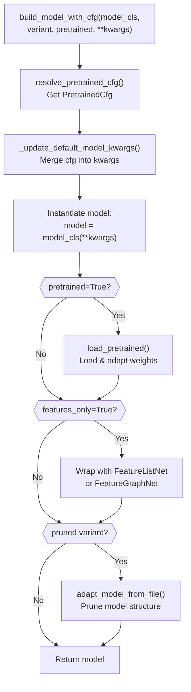

Key responsibilities:

1. **Resolve configuration** - Determine which `PretrainedCfg` to use
2. **Update kwargs** - Merge config values (num_classes, input_size, etc.) into model args
3. **Instantiate model** - Call the model class constructor
4. **Load weights** (if `pretrained=True`) - Download and apply pretrained weights
5. **Feature extraction** (if `features_only=True`) - Wrap model for intermediate outputs
6. **Pruning** (if pruned variant) - Adapt model structure from pruning metadata

Sources: [timm/models/_builder.py:376-498]()

---

## Pretrained Configuration System

Configurations define model metadata, input specifications, and weight sources.

### PretrainedCfg Dataclass

```mermaid
graph TB
    subgraph "PretrainedCfg Fields"
        subgraph "Weight Sources"
            url["url: str<br/>Remote URL"]
            file["file: str<br/>Local path"]
            hf_hub_id["hf_hub_id: str<br/>HuggingFace org/model"]
            state_dict["state_dict: Dict<br/>In-memory weights"]
        end
        
        subgraph "Input Configuration"
            input_size["input_size: Tuple[int, int, int]<br/>Channel, Height, Width"]
            interpolation["interpolation: str<br/>Resize method"]
            crop_pct["crop_pct: float<br/>Center crop ratio"]
            mean["mean: Tuple[float, ...]<br/>Normalization mean"]
            std["std: Tuple[float, ...]<br/>Normalization std"]
        end
        
        subgraph "Model Metadata"
            num_classes["num_classes: int<br/>Output classes"]
            architecture["architecture: str<br/>Model family"]
            tag["tag: str<br/>Variant identifier"]
            pool_size["pool_size: Tuple<br/>Feature map size"]
            first_conv["first_conv: str<br/>Input conv layer name"]
            classifier["classifier: str<br/>Classifier layer name"]
        end
    end
    
    cfg["PretrainedCfg<br/>instance"]
    
    cfg --> url
    cfg --> input_size
    cfg --> num_classes
```

### DefaultCfg for Multiple Variants

A single architecture can have multiple pretrained variants managed by `DefaultCfg`:

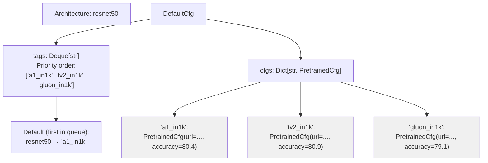

The `generate_default_cfgs()` function processes model configurations:

- Configs without tags or ending with `*` get priority as defaults
- Weights presence determines if a model is in `_model_has_pretrained`
- Tags are stored in priority order (first is default)

Sources: [timm/models/_pretrained.py:10-95](), [timm/models/_registry.py:43-72]()

---

## Weight Loading System

Weights can be loaded from multiple sources with automatic fallback and adaptation.

### Source Resolution

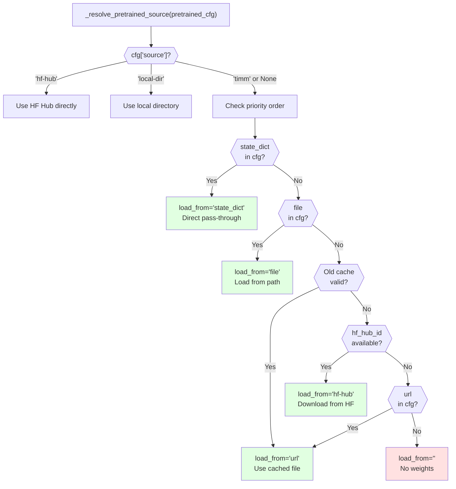

### Weight Loading Pipeline

Once the source is resolved, `load_pretrained()` handles the actual loading:

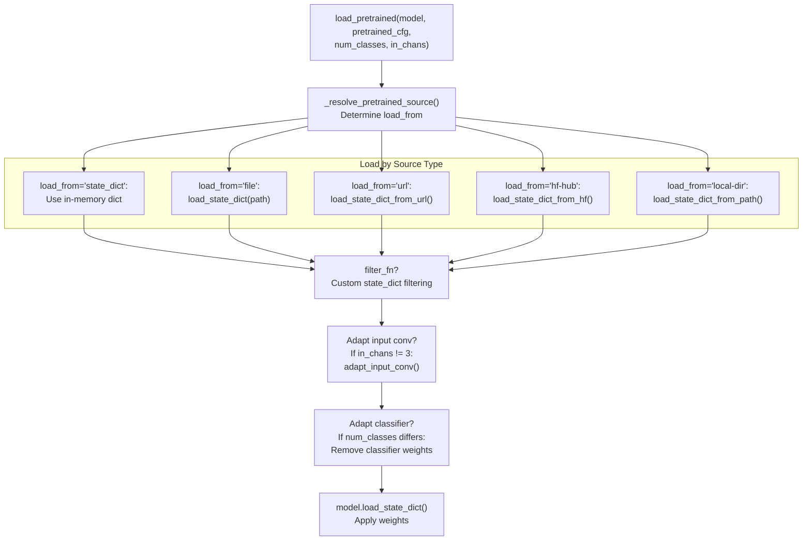

### Weight Adaptation Operations

The loading process automatically adapts weights to match the target model:

**Input Channel Adaptation**

When `in_chans` differs from the pretrained model (typically 3):

```python
# timm/models/_manipulate.py:288-310
def adapt_input_conv(in_chans: int, conv_weight: Tensor) -> Tensor:
    if in_chans == 1:
        # Sum across input channels: (O, 3, H, W) -> (O, 1, H, W)
        conv_weight = conv_weight.sum(dim=1, keepdim=True)
    elif in_chans != 3:
        # Repeat and scale: (O, 3, H, W) -> (O, in_chans, H, W)
        repeat = int(math.ceil(in_chans / 3))
        conv_weight = conv_weight.repeat(1, repeat, 1, 1)[:, :in_chans, :, :]
        conv_weight *= (3 / float(in_chans))
    return conv_weight
```

**Classifier Adaptation**

When `num_classes` differs from pretrained:

- Classifier layer weights are removed from state dict
- Model's classifier is randomly initialized to match new `num_classes`
- `strict=False` allows loading to proceed

**Custom Filter Functions**

Models can provide `checkpoint_filter_fn` to handle format conversions:

```python
# Example from model definition
def _filter_fn(state_dict, model):
    # Remap old key names
    if 'old.layer.weight' in state_dict:
        state_dict['new.layer.weight'] = state_dict.pop('old.layer.weight')
    return state_dict
```

Sources: [timm/models/_builder.py:43-88](), [timm/models/_builder.py:152-289](), [timm/models/_manipulate.py:288-310]()

---

## Hugging Face Hub Integration

The library supports loading models directly from Hugging Face Hub with the `hf-hub:` prefix.

### Hub Loading Flow

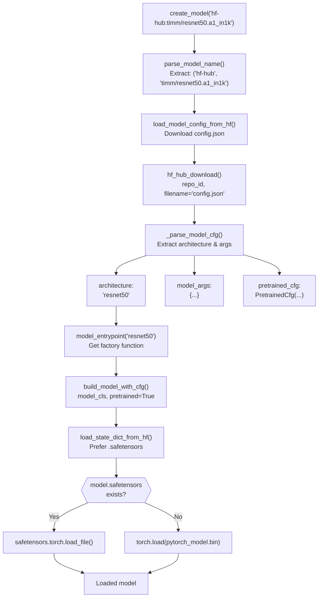

### Hub Configuration Format

Models stored on Hugging Face Hub use a `config.json` file:

```json
{
  "architecture": "resnet50",
  "num_classes": 1000,
  "num_features": 2048,
  "pretrained_cfg": {
    "tag": "a1_in1k",
    "input_size": [3, 224, 224],
    "mean": [0.485, 0.456, 0.406],
    "std": [0.229, 0.224, 0.225],
    "num_classes": 1000,
    "pool_size": [7, 7],
    "first_conv": "conv1",
    "classifier": "fc"
  },
  "model_args": {}
}
```

The `_parse_model_cfg()` function extracts:
- `architecture` - Model name to look up in registry
- `pretrained_cfg` - Configuration dict converted to `PretrainedCfg`
- `model_args` - Additional kwargs passed to model constructor

Sources: [timm/models/_hub.py:143-211](), [timm/models/_hub.py:213-251]()

---

## Local Directory Loading

Models can be loaded from local directories containing `config.json` and weight files:

```python
create_model('local-dir:/path/to/model', pretrained=True)
```

The directory structure:

```
/path/to/model/
├── config.json          # Model configuration
├── model.safetensors    # Weights (preferred)
└── pytorch_model.bin    # Weights (fallback)
```

The `load_state_dict_from_path()` function searches for weight files in priority order:

1. `model.safetensors`
2. `pytorch_model.bin`
3. `pytorch_model.pth`
4. Other `.safetensors` or `.pth` files

Sources: [timm/models/_hub.py:200-211](), [timm/models/_hub.py:266-296]()

---

## Complete Creation Example

Here's how a typical model creation flows through the system:

```python
model = create_model(
    'resnet50.a1_in1k',
    pretrained=True,
    num_classes=100,
    drop_rate=0.2
)
```

### Step-by-Step Execution

```mermaid
graph TB
    call["create_model('resnet50.a1_in1k',<br/>pretrained=True, num_classes=100)"]
    
    step1["1. parse_model_name()<br/>→ (None, 'resnet50.a1_in1k')"]
    
    step2["2. split_model_name_tag()<br/>→ ('resnet50', 'a1_in1k')"]
    
    step3["3. is_model('resnet50')<br/>→ True (exists in registry)"]
    
    step4["4. model_entrypoint('resnet50')<br/>→ timm.models.resnet.resnet50"]
    
    step5["5. Call entrypoint:<br/>resnet50(pretrained=True,<br/>pretrained_cfg='a1_in1k',<br/>num_classes=100)"]
    
    step6["6. build_model_with_cfg(<br/>ResNet, 'resnet50',<br/>pretrained=True, ...)"]
    
    step7["7. resolve_pretrained_cfg()<br/>Get PretrainedCfg for 'a1_in1k'"]
    
    step8["8. Instantiate:<br/>model = ResNet(<br/>  block=Bottleneck,<br/>  layers=[3,4,6,3],<br/>  num_classes=100)"]
    
    step9["9. load_pretrained()<br/>Download weights from URL"]
    
    step10["10. Adapt classifier:<br/>Remove fc.weight/fc.bias<br/>(1000 → 100 classes)"]
    
    step11["11. model.load_state_dict()<br/>strict=False"]
    
    result["Return configured model"]
    
    call --> step1
    step1 --> step2
    step2 --> step3
    step3 --> step4
    step4 --> step5
    step5 --> step6
    step6 --> step7
    step7 --> step8
    step8 --> step9
    step9 --> step10
    step10 --> step11
    step11 --> result
```

### Registry Lookups

| Lookup | Result |
|--------|--------|
| `_model_entrypoints['resnet50']` | `timm.models.resnet.resnet50` function |
| `_model_pretrained_cfgs['resnet50.a1_in1k']` | `PretrainedCfg(url='https://...', num_classes=1000, ...)` |
| `_model_has_pretrained` | Contains `'resnet50.a1_in1k'` ✓ |

### Configuration Override Precedence

1. **Explicit kwargs** (highest priority) - `num_classes=100` from user
2. **Pretrained config** - From `PretrainedCfg` for tag `a1_in1k`
3. **Model defaults** (lowest priority) - Defined in model class

Sources: [timm/models/_factory.py:44-149](), [timm/models/_builder.py:376-498]()

---

## Testing and Validation

The test suite validates registry and creation functionality:

### Model Discovery Tests

```python
# tests/test_models.py:172-189
@pytest.mark.parametrize('model_name', list_models())
def test_model_forward(model_name, batch_size):
    """Run a single forward pass with each model"""
    model = create_model(model_name, pretrained=False)
    model.eval()
    # ... test forward pass
```

Key test patterns:

- **Enumerate all models**: `list_models()` for comprehensive testing
- **Filter by category**: `list_models(module='vision_transformer')`
- **Test pretrained loading**: `list_models(pretrained=True)`
- **Exclude large models**: `exclude_filters=['*huge*', '*giant*']` for CI

### Registry Validation Tests

The test suite verifies:

1. All registered models can be instantiated
2. Pretrained weights can be loaded
3. Default configurations are correct
4. Feature extraction modes work
5. TorchScript compilation succeeds

Sources: [tests/test_models.py:1-700]()

---

## Summary

The Model Creation and Registry System provides:

1. **Centralized registration** - Single decorator registers models globally
2. **Flexible discovery** - Rich filtering for finding models
3. **Multiple weight sources** - URL, Hugging Face Hub, local files, in-memory
4. **Automatic adaptation** - Input channels, classifier heads, position embeddings
5. **Configuration management** - Pretrained configs with multiple variants
6. **Extensible pipeline** - Custom filter functions, pruning, feature extraction

The system supports 1000+ model variants through a clean API while handling the complexity of weight loading, configuration resolution, and model adaptation internally.

---

