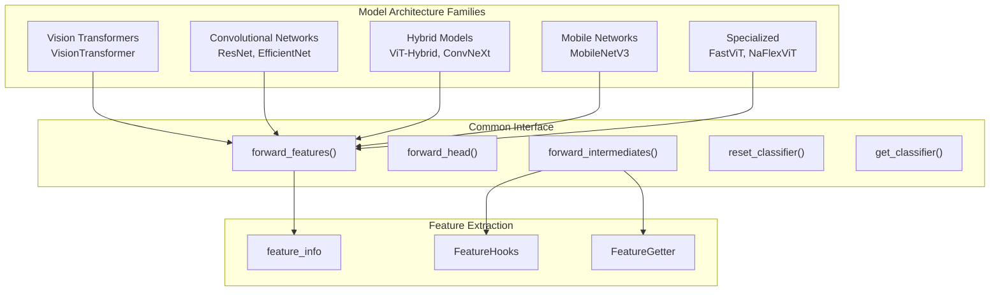
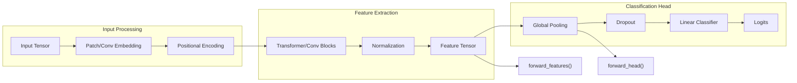
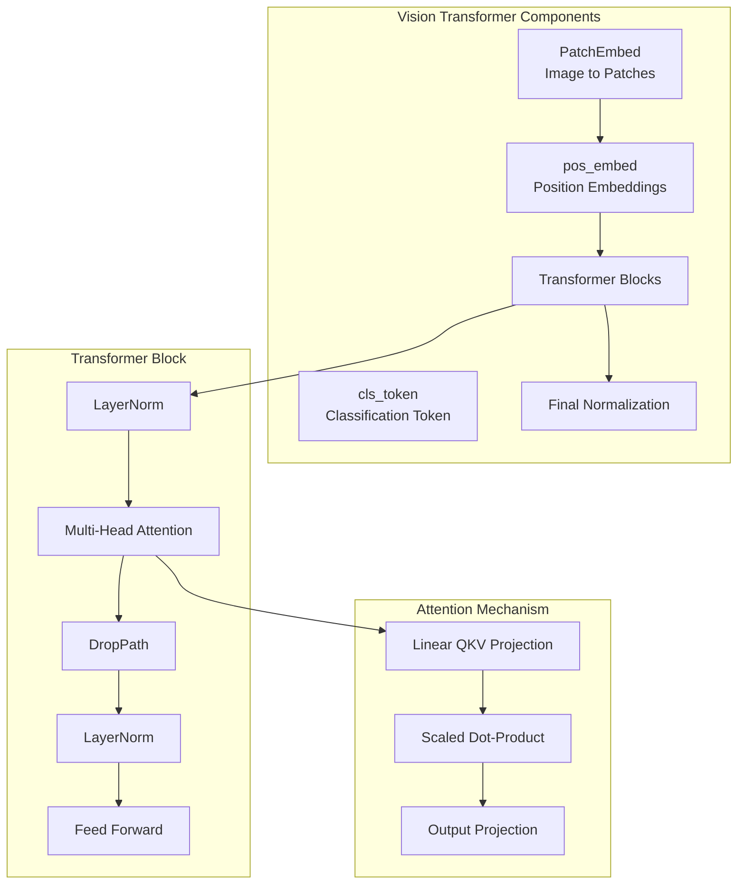
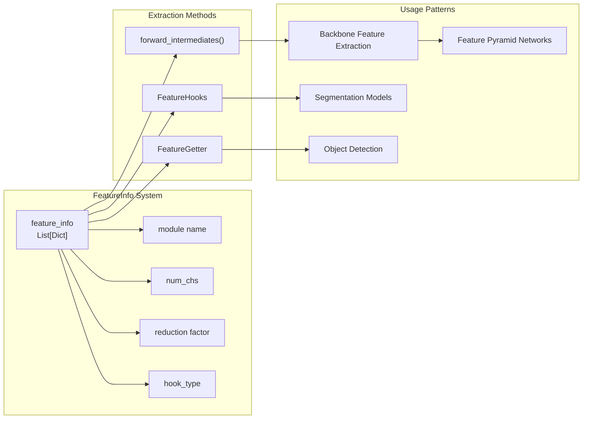
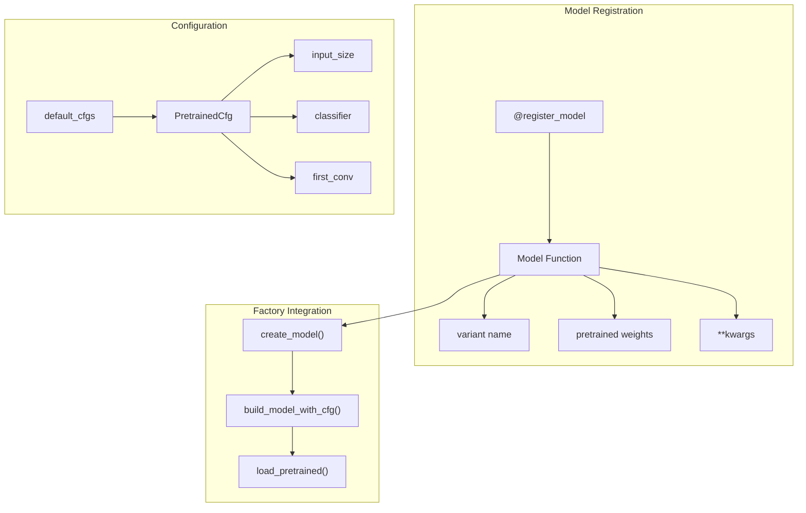

<!-- source: DeepWiki mcp.deepwiki.com · repo huggingface/pytorch-image-models · page 3 Model Architecture System · fetched 2026-10-26 -->

# Model Architecture System

Relevant source files

The following files were used as context for generating this wiki page:

- [README.md](README.md)
- [timm/models/convnext.py](timm/models/convnext.py)
- [timm/models/fastvit.py](timm/models/fastvit.py)
- [timm/models/mambaout.py](timm/models/mambaout.py)
- [timm/models/maxxvit.py](timm/models/maxxvit.py)
- [timm/models/vision_transformer.py](timm/models/vision_transformer.py)
- [timm/models/vision_transformer_hybrid.py](timm/models/vision_transformer_hybrid.py)
- [timm/models/vision_transformer_relpos.py](timm/models/vision_transformer_relpos.py)
- [timm/models/vision_transformer_sam.py](timm/models/vision_transformer_sam.py)
- [timm/models/vitamin.py](timm/models/vitamin.py)
- [timm/version.py](timm/version.py)

This document provides an overview of the model architecture system in timm, covering the different architecture families and their common patterns. It explains how various model types are organized and how they share common interfaces for feature extraction, forward passes, and integration with the model factory system.

For information about creating and registering models, see [Model Creation and Registry System](#2). For detailed coverage of specific architecture families, see [Vision Transformers](#3.1), [Convolutional Networks](#3.2), [Configurable and Hybrid Models](#3.3), and [Specialized Architectures](#3.4).

## Architecture Family Overview

The timm library organizes model architectures into distinct families, each implementing a common interface while providing architecture-specific optimizations. All architectures follow standardized patterns for feature extraction, classification heads, and intermediate layer access.

Sources: [timm/models/vision_transformer.py:444-950](), [timm/models/resnet.py:390-700](), [timm/models/efficientnet.py:59-342](), [timm/models/mobilenetv3.py:29-326]()

## Common Interface Patterns

All model architectures in timm implement a standardized interface that enables consistent usage across different model types. This interface separates feature extraction from classification and provides methods for intermediate layer access.

### Standard Model Interface

The interface methods implemented by all architectures:

| Method | Purpose | Return Type |
|--------|---------|-------------|
| `forward_features()` | Extract features without classification head | `torch.Tensor` |
| `forward_head()` | Apply classification head to features | `torch.Tensor` |
| `forward_intermediates()` | Extract intermediate layer features | `List[torch.Tensor]` |
| `reset_classifier()` | Change number of output classes | `None` |
| `get_classifier()` | Get current classifier module | `nn.Module` |
| `set_grad_checkpointing()` | Enable/disable gradient checkpointing | `None` |

Sources: [timm/models/vision_transformer.py:934-951](), [timm/models/resnet.py:617-700](), [timm/models/efficientnet.py:310-341](), [timm/models/mobilenetv3.py:276-325]()

## Architecture Categories

### Vision Transformers

Vision Transformers represent the newest paradigm in computer vision, applying transformer architectures originally designed for NLP to image recognition tasks. The `VisionTransformer` class serves as the base implementation.

Key Vision Transformer characteristics:
- **Patch-based processing**: Images divided into fixed-size patches
- **Self-attention mechanism**: Global receptive field from first layer
- **Position embeddings**: Learnable or fixed positional encoding
- **Classification token**: Special `[CLS]` token for classification
- **Layer normalization**: Pre-normalization in transformer blocks

Sources: [timm/models/vision_transformer.py:444-624](), [timm/models/vision_transformer.py:109-179]()

### Convolutional Networks

Convolutional networks form the traditional backbone of computer vision models, with ResNet being a prime example. These architectures use hierarchical feature learning through convolution operations.

```mermaid
graph TD
    subgraph "ResNet Architecture"
        CONV1["Initial Convolution<br/>conv1 7x7"]
        BN1["Batch Normalization<br/>bn1"]
        MAXPOOL["Max Pooling<br/>maxpool"]
        LAYER1["Stage 1<br/>layer1"]
        LAYER2["Stage 2<br/>layer2"]
        LAYER3["Stage 3<br/>layer3"]
        LAYER4["Stage 4<br/>layer4"]
        GLOBAL_POOL["Global Pooling"]
        FC["Classification<br/>fc"]
    end
    
    subgraph "Residual Block"
        BLOCK_CONV1["3x3 Conv"]
        BLOCK_BN1["BatchNorm"]
        BLOCK_RELU1["ReLU"]
        BLOCK_CONV2["3x3 Conv"]
        BLOCK_BN2["BatchNorm"]
        SHORTCUT["Shortcut Connection"]
        BLOCK_RELU2["ReLU"]
    end
    
    CONV1 --> BN1
    BN1 --> MAXPOOL
    MAXPOOL --> LAYER1
    LAYER1 --> LAYER2
    LAYER2 --> LAYER3
    LAYER3 --> LAYER4
    LAYER4 --> GLOBAL_POOL
    GLOBAL_POOL --> FC
    
    BLOCK_CONV1 --> BLOCK_BN1
    BLOCK_BN1 --> BLOCK_RELU1
    BLOCK_RELU1 --> BLOCK_CONV2
    BLOCK_CONV2 --> BLOCK_BN2
    SHORTCUT --> BLOCK_RELU2
    BLOCK_BN2 --> BLOCK_RELU2
```

Convolutional network characteristics:
- **Hierarchical features**: Progressive feature abstraction through stages
- **Local receptive fields**: Convolution operations with limited spatial scope
- **Residual connections**: Skip connections for gradient flow (ResNet)
- **Batch normalization**: Normalization after convolution layers
- **Spatial downsampling**: Progressive reduction of spatial dimensions

Sources: [timm/models/resnet.py:390-624](), [timm/models/resnet.py:34-244](), [timm/models/efficientnet.py:59-167]()

### Mobile and Efficient Networks

Mobile networks like MobileNetV3 and EfficientNet optimize for efficiency while maintaining performance. They use techniques like depthwise separable convolutions and neural architecture search.

Key mobile network features:
- **Depthwise separable convolutions**: Factorized convolutions for efficiency
- **Squeeze-and-excitation**: Channel attention mechanisms
- **Inverted residuals**: Efficient residual block design
- **Neural architecture search**: Automated architecture optimization

Sources: [timm/models/mobilenetv3.py:29-140](), [timm/models/efficientnet.py:59-167]()

### Hybrid and Configurable Models

Hybrid models combine different architectural paradigms, such as CNN backbones with transformer heads. Configurable models allow runtime architecture modifications.

Examples include:
- **Vision Transformer Hybrid**: CNN backbone + ViT head
- **ConvNeXt**: CNN with transformer-inspired design choices
- **ByobNet**: Build-your-own-backbone configurable networks

Sources: [timm/models/vision_transformer_hybrid.py:130-143]()

## Feature Extraction System

The feature extraction system provides unified access to intermediate layer outputs across all architectures, enabling their use as backbones for downstream tasks.

### Feature Information Structure

The feature extraction system enables:
- **Multi-scale features**: Access to outputs from different network depths
- **Backbone compatibility**: Use any timm model as a feature extractor
- **Flexible extraction**: Hook-based or direct intermediate access
- **Standardized interface**: Consistent API across all architectures

Sources: [timm/models/vision_transformer.py:782-875](), [timm/models/resnet.py:617-684](), [timm/models/efficientnet.py:219-277]()

## Integration with Model Factory

All architectures integrate seamlessly with the model factory system through standardized registration and configuration patterns.

### Registration Pattern

The integration provides:
- **Unified creation interface**: Single `create_model()` function for all architectures
- **Standardized configuration**: Common configuration patterns across models
- **Pretrained weight loading**: Automatic weight loading with adaptation
- **Feature extraction modes**: Seamless switching between classification and feature extraction

Sources: [timm/models/vision_transformer.py:1625-1700](), [timm/models/resnet.py:1450-1500](), [timm/models/__init__.py:90-102]()

This architecture system enables timm to provide a unified interface to dozens of different model architectures while maintaining the flexibility for architecture-specific optimizations and features.

---

