<!-- source: DeepWiki mcp.deepwiki.com · repo huggingface/pytorch-image-models · page 3.1 Vision Transformers · fetched 2026-10-26 -->

# Vision Transformers

<details>
<summary>Relevant source files</summary>

The following files were used as context for generating this wiki page:

- [timm/layers/__init__.py](timm/layers/__init__.py)
- [timm/layers/attention.py](timm/layers/attention.py)
- [timm/layers/blur_pool.py](timm/layers/blur_pool.py)
- [timm/layers/mlp.py](timm/layers/mlp.py)
- [timm/layers/patch_embed.py](timm/layers/patch_embed.py)
- [timm/layers/pos_embed.py](timm/layers/pos_embed.py)
- [timm/layers/pos_embed_rel.py](timm/layers/pos_embed_rel.py)
- [timm/layers/pos_embed_sincos.py](timm/layers/pos_embed_sincos.py)
- [timm/models/beit.py](timm/models/beit.py)
- [timm/models/convnext.py](timm/models/convnext.py)
- [timm/models/csatv2.py](timm/models/csatv2.py)
- [timm/models/eva.py](timm/models/eva.py)
- [timm/models/fastvit.py](timm/models/fastvit.py)
- [timm/models/mambaout.py](timm/models/mambaout.py)
- [timm/models/maxxvit.py](timm/models/maxxvit.py)
- [timm/models/swin_transformer.py](timm/models/swin_transformer.py)
- [timm/models/swin_transformer_v2.py](timm/models/swin_transformer_v2.py)
- [timm/models/swin_transformer_v2_cr.py](timm/models/swin_transformer_v2_cr.py)
- [timm/models/vision_transformer.py](timm/models/vision_transformer.py)
- [timm/models/vision_transformer_hybrid.py](timm/models/vision_transformer_hybrid.py)
- [timm/models/vision_transformer_relpos.py](timm/models/vision_transformer_relpos.py)
- [timm/models/vision_transformer_sam.py](timm/models/vision_transformer_sam.py)
- [timm/models/vitamin.py](timm/models/vitamin.py)
- [timm/models/volo.py](timm/models/volo.py)

</details>


This page documents Vision Transformer (ViT) architectures and their variants in the timm library, including the core ViT implementation, Swin Transformers (V1, V2, V2-CR), EVA models with rotary position embeddings, BEiT with relative position bias, and specialized variants like VOLO and SAM. For hybrid models combining CNNs with transformers, see [Configurable and Hybrid Models](#3.3). For the layer components used across these architectures, see [Layer and Component Library](#3.5).

## Overview

Vision Transformers apply the transformer architecture from NLP to computer vision by dividing images into patches and treating them as sequence tokens. The timm library implements numerous ViT variants that differ primarily in their attention mechanisms, position encoding strategies, and architectural optimizations:

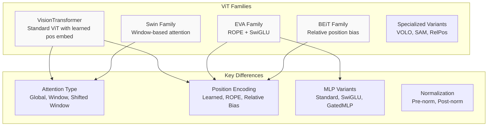

**Sources:** [timm/models/vision_transformer.py:1-80](), [timm/models/eva.py:1-102](), [timm/models/swin_transformer.py:1-37](), [timm/models/beit.py:1-69]()

## Core VisionTransformer Architecture

The `VisionTransformer` class in [timm/models/vision_transformer.py:674-1095]() implements the standard ViT architecture from "An Image is Worth 16x16 Words". The model consists of a patch embedding stem, optional position embeddings, transformer blocks, and a classification head.

### Model Construction Pipeline


**Key Configuration Parameters:**

| Parameter | Default | Purpose |
|-----------|---------|---------|
| `img_size` | 224 | Input image size |
| `patch_size` | 16 | Patch size for tokenization |
| `embed_dim` | 768 | Embedding dimension |
| `depth` | 12 | Number of transformer blocks |
| `num_heads` | 12 | Number of attention heads |
| `mlp_ratio` | 4.0 | MLP hidden dimension expansion |
| `qkv_bias` | True | Bias in QKV projections |
| `class_token` | True | Use class token |
| `global_pool` | 'token' | Pooling type: token/avg/map |

**Sources:** [timm/models/vision_transformer.py:674-795]()

### Patch Embedding

The `PatchEmbed` layer in [timm/layers/patch_embed.py:26-139]() converts images to patch tokens via a convolutional projection:


The patch embedding supports both static and dynamic image sizes through the `dynamic_img_size` parameter. When enabled, the output format is `NHWC` and flattening is deferred until after position embeddings are applied.

**Sources:** [timm/layers/patch_embed.py:26-139](), [timm/models/vision_transformer.py:786-795]()

## Transformer Block Variants

Vision transformers use different block architectures that vary in normalization placement and component ordering:

### Standard Pre-Norm Block

The standard `Block` in [timm/models/vision_transformer.py:126-208]() uses pre-normalization (norm before attention/MLP):

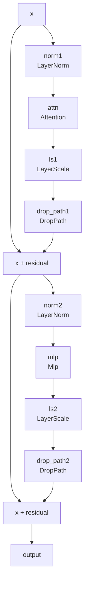

### Post-Norm Block

The `ResPostBlock` in [timm/models/vision_transformer.py:210-278]() applies normalization after attention/MLP:

```python
# Post-norm: attn(x) + norm(x) vs Pre-norm: x + attn(norm(x))
x = x + drop_path(norm1(attn(x)))
x = x + drop_path(norm2(mlp(x)))
```

### Parallel Blocks

The `ParallelScalingBlock` in [timm/models/vision_transformer.py:280-398]() computes attention and MLP in parallel for efficiency:

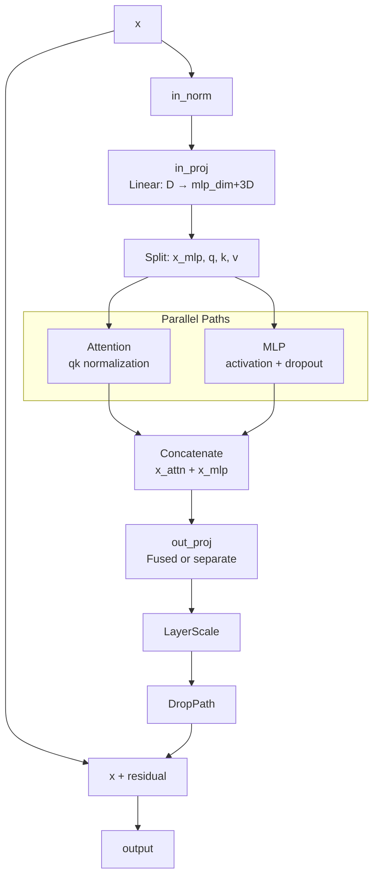

**Sources:** [timm/models/vision_transformer.py:126-398]()

## Position Embeddings

Vision transformers use various position encoding strategies to provide spatial information to the attention mechanism:

### Learned Position Embeddings

Standard ViT uses learnable position embeddings added to patch tokens [timm/models/vision_transformer.py:802-806]():

```python
# Learned position embedding: [1, num_patches + num_prefix_tokens, embed_dim]
self.pos_embed = nn.Parameter(torch.randn(1, embed_len, embed_dim) * .02)
```

The embeddings are resized when the input resolution changes using bicubic interpolation in [timm/layers/pos_embed.py:19-52]().

### Rotary Position Embeddings (ROPE)

EVA models and variants use ROPE for position-aware attention [timm/models/eva.py:637-662](). ROPE applies rotations to query and key vectors based on their positions:

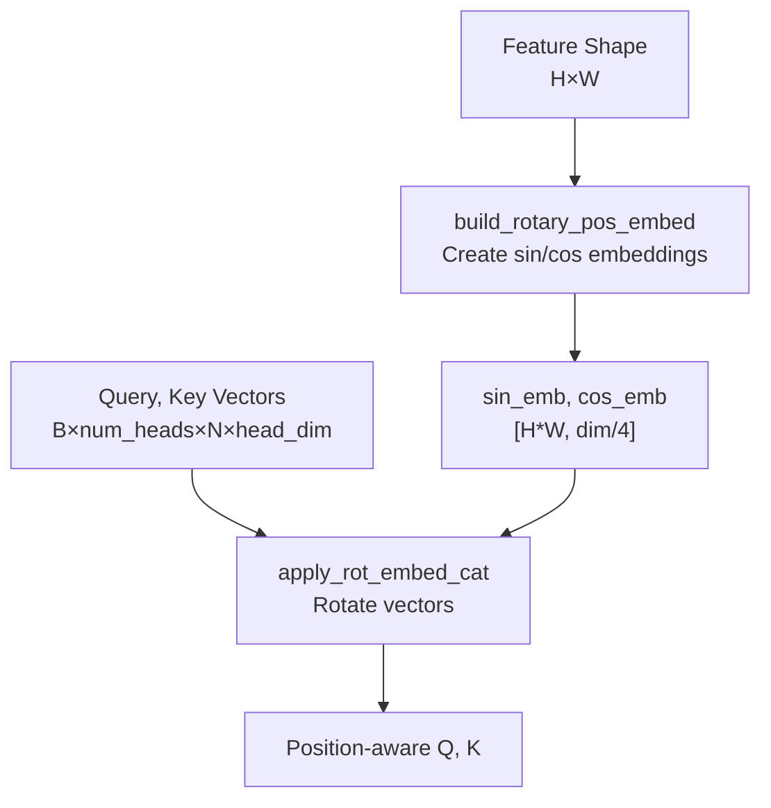

ROPE variants in timm:
- **Standard ROPE**: Interleaved rotation [timm/layers/pos_embed_sincos.py:383-503]()
- **Cat ROPE**: Concatenated sin/cos [timm/layers/pos_embed_sincos.py:505-628]()
- **Mixed ROPE**: Depth-dependent frequencies [timm/layers/pos_embed_sincos.py:630-832]()
- **DINOv3 ROPE**: Specialized for DINOv3 [timm/layers/pos_embed_sincos.py:834-965]()

### Relative Position Bias

BEiT models use relative position bias computed through an MLP [timm/models/beit.py:72-104]():

```python
# Relative position index: [window_area+1, window_area+1]
relative_position_index = gen_relative_position_index(window_size)

# Bias table: [num_relative_positions, num_heads]
self.relative_position_bias_table = nn.Parameter(...)

# Applied to attention: attn = attn + relative_position_bias
```

**Sources:** [timm/layers/pos_embed_sincos.py:327-965](), [timm/models/eva.py:637-662](), [timm/models/beit.py:72-104](), [timm/layers/pos_embed.py:19-52]()

## Attention Mechanisms

### Standard Multi-Head Attention

The base `Attention` module in [timm/layers/attention.py:18-113]() implements standard scaled dot-product attention:

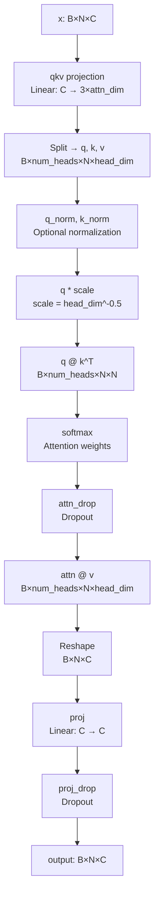

**Key Features:**
- Supports fused attention via `F.scaled_dot_product_attention` when available
- Optional QK normalization for training stability
- Configurable head dimensions via `attn_head_dim` parameter

**Sources:** [timm/layers/attention.py:18-113]()

### Differential Attention

The `DiffAttention` module in [timm/layers/diff_attention.py:13-193]() implements differential attention from "Differential Transformer":

```python
# Computes difference between two attention maps
attn_1 = softmax(q_1 @ k_1^T)
attn_2 = softmax(q_2 @ k_2^T)
attn_diff = attn_1 - λ * attn_2  # λ is learnable
```

This mechanism helps reduce attention noise by subtracting redundant attention patterns.

**Sources:** [timm/layers/diff_attention.py:13-193](), [timm/models/vision_transformer.py:83-87]()

### Attention with ROPE

The `AttentionRope` module in [timm/layers/attention.py:115-225]() integrates rotary position embeddings:

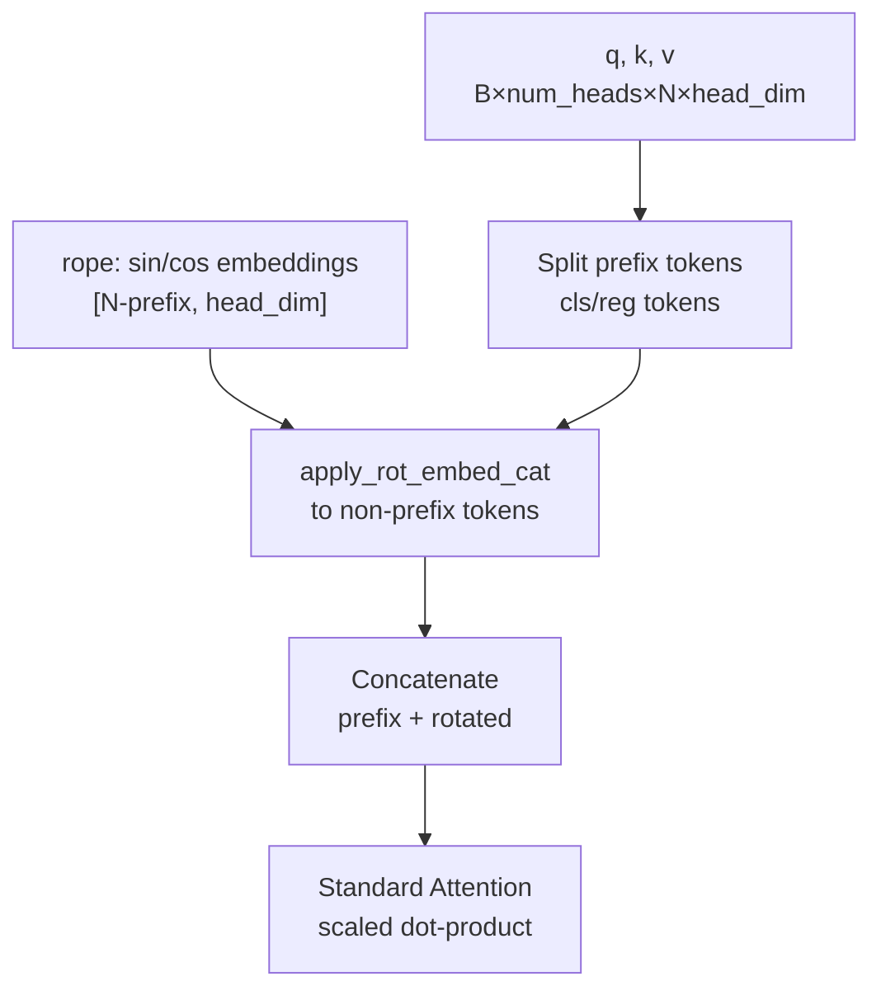

**Sources:** [timm/layers/attention.py:115-225]()

## Swin Transformer Family

Swin Transformers use hierarchical architecture with shifted window attention for computational efficiency. The family includes three main variants: Swin V1, Swin V2, and Swin V2-CR.

### Window Attention Mechanism

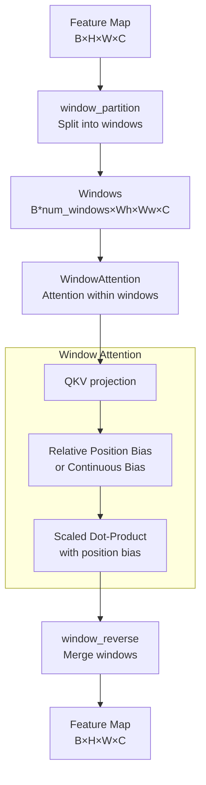

### Swin V1 Architecture

The `SwinTransformer` in [timm/models/swin_transformer.py:1-1045]() implements the original Swin architecture with:

- **Window Partitioning**: [timm/models/swin_transformer.py:42-59]()
- **Relative Position Bias Table**: Learnable bias indexed by relative positions [timm/models/swin_transformer.py:145-154]()
- **Shifted Window Attention**: Cyclic shifts for cross-window connections [timm/models/swin_transformer.py:270-283]()

```python
# Shifted window masking
if self.shift_size > 0:
    x = torch.roll(x, shifts=(-self.shift_size, -self.shift_size), dims=(1, 2))
    attn_mask = self.attn_mask
```

**Sources:** [timm/models/swin_transformer.py:42-283]()

### Swin V2 Improvements

The `SwinTransformerV2` in [timm/models/swin_transformer_v2.py:1-1082]() adds:

1. **Continuous Position Bias**: MLP-based position encoding [timm/models/swin_transformer_v2.py:121-141]()
2. **Cosine Attention**: Normalized attention computation [timm/models/swin_transformer_v2.py:195-219]()
3. **Log-spaced Coordinate Scaling**: Better adaptation to resolution changes [timm/models/swin_transformer_v2.py:143-161]()

```python
# Cosine attention with log-scaled coordinates
attn = (F.normalize(q, dim=-1) @ F.normalize(k, dim=-1).transpose(-2, -1))
logit_scale = torch.clamp(self.logit_scale, max=math.log(1. / 0.01))
attn = attn * logit_scale.exp()
```

**Sources:** [timm/models/swin_transformer_v2.py:78-219]()

### Swin V2-CR Variant

The CR (Christoph Reich) implementation in [timm/models/swin_transformer_v2_cr.py:1-1134]() is an experimental variant with:

- MLP-based meta network for position bias [timm/models/swin_transformer_v2_cr.py:135-142]()
- Sequential attention option for memory efficiency [timm/models/swin_transformer_v2_cr.py:117]()
- Dynamic window size support [timm/models/swin_transformer_v2_cr.py:164-173]()

**Sources:** [timm/models/swin_transformer_v2_cr.py:96-250]()

### Hierarchical Stage Structure

All Swin variants use a hierarchical structure with downsampling between stages:

| Stage | Resolution | Typical Depth | Window Size |
|-------|-----------|---------------|-------------|
| 0 | H/4 × W/4 | 2 | 7×7 |
| 1 | H/8 × W/8 | 2 | 7×7 |
| 2 | H/16 × W/16 | 6-18 | 7×7 |
| 3 | H/32 × W/32 | 2 | 7×7 |

**Sources:** [timm/models/swin_transformer.py:525-621](), [timm/models/swin_transformer_v2.py:499-589]()

## EVA Models

EVA (Exploring the Limits of Masked Visual Representation Learning at Scale) models in [timm/models/eva.py:1-1605]() are BEiT-based ViTs with several enhancements:

### EVA Architecture Components

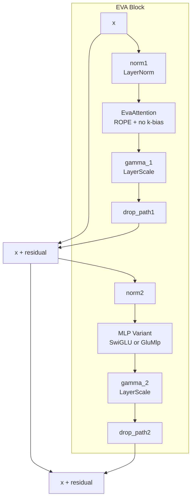

### Key Features

1. **EvaAttention**: [timm/models/eva.py:104-244]()
   - ROPE for position encoding
   - No bias on key projections
   - Optional fused vs separate QKV projections
   - QK normalization for stability

2. **SwiGLU MLP**: [timm/layers/mlp.py:168-264]()
   ```python
   # SwiGLU activation
   x = gate * F.silu(x)  # Element-wise gating
   ```

3. **Scaling Normalization**: Applied inside attention and MLP [timm/models/eva.py:258-309]()

4. **Flexible ROPE Types**: [timm/models/eva.py:650-660]()
   - `'cat'`: Concatenated sin/cos for spatial
   - `'mixed'`: Depth-dependent frequencies
   - `'dinov3'`: DINOv3-specific ROPE

### EVA vs EVA02

| Feature | EVA | EVA02 |
|---------|-----|-------|
| Position Encoding | Absolute | Absolute + ROPE |
| MLP | Standard | SwiGLU |
| Scaling Norm | No | Yes (in MLP) |
| Global Pool | avg | avg |

**Sources:** [timm/models/eva.py:104-710](), [timm/layers/mlp.py:168-264]()

## BEiT Models

BEiT (BERT Pre-Training of Image Transformers) in [timm/models/beit.py:1-1040]() implements masked image modeling for self-supervised pre-training:

### Relative Position Bias

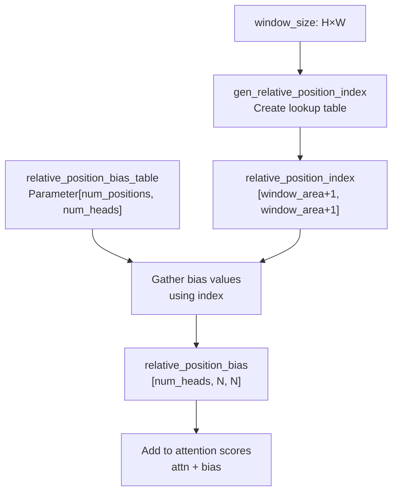

**Index Computation**: [timm/models/beit.py:72-104]()
- Encodes relative distances between all position pairs
- Special indices for class token interactions
- `num_relative_distance = (2*H-1) * (2*W-1) + 3`

### BEiT Attention Module

The `Attention` class in [timm/models/beit.py:107-221]() extends standard attention with:

```python
# Relative position bias lookup
relative_position_bias = self.relative_position_bias_table[
    self.relative_position_index.view(-1)
].view(window_area + 1, window_area + 1, -1)

# Add to attention: [num_heads, N, N]
attn = attn + relative_position_bias.permute(2, 0, 1).unsqueeze(0)
```

### BEiT vs BEiT-v2

| Feature | BEiT | BEiT-v2 |
|---------|------|---------|
| Tokenizer | dVAE | VQ-KD |
| Position Bias | Shared per head | Per-head parameters |
| MLP | Standard | Optional SwiGLU |
| Init Values | None | LayerScale |

**Sources:** [timm/models/beit.py:72-221](), [timm/models/beit.py:246-418]()

## Specialized ViT Variants

### VOLO (Vision OutLOoker)

VOLO in [timm/models/volo.py:1-1015]() uses outlook attention for fine-grained feature aggregation:

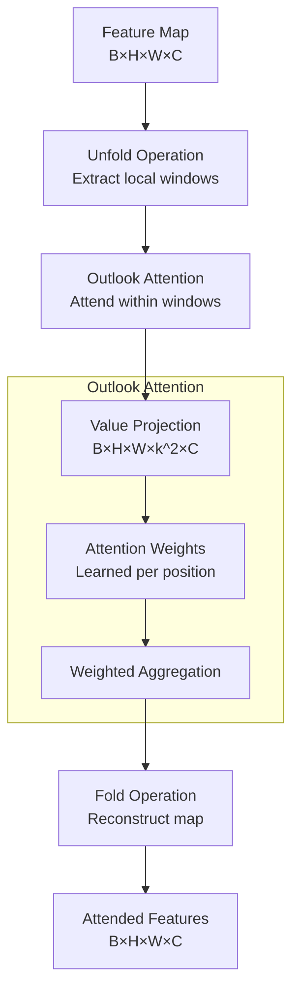

**Key Components**:
- `OutlookAttention`: Local window-based attention [timm/models/volo.py:124-233]()
- `Outlooker`: Complete outlook attention block [timm/models/volo.py:236-297]()
- Two-stage architecture: Outlook attention → Transformer [timm/models/volo.py:778-848]()

**Sources:** [timm/models/volo.py:124-297](), [timm/models/volo.py:778-848]()

### SAM ViT

Segment Anything Model ViT in [timm/models/vision_transformer_sam.py:1-755]() adds:

1. **Decomposed Relative Position Embeddings**: [timm/models/vision_transformer_sam.py:52-134]()
   - Separate embeddings for height and width
   - Interpolated for different resolutions

2. **Window-Based Attention**: [timm/models/vision_transformer_sam.py:137-269]()
   ```python
   # Add relative position to attention
   attn = attn + self._get_rel_pos_bias()
   ```

3. **Optional ROPE**: Via `RotaryEmbeddingCat` [timm/models/vision_transformer_sam.py:402-411]()

**Sources:** [timm/models/vision_transformer_sam.py:52-269]()

### RelPos ViT

Relative position ViT in [timm/models/vision_transformer_relpos.py:1-626]() provides flexible relative position encoding:

**Supported Modes**:
- `RelPosBias`: Learnable bias table (Swin-style) [timm/layers/pos_embed_rel.py:191-302]()
- `RelPosMlp`: MLP-based bias (BEiT-v2 style) [timm/layers/pos_embed_rel.py:40-188]()

```python
# RelPosMlp computes bias via MLP
relative_position_bias = self.mlp(log_relative_coords)
```

**Sources:** [timm/models/vision_transformer_relpos.py:44-160](), [timm/layers/pos_embed_rel.py:40-302]()

## Model Creation and Weight Loading

### Factory Functions

All ViT models are registered with factory functions that configure and instantiate models:

```python
@register_model
def vit_base_patch16_224(pretrained=False, **kwargs):
    model_args = dict(patch_size=16, embed_dim=768, depth=12, num_heads=12)
    model = _create_vision_transformer('vit_base_patch16_224', pretrained=pretrained, **dict(model_args, **kwargs))
    return model
```

The `_create_vision_transformer` helper in [timm/models/vision_transformer.py:1274-1280]() calls `build_model_with_cfg` to:
1. Resolve configuration from registry
2. Instantiate model class
3. Load pretrained weights if requested

**Sources:** [timm/models/vision_transformer.py:1274-1280](), [timm/models/vision_transformer.py:1354-1361]()

### Weight Adaptation

The `checkpoint_filter_fn` in [timm/models/vision_transformer.py:1152-1272]() handles weight compatibility:

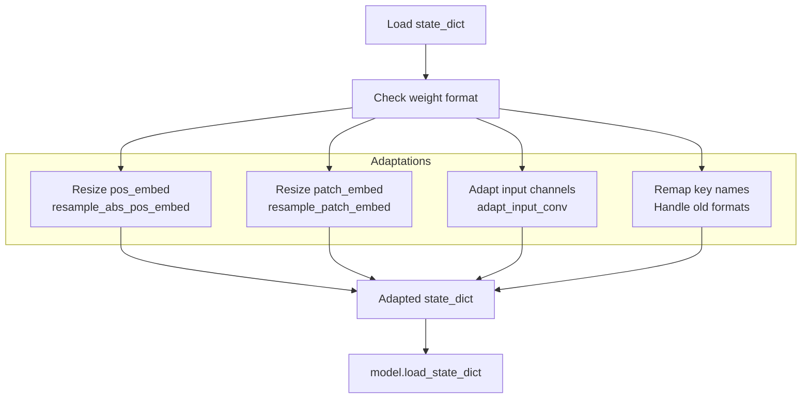

**Key Adaptations**:
- Position embedding resizing via bicubic interpolation [timm/layers/pos_embed.py:19-52]()
- Patch embedding weight resizing [timm/layers/patch_embed.py:155-232]()
- Input channel adaptation (3→1 or 1→3) [timm/models/_manipulate.py:219-267]()

**Sources:** [timm/models/vision_transformer.py:1152-1272](), [timm/layers/pos_embed.py:19-52](), [timm/layers/patch_embed.py:155-232]()

## Usage Examples

### Basic Model Creation

```python
import timm

# Create standard ViT-Base
model = timm.create_model('vit_base_patch16_224', pretrained=True)

# Create with custom configuration
model = timm.create_model(
    'vit_base_patch16_224',
    pretrained=True,
    img_size=384,           # Different input size
    num_classes=100,        # Custom number of classes
    drop_path_rate=0.2,     # Stochastic depth
)

# Feature extraction mode
model = timm.create_model('vit_base_patch16_224', pretrained=True, features_only=True)
features = model(x)  # Returns list of intermediate features
```

### Model-Specific Variants

```python
# Swin Transformer with window attention
swin = timm.create_model('swin_base_patch4_window7_224', pretrained=True)

# EVA with ROPE and SwiGLU
eva = timm.create_model('eva_giant_patch14_224', pretrained=True)

# BEiT with relative position bias
beit = timm.create_model('beit_base_patch16_224', pretrained=True)

# VOLO with outlook attention
volo = timm.create_model('volo_d1_224', pretrained=True)
```

### Dynamic Resolution

```python
# Create model with dynamic image size support
model = timm.create_model(
    'vit_base_patch16_224',
    pretrained=True,
    dynamic_img_size=True,  # Enable dynamic resolution
    dynamic_img_pad=True,   # Pad to match patch size
)

# Can now handle arbitrary sizes (that are multiples of patch size)
x1 = torch.randn(1, 3, 224, 224)
x2 = torch.randn(1, 3, 384, 384)
out1 = model(x1)
out2 = model(x2)
```

**Sources:** [timm/models/vision_transformer.py:707-708](), [timm/models/vision_transformer.py:997-1044]()

---

This page covered the Vision Transformer families in timm, from the standard ViT implementation to specialized variants like Swin, EVA, BEiT, VOLO, and SAM. For training these models, see [Training Scripts and Infrastructure](#4.1). For the shared layer components (attention, MLP, normalization), see [Layer and Component Library](#3.5). For hybrid models combining CNNs with transformers, see [Configurable and Hybrid Models](#3.3).

---

