<!-- source: DeepWiki mcp.deepwiki.com · repo huggingface/pytorch-image-models · page 3.2 Convolutional Networks · fetched 2026-10-26 -->

# Convolutional Networks

<details>
<summary>Relevant source files</summary>

The following files were used as context for generating this wiki page:

- [timm/models/efficientnet.py](timm/models/efficientnet.py)
- [timm/models/hardcorenas.py](timm/models/hardcorenas.py)
- [timm/models/mobilenetv3.py](timm/models/mobilenetv3.py)
- [timm/models/res2net.py](timm/models/res2net.py)
- [timm/models/resnest.py](timm/models/resnest.py)
- [timm/models/resnet.py](timm/models/resnet.py)
- [timm/models/sknet.py](timm/models/sknet.py)
- [timm/models/tresnet.py](timm/models/tresnet.py)

</details>


## Purpose and Scope

This document covers pure convolutional neural network architectures in the timm library, including the ResNet family, EfficientNet family, MobileNet family, and their numerous variants. These models rely primarily on convolutional layers for feature extraction, in contrast to transformer-based architectures (see [3.1](#3.1) for Vision Transformers) and hybrid models (see [3.3](#3.3) for architectures combining convolutions with attention mechanisms).

The architectures documented here represent over 200 model variants spanning multiple design philosophies: residual connections (ResNet), efficient mobile-oriented designs (EfficientNet, MobileNet), split attention (ResNeSt), selective kernels (SKNet), and multi-scale feature hierarchies (Res2Net).

---

## Architecture Overview

The convolutional network implementations in timm are organized into three major families, each with distinct design principles and building blocks:

**ResNet Family Architecture**
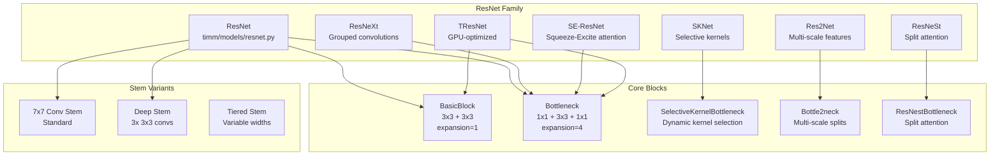

**Sources:** [timm/models/resnet.py:437-778](), [timm/models/sknet.py:1-270](), [timm/models/res2net.py:1-241](), [timm/models/resnest.py:1-279](), [timm/models/tresnet.py:1-447]()

**EfficientNet/MobileNet Family Architecture**
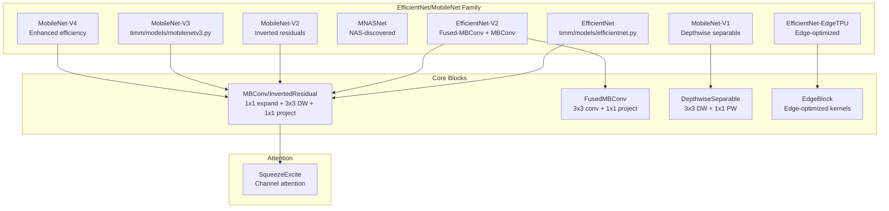

**Sources:** [timm/models/efficientnet.py:59-475](), [timm/models/mobilenetv3.py:29-507]()

---

## ResNet Family

### Core ResNet Architecture

The `ResNet` class in [timm/models/resnet.py:437-778]() implements the base architecture used across all ResNet variants. It supports extensive customization through stem types, downsample strategies, block types, and attention mechanisms.

**ResNet Class Structure**
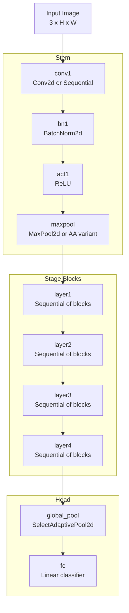

**Sources:** [timm/models/resnet.py:437-608]()

### Building Blocks

**BasicBlock Implementation**

The `BasicBlock` class [timm/models/resnet.py:34-152]() implements the basic residual block used in ResNet-18 and ResNet-34:

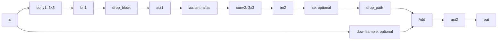

Key characteristics:
- **Expansion factor:** 1 (output channels = input channels)
- **Structure:** Two 3x3 convolutions with batch normalization
- **Optional components:** Anti-aliasing, Squeeze-Excite attention, DropBlock, DropPath

**Sources:** [timm/models/resnet.py:34-152]()

**Bottleneck Implementation**

The `Bottleneck` class [timm/models/resnet.py:154-272]() implements the bottleneck block used in deeper ResNets (ResNet-50, 101, 152):

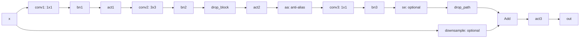

Key characteristics:
- **Expansion factor:** 4 (output channels = 4 × planes)
- **Structure:** 1x1 reduction → 3x3 convolution → 1x1 expansion
- **Grouped convolutions:** Support for ResNeXt via `cardinality` parameter
- **Width configuration:** `width = floor(planes * (base_width / 64)) * cardinality`

**Sources:** [timm/models/resnet.py:154-272]()

### Stem Variants

The ResNet implementation supports multiple stem configurations via the `stem_type` parameter:

| Stem Type | Description | Layers | First Conv |
|-----------|-------------|--------|------------|
| `''` (default) | Standard 7x7 stem | Single 7x7 conv, stride 2 | `conv1` |
| `'deep'` | Deep 3-layer stem | 3x 3x3 convs (32, 32, 64) | `conv1` Sequential |
| `'deep_tiered'` | Tiered deep stem | 3x 3x3 convs (24, 32, 64) | `conv1` Sequential |

The stem construction logic is in [timm/models/resnet.py:538-577]().

**Sources:** [timm/models/resnet.py:538-577]()

### Downsample Strategies

Two downsample functions provide flexibility for the residual path:

**`downsample_conv`** [timm/models/resnet.py:274-303]():
- Standard convolutional downsampling
- Uses 1x1 or 3x3 convolution based on stride/dilation

**`downsample_avg`** [timm/models/resnet.py:306-330]():
- Average pooling followed by 1x1 convolution
- Used in ResNet-D variants for improved accuracy
- Controlled by `avg_down=True` parameter

**Sources:** [timm/models/resnet.py:274-330]()

### Stage Construction

The `make_blocks` function [timm/models/resnet.py:348-434]() constructs the four stages (layer1-layer4) of the ResNet:

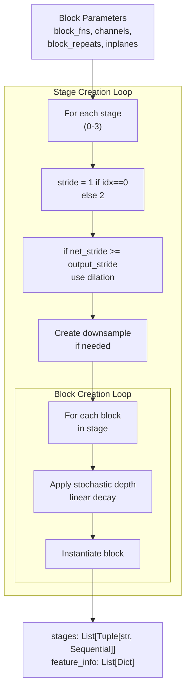

**Sources:** [timm/models/resnet.py:348-434]()

### ResNet Variants

**ResNeXt**

ResNeXt extends ResNet with grouped convolutions controlled by `cardinality` and `base_width` parameters:
- **cardinality**: Number of groups in 3x3 convolution
- **base_width**: Base width per group
- **Effective width**: `floor(planes * (base_width / 64)) * cardinality`

Example configurations:
- ResNeXt-50 32x4d: `cardinality=32, base_width=4`
- ResNeXt-101 32x8d: `cardinality=32, base_width=8`

**Sources:** [timm/models/resnet.py:202-203]()

**SE-ResNet/SE-ResNeXt**

Squeeze-Excite attention is integrated via the `attn_layer` parameter:
- Applied after the final convolution in each block
- Created using `create_attn(attn_layer, outplanes)` in [timm/models/resnet.py:115-116]() (BasicBlock) and [timm/models/resnet.py:231]() (Bottleneck)

**Sources:** [timm/models/resnet.py:115-116, 231]()

---

## Specialized ResNet Variants

### SKNet (Selective Kernel Networks)

SKNet [timm/models/sknet.py]() introduces selective kernel convolutions that dynamically adjust receptive fields through split-attend-merge:

**SelectiveKernelBottleneck Structure**
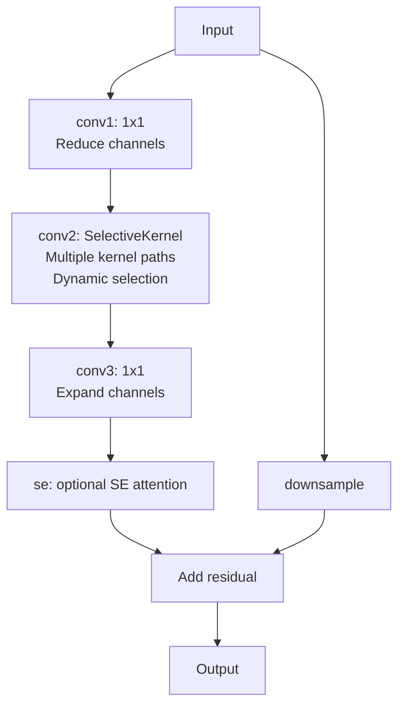

The `SelectiveKernel` layer replaces the standard 3x3 convolution with a mechanism that:
1. Splits into multiple kernel paths (typically 3x3 and 5x5)
2. Fuses information with channel attention
3. Selects or combines kernel paths adaptively

**Sources:** [timm/models/sknet.py:100-169]()

### Res2Net (Multi-Scale Backbone)

Res2Net [timm/models/res2net.py]() introduces hierarchical residual-like connections within a single residual block:

**Bottle2neck Structure**
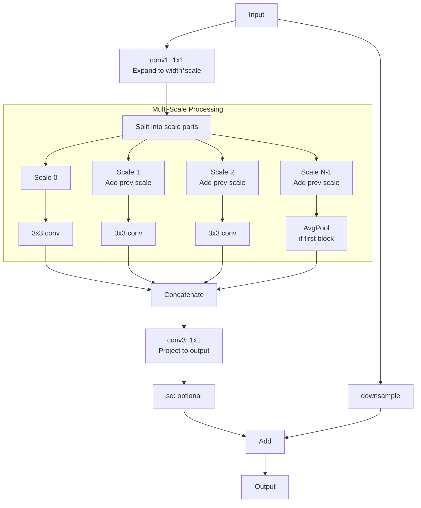

Key parameters:
- **scale**: Number of feature group splits (typically 4)
- **base_width**: Base width per cardinality group (typically 26)

The split features create a multi-scale hierarchy where each scale receives information from the previous scale, enabling efficient multi-scale feature representation.

**Sources:** [timm/models/res2net.py:19-128]()

### ResNeSt (Split-Attention Networks)

ResNeSt [timm/models/resnest.py]() uses split-attention blocks that apply attention across feature map groups:

**ResNestBottleneck Structure**
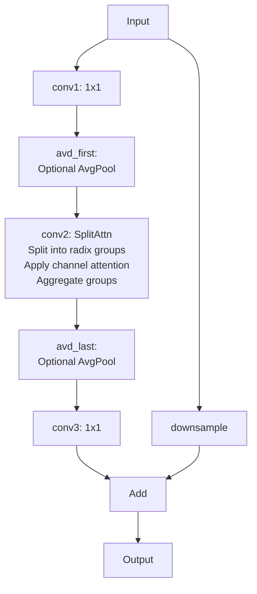

Key parameters:
- **radix**: Number of splits in split-attention (typically 2)
- **avd**: Apply average pooling for downsampling
- **avd_first**: Apply pooling before or after split-attention

**Sources:** [timm/models/resnest.py:20-143]()

### TResNet (GPU-Optimized Architecture)

TResNet [timm/models/tresnet.py]() optimizes ResNet for GPU training with:

1. **SpaceToDepth stem**: Replaces strided convolutions with space-to-depth transformation
2. **Anti-aliased downsampling**: Uses BlurPool2d for better shift-invariance
3. **SE modules**: Integrated squeeze-excite attention
4. **LeakyReLU activation**: Uses LeakyReLU instead of ReLU

**TResNet Structure**
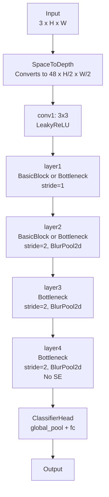

**Sources:** [timm/models/tresnet.py:131-350]()

---

## EfficientNet Family

### Core EfficientNet Architecture

The `EfficientNet` class [timm/models/efficientnet.py:59-350]() provides a flexible implementation supporting multiple efficient architectures through a unified builder system.

**EfficientNet Class Structure**
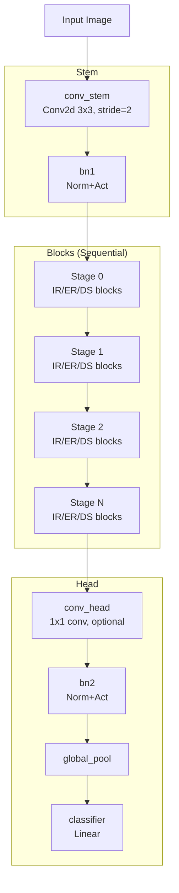

**Sources:** [timm/models/efficientnet.py:81-175]()

### MBConv (Inverted Residual Block)

The Mobile Inverted Bottleneck Convolution (MBConv) is the fundamental building block, implemented through the `EfficientNetBuilder` in [timm/models/_efficientnet_builder.py]():

**MBConv Block Structure**
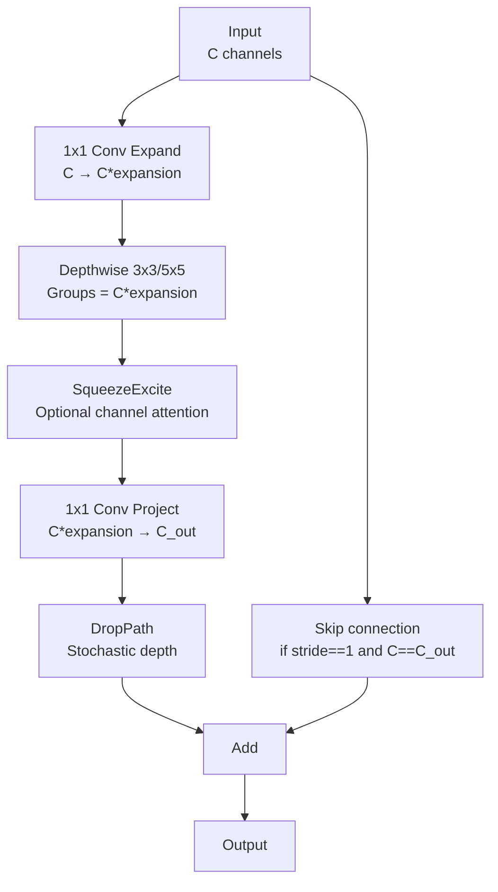

Block variants are specified through architecture definition strings:
- **`ir`**: Inverted Residual (MBConv)
- **`er`**: Edge Residual (no expansion if expansion=1)
- **`ds`**: Depthwise Separable
- **`dsa`**: Depthwise Separable with point-wise separable

**Sources:** [timm/models/efficientnet.py:141-155]()

### Architecture Definition System

EfficientNet models are defined through compact architecture definition strings parsed by `decode_arch_def`:

Example EfficientNet-B0 architecture [timm/models/efficientnet.py:743-751]():
```python
[
    ['ds_r1_k3_s1_e1_c16_se0.25'],          # Stage 0
    ['ir_r2_k3_s2_e6_c24_se0.25'],          # Stage 1
    ['ir_r2_k5_s2_e6_c40_se0.25'],          # Stage 2
    ['ir_r3_k3_s2_e6_c80_se0.25'],          # Stage 3
    ['ir_r3_k5_s1_e6_c112_se0.25'],         # Stage 4
    ['ir_r4_k5_s2_e6_c192_se0.25'],         # Stage 5
    ['ir_r1_k3_s1_e6_c320_se0.25'],         # Stage 6
]
```

String format breakdown:
- `ir`: Inverted Residual block
- `r2`: Repeat 2 times
- `k3`: Kernel size 3
- `s2`: Stride 2
- `e6`: Expansion ratio 6
- `c24`: Output channels 24
- `se0.25`: SE ratio 0.25

**Sources:** [timm/models/efficientnet.py:743-751]()

### EfficientNet Scaling

The EfficientNet family uses compound scaling controlled by `channel_multiplier` and `depth_multiplier`:

| Model | Channel Multiplier | Depth Multiplier | Resolution | Params |
|-------|-------------------|------------------|------------|--------|
| B0 | 1.0 | 1.0 | 224 | 5.3M |
| B1 | 1.0 | 1.1 | 240 | 7.8M |
| B2 | 1.1 | 1.2 | 260 | 9.2M |
| B3 | 1.2 | 1.4 | 300 | 12M |
| B4 | 1.4 | 1.8 | 380 | 19M |
| B5 | 1.6 | 2.2 | 456 | 30M |
| B6 | 1.8 | 2.6 | 528 | 43M |
| B7 | 2.0 | 3.1 | 600 | 66M |

Channels are rounded using `round_channels` with specified `channel_divisor` (typically 8).

**Sources:** [timm/models/efficientnet.py:716-763]()

### EfficientNet-V2

EfficientNet-V2 improves training efficiency by mixing Fused-MBConv and MBConv blocks. Fused-MBConv replaces the depthwise convolution with a standard 3x3 convolution in early stages for faster training.

Architecture definition examples are found in the `_gen_efficientnetv2_*` functions.

**Sources:** [timm/models/efficientnet.py]()

---

## MobileNet Family

### MobileNet-V3 Architecture

The `MobileNetV3` class [timm/models/mobilenetv3.py:29-344]() implements the MobileNet-V3 architecture with its distinctive "efficient head" design.

**MobileNetV3 vs EfficientNet Structure**
```mermaid
graph TB
    subgraph "MobileNetV3 Head (Efficient)"
        Blocks3["blocks<br/>Sequential MBConv"]
        GP3["global_pool<br/>Before conv_head"]
        CH3["conv_head<br/>1x1 conv"]
        Act3["act2<br/>Activation only"]
        Flat3["flatten"]
        Class3["classifier<br/>Linear"]
    end
    
    subgraph "EfficientNet Head (Standard)"
        Blocks["blocks<br/>Sequential MBConv"]
        CH["conv_head<br/>1x1 conv"]
        BN["bn2<br/>Norm + Act"]
        GP["global_pool<br/>After bn2"]
        Class["classifier<br/>Linear"]
    end
    
    Blocks3 --> GP3
    GP3 --> CH3
    CH3 --> Act3
    Act3 --> Flat3
    Flat3 --> Class3
    
    Blocks --> CH
    CH --> BN
    BN --> GP
    GP --> Class
```

Key differences:
1. **Global pooling before head conv**: Reduces parameters
2. **No batch norm after head conv**: Simpler design
3. **Optional head norm**: MobileNet-V4 adds norm after head conv via `head_norm=True`

**Sources:** [timm/models/mobilenetv3.py:128-156]()

### MobileNet-V1 and V2 Generators

The library includes generators for MobileNet-V1 and V2 architectures:

**MobileNet-V1** [timm/models/efficientnet.py:578-611]():
- Uses depthwise separable convolutions (`dsa` blocks)
- Simpler than V2, no inverted residuals
- Optional head convolution with `head_conv=True`

**MobileNet-V2** [timm/models/efficientnet.py:614-648]():
- Uses inverted residual blocks (`ir` blocks)
- Linear bottleneck (no activation after final 1x1 projection)
- Fixed 1280-dimensional head features

**Sources:** [timm/models/efficientnet.py:578-648](), [timm/models/mobilenetv3.py:509-552]()

### MobileNet Architecture Variants

**MobileNet-V3 Small vs Large**

The architecture is selected based on the variant name [timm/models/mobilenetv3.py:579-651]():

```python
if 'small' in variant:
    num_features = 1024
    # Fewer stages, smaller expansion ratios
else:
    num_features = 1280
    # More stages, larger expansion ratios
```

**Minimal Variants**

Minimal variants use ReLU instead of Hard-Swish for activation, reducing complexity:
- `mobilenetv3_small_minimal`: Uses ReLU throughout
- `mobilenetv3_large_minimal`: Uses ReLU throughout

**Sources:** [timm/models/mobilenetv3.py:579-651]()

---

## Shared Components and Features

### Attention Mechanisms

**Squeeze-Excite (SE)**

The `SqueezeExcite` layer provides channel attention:
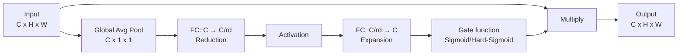

SE is integrated via the `create_attn` helper:
- ResNet: [timm/models/resnet.py:115, 231]()
- EfficientNet: Configured through architecture definition with `se` parameter

**Sources:** [timm/models/resnet.py:115, 231](), [timm/models/efficientnet.py:49]()

**Split Attention (ResNeSt)**

The `SplitAttn` layer in ResNeSt [timm/layers/split_attn.py]() applies attention across feature map splits:
1. Split input into `radix` groups
2. Apply group-wise convolutions
3. Compute split attention weights
4. Aggregate weighted splits

**Sources:** [timm/models/resnest.py:71-83]()

### Stochastic Depth (Drop Path)

Stochastic depth is implemented via `DropPath` and applied with linear decay:

```python
# In make_blocks for ResNet
block_dpr = drop_path_rate * net_block_idx / (net_num_blocks - 1)
drop_path = DropPath(block_dpr) if block_dpr > 0. else None
```

This improves regularization in deeper networks by randomly dropping residual paths during training.

**Sources:** [timm/models/resnet.py:416-423]()

### Feature Extraction Support

All convolutional models support intermediate feature extraction through:

**`forward_intermediates` method:**
- Returns features at specified stages
- Configurable via `indices` parameter
- Optional `stop_early` for efficiency

**`prune_intermediate_layers` method:**
- Removes unused layers after last required feature
- Optimizes model for feature extraction only

**`feature_info` attribute:**
- List of dicts with `num_chs`, `reduction`, `module` for each stage
- Used by feature pyramid networks and object detection frameworks

**Sources:** [timm/models/resnet.py:668-741](), [timm/models/efficientnet.py:227-316]()

### Model Creation and Registration

All models follow a consistent creation pattern:

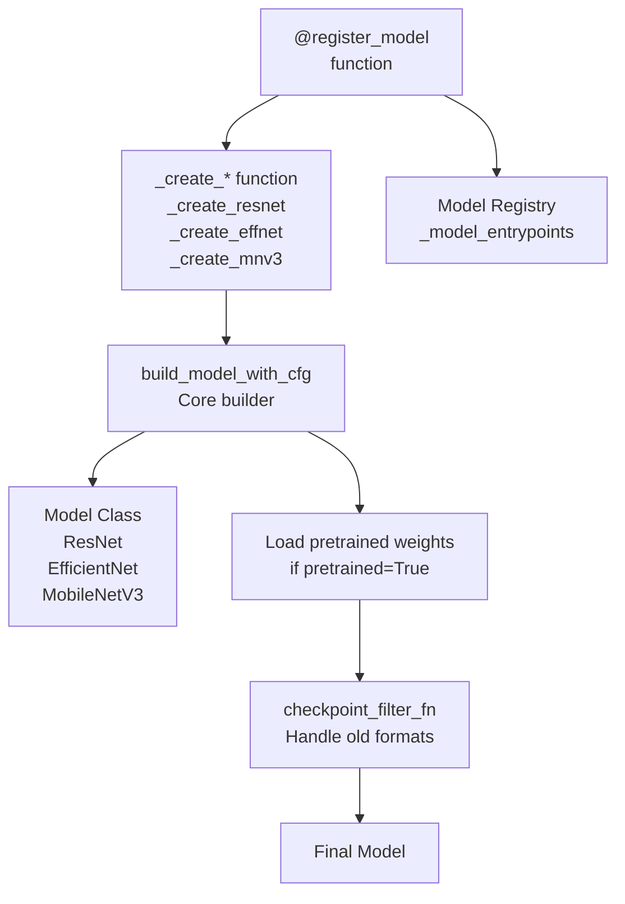

Example pattern from ResNet [timm/models/resnet.py:780-791]():
```python
def _create_resnet(variant: str, pretrained: bool = False, **kwargs) -> ResNet:
    return build_model_with_cfg(ResNet, variant, pretrained, **kwargs)

@register_model
def resnet50(pretrained=False, **kwargs) -> ResNet:
    model_args = dict(block=Bottleneck, layers=[3, 4, 6, 3])
    return _create_resnet('resnet50', pretrained, **dict(model_args, **kwargs))
```

**Sources:** [timm/models/resnet.py:780-791](), [timm/models/efficientnet.py:450-474](), [timm/models/mobilenetv3.py:473-506]()

---

## Model Variants Summary

### ResNet Family Variants

| Architecture | Key Feature | Block Type | Example Models |
|--------------|-------------|------------|----------------|
| ResNet | Residual connections | BasicBlock, Bottleneck | resnet18, resnet50, resnet101 |
| ResNeXt | Grouped convolutions | Bottleneck | resnext50_32x4d, resnext101_32x8d |
| SE-ResNet | Squeeze-Excite | Bottleneck + SE | seresnet50, seresnet101 |
| ResNet-D | Deep stem, avg downsample | Bottleneck | resnet50d, resnet101d |
| SKNet | Selective kernels | SelectiveKernelBottleneck | skresnet50, skresnext50_32x4d |
| Res2Net | Multi-scale features | Bottle2neck | res2net50, res2net101 |
| ResNeSt | Split attention | ResNestBottleneck | resnest50d, resnest101e |
| TResNet | GPU-optimized | BasicBlock/Bottleneck + S2D | tresnet_m, tresnet_l |

**Sources:** [timm/models/resnet.py](), [timm/models/sknet.py](), [timm/models/res2net.py](), [timm/models/resnest.py](), [timm/models/tresnet.py]()

### EfficientNet/MobileNet Variants

| Architecture | Key Feature | Scaling | Example Models |
|--------------|-------------|---------|----------------|
| EfficientNet | Compound scaling | Width + Depth + Resolution | efficientnet_b0 through b8 |
| EfficientNet-V2 | Fused-MBConv, faster training | Progressive training | efficientnetv2_s, m, l |
| EfficientNet-EdgeTPU | Edge optimization | Optimized for TPU | efficientnet_edge_s, m, l |
| MobileNet-V2 | Inverted residuals | Width multiplier | mobilenetv2_100, mobilenetv2_140 |
| MobileNet-V3 | Efficient head, NAS | Width multiplier | mobilenetv3_small, large |
| MNASNet | NAS-discovered | Width multiplier | mnasnet_a1, mnasnet_b1 |
| FBNet | Differentiable NAS | Width multiplier | fbnetc_100 |
| HardCoreNAS | Hardware-aware NAS | Multiple variants | hardcorenas_a through f |

**Sources:** [timm/models/efficientnet.py](), [timm/models/mobilenetv3.py](), [timm/models/hardcorenas.py]()

---

