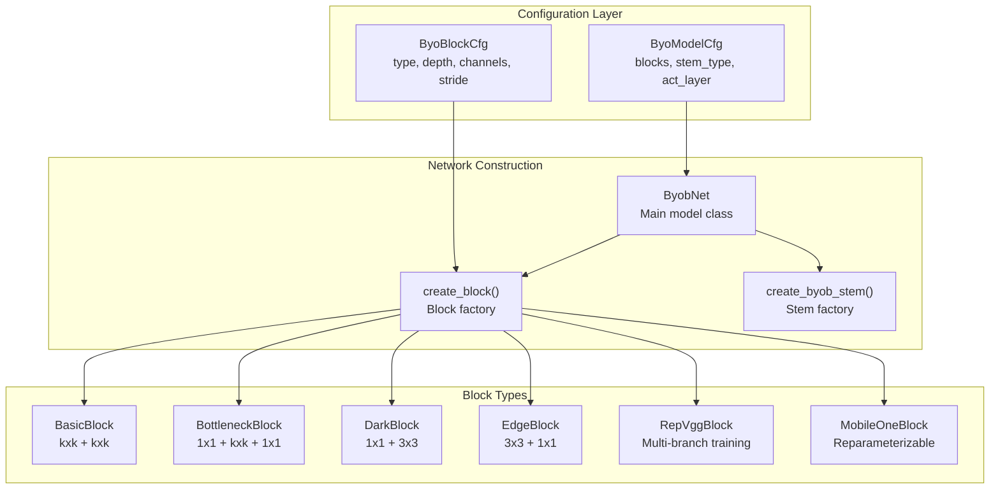
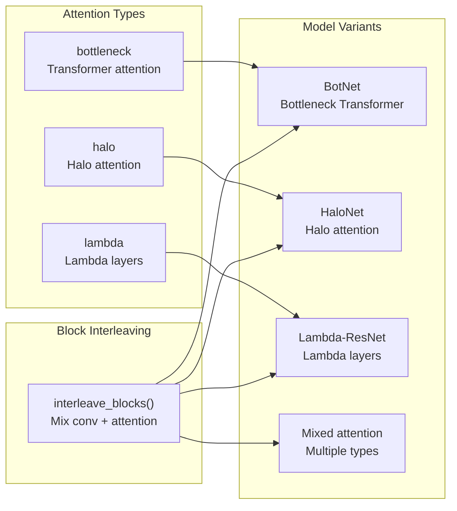
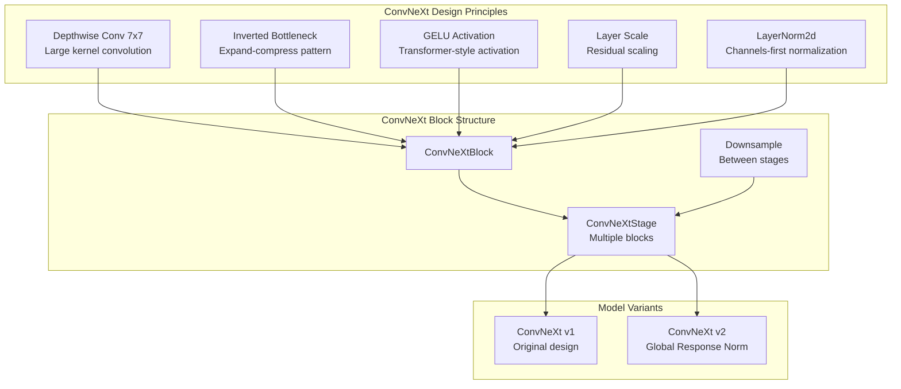
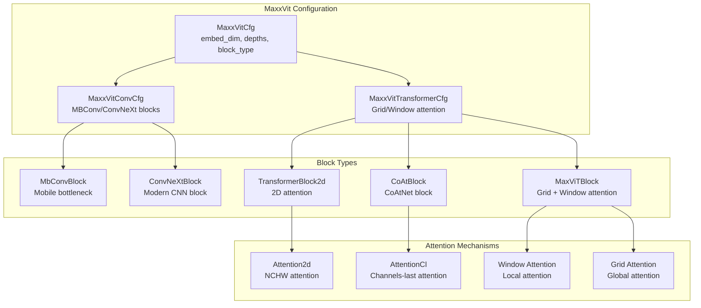
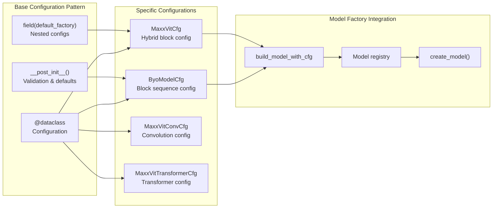
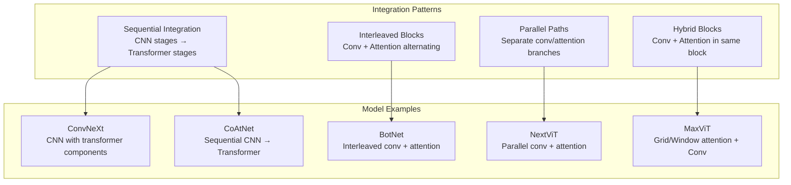
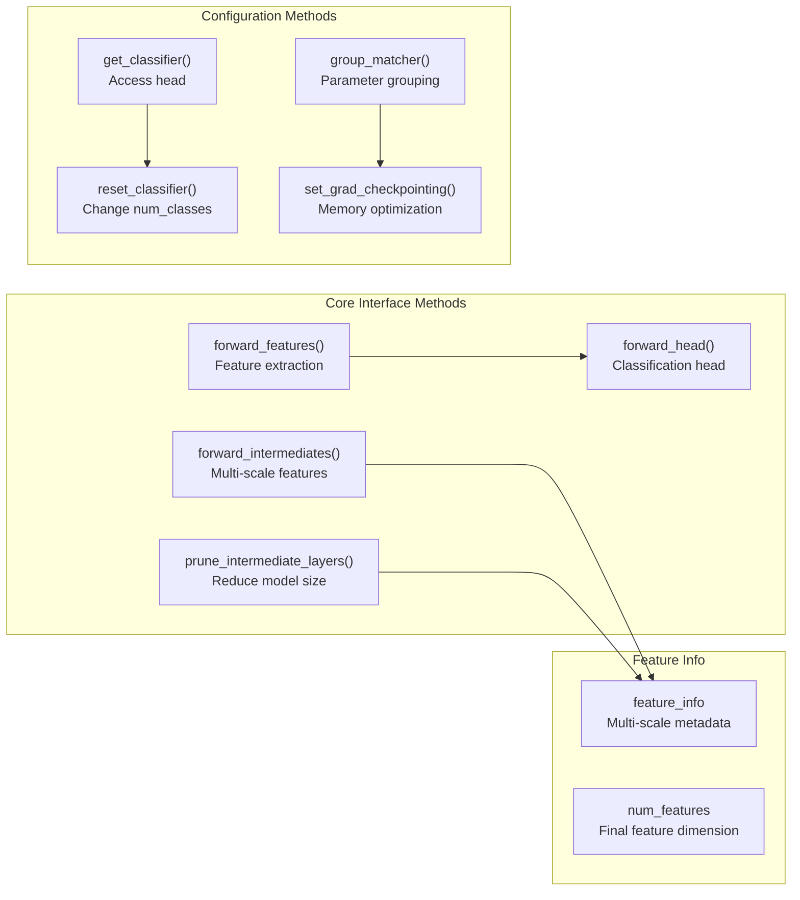
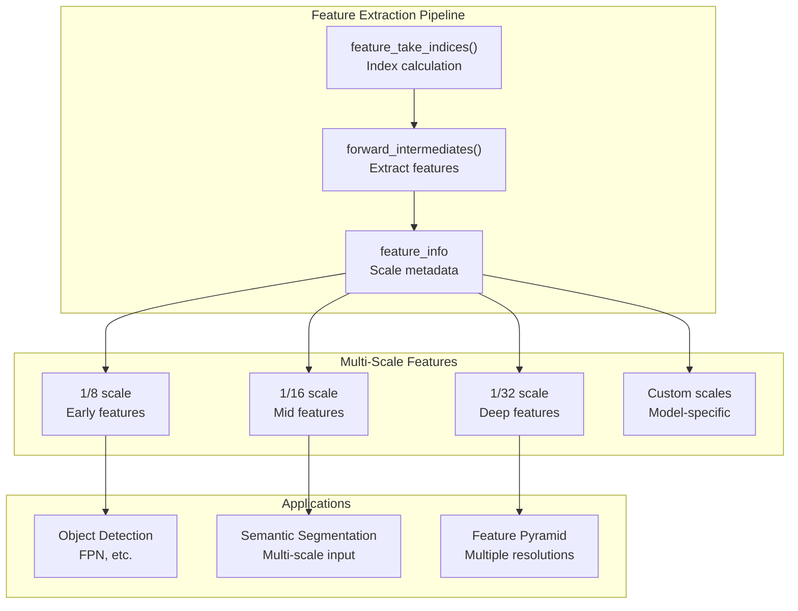

<!-- source: DeepWiki mcp.deepwiki.com · repo huggingface/pytorch-image-models · page 3.3 Configurable and Hybrid Models · fetched 2026-10-26 -->

# Configurable and Hybrid Models

Relevant source files

The following files were used as context for generating this wiki page:

- [timm/models/byobnet.py](timm/models/byobnet.py)
- [timm/models/cspnet.py](timm/models/cspnet.py)
- [timm/models/davit.py](timm/models/davit.py)
- [timm/models/edgenext.py](timm/models/edgenext.py)
- [timm/models/efficientvit_mit.py](timm/models/efficientvit_mit.py)
- [timm/models/efficientvit_msra.py](timm/models/efficientvit_msra.py)
- [timm/models/nfnet.py](timm/models/nfnet.py)
- [timm/models/resnetv2.py](timm/models/resnetv2.py)
- [timm/models/tiny_vit.py](timm/models/tiny_vit.py)
- [timm/models/vgg.py](timm/models/vgg.py)

This document covers timm's configurable architecture frameworks and hybrid CNN-Transformer models. These systems enable flexible model construction through dataclass-based configurations and seamlessly combine convolutional and transformer components in unified architectures.

For pure transformer architectures, see [Vision Transformers](#3.1). For traditional CNN architectures, see [Convolutional Networks](#3.2). For specialized emerging architectures, see [Specialized Architectures](#3.4).

## Overview

The configurable and hybrid model systems in timm serve two primary purposes:

1. **Configurable Architectures**: Framework-based models like `ByobNet` that use dataclass configurations to define arbitrary block stacking patterns
2. **Hybrid Models**: Architectures that combine CNN and Transformer components, such as `ConvNeXt`, `MaxxVit`, and `CoAtNet`

These models demonstrate timm's flexibility in supporting both configuration-driven model construction and novel architectural innovations that bridge different computational paradigms.

## Configurable Architecture Framework

### ByobNet System

The Bring-Your-Own-Blocks Network (`ByobNet`) provides a flexible framework for constructing networks with arbitrary block configurations using dataclass-based specifications.

The system uses two primary dataclasses for configuration:

**Sources**: [timm/models/byobnet.py:53-106]()

### ByoANet Extension

The Bring-Your-Own-Attention Network (`ByoANet`) extends `ByobNet` with self-attention mechanisms, enabling hybrid attention-convolution architectures.

**Sources**: [timm/models/byoanet.py:25-262]()

## Hybrid CNN-Transformer Models

### ConvNeXt Architecture

ConvNeXt modernizes CNN design by incorporating transformer-inspired components while maintaining convolutional structure.

**Sources**: [timm/models/convnext.py:91-178](), [timm/models/convnext.py:298-439]()

### MaxxVit Hybrid Framework

MaxxVit implements a flexible framework for combining convolutional and transformer blocks with sophisticated configuration systems.

**Sources**: [timm/models/maxxvit.py:61-144](), [timm/models/maxxvit.py:146-307]()

## Configuration System Architecture

### Dataclass-Based Configuration

The hybrid and configurable models use sophisticated dataclass systems for defining architecture parameters.

**Sources**: [timm/models/byobnet.py:74-106](), [timm/models/maxxvit.py:132-144]()

### Block Factory System

The configurable models implement factory patterns for creating blocks based on string identifiers and configuration parameters.

| Block Factory Function | Purpose | Supported Block Types |
|------------------------|---------|----------------------|
| `create_block()` | ByobNet block creation | `basic`, `bottle`, `dark`, `edge`, `rep`, `one` |
| `create_byob_stem()` | Stem creation | `3x3`, `7x7`, `deep`, `overlap` |
| `_get_block_type()` | RDNet block selection | `Block`, `BlockESE` |
| Various stage builders | Stage-level construction | Architecture-specific |

**Sources**: [timm/models/byobnet.py:800-900](), [timm/models/rdnet.py:55-63]()

## Hybrid Model Patterns

### CNN-Transformer Integration Strategies

The hybrid models employ several strategies for combining convolutional and transformer components:

**Sources**: [timm/models/convnext.py:1-27](), [timm/models/maxxvit.py:1-35](), [timm/models/byoanet.py:164-203]()

### Attention Mechanisms in Hybrid Models

Different hybrid models implement various attention mechanisms optimized for visual tasks:

| Attention Type | Implementation | Models Using |
|---------------|----------------|--------------|
| Grid Attention | Global attention on grid patches | MaxViT, CoAtNet |
| Window Attention | Local attention within windows | MaxViT, Swin-style |
| Halo Attention | Attention with halo regions | HaloNet variants |
| Lambda Layers | Linear attention approximation | Lambda-ResNet |
| Bottleneck Attention | Standard transformer attention | BotNet variants |

**Sources**: [timm/models/maxxvit.py:227-307](), [timm/models/byoanet.py:88-162]()

## Common Interface Patterns

### Shared Model Interface

All configurable and hybrid models implement consistent interfaces for feature extraction and classification:

**Sources**: [timm/models/convnext.py:441-583](), [timm/models/maxxvit.py:1385-1550]()

### Feature Extraction Support

The hybrid and configurable models provide comprehensive feature extraction capabilities:

**Sources**: [timm/models/_features.py:1-50](), [timm/models/convnext.py:485-533]()

---

