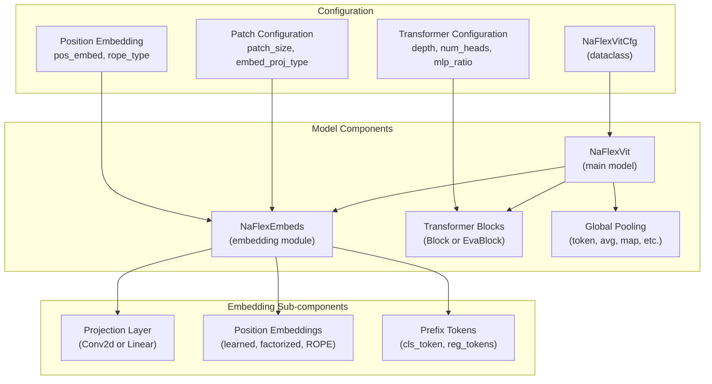
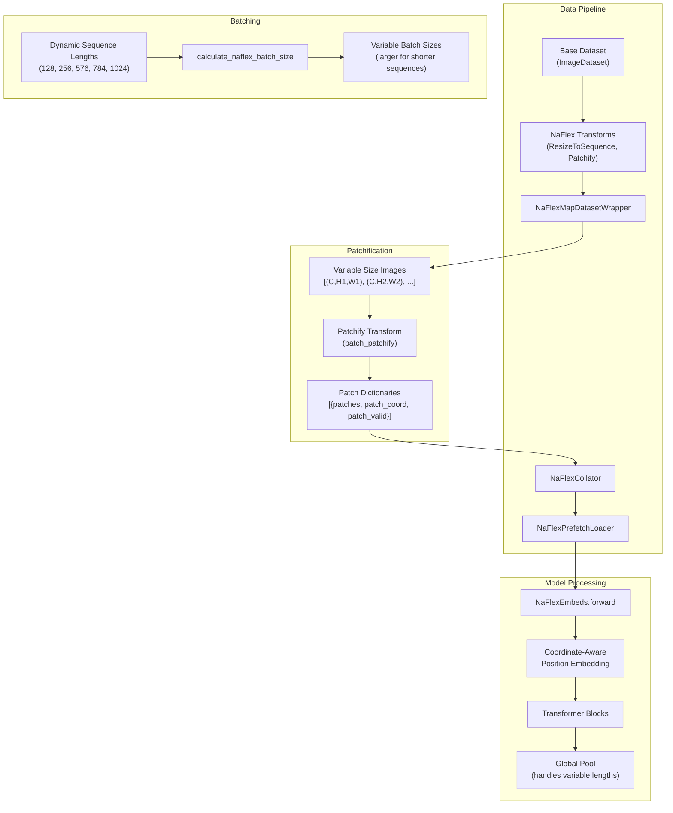
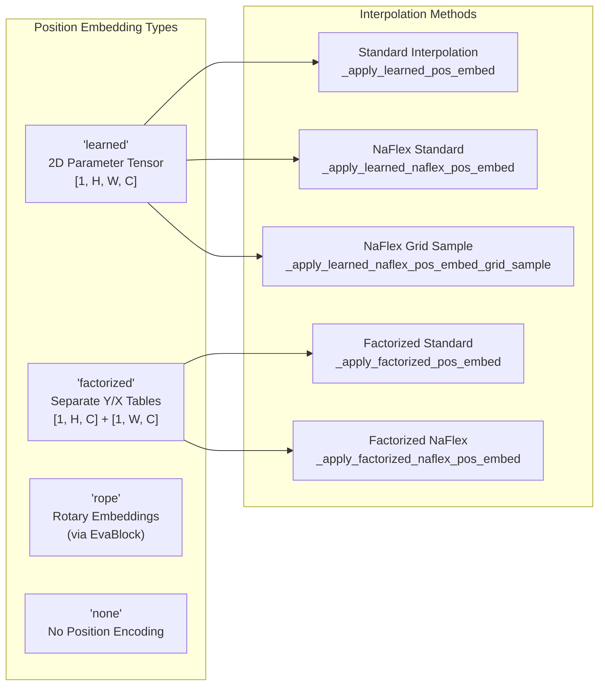
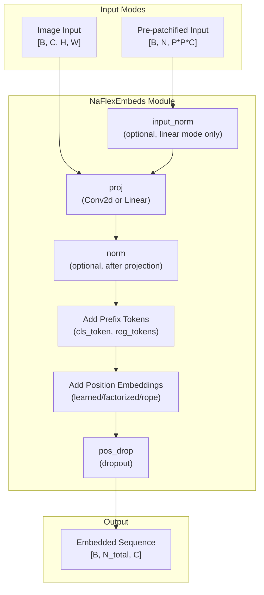
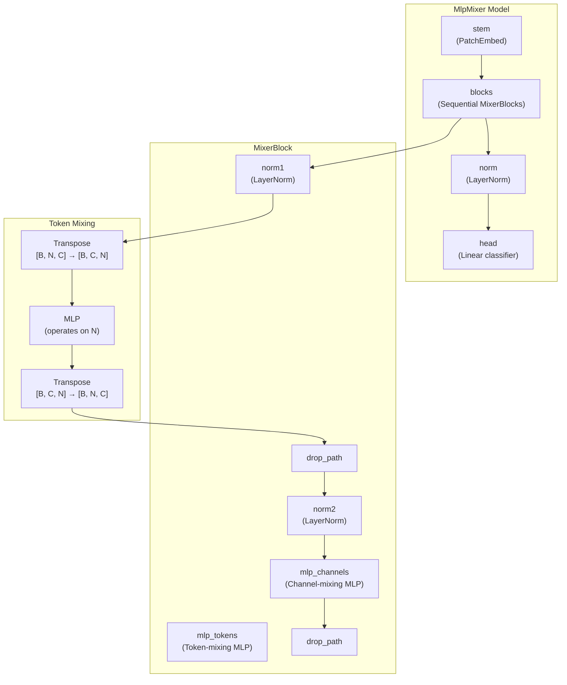
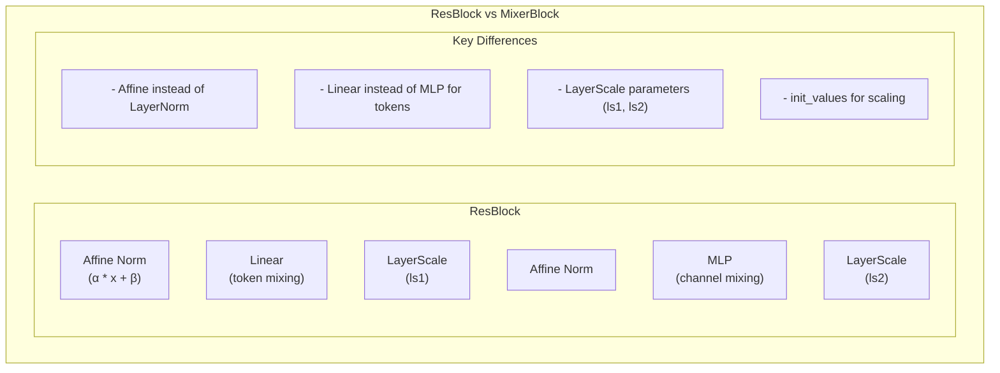
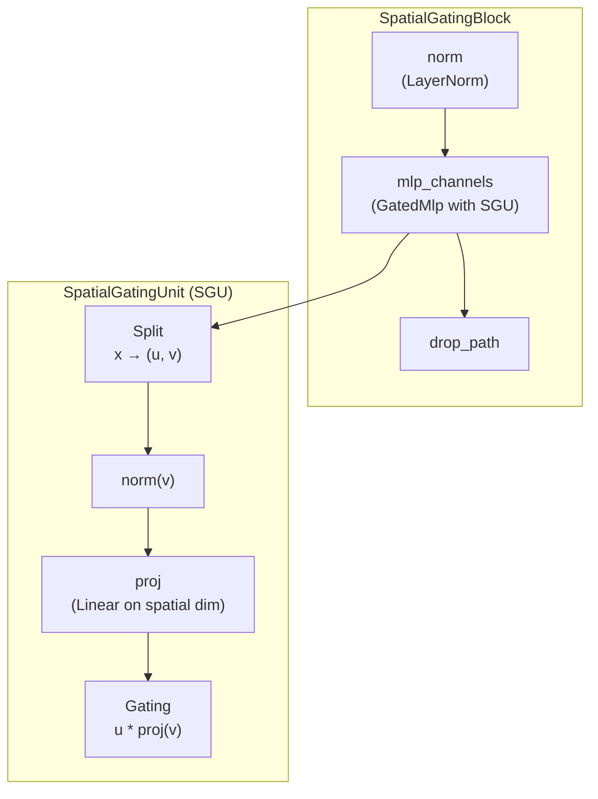
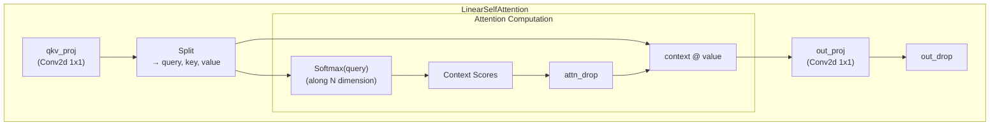

<!-- source: DeepWiki mcp.deepwiki.com · repo huggingface/pytorch-image-models · page 3.4 Specialized Architectures · fetched 2026-10-26 -->

# Specialized Architectures

<details>
<summary>Relevant source files</summary>

The following files were used as context for generating this wiki page:

- [avg_checkpoints.py](avg_checkpoints.py)
- [clean_checkpoint.py](clean_checkpoint.py)
- [distributed_train.sh](distributed_train.sh)
- [timm/data/__init__.py](timm/data/__init__.py)
- [timm/data/naflex_dataset.py](timm/data/naflex_dataset.py)
- [timm/data/naflex_loader.py](timm/data/naflex_loader.py)
- [timm/data/naflex_mixup.py](timm/data/naflex_mixup.py)
- [timm/data/naflex_random_erasing.py](timm/data/naflex_random_erasing.py)
- [timm/data/naflex_transforms.py](timm/data/naflex_transforms.py)
- [timm/layers/attention_pool.py](timm/layers/attention_pool.py)
- [timm/layers/diff_attention.py](timm/layers/diff_attention.py)
- [timm/layers/pool1d.py](timm/layers/pool1d.py)
- [timm/models/_builder.py](timm/models/_builder.py)
- [timm/models/_factory.py](timm/models/_factory.py)
- [timm/models/_helpers.py](timm/models/_helpers.py)
- [timm/models/_hub.py](timm/models/_hub.py)
- [timm/models/_manipulate.py](timm/models/_manipulate.py)
- [timm/models/_pretrained.py](timm/models/_pretrained.py)
- [timm/models/_prune.py](timm/models/_prune.py)
- [timm/models/_registry.py](timm/models/_registry.py)
- [timm/models/mlp_mixer.py](timm/models/mlp_mixer.py)
- [timm/models/mobilevit.py](timm/models/mobilevit.py)
- [timm/models/naflexvit.py](timm/models/naflexvit.py)

</details>


This page documents specialized model architectures designed for specific use cases or constraints. These architectures differ from standard Vision Transformers (see [3.1](#3.1)) and ConvNets (see [3.2](#3.2)) by introducing novel mechanisms to handle unique requirements such as variable resolution training, all-MLP processing, or mobile deployment.

The specialized architectures covered here include:
- **NaFlexVit**: Variable resolution and aspect ratio training for Vision Transformers
- **MLP-Mixer**: All-MLP architectures without convolution or attention
- **MobileViT**: Lightweight hybrid architectures combining convolution and transformers for mobile devices

For flexible/configurable architectures like BYOB and NFNet, see [3.3](#3.3).

---

## NaFlexVit Architecture

**NaFlexVit** (Native-resolution Flexible Vision Transformer) combines ideas from NaViT, FlexiViT, and SigLip-2 to enable efficient variable-resolution training of Vision Transformers. Unlike standard ViT models that require fixed input sizes, NaFlexVit can process images of varying resolutions and aspect ratios within the same batch.

### Core Architecture Components

The NaFlexVit architecture is configured through the `NaFlexVitCfg` dataclass and implemented in the `NaFlexVit` model class.



**Sources:** [timm/models/naflexvit.py:58-145](), [timm/models/naflexvit.py:306-494](), [timm/models/naflexvit.py:815-1020]()

The `NaFlexVitCfg` dataclass contains over 40 configuration parameters organized into logical groups:

| Configuration Group | Key Parameters | Purpose |
|---------------------|----------------|---------|
| Architecture | `patch_size`, `embed_dim`, `depth`, `num_heads` | Basic transformer dimensions |
| Attention | `qkv_bias`, `qk_norm`, `attn_drop_rate` | Attention mechanism configuration |
| Position Embedding | `pos_embed`, `pos_embed_grid_size`, `rope_type` | Position encoding strategy |
| Regularization | `drop_rate`, `drop_path_rate`, `patch_drop_rate` | Dropout and stochastic depth |
| Embedding | `embed_proj_type`, `input_norm_layer`, `embed_norm_layer` | Patch embedding configuration |
| NaFlex Features | `dynamic_img_pad`, `enable_patch_interpolator` | Variable resolution support |

**Sources:** [timm/models/naflexvit.py:58-145]()

### Variable Resolution Support

NaFlexVit's variable resolution capability is implemented through specialized data pipeline components and coordinate-aware processing:



**Sources:** [timm/data/naflex_dataset.py:30-71](), [timm/data/naflex_transforms.py:158-187](), [timm/data/naflex_loader.py:191-271]()

The NaFlex data pipeline handles variable resolutions through several key mechanisms:

1. **Sequence Length Constraint**: `ResizeToSequence` transform resizes images to fit a maximum sequence length while maintaining aspect ratio
2. **Patchification**: `Patchify` transform converts images to patches with coordinate information
3. **Dynamic Batching**: Batch size adjusts based on sequence length to maintain constant token count per batch
4. **Coordinate Tracking**: Each patch carries `(y, x)` grid coordinates for position embedding interpolation

**Sources:** [timm/data/naflex_transforms.py:126-190](), [timm/data/naflex_dataset.py:73-152]()

### Position Embedding Strategies

NaFlexVit supports four position embedding strategies, configurable via the `pos_embed` parameter:



**Sources:** [timm/models/naflexvit.py:470-491](), [timm/models/naflexvit.py:536-783]()

Each strategy handles resolution changes differently:

| Strategy | Storage | Interpolation | NaFlex Support | Benefits |
|----------|---------|---------------|----------------|----------|
| Learned | `[1, H, W, C]` | 2D bicubic | ✓ (per-sample grid) | Standard, proven approach |
| Factorized | `[1, H, C] + [1, W, C]` | 1D linear (per axis) | ✓ (per-sample grid) | Memory efficient, faster |
| ROPE | Computed on-the-fly | N/A | ✓ (via iterator) | No learned parameters |
| None | N/A | N/A | ✓ | Fastest, for datasets with structure |

The NaFlex-specific interpolation methods (`_apply_*_naflex_*`) handle batches where each sample has a different grid size:

```python
# Example: Each sample in batch has different resolution
# Sample 0: 14x14 grid (196 patches)
# Sample 1: 16x24 grid (384 patches)
# Sample 2: 20x20 grid (400 patches)
# Position embeddings are interpolated per-sample based on patch_coord
```

**Sources:** [timm/models/naflexvit.py:536-639](), [timm/models/naflexvit.py:675-784]()

### Embedding Module Architecture

The `NaFlexEmbeds` module encapsulates the complete embedding pipeline:



**Sources:** [timm/models/naflexvit.py:306-494](), [timm/models/naflexvit.py:1179-1290]()

The `NaFlexEmbeds.forward` method handles three input formats:

1. **Standard Image Batch**: `[B, C, H, W]` tensors with uniform sizes
2. **NaFlex Patchified**: Pre-patchified with `patches` and `patch_coord` keys
3. **Variable Patch Size**: Support via `PatchEmbedInterpolator` when enabled

**Sources:** [timm/models/naflexvit.py:1179-1290]()

### Model Registration and Variants

NaFlexVit provides numerous model configurations registered through factory functions:

```python
# Key model families:
# - naflexvit_base: Base configurations (patch16_224, patch14_518, etc.)
# - naflexvit_large: Large configurations
# - naflexvit_huge: Huge configurations  
# - naflexvit_giant: Giant configurations (e.g., g14_518)
# 
# Special variants:
# - *_factorized: Use factorized position embeddings
# - *_rope: Use rotary position embeddings
# - *.siglip2_*: SigLip-2 pretrained weights
```

**Sources:** [timm/models/naflexvit.py:1624-1847]()

---

## MLP-Mixer Architecture

**MLP-Mixer** is an all-MLP architecture for vision that replaces attention mechanisms with token-mixing and channel-mixing MLPs. It demonstrates that convolution and attention are not strictly necessary for strong performance on vision tasks.

### MLP-Mixer Core Components



**Sources:** [timm/models/mlp_mixer.py:59-102](), [timm/models/mlp_mixer.py:265-349]()

The `MixerBlock` implements two sequential MLP operations:

| Operation | Input Shape | MLP Input Dim | Purpose |
|-----------|-------------|---------------|---------|
| Token Mixing | `[B, N, C]` | `N` (sequence length) | Mix information across spatial locations |
| Channel Mixing | `[B, N, C]` | `C` (channels) | Mix information across channels |

**Key insight**: Token mixing operates on transposed tensors `[B, C, N]` so the MLP processes the spatial dimension. This allows patches to communicate with each other.

**Sources:** [timm/models/mlp_mixer.py:98-102]()

### ResMLP Variant

**ResMLP** is a residual variant of MLP-Mixer with layer-scale initialization and simpler normalization:



**Sources:** [timm/models/mlp_mixer.py:124-172]()

ResMLP replaces standard LayerNorm with simpler `Affine` transformations and introduces learnable layer-scale parameters initialized to small values (default `1e-4`):

```python
# LayerScale in ResBlock:
x = x + self.drop_path(self.ls1 * self.linear_tokens(...))
x = x + self.drop_path(self.ls2 * self.mlp_channels(...))
```

**Sources:** [timm/models/mlp_mixer.py:167-170]()

### gMLP Variant

**gMLP** (Gated MLP) adds spatial gating to the channel mixing MLP:



**Sources:** [timm/models/mlp_mixer.py:174-212](), [timm/models/mlp_mixer.py:214-263]()

The `SpatialGatingUnit` splits the channel dimension and uses one half to gate the other:

```python
# Inside SpatialGatingUnit:
u, v = x.chunk(2, dim=-1)  # Split channels
v = self.norm(v)
v = self.proj(v.transpose(-1, -2))  # Project along spatial dimension
return u * v.transpose(-1, -2)  # Element-wise gating
```

**Sources:** [timm/models/mlp_mixer.py:206-211]()

### Model Variants and Configurations

MLP-Mixer supports multiple model scales and training recipes:

| Model Family | Patch Size | Blocks | Embed Dim | Token/Channel Ratio |
|--------------|------------|--------|-----------|---------------------|
| Mixer-S | 16 or 32 | 8 | 512 | (0.5, 4.0) |
| Mixer-B | 16 or 32 | 12 | 768 | (0.5, 4.0) |
| Mixer-L | 16 or 32 | 24 | 1024 | (0.5, 4.0) |
| ResMLP-12 | 16 | 12 | 384 | 4.0 (channel only) |
| ResMLP-24 | 16 | 24 | 384 | 4.0 (channel only) |
| ResMLP-36 | 16 | 36 | 384 | 4.0 (channel only) |
| gMLP-S | 16 | 30 | 512 | 6.0 (channel only) |
| gMLP-B | 16 | 30 | 512 | 6.0 (channel only) |

**Sources:** [timm/models/mlp_mixer.py:700-850]()

---

## MobileViT Architecture

**MobileViT** is a lightweight hybrid architecture that combines the efficiency of MobileNetV2-style inverted residuals with the modeling power of transformers. It is designed for mobile and edge devices.

### MobileViT Block Structure

```mermaid
graph TB
    subgraph "MobileVitBlock"
        ConvKxK["conv_kxk<br/>(depthwise conv)"]
        Conv1x1["conv_1x1<br/>(expand to transformer_dim)"]
        
        subgraph "Unfold"
            Interpolate["Interpolate<br/>(if needed for patch alignment)"]
            Reshape["Reshape<br/>[B,C,H,W] → [B*P,N,C]"]
        end
        
        Transformer["transformer<br/>(TransformerBlock stack)"]
        NormT["norm<br/>(LayerNorm)"]
        
        subgraph "Fold"
            Reshape2["Reshape<br/>[B*P,N,C] → [B,C,H,W]"]
            InterpolateBack["Interpolate back<br/>(if needed)"]
        end
        
        ConvProj["conv_proj<br/>(project back)"]
        ConvFusion["conv_fusion<br/>(fuse with shortcut)"]
    end
    
    ConvKxK --> Conv1x1
    Conv1x1 --> Interpolate
    Interpolate --> Reshape
    Reshape --> Transformer
    Transformer --> NormT
    NormT --> Reshape2
    Reshape2 --> InterpolateBack
    InterpolateBack --> ConvProj
    ConvProj --> ConvFusion
```



**Sources:** [timm/models/mobilevit.py:165-279]()

The `MobileVitBlock` operates in three stages:

1. **Local Representation** (`conv_kxk`, `conv_1x1`): Depthwise convolution followed by 1x1 expansion
2. **Global Representation** (unfold → transformer → fold): Reshape to patches, apply transformer, reshape back
3. **Fusion** (`conv_proj`, `conv_fusion`): Project and optionally fuse with shortcut

**Key mechanism**: The unfold operation converts `[B, C, H, W]` into `[B*P, N, C]` where `P = patch_h * patch_w` is the patch area and `N = num_patches_h * num_patches_w` is the number of patches. This allows transformers to process patch tokens from the same spatial location across all channels.

**Sources:** [timm/models/mobilevit.py:238-279]()

### MobileViTv2 Improvements

**MobileViTv2** replaces standard multi-head self-attention with linear self-attention for improved efficiency:



**Sources:** [timm/models/mobilevit.py:281-380]()

The `LinearSelfAttention` module reduces complexity from O(N²) to O(N) by:

1. Computing attention scores only on the query dimension (1 channel instead of embedding dimension)
2. Using point-wise convolutions instead of linear layers to avoid transpose operations
3. Applying softmax along the spatial dimension rather than computing full pairwise attention

**Sources:** [timm/models/mobilevit.py:331-375]()

### Model Configurations

MobileViT provides several scale configurations optimized for different deployment scenarios:

| Model | Stem Channels | Block Configs | Transformer Depths | Parameters |
|-------|---------------|---------------|-------------------|------------|
| mobilevit_xxs | 16 | [16, 24, 48, 64, 80] | [2, 4, 3] | Smallest |
| mobilevit_xs | 16 | [32, 48, 64, 80, 96] | [2, 4, 3] | Extra Small |
| mobilevit_s | 16 | [32, 64, 96, 128, 160] | [2, 4, 3] | Small |
| mobilevitv2_050 | 32×0.5 | [64, 128, 256, 384, 512]×0.5 | [2, 4, 3] | MobileViTv2 0.5x |
| mobilevitv2_100 | 32 | [64, 128, 256, 384, 512] | [2, 4, 3] | MobileViTv2 1.0x |
| mobilevitv2_150 | 32×1.5 | [64, 128, 256, 384, 512]×1.5 | [2, 4, 3] | MobileViTv2 1.5x |

**Sources:** [timm/models/mobilevit.py:67-161]()

The configuration uses `ByoModelCfg` from the BYOB (Build Your Own Block) system to define model architecture:

```python
# Example MobileViT configuration pattern:
blocks=(
    _inverted_residual_block(d=1, c=32, s=1),      # Stage 1
    _inverted_residual_block(d=3, c=64, s=2),      # Stage 2
    _mobilevit_block(d=1, c=96, s=2, ...),         # Stage 3 (with transformer)
    _mobilevit_block(d=1, c=128, s=2, ...),        # Stage 4 (with transformer)
    _mobilevit_block(d=1, c=160, s=2, ...),        # Stage 5 (with transformer)
)
```

**Sources:** [timm/models/mobilevit.py:88-161]()

---

## Cross-Cutting Concerns

### Feature Extraction

All specialized architectures support feature extraction through the `forward_intermediates` method:

```python
# Extract intermediate features from any specialized architecture
features = model.forward_intermediates(
    x,
    indices=[2, 4, 6, 8],          # Which blocks to extract from
    norm=True,                      # Apply normalization
    output_fmt='NCHW',              # Format: 'NCHW' or 'NLC'
)
```

**Sources:** [timm/models/naflexvit.py:1455-1545](), [timm/models/mlp_mixer.py:405-461]()

### Gradient Checkpointing

Memory-efficient training is supported via `set_grad_checkpointing`:

```python
model.set_grad_checkpointing(enable=True)
```

This applies PyTorch's gradient checkpointing to transformer blocks, trading compute for memory during backpropagation.

**Sources:** [timm/models/naflexvit.py:1104-1108](), [timm/models/mlp_mixer.py:378-384]()

### Model Surgery and Adaptation

The specialized architectures support various model manipulation operations:

| Operation | Method | Purpose |
|-----------|--------|---------|
| Classifier Reset | `reset_classifier(num_classes, global_pool)` | Change output head |
| Intermediate Pruning | `prune_intermediate_layers(indices)` | Remove unnecessary layers |
| Parameter Grouping | `group_matcher(coarse)` | Layer-wise learning rates |
| Feature Configuration | `get_feature_info()` | Query feature map properties |

**Sources:** [timm/models/naflexvit.py:1110-1155](), [timm/models/mlp_mixer.py:363-404]()

---

## Usage Examples

### Creating a NaFlexVit Model

```python
import timm

# Standard configuration with pretrained weights
model = timm.create_model(
    'naflexvit_base_patch16_224.siglip2_so400m_384',
    pretrained=True,
    img_size=384,  # Can override default
)

# Custom NaFlex configuration
model = timm.create_model(
    'naflexvit_base_patch16_224',
    pretrained=False,
    img_size=224,
    pos_embed='factorized',        # Use factorized position embeddings
    dynamic_img_pad=True,           # Enable dynamic padding
    patch_drop_rate=0.1,            # Patch dropout rate
)
```

**Sources:** [timm/models/_factory.py:44-149](), [timm/models/naflexvit.py:1624-1847]()

### Creating an MLP-Mixer Model

```python
# Standard Mixer-B/16 configuration
model = timm.create_model(
    'mixer_b16_224.goog_in21k_ft_in1k',
    pretrained=True,
)

# ResMLP variant
model = timm.create_model(
    'resmlp_24_224.fb_in1k',
    pretrained=True,
)

# gMLP variant
model = timm.create_model(
    'gmlp_s16_224.ra3_in1k',
    pretrained=True,
)
```

**Sources:** [timm/models/mlp_mixer.py:700-850]()

### Creating a MobileViT Model

```python
# MobileViT-S
model = timm.create_model(
    'mobilevit_s',
    pretrained=False,
    num_classes=1000,
)

# MobileViTv2 with width multiplier
model = timm.create_model(
    'mobilevitv2_150',  # 1.5x width multiplier
    pretrained=False,
)
```

**Sources:** [timm/models/mobilevit.py:88-161]()

### Using NaFlex Data Loader

```python
from timm.data import create_naflex_loader

loader = create_naflex_loader(
    dataset,
    patch_size=16,
    train_seq_lens=(128, 256, 576, 784),  # Variable sequence lengths
    max_seq_len=576,                       # For validation
    batch_size=32,                         # Base batch size
    is_training=True,
    use_prefetcher=True,                   # GPU prefetching
    mixup_fn=mixup_fn,                     # Optional mixup
)

for input_dict, targets in loader:
    # input_dict contains:
    # - patches: [B, N, P*P*C] or [B, N, Ph, Pw, C]
    # - patch_coord: [B, N, 2] with (y, x) coordinates
    # - patch_valid: [B, N] validity mask
    outputs = model(input_dict)
```

**Sources:** [timm/data/naflex_loader.py:191-329]()

---

