<!-- source: DeepWiki mcp.deepwiki.com · repo huggingface/pytorch-image-models · page 3.5 Layer and Component Library · fetched 2026-10-26 -->

# Layer and Component Library

<details>
<summary>Relevant source files</summary>

The following files were used as context for generating this wiki page:

- [timm/layers/__init__.py](timm/layers/__init__.py)
- [timm/layers/attention.py](timm/layers/attention.py)
- [timm/layers/blur_pool.py](timm/layers/blur_pool.py)
- [timm/layers/mlp.py](timm/layers/mlp.py)
- [timm/layers/patch_embed.py](timm/layers/patch_embed.py)
- [timm/layers/pos_embed.py](timm/layers/pos_embed.py)
- [timm/layers/pos_embed_rel.py](timm/layers/pos_embed_rel.py)
- [timm/layers/pos_embed_sincos.py](timm/layers/pos_embed_sincos.py)
- [timm/models/convnext.py](timm/models/convnext.py)
- [timm/models/csatv2.py](timm/models/csatv2.py)
- [timm/models/efficientnet.py](timm/models/efficientnet.py)
- [timm/models/eva.py](timm/models/eva.py)
- [timm/models/fastvit.py](timm/models/fastvit.py)
- [timm/models/hardcorenas.py](timm/models/hardcorenas.py)
- [timm/models/mambaout.py](timm/models/mambaout.py)
- [timm/models/maxxvit.py](timm/models/maxxvit.py)
- [timm/models/mobilenetv3.py](timm/models/mobilenetv3.py)
- [timm/models/tresnet.py](timm/models/tresnet.py)
- [timm/models/vision_transformer.py](timm/models/vision_transformer.py)
- [timm/models/vision_transformer_hybrid.py](timm/models/vision_transformer_hybrid.py)
- [timm/models/vision_transformer_relpos.py](timm/models/vision_transformer_relpos.py)
- [timm/models/vision_transformer_sam.py](timm/models/vision_transformer_sam.py)
- [timm/models/vitamin.py](timm/models/vitamin.py)

</details>


## Purpose and Scope

This document covers the shared library of reusable components in timm that are used across all model architectures. These components include attention mechanisms, position embeddings, MLP variants, normalization layers, pooling strategies, and other building blocks that enable rapid development of new architectures by mixing and matching proven implementations.

For information about how these components are assembled into complete model architectures, see [Model Architecture System](#3). For training infrastructure that uses these models, see [Training and Evaluation](#4).

---

## Component Library Organization

The layer library is organized into functional categories, with each component designed for composability and flexibility across different architectural families.

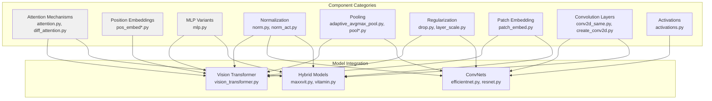

**Sources:** [timm/layers/__init__.py:1-160]()

---

## Attention Mechanisms

The library provides multiple attention mechanism implementations optimized for different use cases and supporting various features like ROPE, differential attention, and fused kernels.

### Core Attention Components

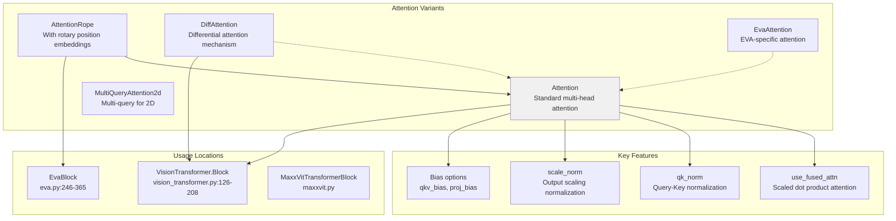

**Sources:** [timm/layers/attention.py:1-150](), [timm/layers/diff_attention.py](), [timm/models/vision_transformer.py:83-124](), [timm/models/eva.py:104-244]()

### Standard Attention Implementation

The `Attention` class implements standard multi-head self-attention with optional enhancements:

| Feature | Description | Configuration |
|---------|-------------|---------------|
| **QKV Projection** | Single fused or separate Q/K/V projections | `qkv_bias`, `proj_bias` |
| **QK Normalization** | Normalize query and key vectors | `qk_norm=True`, `norm_layer` |
| **Scale Normalization** | Normalize attention output | `scale_norm=True`, `norm_layer` |
| **Fused Attention** | Use `F.scaled_dot_product_attention` | Automatic via `use_fused_attn()` |
| **Head Dimension** | Custom head dimension override | `attn_head_dim` |

**Sources:** [timm/layers/attention.py:18-150]()

### Differential Attention

`DiffAttention` implements the differential attention mechanism from "Differential Transformer", which computes two separate attention patterns and takes their weighted difference:

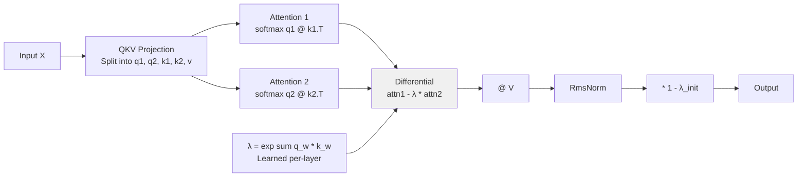

Key parameters:
- `depth`: Block index for depth-dependent lambda initialization (`λ_init = 0.8 - 0.6 * exp(-0.3 * depth)`)
- `dual_lambda`: Use two scalars instead of per-dimension lambda parameters

**Sources:** [timm/layers/diff_attention.py](), [timm/models/vision_transformer.py:400-563]()

### Attention with Rotary Position Embeddings

`AttentionRope` integrates rotary position embeddings (ROPE) directly into the attention mechanism:

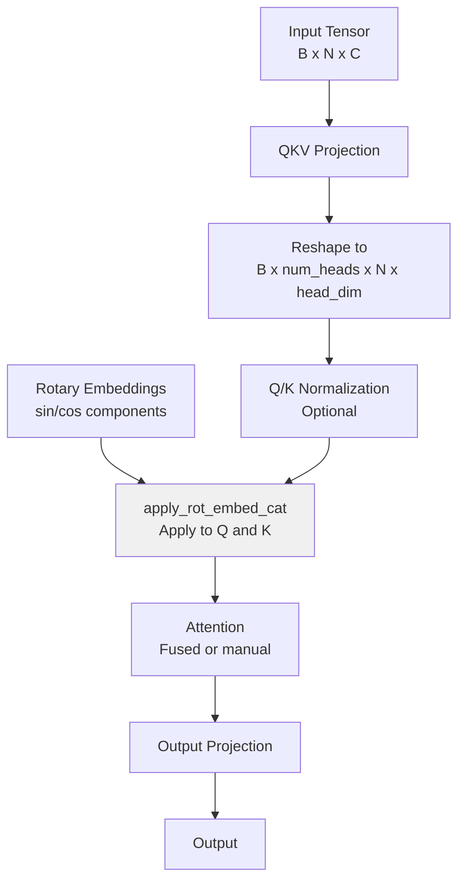

**Sources:** [timm/layers/attention.py:80-150](), [timm/models/eva.py:104-244]()

---

## Position Embedding Components

Position embeddings enable transformers to incorporate spatial information. The library supports multiple strategies for 2D image data.

### Position Embedding Types

```mermaid
graph TB
    subgraph "Absolute Position Embeddings"
        Learned["Learned Embeddings<br/>nn.Parameter"]
        Sincos["Sin-Cos Embeddings<br/>build_sincos2d_pos_embed"]
        Fourier["Fourier Embeddings<br/>build_fourier_pos_embed"]
    end
    
    subgraph "Relative Position Embeddings"
        RelPosBias["RelPosBias<br/>Additive bias table"]
        RelPosMlp["RelPosMlp<br/>MLP-based relative pos"]
        RelPosBiasTf["RelPosBiasTf<br/>TensorFlow-style bias"]
    end
    
    subgraph "Rotary Position Embeddings"
        RoPE["RotaryEmbedding<br/>2D rotary embeddings"]
        RoPECat["RotaryEmbeddingCat<br/>Concatenated sin/cos"]
        RoPEMixed["RotaryEmbeddingMixed<br/>Mixed freqs for VLMs"]
        RoPEDinoV3["RotaryEmbeddingDinoV3<br/>DINOv3 variant"]
    end
    
    subgraph "Utilities"
        Resample["resample_abs_pos_embed<br/>Resize for different resolutions"]
        ResamplePatch["resample_patch_embed<br/>Resize patch embeddings"]
        ApplyRot["apply_rot_embed<br/>Apply ROPE to tensors"]
    end
    
    Learned --> Resample
    Sincos --> VitModel["VisionTransformer"]
    RoPE --> EvaModel["Eva / EVA02"]
    RelPosBias --> SwinModel["Swin Transformer"]
    
    style RoPE fill:#f0f0f0
    style Learned fill:#f0f0f0
    style RelPosBias fill:#f0f0f0
```

**Sources:** [timm/layers/pos_embed.py:1-100](), [timm/layers/pos_embed_sincos.py:1-450](), [timm/layers/pos_embed_rel.py:1-300]()

### Learned Absolute Position Embeddings

The simplest form used in original ViT models:

```python
# From vision_transformer.py:799-805
self.pos_embed = nn.Parameter(torch.randn(1, embed_len, embed_dim) * .02)
```

Initialized with truncated normal and added to patch embeddings. Can be resized for different input resolutions using `resample_abs_pos_embed`.

**Sources:** [timm/models/vision_transformer.py:799-805](), [timm/layers/pos_embed.py:19-50]()

### Sinusoidal Position Embeddings

Fixed sinusoidal embeddings that don't require learning:

```python
# From pos_embed_sincos.py:40-78
def build_sincos2d_pos_embed(
    feat_shape: List[int],
    dim: int = 64,
    temperature: float = 10000.,
    reverse_coord: bool = False,
    interleave_sin_cos: bool = False,
):
    # Creates sin/cos position embeddings
    bands = freq_bands(dim // 4, temperature)
    grid = ndgrid(feat_shape)
    pos_emb = torch.stack([torch.sin(pos2), torch.cos(pos2)])
```

**Sources:** [timm/layers/pos_embed_sincos.py:40-78]()

### Rotary Position Embeddings (ROPE)

Rotary embeddings rotate Q and K vectors based on position, enabling relative position awareness:

| Component | Purpose | Usage |
|-----------|---------|-------|
| `RotaryEmbedding` | Base ROPE for 2D spatial data | EVA, EVA02 models |
| `RotaryEmbeddingCat` | Concatenated sin/cos for efficiency | SAM ViT variants |
| `RotaryEmbeddingMixed` | Mixed frequency bands for VLMs | Vision-language models |
| `RotaryEmbeddingDinoV3` | DINOv3-specific ROPE | DINOv3 models |

**Rotation mechanics:**

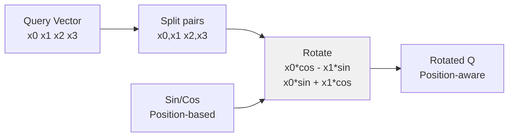

**Sources:** [timm/layers/pos_embed_sincos.py:218-450]()

### Relative Position Bias

Used in Swin Transformer and variants, adds learned biases to attention based on relative positions:

```python
# From pos_embed_rel.py:124-200
class RelPosBias(nn.Module):
    def __init__(self, window_size, num_heads):
        self.window_size = window_size
        # Bias table: (2*Wh-1) * (2*Ww-1) x num_heads
        self.relative_position_bias_table = nn.Parameter(
            torch.zeros((2 * window_size[0] - 1) * (2 * window_size[1] - 1), num_heads)
        )
```

**Sources:** [timm/layers/pos_embed_rel.py:124-200]()

---

## MLP Components

MLP (Multi-Layer Perceptron) modules are fundamental building blocks used in transformer blocks and convolutional networks.

### MLP Variants

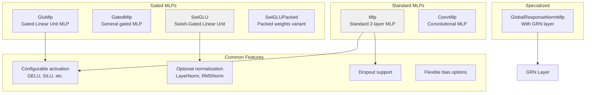

**Sources:** [timm/layers/mlp.py:1-300]()

### Standard MLP

The basic two-layer MLP used in most transformer models:

| Parameter | Description | Typical Value |
|-----------|-------------|---------------|
| `in_features` | Input dimension | `embed_dim` |
| `hidden_features` | Hidden layer size | `4 * embed_dim` |
| `out_features` | Output dimension | `embed_dim` |
| `act_layer` | Activation function | `nn.GELU` |
| `drop` | Dropout rate | `0.0` to `0.1` |
| `use_conv` | Use 1x1 convs instead of linear | `False` for ViT, `True` for some ConvNets |

```python
# From mlp.py:14-60
class Mlp(nn.Module):
    def __init__(self, in_features, hidden_features=None, ...):
        self.fc1 = nn.Linear(in_features, hidden_features, bias=bias)
        self.act = act_layer()
        self.drop1 = nn.Dropout(drop)
        self.norm = norm_layer(hidden_features) if norm_layer else nn.Identity()
        self.fc2 = nn.Linear(hidden_features, out_features, bias=bias)
        self.drop2 = nn.Dropout(drop)
```

**Sources:** [timm/layers/mlp.py:14-80]()

### SwiGLU and Gated MLPs

SwiGLU (Swish-Gated Linear Unit) is used in models like EVA02 and provides better performance through gating:

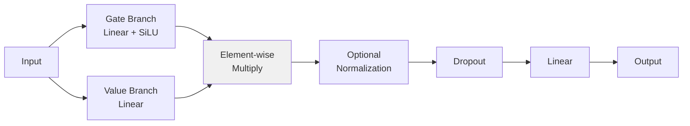

Two implementations:
- `SwiGLU`: Separate projections for gate and value (when normalization used)
- `SwiGLUPacked` / `GluMlp`: Packed weights for efficiency (when no normalization)

**Sources:** [timm/layers/mlp.py:83-230]()

### Global Response Normalization MLP

Used in ConvNeXt-V2, adds a GRN (Global Response Normalization) layer:

```python
# From mlp.py:233-280
class GlobalResponseNormMlp(nn.Module):
    def forward(self, x):
        x = self.fc1(x)
        x = self.act(x)
        x = self.grn(x)  # Global Response Norm
        x = self.drop(x)
        x = self.fc2(x)
```

The GRN layer normalizes spatial features globally before the second projection.

**Sources:** [timm/layers/mlp.py:233-280]()

---

## Normalization Components

The library provides comprehensive normalization layer support with both standard and specialized variants.

### Normalization Layer Types

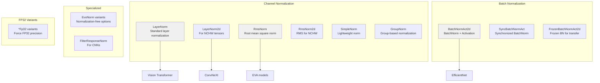

**Sources:** [timm/layers/norm.py](), [timm/layers/norm_act.py]()

### LayerNorm Variants

| Variant | Input Format | Precision | Use Case |
|---------|--------------|-----------|----------|
| `LayerNorm` | `(B, *, C)` | Mixed | Transformer blocks (channels last) |
| `LayerNorm2d` | `(B, C, H, W)` | Mixed | ConvNeXt, ConvNet blocks |
| `LayerNormFp32` | `(B, *, C)` | FP32 | Numerical stability for large models |
| `LayerNorm2dFp32` | `(B, C, H, W)` | FP32 | ConvNets with stability needs |

All LayerNorm variants support:
- Configurable epsilon: `eps` parameter (typically `1e-6`)
- Elementwise affine: `elementwise_affine=True` for learnable scale/bias
- Bias: `bias=True/False` to control bias parameter

**Sources:** [timm/layers/norm.py:40-150]()

### RMS Normalization

RmsNorm computes normalization without mean centering, used in modern efficient transformers:

```python
# From norm.py:180-220
class RmsNorm(nn.Module):
    def forward(self, x):
        # Normalize by RMS without mean subtraction
        x = x * torch.rsqrt(x.pow(2).mean(-1, keepdim=True) + self.eps)
        return x * self.weight
```

Benefits:
- Faster than LayerNorm (no mean computation)
- Often provides similar or better performance
- Used in EVA, LLaMA-style architectures

**Sources:** [timm/layers/norm.py:180-260]()

### BatchNorm with Activation

`BatchNormAct2d` fuses batch normalization and activation for efficiency:

```python
# From norm_act.py
class BatchNormAct2d(nn.BatchNorm2d):
    def __init__(self, num_features, act_layer=nn.ReLU, ...):
        super().__init__(num_features, ...)
        self.act = act_layer(inplace=True)
```

Features:
- Fused BN + activation for fewer kernel launches
- Supports all standard activations
- Drop-in replacement for `nn.BatchNorm2d`
- Used extensively in EfficientNet, ResNet variants

**Sources:** [timm/layers/norm_act.py:1-150]()

---

## Pooling and Spatial Processing

Pooling layers aggregate spatial information for classification or downsampling.

### Pooling Strategy Overview

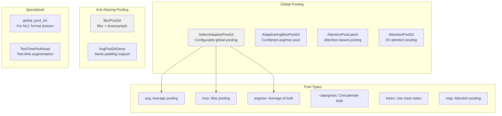

**Sources:** [timm/layers/adaptive_avgmax_pool.py](), [timm/layers/blur_pool.py:1-150](), [timm/layers/attention_pool.py]()

### SelectAdaptivePool2d

Flexible global pooling used in most models:

| Pool Type | Description | Output Shape |
|-----------|-------------|--------------|
| `avg` | Global average pooling | `(B, C)` |
| `max` | Global max pooling | `(B, C)` |
| `avgmax` | Average of avg and max | `(B, C)` |
| `catavgmax` | Concatenate avg and max | `(B, 2*C)` |
| `'' (empty)` | No pooling | `(B, C, H, W)` |

```python
# From adaptive_avgmax_pool.py
pool = SelectAdaptivePool2d(pool_type='avg', flatten=True)
x = pool(features)  # (B, C, H, W) -> (B, C)
```

**Sources:** [timm/layers/adaptive_avgmax_pool.py:50-150]()

### Attention Pooling

`AttentionPoolLatent` uses learnable queries for pooling, providing more flexible aggregation:

```python
# From attention_pool.py
class AttentionPoolLatent(nn.Module):
    def __init__(self, in_features, num_heads=8, ...):
        self.latent = nn.Parameter(torch.zeros(1, 1, in_features))
        self.q = nn.Linear(in_features, in_features, bias=qkv_bias)
        self.kv = nn.Linear(in_features, in_features * 2, bias=qkv_bias)
```

Used in:
- Vision Transformers with `global_pool='map'`
- CLIP-style models
- Multi-scale feature aggregation

**Sources:** [timm/layers/attention_pool.py:1-150]()

### BlurPool for Shift Invariance

`BlurPool2d` implements blur pooling for making CNNs more shift-invariant:

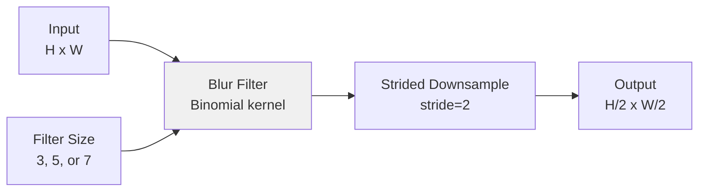

Features:
- Reduces aliasing artifacts during downsampling
- Improves robustness to small spatial shifts
- Used in anti-aliased ResNets (ResNet-RS)

**Sources:** [timm/layers/blur_pool.py:20-150]()

---

## Regularization Components

Regularization layers prevent overfitting and improve generalization.

### Regularization Techniques

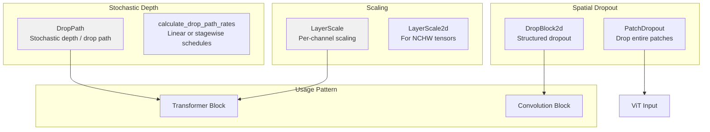

**Sources:** [timm/layers/drop.py](), [timm/layers/layer_scale.py](), [timm/layers/patch_dropout.py]()

### DropPath (Stochastic Depth)

Randomly drops entire residual paths during training:

```python
# From drop.py
class DropPath(nn.Module):
    def forward(self, x):
        if self.training and self.drop_prob > 0:
            keep_prob = 1 - self.drop_prob
            shape = (x.shape[0],) + (1,) * (x.ndim - 1)
            random_tensor = keep_prob + torch.rand(shape, ...)
            random_tensor.floor_()  # binarize
            x = x.div(keep_prob) * random_tensor
        return x
```

**Scheduling:** Drop rates typically increase linearly with depth:

| Depth | Drop Rate (max=0.1) | Drop Rate (max=0.3) |
|-------|---------------------|---------------------|
| 0 (early) | 0.0 | 0.0 |
| 6 (middle) | 0.05 | 0.15 |
| 12 (late) | 0.1 | 0.3 |

**Sources:** [timm/layers/drop.py:140-200]()

### LayerScale

Learnable per-channel scaling introduced in CaiT, stabilizes deep transformer training:

```python
# From layer_scale.py
class LayerScale(nn.Module):
    def __init__(self, dim, init_values=1e-5):
        self.gamma = nn.Parameter(init_values * torch.ones(dim))
    
    def forward(self, x):
        return x * self.gamma
```

Usage in transformer blocks:
```python
x = x + drop_path(layer_scale(attn(norm(x))))
x = x + drop_path(layer_scale(mlp(norm(x))))
```

**Sources:** [timm/layers/layer_scale.py:1-80]()

### PatchDropout

Drops random patches from the input token sequence:

```python
# From patch_dropout.py
class PatchDropout(nn.Module):
    def forward(self, x):
        # x: (B, N, C) where N = num_patches + num_prefix_tokens
        # Randomly drop patches (not class tokens)
        keep = torch.randperm(...)[:num_keep]
        return x[:, keep]
```

Benefits:
- Improves robustness to occlusions
- Acts as data augmentation
- Reduces computational cost during training

**Sources:** [timm/layers/patch_dropout.py:1-150]()

---

## Patch Embedding Components

Patch embedding layers convert images into token sequences for transformers.

### Embedding Strategies

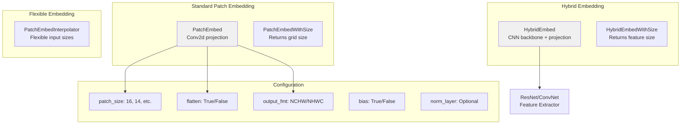

**Sources:** [timm/layers/patch_embed.py:1-350](), [timm/layers/hybrid_embed.py]()

### PatchEmbed Implementation

Standard patch embedding using a strided convolution:

| Parameter | Description | Typical Value |
|-----------|-------------|---------------|
| `img_size` | Input image size | `224`, `384` |
| `patch_size` | Patch dimensions | `16`, `14`, `8` |
| `in_chans` | Input channels | `3` (RGB) |
| `embed_dim` | Output embedding dimension | `768`, `1024` |
| `flatten` | Flatten spatial dimensions | `True` for transformers |
| `norm_layer` | Post-projection normalization | `None` or `LayerNorm` |

```python
# From patch_embed.py:26-100
class PatchEmbed(nn.Module):
    def __init__(self, img_size=224, patch_size=16, in_chans=3, embed_dim=768):
        self.proj = nn.Conv2d(
            in_chans, embed_dim, 
            kernel_size=patch_size, 
            stride=patch_size
        )
        # Output: (B, embed_dim, H', W') where H' = H/patch_size
```

**Supported output formats:**
- `NCHW`: `(B, C, H, W)` - for convolution-friendly operations
- `NHWC`: `(B, H, W, C)` - for better memory layout in some ops
- `NLC`: `(B, N, C)` - flattened for transformer processing

**Sources:** [timm/layers/patch_embed.py:26-150]()

### Hybrid Embeddings

`HybridEmbed` uses a CNN backbone to extract features before projection:

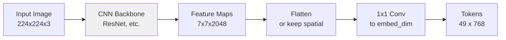

Usage:
```python
# From vision_transformer_hybrid.py:150-163
backbone = resnet50d(features_only=True, out_indices=[-1])
embed_layer = partial(HybridEmbed, backbone=backbone)
model = VisionTransformer(embed_layer=embed_layer, ...)
```

**Sources:** [timm/layers/hybrid_embed.py:1-200](), [timm/models/vision_transformer_hybrid.py:150-163]()

### Resizing Embeddings

Utilities for adapting pre-trained embeddings to different input sizes:

```python
# From patch_embed.py:180-250
def resample_patch_embed(
    patch_embed: torch.Tensor,
    new_size: Tuple[int, int],
    interpolation: str = 'bicubic',
    antialias: bool = True,
) -> torch.Tensor:
    # Resize patch embedding weights for different patch sizes
    # Used when fine-tuning at different resolutions
```

**Sources:** [timm/layers/patch_embed.py:180-280]()

---

## Squeeze-and-Excitation and Channel Attention

Channel attention mechanisms recalibrate feature channels based on global context.

### SE Module Variants

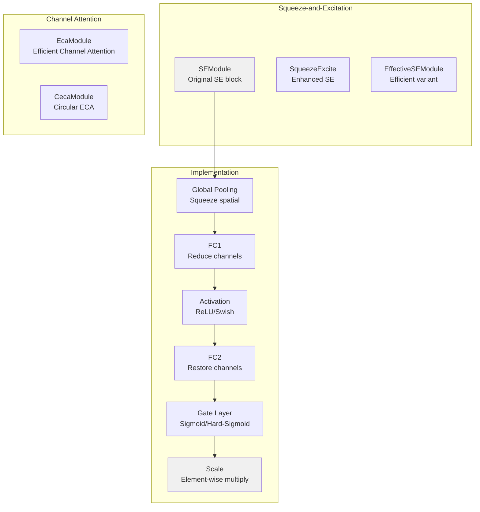

**Sources:** [timm/layers/squeeze_excite.py](), [timm/layers/eca.py]()

### SEModule and SqueezeExcite

Standard SE block with optional enhancements:

| Parameter | Description | Common Values |
|-----------|-------------|---------------|
| `channels` | Input channel count | Feature map channels |
| `rd_ratio` | Channel reduction ratio | `0.25` (4x reduction) |
| `rd_channels` | Explicit reduction channels | Alternative to `rd_ratio` |
| `act_layer` | Activation after reduction | `nn.ReLU`, `nn.SiLU` |
| `gate_layer` | Final gating activation | `'sigmoid'`, `'hard_sigmoid'` |

```python
# From squeeze_excite.py
class SqueezeExcite(nn.Module):
    def forward(self, x):
        x_se = x.mean((2, 3), keepdim=True)  # Global pool
        x_se = self.fc1(x_se)  # Reduce
        x_se = self.act(x_se)
        x_se = self.fc2(x_se)  # Expand
        x_se = self.gate(x_se)  # Gate
        return x * x_se  # Scale input
```

**Sources:** [timm/layers/squeeze_excite.py:40-150]()

### Efficient Channel Attention (ECA)

ECA replaces FC layers with 1D convolution for efficiency:

```python
# From eca.py
class EcaModule(nn.Module):
    def __init__(self, channels, kernel_size=3):
        self.conv = nn.Conv1d(1, 1, kernel_size, padding=(kernel_size - 1) // 2)
    
    def forward(self, x):
        y = x.mean((2, 3))  # Global avg pool
        y = self.conv(y.unsqueeze(-1).transpose(-1, -2))
        y = y.transpose(-1, -2).unsqueeze(-1)
        return x * y.sigmoid()
```

Benefits over SE:
- Fewer parameters (no FC layers)
- Captures local channel interactions via 1D conv
- Adaptive kernel size based on channel count

**Sources:** [timm/layers/eca.py:30-120]()

---

## Convolution Utilities

Specialized convolution layers and utilities for consistent behavior across models.

### Convolution Helpers

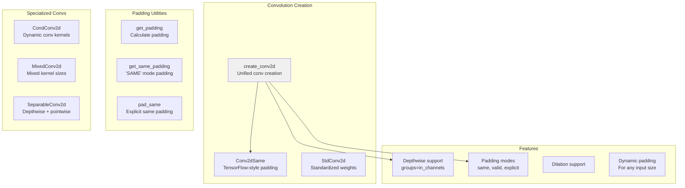

**Sources:** [timm/layers/create_conv2d.py](), [timm/layers/conv2d_same.py](), [timm/layers/std_conv.py]()

### create_conv2d Factory

Unified convolution creation with automatic padding handling:

```python
# From create_conv2d.py
def create_conv2d(
    in_channels, out_channels, kernel_size,
    stride=1, dilation=1, groups=1,
    padding='', depthwise=False, **kwargs
):
    # Automatically selects Conv2d or Conv2dSame based on padding
    # Handles depthwise convolutions (groups=in_channels)
```

**Padding modes:**
- `''` or `'same'`: Dynamic same padding (like TensorFlow)
- `'valid'`: No padding
- Integer: Explicit padding value

**Sources:** [timm/layers/create_conv2d.py:1-150]()

### Conv2dSame

Provides TensorFlow-style SAME padding that adapts to input size:

```python
# From conv2d_same.py
class Conv2dSame(nn.Conv2d):
    def forward(self, x):
        # Calculate padding based on input size
        ih, iw = x.size()[-2:]
        pad_h = get_same_padding(ih, self.kernel_size[0], self.stride[0], self.dilation[0])
        pad_w = get_same_padding(iw, self.kernel_size[1], self.stride[1], self.dilation[1])
        x = pad_same(x, self.kernel_size, self.stride, self.dilation)
        return F.conv2d(x, self.weight, self.bias, ...)
```

**Sources:** [timm/layers/conv2d_same.py:1-100]()

---

## Component Integration Patterns

This section demonstrates how components are composed in real models.

### Transformer Block Composition

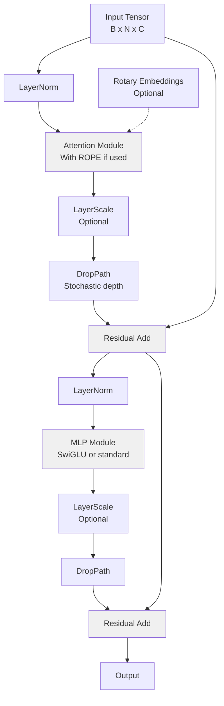

**Example implementation:**

```python
# From vision_transformer.py:126-208
class Block(nn.Module):
    def forward(self, x, attn_mask=None):
        x = x + self.drop_path1(
            self.ls1(self.attn(self.norm1(x), attn_mask=attn_mask))
        )
        x = x + self.drop_path2(
            self.ls2(self.mlp(self.norm2(x)))
        )
        return x
```

**Sources:** [timm/models/vision_transformer.py:126-208]()

### ConvNet Block Composition

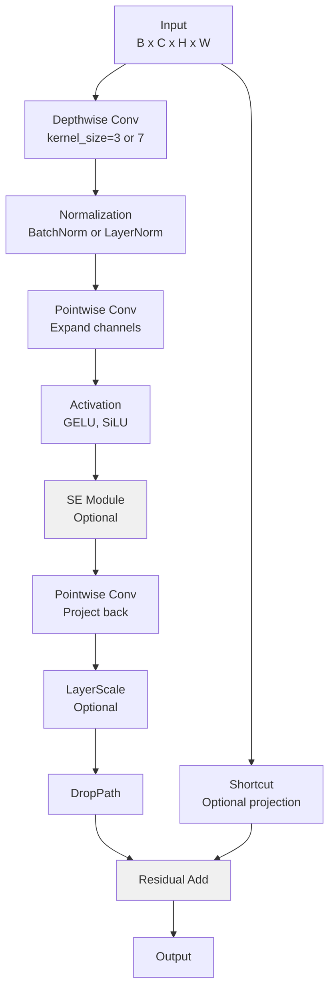

**Example from ConvNeXt:**

```python
# From convnext.py:197-213
class ConvNeXtBlock(nn.Module):
    def forward(self, x):
        shortcut = x
        x = self.conv_dw(x)  # 7x7 depthwise
        x = self.norm(x)
        x = self.mlp(x)  # 1x1 -> expand -> GELU -> 1x1
        if self.gamma is not None:
            x = x.mul(self.gamma)  # LayerScale
        x = self.drop_path(x) + self.shortcut(shortcut)
        return x
```

**Sources:** [timm/models/convnext.py:117-214]()

### Hybrid Model Composition

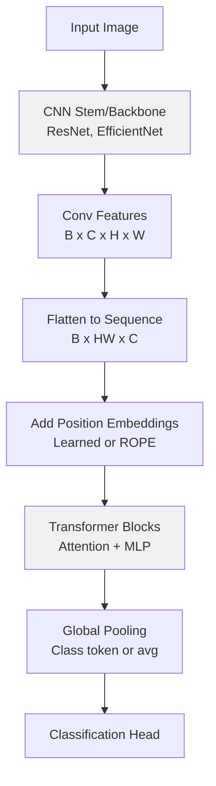

**Example from ViT Hybrid:**

```python
# From vision_transformer_hybrid.py:150-163
backbone = resnet26d(features_only=True)
embed_layer = partial(HybridEmbed, backbone=backbone)
model = VisionTransformer(
    embed_layer=embed_layer,
    embed_dim=768,
    depth=12,
    num_heads=12,
    ...
)
```

**Sources:** [timm/models/vision_transformer_hybrid.py:150-163](), [timm/layers/hybrid_embed.py:1-150]()

---

## Activation Functions

The library supports a wide range of activation functions optimized for different use cases.

### Activation Layer Factory

| Activation | String ID | Description | Use Cases |
|------------|-----------|-------------|-----------|
| `nn.ReLU` | `'relu'` | Standard ReLU | ResNet, ConvNets |
| `nn.GELU` | `'gelu'` | Gaussian Error Linear Unit | Vision Transformers |
| `nn.SiLU` | `'silu'`, `'swish'` | Sigmoid Linear Unit | EfficientNet, modern CNNs |
| `nn.Hardswish` | `'hard_swish'` | Hard version of Swish | MobileNet V3 |
| `nn.Mish` | `'mish'` | Self-regularized activation | Some research models |
| `nn.PReLU` | `'prelu'` | Parametric ReLU | Varied usage |

```python
# From create_act.py
def get_act_layer(name):
    # Returns activation class by string name
    return _ACT_LAYER_MAP.get(name, nn.GELU)

def create_act_layer(name, inplace=False, **kwargs):
    # Creates activation instance
    act_layer = get_act_layer(name)
    return act_layer(inplace=inplace, **kwargs)
```

**Sources:** [timm/layers/create_act.py](), [timm/layers/activations.py]()

---

## Summary Tables

### Component Selection Guide

| Architecture | Attention | Position Embed | MLP | Normalization | Pooling |
|--------------|-----------|----------------|-----|---------------|---------|
| **ViT** | `Attention` | Learned absolute | `Mlp` | `LayerNorm` | Class token or `avg` |
| **Swin** | Window attention | Relative bias (`RelPosBias`) | `Mlp` | `LayerNorm` | `avg` |
| **EVA** | `EvaAttention` | Absolute + ROPE | `SwiGLU` | `LayerNorm` | `avg` |
| **DaVit** | Dual attention | Window + ROPE | `Mlp` | `LayerNorm` | `avg` |
| **ConvNeXt** | N/A | N/A | `Mlp` (conv) | `LayerNorm2d` | `avg` |
| **EfficientNet** | SE modules | N/A | N/A | `BatchNorm2d` | `avg` |
| **MaxViT** | Block + Grid | Relative | `Mlp` / `ConvMlp` | `LayerNorm2d` | `avg` |

### Common Component Parameters

| Component | Key Parameters | Impact |
|-----------|----------------|--------|
| **Attention** | `num_heads`, `qkv_bias`, `qk_norm` | Model capacity, stability |
| **MLP** | `mlp_ratio`, `act_layer` | Expressiveness, compute cost |
| **DropPath** | `drop_path_rate` | Regularization strength |
| **LayerScale** | `init_values` | Training stability for deep models |
| **Position Embed** | `temperature`, `in_pixels` | Position encoding resolution |
| **SE Module** | `rd_ratio` | Channel attention strength |

**Sources:** [timm/models/vision_transformer.py:1-1000](), [timm/models/eva.py:1-600](), [timm/models/convnext.py:1-500]()

---

