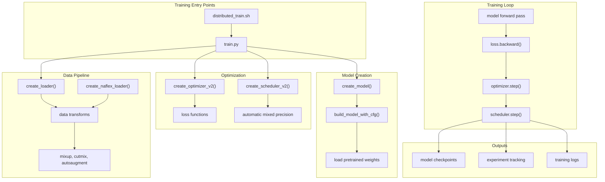
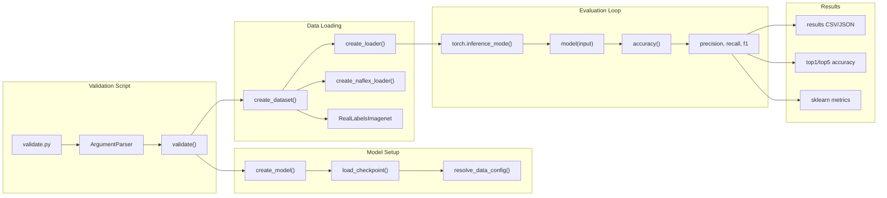
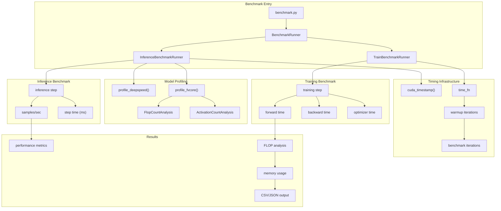
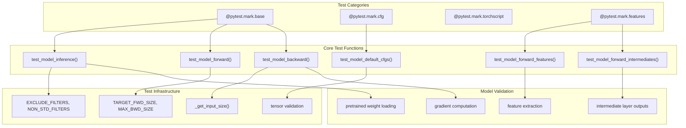

<!-- source: DeepWiki mcp.deepwiki.com · repo huggingface/pytorch-image-models · page 4 Training and Evaluation · fetched 2026-10-26 -->

# Training and Evaluation

Relevant source files

The following files were used as context for generating this wiki page:

- [README.md](README.md)
- [benchmark.py](benchmark.py)
- [inference.py](inference.py)
- [timm/data/config.py](timm/data/config.py)
- [timm/version.py](timm/version.py)
- [train.py](train.py)
- [validate.py](validate.py)

This document covers the training and evaluation infrastructure in timm, including training scripts, validation tools, benchmarking utilities, and the comprehensive testing framework. The system provides end-to-end capabilities for training models, evaluating their performance, and ensuring reliability across the extensive model collection.

For information about model creation and the registry system that these tools operate on, see [Model Creation and Registry System](#2). For details about the data pipeline that feeds these training and evaluation processes, see [Data Pipeline](#5).

## Training Infrastructure

The training infrastructure is centered around `train.py`, which provides a comprehensive training framework supporting distributed training, mixed precision, various optimizers and schedulers, and extensive data augmentation options.

### Core Training Pipeline

The training system supports extensive configuration through command-line arguments organized into logical groups: dataset parameters, model parameters, device settings, optimizer parameters, learning rate schedules, augmentation settings, batch normalization parameters, model EMA, and miscellaneous options.

**Sources:** [train.py:1-1200]()

### Advanced Training Features

The training infrastructure includes several advanced features:

- **NaFlex Training**: Variable resolution training for NaFlexViT models through `--naflex-loader` with configurable sequence lengths and patch sizes
- **Distributed Training**: Multi-GPU training support with gradient accumulation and synchronized batch normalization
- **Mixed Precision**: Native PyTorch AMP and Apex AMP support with configurable precision types
- **Model Compilation**: Support for TorchScript, torch.compile, and functorch optimization
- **Experiment Tracking**: Weights & Biases integration for monitoring training progress

**Sources:** [train.py:404-417](), [train.py:466-481](), [train.py:529-531]()

## Model Evaluation

The evaluation system provides comprehensive tools for validating trained models and measuring their performance across different metrics and datasets.

### Validation Pipeline

The validation script supports various evaluation modes including standard validation, real labels evaluation for ImageNet, and comprehensive metrics calculation with scikit-learn integration.

**Sources:** [validate.py:179-467]()

### Evaluation Features

Key evaluation capabilities include:

- **Flexible Data Loading**: Support for various dataset formats with customizable preprocessing
- **Real Labels Support**: Corrected ImageNet labels for more accurate evaluation
- **Advanced Metrics**: Beyond accuracy, supports precision, recall, and F1-score with different averaging methods
- **Test Time Augmentation**: Optional TTA support for improved evaluation accuracy
- **Model Optimizations**: Support for reparameterization, mixed precision, and model compilation during evaluation

**Sources:** [validate.py:164-178](), [validate.py:436-449]()

## Performance Benchmarking

The benchmarking system provides detailed performance analysis for models, measuring inference speed, training throughput, and computational requirements.

### Benchmark Architecture

The benchmarking system provides separate runners for inference and training benchmarks, with detailed timing analysis and computational profiling capabilities.

**Sources:** [benchmark.py:214-292](), [benchmark.py:300-372](), [benchmark.py:375-497]()

### Benchmark Capabilities

The benchmark infrastructure supports:

- **Inference Benchmarking**: Measures throughput, latency, and computational requirements for inference workloads
- **Training Benchmarking**: Profiles forward pass, backward pass, and optimizer step timing separately
- **FLOP Analysis**: Integration with DeepSpeed profiler and FVCore for detailed computational analysis
- **Memory Profiling**: Tracks memory usage patterns during model execution
- **Model Compilation**: Benchmarks performance with TorchScript, torch.compile, and other optimization techniques

**Sources:** [benchmark.py:354-367](), [benchmark.py:187-211]()

## Batch Inference

The inference system provides efficient batch processing capabilities for large-scale model deployment and evaluation scenarios.

### Inference Pipeline

The `inference.py` script implements a streamlined pipeline for batch inference with flexible output formatting:

- **Data Processing**: Supports various dataset formats with automatic ImageNet subset detection for labeling
- **Output Formats**: Configurable output in CSV, JSON, or Parquet formats with customizable column naming
- **Label Resolution**: Automatic conversion of class indices to human-readable labels using ImageNet metadata
- **Flexible Precision**: Support for mixed precision inference and model compilation optimizations

**Sources:** [inference.py:156-375]()

## Testing Framework

The testing infrastructure ensures model reliability and compatibility across the extensive collection of model architectures.

### Test Organization

The testing framework is organized into multiple categories with specific markers for parallel execution in CI environments.

**Sources:** [tests/test_models.py:1-12](), [tests/test_models.py:125-236]()

### Test Coverage

The testing infrastructure provides comprehensive coverage:

- **Model Inference**: Validates pretrained model outputs against reference tensors stored in Hugging Face Hub
- **Forward/Backward Pass**: Ensures models can perform forward inference and gradient computation
- **Configuration Validation**: Verifies model default configurations match expected specifications  
- **Feature Extraction**: Tests intermediate layer output extraction and feature-only model creation
- **TorchScript Compatibility**: Validates models can be scripted for deployment
- **Memory Management**: Includes adaptive batch size testing with retry mechanisms for resource-constrained environments

**Sources:** [tests/test_models.py:129-167](), [tests/test_models.py:173-236](), [tests/test_models.py:419-440]()

## Integration with Model Creation System

The training and evaluation infrastructure integrates seamlessly with timm's model creation system through standardized interfaces:

| Component | Integration Point | Description |
|-----------|------------------|-------------|
| `create_model()` | All scripts | Unified model instantiation with pretrained weight loading |
| `resolve_data_config()` | Data preprocessing | Automatic resolution of input size, normalization, and preprocessing parameters |
| Model registry | Model selection | Access to all registered models through string identifiers |
| Pretrained configurations | Default settings | Automatic application of model-specific training and evaluation settings |
| Feature extraction | Advanced evaluation | Support for intermediate layer outputs and feature-only model creation |

The system supports over 1000 model variants with consistent interfaces for training, evaluation, and deployment, making it easy to experiment with different architectures using the same infrastructure.

**Sources:** [train.py:502-517](), [validate.py:232-243](), [benchmark.py:244-254](), [tests/test_models.py:175-176]()

---

