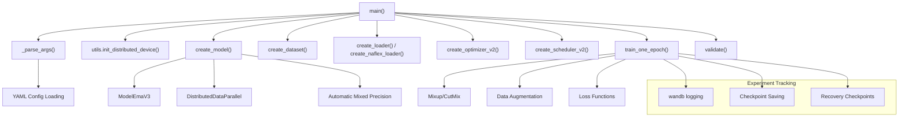
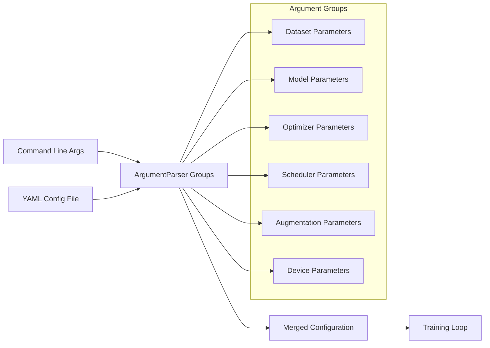
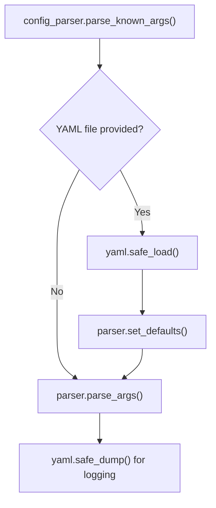
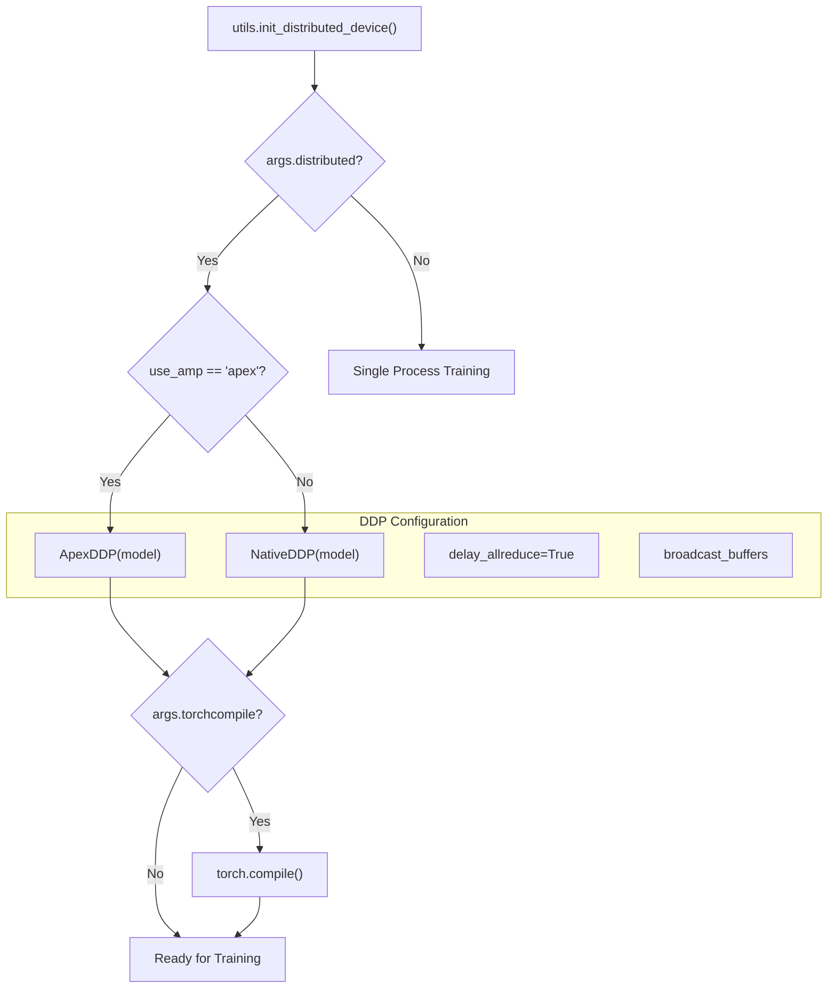
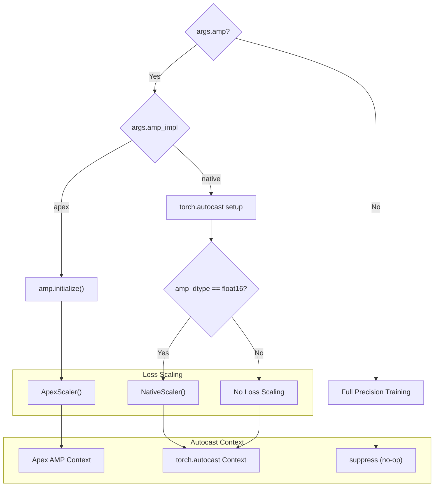
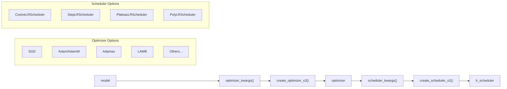
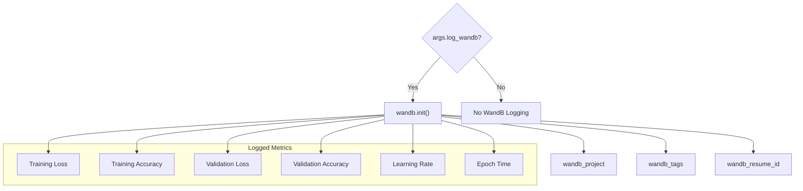
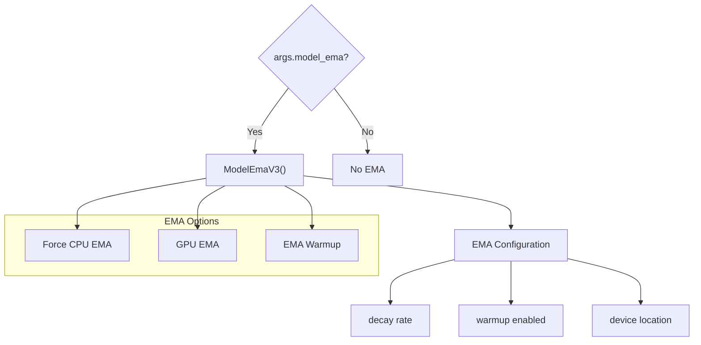
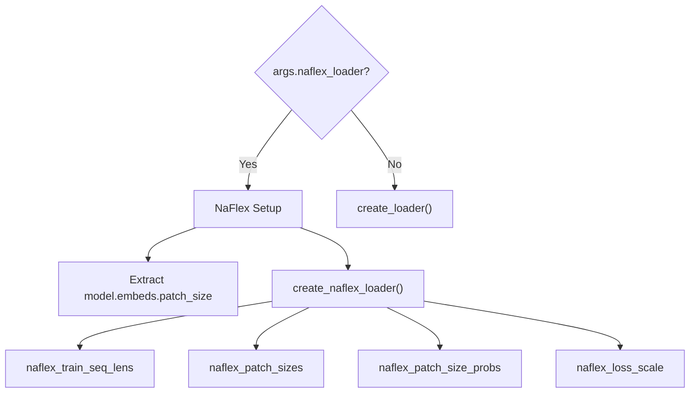

<!-- source: DeepWiki mcp.deepwiki.com · repo huggingface/pytorch-image-models · page 4.1 Training Scripts and Infrastructure · fetched 2026-10-26 -->

# Training Scripts and Infrastructure

Relevant source files

The following files were used as context for generating this wiki page:

- [README.md](README.md)
- [benchmark.py](benchmark.py)
- [inference.py](inference.py)
- [timm/data/config.py](timm/data/config.py)
- [timm/version.py](timm/version.py)
- [train.py](train.py)
- [validate.py](validate.py)

This page documents the training scripts and infrastructure that form the backbone of the timm training ecosystem. It covers the main training script (`train.py`), distributed training capabilities, configuration management, and the supporting infrastructure for large-scale model training.

For information about model validation and testing infrastructure, see [Model Testing and Validation](#4.2). For benchmark results and analysis tools, see [Benchmark Results and Analysis](#4.3).

## Training Script Overview

The primary training infrastructure centers around `train.py`, which provides a comprehensive and modular training framework supporting modern deep learning training techniques.

**Training Script Architecture**
Sources: [train.py:436-1120]()

## Configuration System

The training script uses a hierarchical configuration system that combines command-line arguments, YAML configuration files, and sensible defaults.

### Argument Groups

The configuration is organized into logical groups for maintainability:

| Group | Purpose | Key Parameters |
|-------|---------|----------------|
| Dataset | Data loading and preprocessing | `--data-dir`, `--dataset`, `--train-split`, `--val-split` |
| Model | Model architecture and initialization | `--model`, `--pretrained`, `--num-classes`, `--img-size` |
| Optimizer | Optimization parameters | `--opt`, `--lr`, `--weight-decay`, `--momentum` |
| Scheduler | Learning rate scheduling | `--sched`, `--epochs`, `--warmup-epochs`, `--decay-epochs` |
| Augmentation | Data augmentation and regularization | `--mixup`, `--cutmix`, `--aa`, `--drop-path` |
| Device | Hardware and distributed training | `--amp`, `--device`, `--sync-bn`, `--channels-last` |

**Configuration Flow and Argument Processing**
Sources: [train.py:71-434]()

### YAML Configuration Support

The training script supports YAML configuration files that can override default parameters:

**YAML Configuration Loading Process**
Sources: [train.py:419-433]()

## Distributed Training Infrastructure

The training infrastructure supports multiple distributed training backends with automatic configuration based on available libraries.

### Distributed Backend Selection

**Distributed Training Setup Flow**
Sources: [train.py:657-673]()

### Synchronization and Communication

The infrastructure handles various forms of synchronization:

- **Gradient Synchronization**: Automatic via DDP wrappers
- **BatchNorm Synchronization**: Via `convert_sync_batchnorm()` or Apex `convert_syncbn_model()`
- **Buffer Broadcasting**: Controlled by `--no-ddp-bb` flag
- **Step Synchronization**: Optional `torch.cuda.synchronize()` after each step

Sources: [train.py:554-567](), [train.py:183-186]()

## Mixed Precision and Optimization

### Automatic Mixed Precision (AMP) Support

The training script supports both Apex AMP and PyTorch native AMP:

**Mixed Precision Setup and Configuration**
Sources: [train.py:466-625]()

### Optimizer and Scheduler Creation

**Optimizer and Scheduler Creation Flow**
Sources: [train.py:594-598](), [timm/optim/__init__.py](), [timm/scheduler/__init__.py]()

## Experiment Tracking and Monitoring

### Weights & Biases Integration

The training script includes comprehensive WandB integration for experiment tracking:

- **Automatic Logging**: Training metrics, validation metrics, learning rate schedules
- **Artifact Tracking**: Model checkpoints, configuration files
- **Resume Support**: Ability to resume interrupted runs with `--wandb-resume-id`

**Experiment Tracking Setup**
Sources: [train.py:395-402](), [train.py:54-58]()

### Checkpoint Management

The training infrastructure provides comprehensive checkpoint management:

- **Regular Checkpoints**: Saved at specified intervals
- **Best Model Checkpoints**: Based on validation metrics
- **Recovery Checkpoints**: For fault tolerance
- **Checkpoint History**: Configurable number of checkpoints to retain

Sources: [train.py:374-376](), [train.py:627-636]()

## Advanced Training Features

### Model Exponential Moving Average (EMA)

**Model EMA Configuration**
Sources: [train.py:639-656]()

### NaFlex Variable Resolution Training

The training script supports NaFlex (Native Flexible) training for variable resolution and patch size:

- **Variable Sequence Lengths**: Support for different input resolutions
- **Variable Patch Sizes**: Dynamic patch size selection during training
- **Loss Scaling**: Gradient scaling based on batch size for variable resolution

**NaFlex Loader Configuration**
Sources: [train.py:405-416](), [train.py:569-572]()

### Gradient Accumulation and Clipping

The training infrastructure supports:
- **Gradient Accumulation**: Via `--grad-accum-steps`
- **Gradient Clipping**: Multiple modes (`norm`, `value`, `agc`)
- **Layer-wise Learning Rate Decay**: For fine-tuned control

Sources: [train.py:150-151](), [train.py:203-212]()

---

