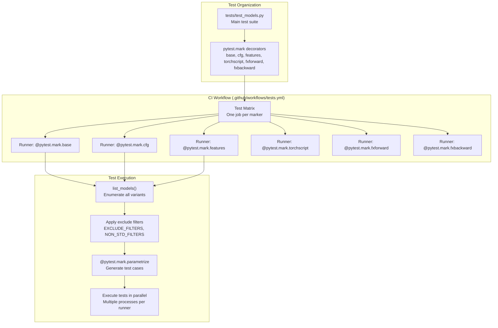
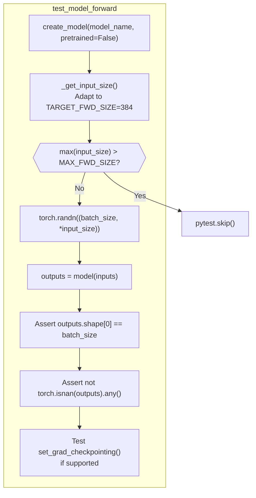
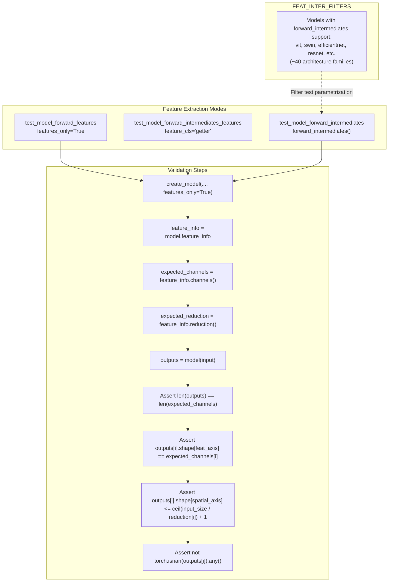
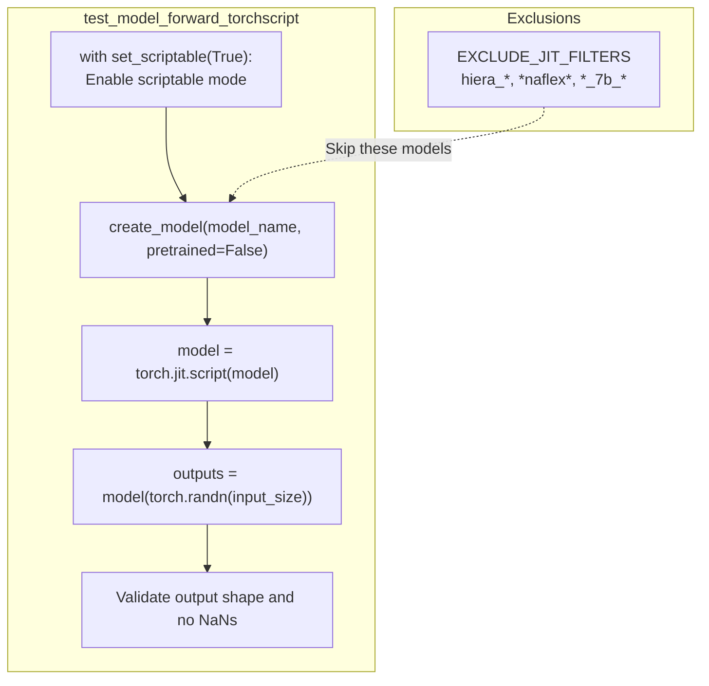
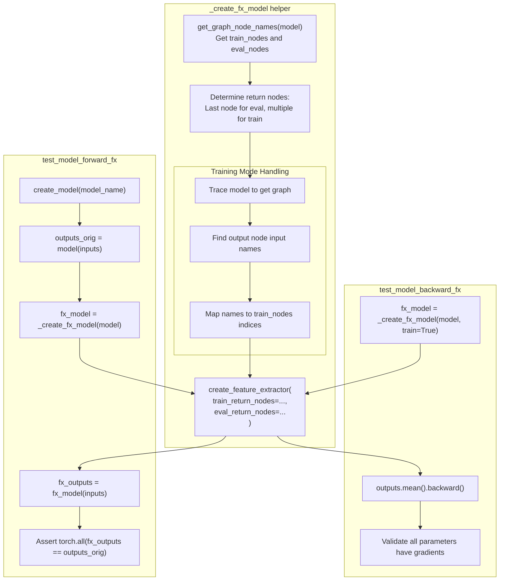
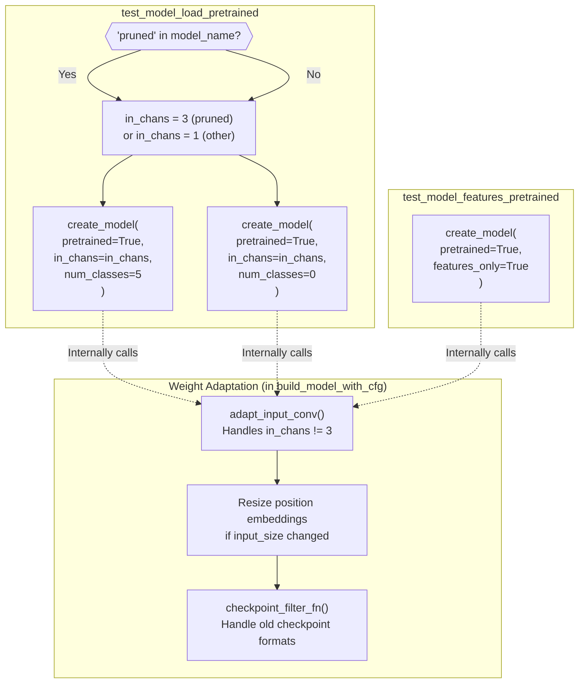
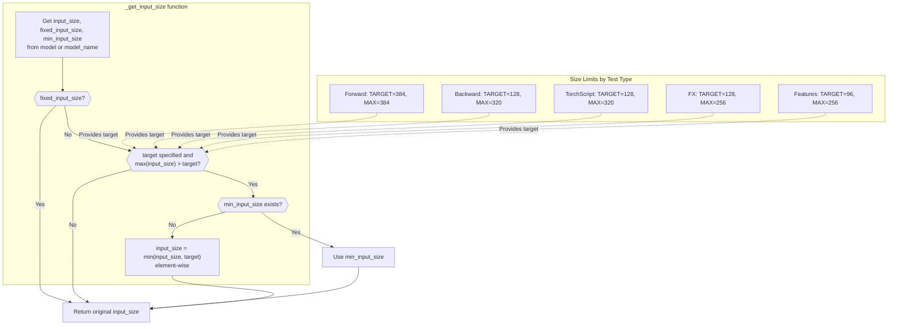
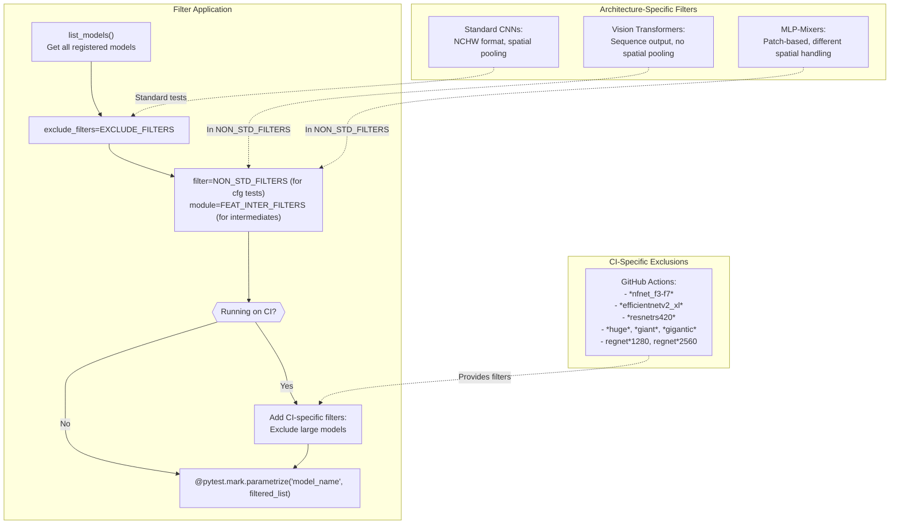

<!-- source: DeepWiki mcp.deepwiki.com · repo huggingface/pytorch-image-models · page 4.2 Model Testing and Validation · fetched 2026-10-26 -->

# Model Testing and Validation

<details>
<summary>Relevant source files</summary>

The following files were used as context for generating this wiki page:

- [tests/test_models.py](tests/test_models.py)
- [timm/models/__init__.py](timm/models/__init__.py)
- [timm/models/helpers.py](timm/models/helpers.py)

</details>


## Purpose and Scope

This document covers the comprehensive automated test suite for validating model correctness across the 1000+ model variants in the timm library. The test infrastructure ensures that all models correctly implement forward/backward passes, configuration contracts, feature extraction modes, and compilation compatibility with TorchScript and FX.

For information about training and validation scripts (`train.py`, `validate.py`, `benchmark.py`), see [Training Scripts and Infrastructure](#4.1). For benchmark result analysis and metrics across ImageNet variants, see [Benchmark Results and Analysis](#4.3).

**Sources**: [tests/test_models.py:1-12]()

## Test Organization and CI Integration

The test suite uses pytest with a marker-based parallelization strategy to efficiently run tests across multiple CI runners. Each test is assigned a specific marker that determines which CI runner executes it.

### Test Markers and Parallelization

The following markers are used to organize and parallelize test execution:

| Marker | Purpose | Typical Test Count |
|--------|---------|-------------------|
| `@pytest.mark.base` | Basic forward pass and backward pass tests | ~1000 models |
| `@pytest.mark.cfg` | Configuration validation tests | ~700 models |
| `@pytest.mark.features` | Feature extraction mode tests | ~800 models |
| `@pytest.mark.torchscript` | TorchScript compilation tests | ~900 models |
| `@pytest.mark.fxforward` | FX tracing forward pass tests | ~800 models |
| `@pytest.mark.fxbackward` | FX tracing backward pass tests | ~800 models |



**Diagram: Test Organization and CI Parallelization Strategy**

The test suite is designed to run efficiently on CI by:
1. Assigning each test function a specific marker
2. Running one CI job per marker, allowing parallel execution
3. Using pytest parametrization to generate individual test cases for each model
4. Applying filters to exclude models that exceed resource limits

**Sources**: [tests/test_models.py:1-12](), [tests/test_models.py:73-83]()

## Test Types

### Basic Forward and Backward Pass Tests

These tests validate the fundamental functionality of model forward and backward passes, ensuring that gradients flow correctly through all parameters.

#### Forward Pass Test (`test_model_forward`)



**Diagram: Forward Pass Test Flow**

The forward pass test [tests/test_models.py:174-201]() validates:
- Model accepts input with correct shape
- Output batch dimension matches input
- No NaN values in output
- Gradient checkpointing (if supported) produces identical outputs

#### Backward Pass Test (`test_model_backward`)

The backward pass test [tests/test_models.py:207-237]() validates:
- Loss can be computed and reduced
- All model parameters receive gradients
- Output shape matches expected dimensions (either `num_classes` or `num_features`)
- No NaN values in gradients or outputs

For encoder-only models (where `num_classes == 0`), the test verifies that:
- Output feature dimension matches `model.num_features`
- Output format is correctly specified via `output_fmt` attribute

**Sources**: [tests/test_models.py:170-237]()

### Configuration Validation Tests

Configuration tests ensure that models correctly implement their configuration contracts, including pool sizes, feature dimensions, and classifier/stem naming conventions.

```mermaid
graph TB
    subgraph "test_model_default_cfgs"
        LoadModel["create_model(model_name, pretrained=False)"]
        GetCfg["cfg = model.default_cfg"]
        ExtractParams["Extract:<br/>pool_size, input_size, output_fmt"]
        
        subgraph "Test forward_features"
            TestFeatures["outputs = model.forward_features(input)"]
            CheckPoolSize["Assert outputs.shape[spatial_axis] == pool_size"]
            CheckNumFeats["Assert outputs.shape[feat_axis] == model.num_features"]
        end
        
        subgraph "Test forward_head"
            TestHead["outputs_pre = model.forward_head(features, pre_logits=True)"]
            CheckHeadSize["Assert outputs_pre.shape[1] == model.head_hidden_size"]
        end
        
        subgraph "Test reset_classifier"
            Reset0["model.reset_classifier(0)"]
            TestReset["outputs = model.forward(input)"]
            CheckResetShape["Assert outputs.shape[1] == model.head_hidden_size"]
            
            ResetEmpty["model.reset_classifier(0, '')"]
            TestNoPool["outputs = model.forward(input)"]
            CheckSpatial["Assert outputs.shape[spatial_axis] == pool_size"]
        end
        
        ValidateNames["Validate classifier and first_conv names in state_dict"]
    end
    
    LoadModel --> GetCfg
    GetCfg --> ExtractParams
    ExtractParams --> TestFeatures
    TestFeatures --> CheckPoolSize
    CheckPoolSize --> CheckNumFeats
    CheckNumFeats --> TestHead
    TestHead --> CheckHeadSize
    CheckHeadSize --> Reset0
    Reset0 --> TestReset
    TestReset --> CheckResetShape
    CheckResetShape --> ResetEmpty
    ResetEmpty --> TestNoPool
    TestNoPool --> CheckSpatial
    CheckSpatial --> ValidateNames
```



**Diagram: Configuration Validation Test Flow**

The configuration tests [tests/test_models.py:257-329]() validate:

1. **Unpooled Features**: `forward_features()` returns features with spatial dimensions matching `pool_size` from config
2. **Pre-logits Features**: `forward_head(features, pre_logits=True)` returns features with dimension `head_hidden_size`
3. **Classifier Reset**: `reset_classifier(0)` removes classifier and produces pooled features
4. **Pooling Reset**: `reset_classifier(0, '')` removes both classifier and pooling
5. **Configuration Names**: Classifier and stem layer names in config match actual state_dict keys

Special handling exists for models with non-standard spatial outputs (Vision Transformers, sequence models) via the `test_model_default_cfgs_non_std` test [tests/test_models.py:335-399]().

**Sources**: [tests/test_models.py:252-399]()

### Feature Extraction Tests

Feature extraction tests validate that models correctly support multi-scale feature extraction through three different interfaces:

1. **Standard Feature Extraction** (`features_only=True`)
2. **Getter-based Feature Extraction** (`feature_cls='getter'`)
3. **Forward Intermediates** (`forward_intermediates()` method)



**Diagram: Feature Extraction Test Architecture**

#### Standard Feature Extraction

The `test_model_forward_features` test [tests/test_models.py:455-480]() validates basic feature extraction:
- Models created with `features_only=True` return a list of feature tensors
- Number of outputs matches `feature_info` specification
- Channel dimensions match expected values
- Spatial dimensions respect reduction factors (with +1 tolerance for padding)

#### Getter-based Feature Extraction

The `test_model_forward_intermediates_features` test [tests/test_models.py:486-510]() validates the alternative getter-based feature extraction interface:
- Uses `feature_cls='getter'` which wraps the model with `FeatureGetterNet`
- Only applies to models listed in `FEAT_INTER_FILTERS` [tests/test_models.py:52-61]()
- Validates same contracts as standard feature extraction

#### Forward Intermediates

The `test_model_forward_intermediates` test [tests/test_models.py:517-563]() validates the `forward_intermediates()` method:
- Returns both final output and intermediate features
- Supports models with native `forward_intermediates()` implementation
- Validates that output matches `forward_features()` result
- Tests gradient checkpointing compatibility

**Sources**: [tests/test_models.py:451-563]()

### Compilation Tests

Compilation tests ensure models are compatible with TorchScript and FX graph tracing, which are critical for deployment and optimization.

#### TorchScript Compilation



**Diagram: TorchScript Compilation Test Flow**

The TorchScript test [tests/test_models.py:425-441]() uses `set_scriptable(True)` context manager to enable scriptable mode, which:
- Disables certain dynamic behaviors (e.g., gradient checkpointing hooks)
- Ensures models use scriptable variants of operations
- Validates that models can be converted to TorchScript without errors

#### FX Tracing

FX tracing tests are more complex due to the need to handle models with multiple outputs in training mode.



**Diagram: FX Tracing Test Infrastructure**

The FX tests [tests/test_models.py:621-683]() use TorchVision's `create_feature_extractor` to symbolically trace models. The `_create_fx_model` helper [tests/test_models.py:566-595]() handles:
- Extracting graph node names for train and eval modes
- Handling models with tuple/dict outputs in training mode
- Configuring leaf modules and autowrap functions via `get_notrace_modules()` and `get_notrace_functions()`
- Validating traced model produces identical outputs to original

**Sources**: [tests/test_models.py:420-722]()

### Pretrained Weight Loading Tests

Pretrained weight loading tests validate that models can successfully load pretrained weights with various input channel configurations.



**Diagram: Pretrained Weight Loading Test Coverage**

The pretrained loading tests [tests/test_models.py:406-417]() validate:
- Models can load weights with non-standard input channels (`in_chans=1` instead of 3)
- Models work with both classification heads (`num_classes=5`) and encoder-only mode (`num_classes=0`)
- Feature extraction mode (`features_only=True`) works with pretrained weights

These tests are only run locally (not on CI) due to download bandwidth and time constraints [tests/test_models.py:402]().

**Sources**: [tests/test_models.py:402-417]()

### Model Inference Test

The `test_model_inference` test [tests/test_models.py:130-168]() is a comprehensive end-to-end validation that uses reference tensors stored on HuggingFace Hub:

```mermaid
graph TB
    subgraph "test_model_inference"
        LoadPretrained["create_model(model_name, pretrained=True)"]
        DownloadRef["snapshot_download('timm/' + model_name)<br/>Download test/ directory"]
        LoadTensors["Load rand_tensors.safetensors<br/>Load owl_tensors.safetensors<br/>Load test_owl.jpg"]
        
        subgraph "Random Tensor Tests"
            TestRandOut["outputs = model(rand_input)"]
            TestRandFeat["features = model.forward_features(rand_input)"]
            TestRandPre["pre_logits = model.forward_head(features, pre_logits=True)"]
            CompareRand["Assert torch.allclose() for all outputs"]
        end
        
        subgraph "Owl Image Tests"
            TestOwlOut["outputs = model(owl_input)"]
            TestOwlClass["Assert outputs.softmax(1).argmax(1) == 24"]
            CompareOwl["Assert torch.allclose() to reference"]
            ReprocessOwl["Re-process test_owl.jpg and validate"]
        end
    end
    
    LoadPretrained --> DownloadRef
    DownloadRef --> LoadTensors
    LoadTensors --> TestRandOut
    TestRandOut --> TestRandFeat
    TestRandFeat --> TestRandPre
    TestRandPre --> CompareRand
    CompareRand --> TestOwlOut
    TestOwlOut --> TestOwlClass
    TestOwlClass --> CompareOwl
    CompareOwl --> ReprocessOwl
```



**Diagram: Model Inference Test with Reference Tensors**

This test validates:
- Model produces bit-exact outputs matching reference tensors (within tolerance)
- Classification head correctly predicts class 24 (owl) for test image
- All model methods (`forward`, `forward_features`, `forward_head`) produce correct outputs
- Image preprocessing is consistent (with relaxed tolerance for re-processed images due to Pillow version differences)

**Sources**: [tests/test_models.py:126-168]()

## Test Infrastructure

### Input Size Adaptation

Tests automatically adapt input sizes to stay within resource limits while respecting model constraints:



**Diagram: Input Size Adaptation System**

The `_get_input_size` function [tests/test_models.py:101-123]() implements intelligent input size selection:

1. **Fixed Size Models**: If `fixed_input_size=True`, always use original size
2. **Variable Size Models**: Adapt size based on target:
   - If model specifies `min_input_size`, use that when original size exceeds target
   - Otherwise, clip input size dimensions to target
3. **Size Limits**: Different test types use different size limits [tests/test_models.py:87-98]():
   - Forward tests: max 384x384 (balance coverage and speed)
   - Backward tests: max 320x320 (memory constraints)
   - TorchScript/FX: max 320x320 and 256x256 respectively (compilation time)
   - Feature extraction: max 256x256 (multiple output tensors)

**Sources**: [tests/test_models.py:87-123]()

### Model Filtering System

The test suite uses a sophisticated filtering system to exclude models based on resource constraints and known compatibility issues:

| Filter Category | Purpose | Examples |
|----------------|---------|----------|
| `EXCLUDE_FILTERS` | Models exceeding memory limits | `*efficientnet_l2*`, `*huge*`, `*_7b_*` |
| `NON_STD_FILTERS` | Models with non-standard spatial outputs | `vit_*`, `*mixer_*`, `twins_*` |
| `NON_STD_EXCLUDE_FILTERS` | Large non-standard models | `*gigantic*`, `*enormous*` |
| `EXCLUDE_JIT_FILTERS` | Models incompatible with TorchScript | `hiera_*`, `*naflex*` |
| `EXCLUDE_FEAT_FILTERS` | Models incompatible with features_only | `*pruned*` + NON_STD_FILTERS |
| `EXCLUDE_FX_FILTERS` | Models with FX tracing issues | `vit_gi*`, `hiera*` |



**Diagram: Model Filtering and Exclusion System**

The filtering system [tests/test_models.py:64-84]() adapts based on environment:
- **CI Environment**: Excludes very large models that would exceed memory/time limits
- **Local Environment**: Runs broader test suite with fewer exclusions
- **Architecture-Specific**: Non-standard models get separate test functions with relaxed spatial validation

**Sources**: [tests/test_models.py:52-84](), [tests/test_models.py:598-614]()

### Test Parametrization

Tests use pytest's `@pytest.mark.parametrize` decorator to generate individual test cases for each model:

```python
@pytest.mark.base
@pytest.mark.parametrize('model_name', list_models(exclude_filters=EXCLUDE_FILTERS))
@pytest.mark.parametrize('batch_size', [1])
def test_model_forward(model_name, batch_size):
    # Test implementation
```

This approach:
1. Generates one test case per model (1000+ test cases from one function)
2. Allows parallel execution within a single test marker
3. Provides clear test names in CI output: `test_model_forward[resnet50-1]`
4. Enables easy filtering: `pytest -k "resnet" -m base`

The `list_models()` function [timm/models/__init__.py:160]() supports filtering by:
- `exclude_filters`: Patterns to exclude (e.g., `['*huge*', '*_7b_*']`)
- `filter`: Patterns to include (e.g., `NON_STD_FILTERS`)
- `module`: Module names to filter (e.g., `FEAT_INTER_FILTERS`)
- `pretrained`: Only models with pretrained weights
- `name_matches_cfg`: Only models where name matches registered config

**Sources**: [tests/test_models.py:126-128](), [tests/test_models.py:172-173](), [timm/models/__init__.py:160]()

### Special Model Handling

Some model types require special handling in tests:

#### Early Pool Models

Models with convolution/linear layers after pooling require special treatment when testing pooling removal:

```python
EARLY_POOL_MODELS = (
    timm.models.EfficientVit,
    timm.models.EfficientVitLarge,
    timm.models.FasterNet,
    timm.models.HighPerfGpuNet,
    timm.models.GhostNet,
    # ... more types
)
```

These models skip the `reset_classifier(0, '')` test [tests/test_models.py:299-305]() because their architecture places additional processing after the global pooling layer.

#### FX Tracing Multi-Output Handling

The `_create_fx_model` helper [tests/test_models.py:566-595]() handles models with multiple outputs in training mode:
1. Traces model once to inspect graph structure
2. Identifies output node input connections
3. Maps these to train_nodes to find correct return nodes
4. Creates feature extractor with appropriate return nodes for both train and eval modes

This complex logic is necessary because some models return tuples in training mode (e.g., for auxiliary losses) but single tensors in eval mode.

**Sources**: [tests/test_models.py:239-250](), [tests/test_models.py:566-595]()

## Summary

The timm test infrastructure provides comprehensive validation across multiple dimensions:

1. **Correctness**: Forward/backward passes, gradient flow, output shapes
2. **Configuration Contracts**: Pool sizes, feature dimensions, classifier naming
3. **Feature Extraction**: Multi-scale outputs, intermediate features, multiple interfaces
4. **Compilation**: TorchScript and FX compatibility for deployment
5. **Weight Loading**: Pretrained weights with input channel adaptation

The marker-based parallelization strategy efficiently runs 5000+ test cases across CI runners, while the filtering system ensures tests stay within resource constraints. This enables continuous validation of the library's 1000+ model variants with each code change.

**Sources**: [tests/test_models.py:1-754](), [timm/models/__init__.py:91-170]()

---

