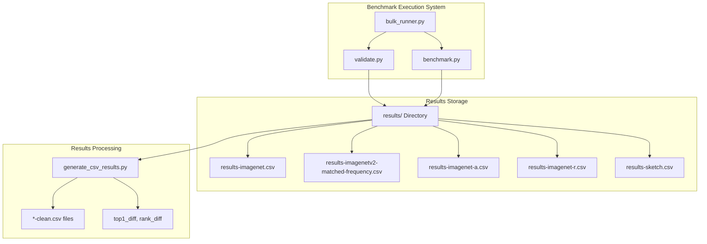
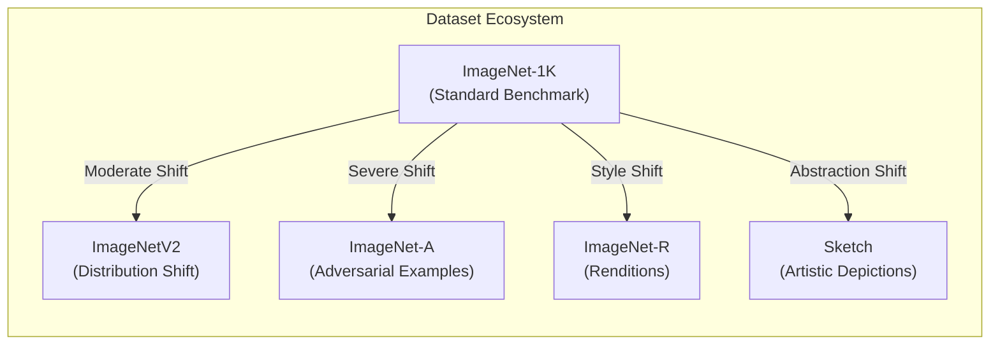
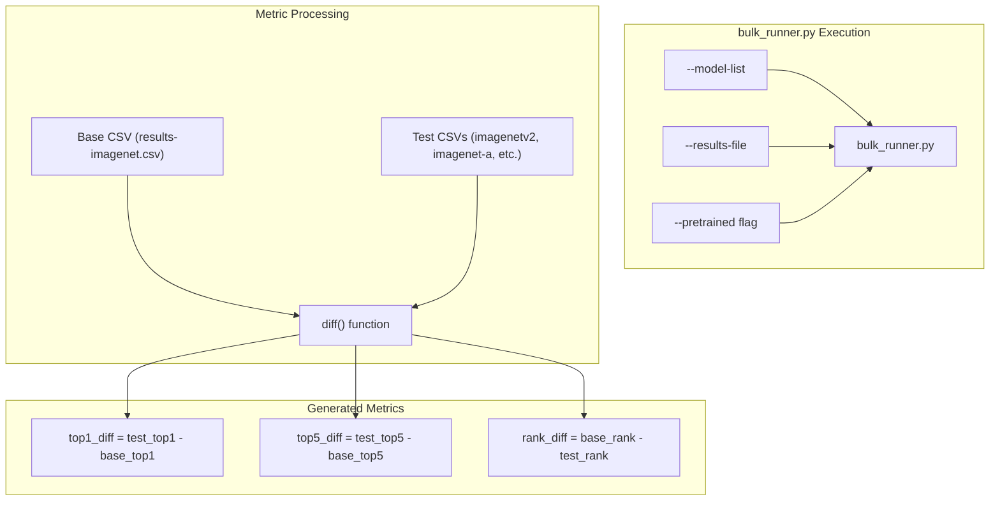
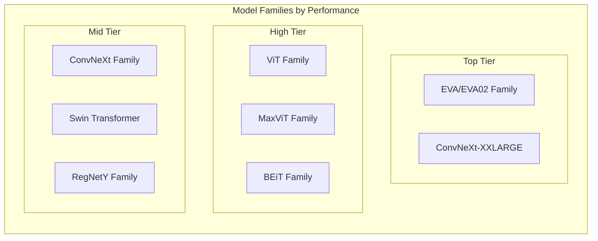

<!-- source: DeepWiki mcp.deepwiki.com · repo huggingface/pytorch-image-models · page 4.3 Benchmark Results and Analysis · fetched 2026-10-26 -->

# Benchmark Results and Analysis

<details>
<summary>Relevant source files</summary>

The following files were used as context for generating this wiki page:

- [results/generate_csv_results.py](results/generate_csv_results.py)
- [results/results-imagenet-a-clean.csv](results/results-imagenet-a-clean.csv)
- [results/results-imagenet-a.csv](results/results-imagenet-a.csv)
- [results/results-imagenet-r-clean.csv](results/results-imagenet-r-clean.csv)
- [results/results-imagenet-r.csv](results/results-imagenet-r.csv)
- [results/results-imagenet-real.csv](results/results-imagenet-real.csv)
- [results/results-imagenet.csv](results/results-imagenet.csv)
- [results/results-imagenetv2-matched-frequency.csv](results/results-imagenetv2-matched-frequency.csv)
- [results/results-sketch.csv](results/results-sketch.csv)

</details>


This page documents the benchmark system used in PyTorch Image Models (timm), explains how benchmark results are generated, stored, and analyzed, and provides guidance on interpreting these results. For information about the training process, please see [Training and Evaluation](#3).

## Purpose and Scope

The benchmark results system in timm serves several critical functions:
- Tracks model performance across multiple datasets to measure generalization
- Facilitates comparison between model architectures and training techniques
- Provides standardized evaluation metrics for the research community
- Helps users select appropriate models for their specific applications

This documentation covers the benchmark result files, metrics used for evaluation, performance trends across model families, and how to interpret the results for model selection.

## Benchmark System Architecture



Sources: 
- bulk_runner.py:1-270
- results/generate_csv_results.py:1-67
- results/results-imagenet.csv
- results/results-imagenetv2-matched-frequency.csv
- results/results-imagenet-a.csv
- results/results-imagenet-r.csv
- results/results-sketch.csv

The benchmark system in timm consists of execution scripts, result storage, and post-processing tools. The [bulk_runner.py]() script orchestrates model evaluation across multiple datasets, while [generate_csv_results.py]() processes raw results to compute robustness metrics.

### CSV Structure and Metrics

Each benchmark results CSV file includes the following columns:

| Column | Description |
|--------|-------------|
| model | Model identifier (architecture, training details) |
| img_size | Input resolution used for evaluation |
| top1 | Top-1 accuracy percentage |
| top1_err | Top-1 error rate percentage (100 - top1) |
| top5 | Top-5 accuracy percentage |
| top5_err | Top-5 error rate percentage (100 - top5) |
| param_count | Number of parameters in millions |
| crop_pct | Center crop percentage used during preprocessing |
| interpolation | Interpolation method for resizing (bicubic, bilinear, etc.) |

Robustness evaluation files (like ImageNetV2, ImageNet-A) include additional columns:

| Column | Description |
|--------|-------------|
| top1_diff | Difference in top-1 accuracy compared to ImageNet |
| top5_diff | Difference in top-5 accuracy compared to ImageNet |
| rank_diff | Change in ranking position compared to ImageNet |

Sources:
- results/results-imagenetv2-matched-frequency.csv
- results/results-imagenet-a.csv
- results/results-imagenet-r.csv
- results/results-sketch.csv

## Benchmark Datasets



The timm benchmark system evaluates models on multiple datasets to assess generalization capabilities:

1. **ImageNet-1K**: The standard benchmark with 1,000 classes. Serves as the baseline.
2. **ImageNetV2**: Contains distribution-shifted versions of ImageNet validation images.
3. **ImageNet-A**: Adversarially filtered natural images that cause misclassification.
4. **ImageNet-R (Rendition)**: Renditions of ImageNet classes (art, cartoons, sketches, etc.).
5. **Sketch**: Artistic sketch-based depictions of objects.

Each dataset tests different aspects of model robustness to distribution shifts, with increasing difficulty from ImageNetV2 to Sketch.

Sources:
- results/results-imagenet.csv
- results/results-imagenetv2-matched-frequency.csv
- results/results-imagenet-a.csv
- results/results-imagenet-r.csv
- results/results-sketch.csv

## Benchmark Execution and Analysis Tools



The benchmark analysis system uses several tools:

### Bulk Evaluation with bulk_runner.py

The [bulk_runner.py:27-47]() script provides automated model evaluation:

```bash
# Benchmark all 'vit*' models
python bulk_runner.py --model-list 'vit*' --results-file vit_bench.csv benchmark.py --amp -b 512

# Validate all models  
python bulk_runner.py --model-list all --results-file val.csv --pretrained validate.py --amp -b 512 --retry
```

### Results Processing with generate_csv_results.py

The [generate_csv_results.py:20-67]() script computes robustness metrics by comparing performance across datasets:

1. **Accuracy Metrics**: `top1` and `top5` from raw CSV files
2. **Robustness Metrics**: `top1_diff`, `top5_diff`, and `rank_diff` computed via the `diff()` function
3. **Ranking Analysis**: `rank_diff` shows position changes, with positive values indicating improved ranking

The `results` dictionary at [generate_csv_results.py:5-17]() defines which files are processed together to generate difference metrics.

Sources:
- bulk_runner.py:6-11
- bulk_runner.py:27-47
- results/generate_csv_results.py:5-17
- results/generate_csv_results.py:20-67

## Key Performance Trends

Analysis of the benchmark results reveals several consistent trends:

### Model Architecture Comparison



Based on the benchmark results, these patterns emerge:

1. **Architecture Performance**: EVA and EVA02 models consistently achieve the highest accuracy across datasets, followed by large Vision Transformers and ConvNeXt models.

2. **Robustness Analysis**: Larger models generally exhibit better robustness to distribution shifts. For example, the `eva02_large_patch14_448.mim_m38m_ft_in22k_in1k` model shows a 7.3% drop on ImageNetV2 compared to ImageNet, while smaller models often show >10% drops.

3. **Size-Performance Tradeoff**: The benchmark results demonstrate a clear correlation between model size and accuracy, but with diminishing returns. EVA02-Large models (305M parameters) often outperform much larger models with smaller input sizes.

4. **Distribution Shift Impact**: Performance decline is most dramatic on the Sketch dataset (often >25% drop) and ImageNet-A (often >20% drop), while ImageNetV2 shows milder degradation (typically 5-10%).

Sources:
- results/results-imagenetv2-matched-frequency.csv
- results/results-imagenet-a.csv
- results/results-imagenet-r.csv
- results/results-sketch.csv

### Current Top Performers

Based on the latest benchmark results, these models consistently rank at the top across multiple datasets:

| Model | ImageNet | ImageNetV2 | ImageNet-A | ImageNet-R | Sketch |
|-------|----------|------------|------------|------------|--------|
| eva02_large_patch14_448.mim_m38m_ft_in22k_in1k | 90.054% | 82.740% | 88.640% | 90.477% | 70.668% |
| eva02_large_patch14_448.mim_in22k_ft_in22k_in1k | 89.966% | 82.740% | 88.413% | 87.833% | 67.561% |
| eva_giant_patch14_560.m30m_ft_in22k_in1k | 89.796% | 81.810% | 87.320% | 88.413% | 67.480% |
| eva_giant_patch14_336.clip_ft_in1k | 89.462% | 82.190% | 85.120% | 90.517% | 71.200% |

### Robustness Analysis by Dataset

The robustness metrics reveal distinct patterns:

| Dataset | Typical Top-1 Drop | Best Models (lowest drop) |
|---------|-------------------|---------------------------|
| ImageNetV2 | 7-10% | EVA02/Giant models (-7.2% to -7.8%) |
| ImageNet-A | 10-15% | EVA02 Large models (-10.2% to -10.5%) |
| ImageNet-R | 0-5% | ConvNeXt XXLARGE (+2.0%) |
| Sketch | 18-25% | EVA Giant/ConvNeXt models (-18% to -19%) |

Sources:
- results/results-imagenet.csv:2-11
- results/results-imagenetv2-matched-frequency.csv:2-11
- results/results-imagenet-a.csv:2-11
- results/results-imagenet-r.csv:2-11
- results/results-sketch.csv:2-11

## Performance vs. Robustness Analysis

A key insight from the benchmark results is the relationship between model performance and robustness to distribution shifts:

1. **Model Size Impact**: Larger models (>300M parameters) generally show better robustness to distribution shifts with smaller performance drops relative to their original ImageNet accuracy.

2. **Architecture Effect**: Vision Transformer models (particularly EVA/EVA02) demonstrate superior robustness compared to convolutional models of similar size.

3. **Pre-training Influence**: Models with extensive pre-training (e.g., those with "clip", "m38m", or "in22k" in their names) show better generalization to novel distributions.

4. **Resolution Sensitivity**: Higher resolution inputs (384+) contribute significantly to robustness across distribution shifts.

The `rank_diff` metric reveals that some models maintain consistent ranking across datasets (values near 0), while others show dramatic shifts in relative performance (large positive or negative values).

Sources:
- results/results-imagenetv2-matched-frequency.csv
- results/results-imagenet-a.csv
- results/results-imagenet-r.csv
- results/results-sketch.csv

## Using Benchmark Results for Model Selection

### Automated Benchmarking Workflow

To evaluate new models or reproduce results, use the bulk evaluation system:

```bash
# Evaluate specific model families
python bulk_runner.py --model-list 'eva*' --results-file eva_results.csv validate.py --amp

# Benchmark with pretrained weights only
python bulk_runner.py --pretrained --results-file pretrained_bench.csv benchmark.py
```

### Result Interpretation Guidelines

1. **Performance Baseline**: Use ImageNet accuracy as the primary metric, found in [results/results-imagenet.csv]()

2. **Robustness Assessment**: Check `top1_diff` and `rank_diff` values in comparison files:
   - Small `|top1_diff|` values (< 8%) indicate good robustness
   - Stable `rank_diff` values (near 0) show consistent relative performance

3. **Efficiency Analysis**: Balance `param_count` and `img_size` against accuracy requirements

4. **Dataset-Specific Selection**: 
   - Natural images: Prioritize ImageNet and ImageNetV2 performance
   - Artistic content: Focus on Sketch and ImageNet-R results
   - Adversarial robustness: Emphasize ImageNet-A performance

### Processing Custom Results

To generate difference metrics for new benchmark runs:

1. Add base and comparison CSV files to the `results` dictionary in [generate_csv_results.py:5-17]()
2. Run the script to compute `top1_diff`, `top5_diff`, and `rank_diff` metrics
3. The `diff()` function at [generate_csv_results.py:20-47]() handles the metric calculations

The most reliable models show:
- ImageNet accuracy > 85%
- |`top1_diff`| < 10% across all datasets  
- Consistent ranking positions (`|rank_diff|` < 20)

Sources:
- bulk_runner.py:6-11
- results/generate_csv_results.py:5-17
- results/generate_csv_results.py:20-47
- results/results-imagenet.csv
- results/results-imagenetv2-matched-frequency.csv

## Conclusion

The benchmark results in timm provide comprehensive evaluation of model performance across multiple datasets with varying distribution shifts. These results offer valuable insights for both researchers developing new architectures and practitioners selecting models for specific applications.

Key takeaways:
- EVA and EVA02 models currently define the state-of-the-art in both accuracy and robustness
- Vision Transformers generally outperform ConvNets in robustness to distribution shifts
- Model size, input resolution, and pre-training strategy all significantly impact generalization
- Different benchmark datasets highlight distinct aspects of model robustness

By analyzing these benchmark results, users can make informed decisions about model selection based on their specific requirements for accuracy, robustness, and efficiency.

---

