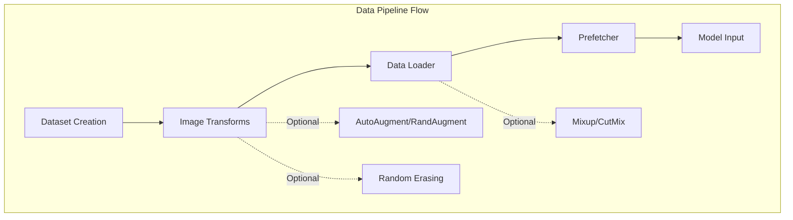
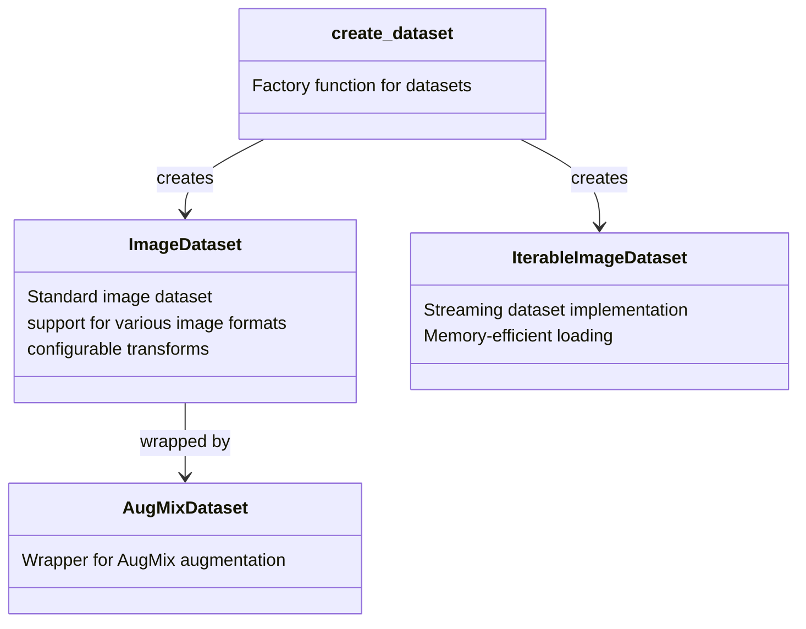
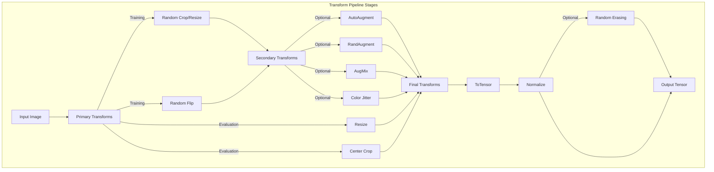
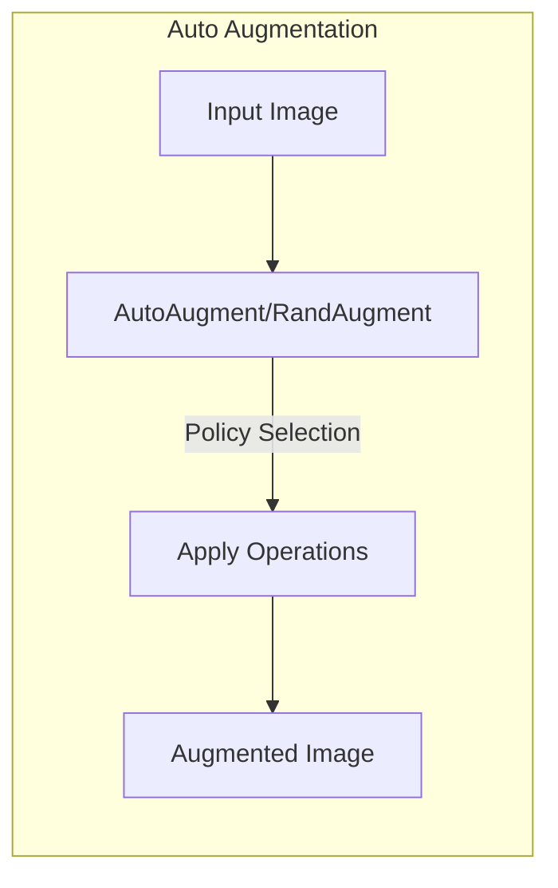
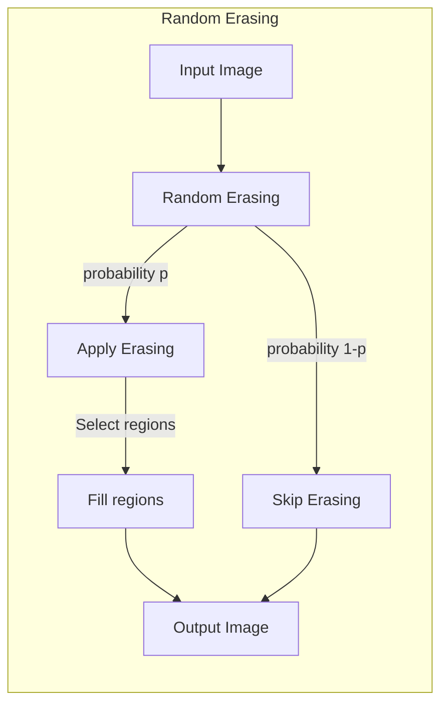
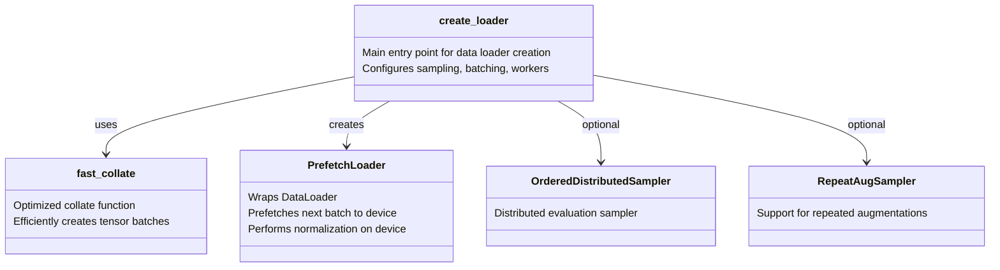
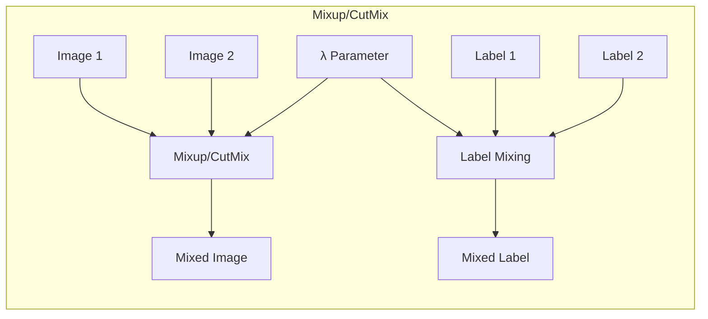

<!-- source: DeepWiki mcp.deepwiki.com · repo huggingface/pytorch-image-models · page 5 Data Pipeline · fetched 2026-10-26 -->

# Data Pipeline

<details>
<summary>Relevant source files</summary>

The following files were used as context for generating this wiki page:

- [README.md](README.md)
- [benchmark.py](benchmark.py)
- [inference.py](inference.py)
- [timm/data/__init__.py](timm/data/__init__.py)
- [timm/data/config.py](timm/data/config.py)
- [timm/data/naflex_dataset.py](timm/data/naflex_dataset.py)
- [timm/data/naflex_loader.py](timm/data/naflex_loader.py)
- [timm/data/naflex_mixup.py](timm/data/naflex_mixup.py)
- [timm/data/naflex_random_erasing.py](timm/data/naflex_random_erasing.py)
- [timm/data/naflex_transforms.py](timm/data/naflex_transforms.py)
- [timm/layers/attention_pool.py](timm/layers/attention_pool.py)
- [timm/layers/diff_attention.py](timm/layers/diff_attention.py)
- [timm/layers/pool1d.py](timm/layers/pool1d.py)
- [timm/models/naflexvit.py](timm/models/naflexvit.py)
- [timm/version.py](timm/version.py)
- [train.py](train.py)
- [validate.py](validate.py)

</details>


The Data Pipeline in PyTorch Image Models (timm) provides a comprehensive system for loading, transforming, and augmenting image data for model training and evaluation. It offers efficient implementations of state-of-the-art data augmentation techniques while maintaining high throughput for training deep learning models.

This page documents the core components and workflow of the data pipeline system. For information about training and evaluation, see [Training and Evaluation](#3).

## Core Components and Architecture

The data pipeline consists of several interconnected components that transform raw images into properly formatted tensors ready for model training or inference.



The pipeline follows these key steps:
1. **Dataset Creation**: Load images from disk or other sources
2. **Transforms**: Apply various image transformations and augmentations
3. **Data Loading**: Batch images efficiently using PyTorch's DataLoader
4. **Prefetching**: Optimize GPU utilization by prefetching the next batch
5. **Optional Augmentations**: Apply advanced techniques like Mixup/CutMix

Sources: [timm/data/__init__.py](), [timm/data/loader.py]()

## Dataset Creation

timm provides several dataset classes for handling image data:



The dataset classes handle reading images from disk and preparing them for processing through the transform pipeline.

Sources: [timm/data/__init__.py]()

## Transform Pipeline

The transform pipeline is responsible for converting raw images into properly formatted tensors with appropriate augmentations.

### Transform Architecture



The transform pipeline is created by the `create_transform` function which configures the appropriate transforms based on whether the dataset is for training or evaluation.

Sources: [timm/data/transforms_factory.py:334-460]()

### Primary Transforms

Primary transforms handle basic image manipulations:

#### For Training:
- `RandomResizedCropAndInterpolation`: Randomly crops and resizes images
- Random horizontal and vertical flips

#### For Evaluation:
- `Resize`: Resizes images to a target size
- `CenterCrop`: Crops the center of the image

These transforms are configured with parameters like input size, interpolation method, and crop percentage.

Sources: [timm/data/transforms.py:166-269](), [timm/data/transforms_factory.py:64-117](), [timm/data/transforms_factory.py:247-331]()

### Advanced Augmentation Techniques

timm implements several state-of-the-art augmentation techniques:

#### AutoAugment and RandAugment



- **AutoAugment**: Implements learned policies from the AutoAugment paper
- **RandAugment**: Simplified automatic augmentation with random magnitude and operations

Sources: [timm/data/auto_augment.py:407-561](), [timm/data/auto_augment.py:736-843]()

#### Random Erasing (Cutout)

Random Erasing masks random rectangular regions of the input image:



The implementation in `RandomErasing` supports different fill modes and multiple erasing regions per image.

Sources: [timm/data/random_erasing.py:26-117]()

## Data Loading and Prefetching

The data loading system is built around PyTorch's DataLoader with several optimizations:



The `create_loader` function is the main entry point for creating data loaders, configuring various options like batch size, distributed training, and prefetching.

### PrefetchLoader

The `PrefetchLoader` class is a key optimization that:
1. Prefetches the next batch to the device (GPU/NPU) while the current batch is processed
2. Performs normalization and random erasing on the device rather than CPU
3. Improves training speed by overlapping data loading with computation

Sources: [timm/data/loader.py:76-178](), [timm/data/loader.py:196-374]()

## Mixing Techniques

timm implements Mixup and CutMix, techniques that create new training samples by combining pairs of images:



### Mixup

Mixup blends two images and their labels with a mixing coefficient λ:
- Images: `x = λ*x1 + (1-λ)*x2`
- Labels: `y = λ*y1 + (1-λ)*y2`

### CutMix

CutMix replaces a random rectangular region of one image with the same region from another:
- The labels are mixed proportionally to the area: `y = λ*y1 + (1-λ)*y2`

Two implementations are provided:
- `Mixup`: Standard implementation for post-loading mixing
- `FastCollateMixup`: Efficient implementation that applies mixing during batch collation

Sources: [timm/data/mixup.py:90-218](), [timm/data/mixup.py:221-316]()

## Creating a Complete Pipeline

The entire pipeline is typically created through the `create_loader` function:

```python
# Create data loader with transform pipeline
loader = create_loader(
    dataset,                      # Dataset to load from
    input_size=(3, 224, 224),     # Input dimensions (C,H,W)
    batch_size=128,               # Batch size
    is_training=True,             # Training mode
    auto_augment='rand-m9-mstd0.5', # RandAugment config
    re_prob=0.25,                 # Random Erasing probability
    mixup_alpha=0.2,              # Mixup alpha parameter
    cutmix_alpha=1.0,             # CutMix alpha parameter
    use_prefetcher=True,          # Enable prefetching
    num_workers=8,                # Worker processes for loading
)
```

The `create_loader` function handles all the complexity of configuring the pipeline components based on the provided arguments.

Sources: [timm/data/loader.py:196-374]()

## Performance Optimizations

The data pipeline includes several optimizations to maximize throughput:

1. **Prefetching**: Uses `PrefetchLoader` to overlap data loading with model computation
2. **Fast Collate**: Optimized batch collation for uint8 images (`fast_collate`)
3. **Device-side Operations**: Performs normalization and random erasing on the GPU
4. **MultiEpochsDataLoader**: Avoids worker reinitialization between epochs
5. **Parallel Workers**: Configurable through the `num_workers` parameter
6. **Efficient Augmentations**: Optimized implementations of advanced augmentation techniques

These optimizations are particularly important for large datasets like ImageNet, where data loading can easily become a bottleneck.

Sources: [timm/data/loader.py:29-61](), [timm/data/loader.py:76-178](), [timm/data/loader.py:377-409]()

## Distributed Training Support

For distributed training scenarios, the data pipeline provides:

- `OrderedDistributedSampler`: Ensures deterministic ordering in distributed evaluation
- `RepeatAugSampler`: Supports repeated augmentations in distributed settings
- Worker seeding controls to ensure reproducibility across processes

Sources: [timm/data/loader.py:319-331]()

## Example Use Cases

### Basic Training Pipeline

```python
loader = create_loader(
    dataset,
    input_size=(3, 224, 224),
    batch_size=128,
    is_training=True,
    hflip=0.5,                # 50% horizontal flip probability
    color_jitter=0.4,         # Color jitter factor
    use_prefetcher=True,
    num_workers=8,
)
```

### Advanced Training with Augmentations

```python
loader = create_loader(
    dataset,
    input_size=(3, 224, 224),
    batch_size=64,
    is_training=True,
    auto_augment='rand-m9-mstd0.5-inc1',  # RandAugment config
    re_prob=0.25,             # Random Erasing probability
    mixup_alpha=0.2,          # Mixup alpha parameter
    cutmix_alpha=1.0,         # CutMix alpha parameter
    use_prefetcher=True,
    num_workers=8,
)
```

### Evaluation Pipeline

```python
loader = create_loader(
    dataset,
    input_size=(3, 224, 224),
    batch_size=256,
    is_training=False,
    crop_pct=0.95,            # Center crop percentage
    use_prefetcher=True,
    num_workers=8,
)
```

Sources: [timm/data/loader.py:196-374](), [timm/data/transforms_factory.py:334-460]()

---

