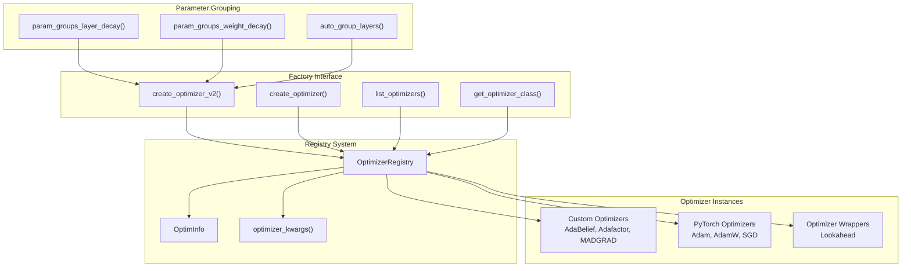
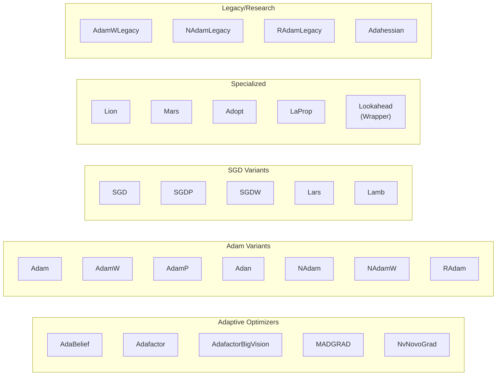
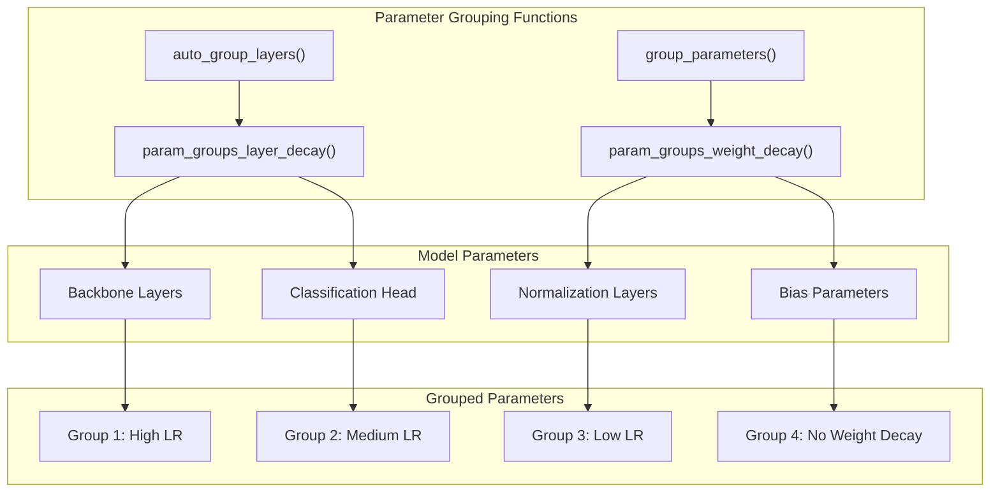
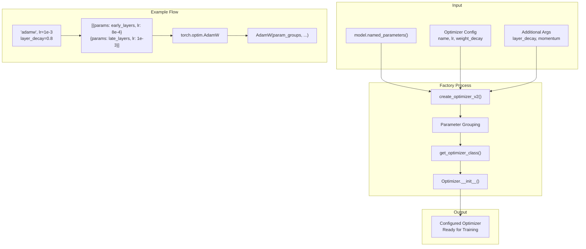
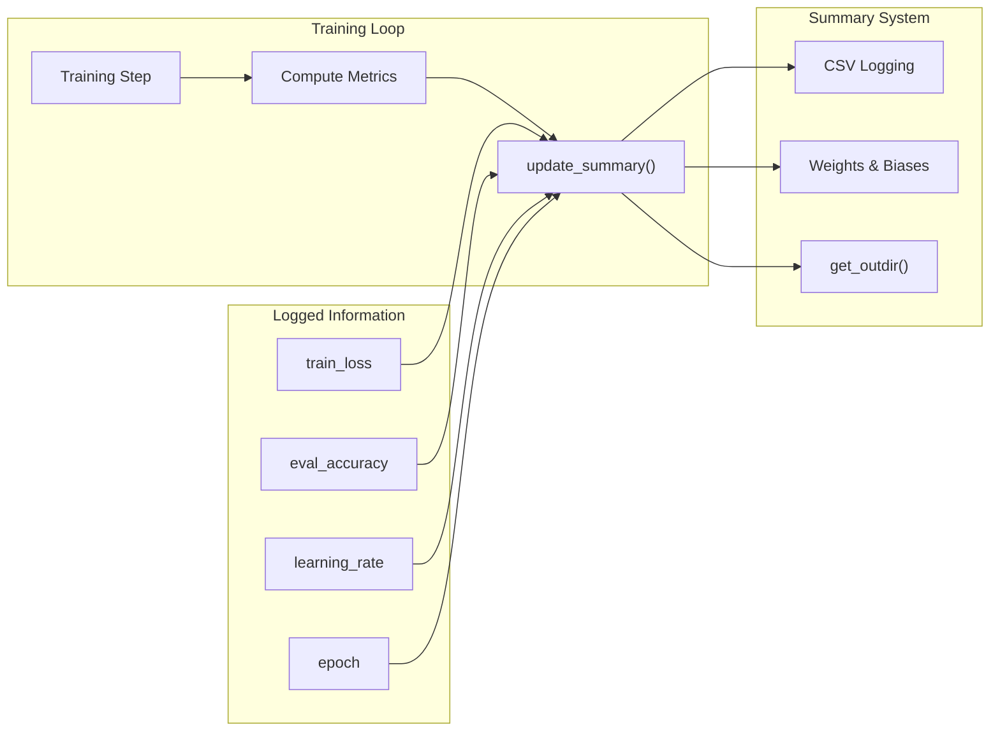

<!-- source: DeepWiki mcp.deepwiki.com · repo huggingface/pytorch-image-models · page 6 Optimization System · fetched 2026-10-26 -->

# Optimization System

<details>
<summary>Relevant source files</summary>

The following files were used as context for generating this wiki page:

- [README.md](README.md)
- [tests/test_optim.py](tests/test_optim.py)
- [timm/optim/_optim_factory.py](timm/optim/_optim_factory.py)
- [timm/optim/_param_groups.py](timm/optim/_param_groups.py)
- [timm/optim/kron.py](timm/optim/kron.py)
- [timm/optim/muon.py](timm/optim/muon.py)
- [timm/version.py](timm/version.py)

</details>


The Optimization System provides a comprehensive framework for creating, configuring, and managing optimizers used during model training. This system includes a factory pattern for optimizer creation, an extensive collection of state-of-the-art optimizer implementations, utilities for parameter grouping (such as layer-wise learning rate decay), and integration with experiment tracking tools.

For information about training scripts and infrastructure, see [Training Scripts and Infrastructure](#4.1). For details about learning rate scheduling, refer to the broader [Training and Evaluation](#4) system.

## Optimizer Factory Architecture

The optimization system is built around a central factory pattern that provides a unified interface for creating optimizers across the entire library.



Sources: [timm/optim/__init__.py:32-34](), [timm/optim/optim_factory.py:1-8]()

## Available Optimizer Implementations

The system provides an extensive collection of optimizer implementations, ranging from PyTorch built-ins to cutting-edge research optimizers.

### Core Optimizer Categories



Sources: [timm/optim/__init__.py:1-35]()

### Key Optimizer Features

| Optimizer | Key Features | Use Cases |
|-----------|-------------|-----------|
| `Adafactor` | Memory-efficient, factorized second moments | Large models, memory-constrained training |
| `AdaBelief` | Adapts step size by "belief" in gradient direction | General purpose, often better than Adam |
| `MADGRAD` | Momentumized adaptive dual averaging | Fast convergence, good generalization |
| `Lion` | Sign-based updates, memory efficient | Large scale training |
| `Lookahead` | Meta-optimizer wrapper for stability | Wraps other optimizers for stability |

Sources: [timm/optim/adafactor.py:21-44](), [timm/optim/adabelief.py:34-39](), [timm/optim/madgrad.py:25-53](), [timm/optim/lookahead.py:15-24]()

## Parameter Grouping System

The optimization system provides sophisticated parameter grouping utilities that allow different optimizer settings for different parts of the model.



Sources: [timm/optim/__init__.py:34](), [timm/optim/optim_factory.py:4]()

### Layer-wise Learning Rate Decay

The `param_groups_layer_decay` function implements layer-wise learning rate decay, where deeper layers receive progressively smaller learning rates:

- **Purpose**: Apply different learning rates to different layers
- **Pattern**: `lr = base_lr * (decay_rate ^ layer_depth)`
- **Benefits**: Stabilizes training of very deep networks

### Weight Decay Grouping

The `param_groups_weight_decay` function separates parameters that should and shouldn't receive weight decay:

- **No Weight Decay**: Bias parameters, normalization layer parameters
- **Standard Weight Decay**: Weight matrices, embedding layers
- **Custom Patterns**: User-defined parameter matching

Sources: [timm/optim/optim_factory.py:4]()

## Optimizer Factory Usage Flow

The following diagram shows how the factory system creates configured optimizers from model parameters:



Sources: [timm/optim/__init__.py:32-34]()

## Experiment Tracking Integration

The optimization system integrates with experiment tracking tools to monitor training progress and optimizer behavior.



Sources: [timm/utils/summary.py:30-51]()

### Summary Logging Features

The `update_summary` function provides comprehensive logging capabilities:

- **CSV Output**: Structured logging to CSV files for analysis
- **Weights & Biases**: Real-time experiment tracking via `wandb.log()`
- **Metric Aggregation**: Combines training and evaluation metrics
- **Learning Rate Tracking**: Monitors optimizer learning rate changes

Key parameters tracked:
- `epoch`: Current training epoch
- `train_*`: Training metrics (loss, accuracy, etc.)
- `eval_*`: Evaluation metrics
- `lr`: Current learning rate

Sources: [timm/utils/summary.py:30-51]()

## Advanced Optimizer Features

### Mixed Precision Support

Many optimizers in the system support mixed precision training with automatic gradient scaling:

```python
# Example from Adafactor implementation
if grad.dtype in {torch.float16, torch.bfloat16}:
    grad = grad.float()
# ... optimizer computation in float32 ...
if p.dtype in {torch.float16, torch.bfloat16}:
    p.copy_(p_fp32)
```

Sources: [timm/optim/adafactor.py:143-144](), [timm/optim/adafactor.py:226-227]()

### Factorized Optimizers

Optimizers like `Adafactor` use memory-efficient factorization for large parameter tensors:

- **Row/Column Factorization**: Reduces memory for 2D+ tensors
- **Automatic Dimension Selection**: Heuristics for choosing factorization dimensions
- **Fallback to Full**: Uses full tensors when factorization isn't beneficial

Sources: [timm/optim/adafactor.py:100-115]()

### Optimizer Wrappers

The `Lookahead` optimizer demonstrates the wrapper pattern:

- **Base Optimizer**: Wraps any existing optimizer
- **Slow Weights**: Maintains a separate set of "slow" weights
- **Periodic Updates**: Updates slow weights every `k` steps

Sources: [timm/optim/lookahead.py:15-67]()