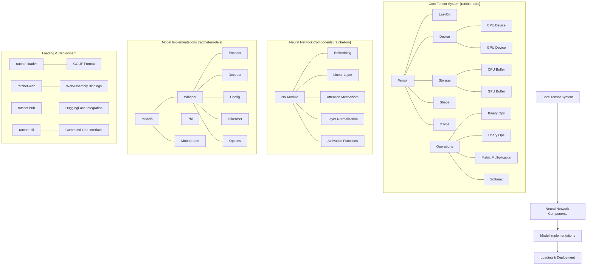
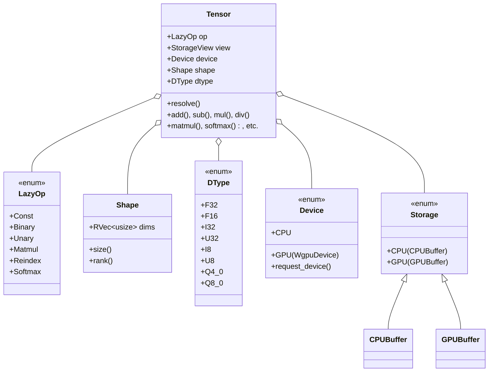
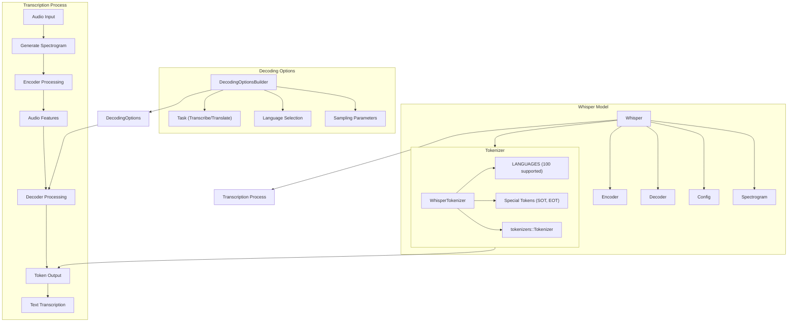
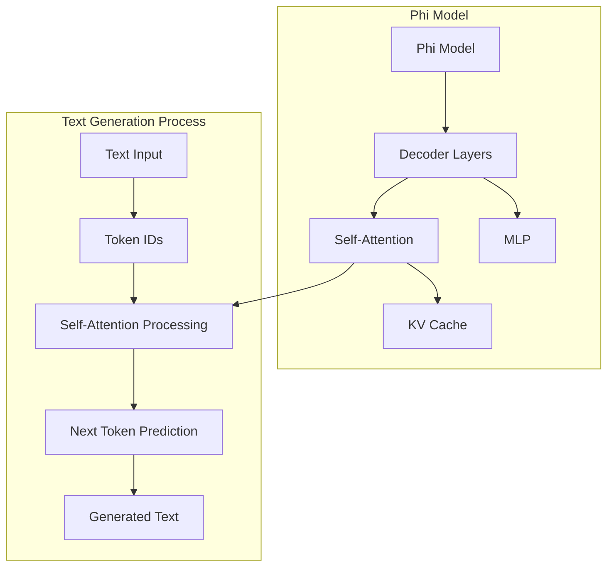
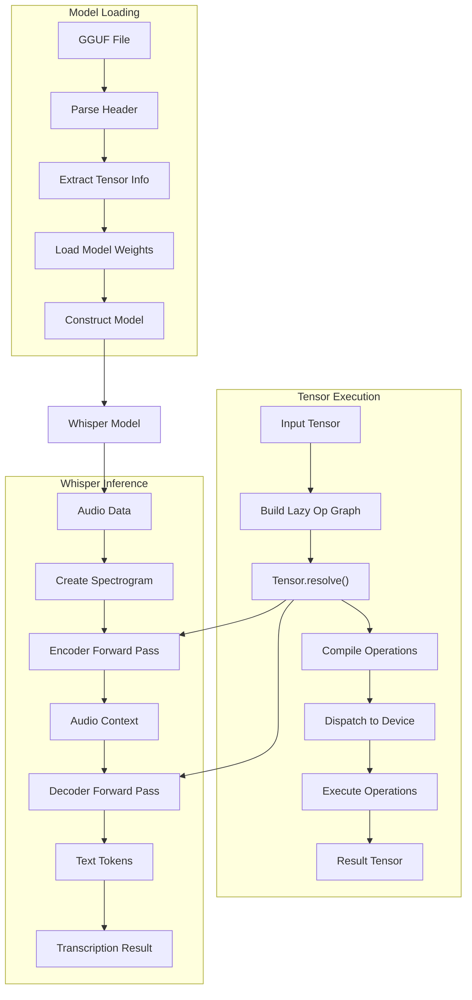
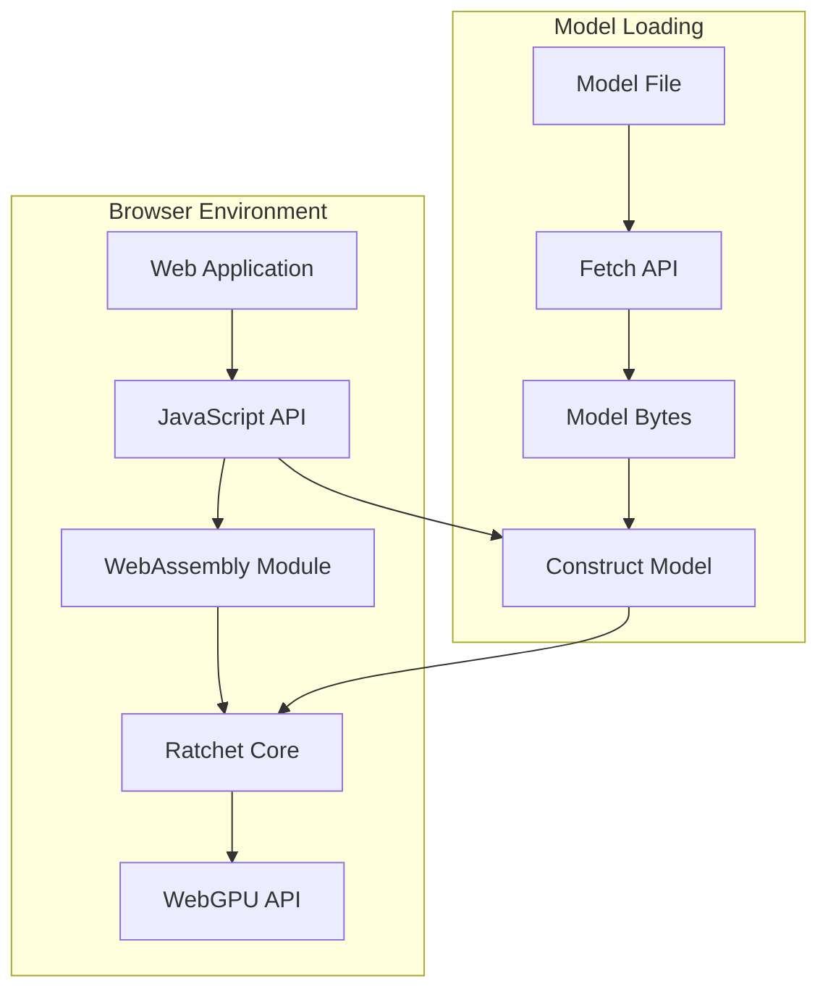
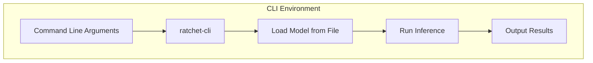

<!-- source: DeepWiki mcp.deepwiki.com · repo huggingface/ratchet · page 1 Overview · fetched 2026-10-26 -->

# Overview

<details>
<summary>Relevant source files</summary>

The following files were used as context for generating this wiki page:

- [.github/workflows/rust.yml](.github/workflows/rust.yml)
- [crates/ratchet-core/Cargo.toml](crates/ratchet-core/Cargo.toml)
- [crates/ratchet-core/src/lib.rs](crates/ratchet-core/src/lib.rs)
- [crates/ratchet-core/tests/attn_tests.rs](crates/ratchet-core/tests/attn_tests.rs)
- [crates/ratchet-models/Cargo.toml](crates/ratchet-models/Cargo.toml)
- [crates/ratchet-models/src/whisper/mod.rs](crates/ratchet-models/src/whisper/mod.rs)
- [crates/ratchet-models/src/whisper/options.rs](crates/ratchet-models/src/whisper/options.rs)
- [crates/ratchet-models/src/whisper/tokenizer.rs](crates/ratchet-models/src/whisper/tokenizer.rs)
- [justfile](justfile)
- [pnpm-workspace.yaml](pnpm-workspace.yaml)

</details>


## Purpose and Scope

Ratchet is a high-performance tensor computation framework written in Rust, designed for efficient machine learning model inference with a focus on web deployment through WebAssembly. The framework provides:

1. A core tensor system supporting both CPU and GPU execution (via WebGPU)
2. Neural network primitives for building machine learning models
3. Implementations of popular models like Whisper (speech recognition) and Phi (language model)
4. Tools for loading models from standardized formats (GGUF)
5. Deployment options including web browsers (WebAssembly) and command-line interfaces

For detailed information about specific systems, see:
- [Core Tensor System](#2) for tensor operations and device abstractions
- [Model Implementations](#3) for specific model architectures and usage
- [Model Loading](#4) for loading models from file formats
- [Deployment](#5) for running models in different environments

## System Architecture

The diagram below illustrates the layered architecture of Ratchet:



Sources: [crates/ratchet-core/Cargo.toml](), [crates/ratchet-models/Cargo.toml](), [crates/ratchet-core/src/lib.rs]()

## Core Tensor System

The core tensor system provides the foundation for all computations in Ratchet:



Key features of the tensor system:

1. **Lazy Evaluation**: Operations on tensors create a computation graph via `LazyOp` that is executed only when `resolve()` is called.
2. **Shape and Data Types**: Support for multiple shapes and data types, including F32, F16, I32, and quantized types.
3. **Device Abstraction**: Computations can be performed on CPU or GPU through the `Device` abstraction.
4. **Memory Management**: Efficient buffer allocation and reuse strategies for both CPU and GPU memory.

Example tensor operations:
```rust
// Create a tensor with specific shape
let input = Tensor::randn::<f32>(shape![1, 128, 256], Device::CPU);

// Matrix multiplication
let output = input.matmul(weights, false, false)?;

// Apply softmax
let output = output.softmax(2)?;

// Resolve to execute computation
let result = output.resolve()?;
```

Sources: [crates/ratchet-core/src/lib.rs](), [crates/ratchet-core/tests/attn_tests.rs:50-66]()

## Model Implementations

### Whisper Speech Recognition Model

The Whisper model is structured as follows:



The Whisper implementation includes:

- **Model Structure**: Encoder-decoder architecture for audio transcription
- **Tokenizer**: Handles 100 languages with special tokens for tasks and control
- **Decoding Options**: Configurable parameters for inference (language, temperature, etc.)
- **Spectrogram Generation**: Converts raw audio to mel spectrograms
- **Transcription Process**: End-to-end pipeline from audio to text

Configuring Whisper transcription:
```rust
let options = DecodingOptionsBuilder::new()
    .task(Task::Transcribe)
    .language("en")
    .temperature(0.0)
    .build();
```

Sources: [crates/ratchet-models/src/whisper/mod.rs](), [crates/ratchet-models/src/whisper/options.rs](), [crates/ratchet-models/src/whisper/tokenizer.rs]()

### Phi Language Model



Sources: [crates/ratchet-models/Cargo.toml]()

## Execution Flow

The execution flow in Ratchet involves several stages:



The key aspect of Ratchet's execution flow is lazy evaluation. Operations on tensors build a computation graph that is only executed when `resolve()` is called. This allows for optimization of the computation sequence and efficient memory allocation.

Sources: [crates/ratchet-core/tests/attn_tests.rs]()

## Deployment Options

### Web Deployment via WebAssembly



### Command Line Interface



Sources: [.github/workflows/rust.yml](), [justfile]()

## Project Structure

The codebase is organized into several crates, each with a specific responsibility:

| Crate | Description | Key Components |
|-------|-------------|----------------|
| ratchet-core | Core tensor system | Tensor, LazyOp, Device, Storage, Shape, DType |
| ratchet-nn | Neural network components | Embedding, Linear, Attention, LayerNorm |
| ratchet-models | Model implementations | Whisper, Phi, Moondream |
| ratchet-loader | Model loading utilities | GGUF format parsing, tensor loading |
| ratchet-web | WebAssembly bindings | JavaScript API, WASM exports |
| ratchet-hub | HuggingFace integration | Model repository access |
| ratchet-cli | Command-line interface | Argument parsing, model execution |

This organization allows for a clean separation of concerns, with each crate building upon the functionality provided by lower-level crates.

Sources: [crates/ratchet-core/Cargo.toml](), [crates/ratchet-models/Cargo.toml](), [pnpm-workspace.yaml]()

## Environment Configuration

Ratchet supports various runtime environments and configurations, controlled through environment variables and build features:

```
RUST_LOG: "info"
WGPU_DX12_COMPILER: dxc
RUSTFLAGS: --cfg=web_sys_unstable_apis
RUST_BACKTRACE: 1
RATCHET_FORCE_F32: 1
```

These settings enable debugging, configure GPU backends, and set tensor precision.

Sources: [.github/workflows/rust.yml:9-22]()

## Development and Testing

The project includes a comprehensive test suite, including tests for core tensor operations and model-specific functionality:

```bash
# Run tests
cargo nextest run -j 1 --no-fail-fast --features=ci,pyo3

# Build WebAssembly module
just wasm ratchet-web

# Publish WebAssembly package
just wasm-publish-pr ratchet-web
```

Sources: [.github/workflows/rust.yml:51-73](), [justfile:7-16]()

---

