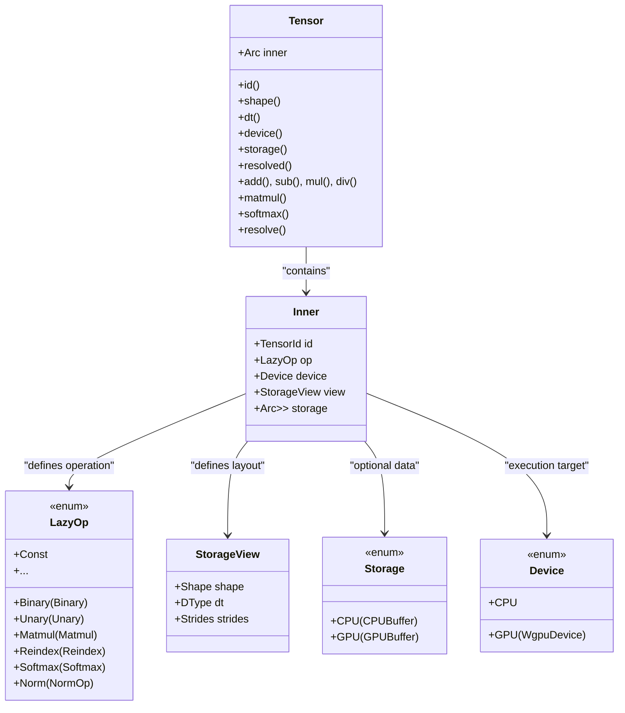
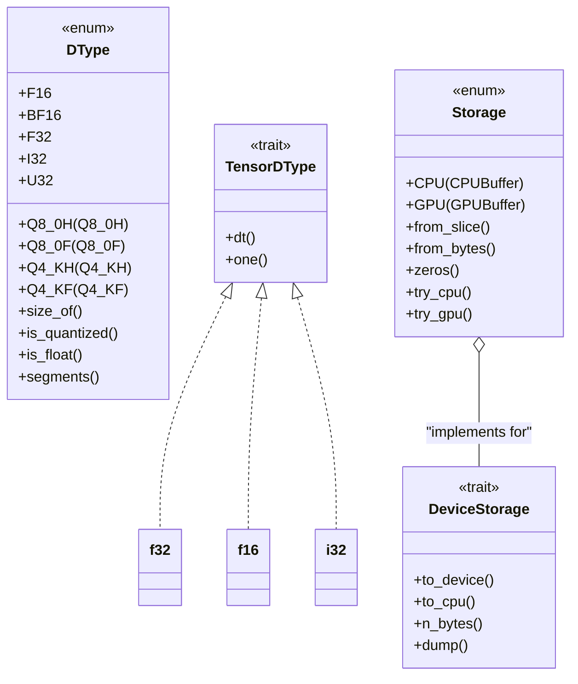
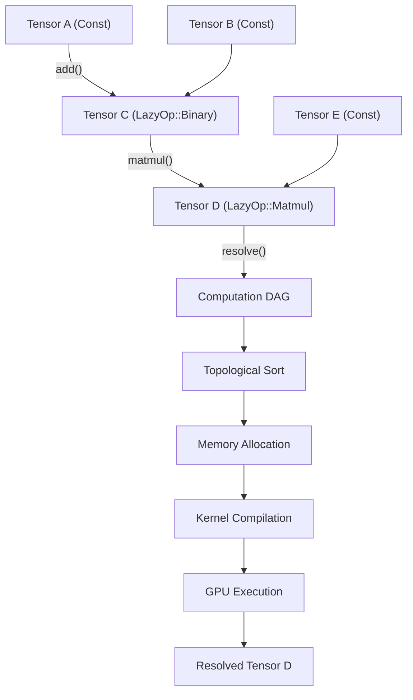
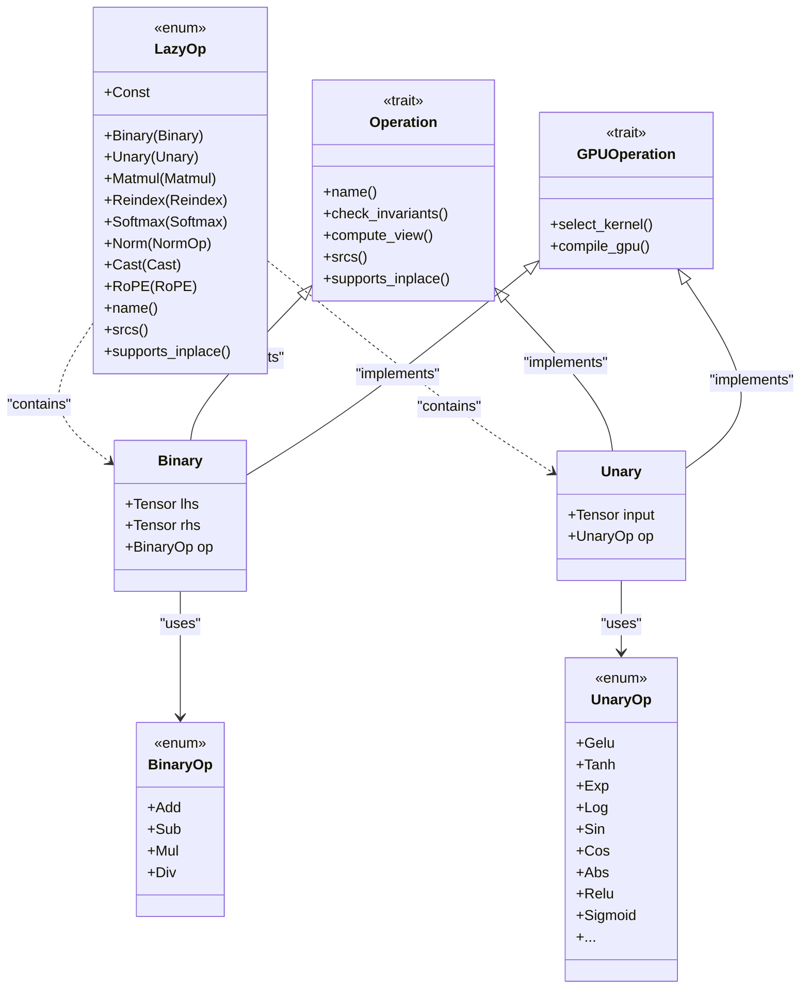
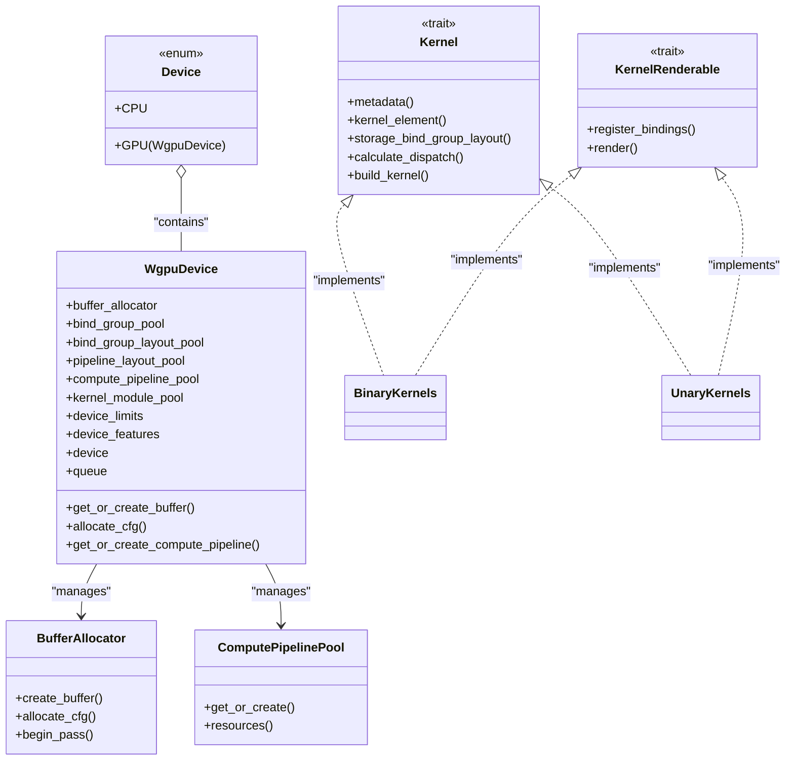
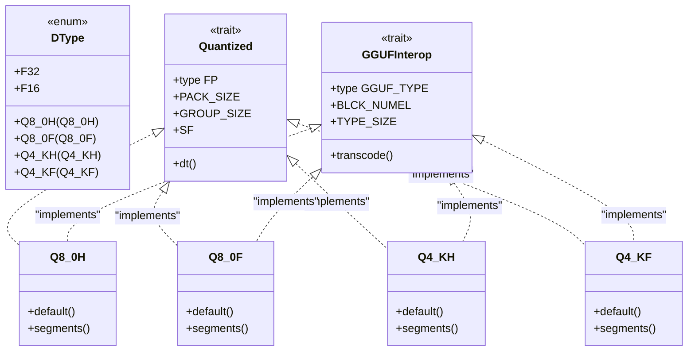

<!-- source: DeepWiki mcp.deepwiki.com · repo huggingface/ratchet · page 2 Core Tensor System · fetched 2026-10-26 -->

# Core Tensor System

Relevant source files

The following files were used as context for generating this wiki page:

- [Cargo.toml](Cargo.toml)
- [crates/ratchet-core/src/dtype/blocks.rs](crates/ratchet-core/src/dtype/blocks.rs)
- [crates/ratchet-core/src/dtype/mod.rs](crates/ratchet-core/src/dtype/mod.rs)
- [crates/ratchet-core/src/gpu/align.rs](crates/ratchet-core/src/gpu/align.rs)
- [crates/ratchet-core/src/gpu/device.rs](crates/ratchet-core/src/gpu/device.rs)
- [crates/ratchet-core/src/gpu/pools/pipeline_pool.rs](crates/ratchet-core/src/gpu/pools/pipeline_pool.rs)
- [crates/ratchet-core/src/op.rs](crates/ratchet-core/src/op.rs)
- [crates/ratchet-core/src/ops/binary.rs](crates/ratchet-core/src/ops/binary.rs)
- [crates/ratchet-core/src/ops/unary.rs](crates/ratchet-core/src/ops/unary.rs)
- [crates/ratchet-core/src/storage/cpu_buffer.rs](crates/ratchet-core/src/storage/cpu_buffer.rs)
- [crates/ratchet-core/src/storage/mod.rs](crates/ratchet-core/src/storage/mod.rs)
- [crates/ratchet-core/src/tensor.rs](crates/ratchet-core/src/tensor.rs)
- [crates/ratchet-loader/src/gguf/dtype.rs](crates/ratchet-loader/src/gguf/dtype.rs)

The Core Tensor System is the foundation of Ratchet, providing tensor operations and abstractions that power all neural network computations in the library. It implements a lazy computation model with efficient execution on both CPU and GPU backends. This page documents the tensor representation, operations, storage system, and execution model that make up this core subsystem.

For information about specific model implementations built on top of this system, see [Model Implementations](#3). For details about the neural network layers, see [Neural Network Components](#3.1).

## Tensor Representation and Structure

The `Tensor` is the primary abstraction in Ratchet, representing a multi-dimensional array of values with associated metadata.

Sources: [crates/ratchet-core/src/tensor.rs:44-51](), [crates/ratchet-core/src/tensor.rs:144-151]()

A `Tensor` contains:

1. **Unique identifier**: Each tensor has a unique ID for tracking in the computation graph
2. **Lazy operation**: Defines how this tensor was or will be computed
3. **Device**: Specifies whether the tensor is on CPU or GPU
4. **StorageView**: Metadata about shape, data type, and memory layout
5. **Storage**: The actual data buffer (may be None if not yet computed)

Tensors in Ratchet are lazy by default - operations create new tensors with updated lazy operations, but actual computation is deferred until explicitly requested.

Sources: [crates/ratchet-core/src/tensor.rs:131-142](), [crates/ratchet-core/src/tensor.rs:186-247]()

## Data Types and Storage

Ratchet supports various data types to handle different precision requirements and memory constraints.

### Supported Data Types

The system supports:
- **Full precision**: 32-bit floating point (`F32`)
- **Half precision**: 16-bit floating point (`F16`, `BF16`)
- **Integer types**: 32-bit signed and unsigned integers (`I32`, `U32`)
- **Quantized types**: 8-bit and 4-bit quantized formats for memory-efficient inference
  - `Q8_0H`/`Q8_0F`: 8-bit quantization with FP16/FP32 scales
  - `Q4_KH`/`Q4_KF`: 4-bit quantization with FP16/FP32 scales

Sources: [crates/ratchet-core/src/dtype/mod.rs:12-23](), [crates/ratchet-core/src/dtype/blocks.rs:52-59]()

### Storage System

Tensor data is managed through a unified storage abstraction that handles both CPU and GPU memory:

- **CPUBuffer**: Manages memory on the CPU with efficient allocation and data access
- **GPUBuffer**: Manages memory on the GPU with WebGPU buffer management
- **DeviceStorage trait**: Provides methods for data transfer between devices

Quantized tensors use special storage formats that separate quantized values from scale factors for efficient processing on GPU.

Sources: [crates/ratchet-core/src/storage/mod.rs:14-18](), [crates/ratchet-core/src/storage/cpu_buffer.rs:64-145](), [crates/ratchet-core/src/dtype/blocks.rs:11-35]()

## Lazy Evaluation and Operation Graph

Ratchet uses a lazy computation model where operations form a directed acyclic graph (DAG) that is only evaluated when explicitly requested.

### Lazy Operation Flow

1. **Operation registration**: When operations like `add()` or `matmul()` are called, they create new tensors with updated lazy operations
2. **DAG construction**: The operations form a directed acyclic graph of computations
3. **Resolution**: The `resolve()` method triggers evaluation of the computation graph
4. **Execution ordering**: `execution_order()` determines the correct sequence of operations
5. **Memory allocation**: Storage for intermediate tensors is allocated efficiently
6. **Execution**: Operations are executed on the appropriate device (CPU or GPU)

Sources: [crates/ratchet-core/src/tensor.rs:696-740](), [crates/ratchet-core/src/tensor.rs:772-863]()

## Operation System

Ratchet implements a comprehensive set of tensor operations through a clean abstraction hierarchy.

### Operation Abstraction

The operation system is built around these key abstractions:

1. **Operation trait**: A hardware-agnostic interface for tensor operations, providing methods for:
   - Getting the operation name
   - Checking operation invariants
   - Computing the output tensor shape and type
   - Accessing source tensors
   - Determining if in-place execution is supported

2. **GPUOperation trait**: Extends Operation with GPU-specific functionality:
   - Kernel selection based on input types and shapes
   - GPU compilation for shader generation

3. **Operation implementations**:
   - Binary operations: `add`, `sub`, `mul`, `div`
   - Unary operations: `exp`, `log`, `tanh`, `relu`, `sigmoid`, etc.
   - Matrix operations: `matmul`, `gemm`
   - Tensor manipulation: `slice`, `view`, `permute`, `broadcast_to`
   - Neural network operations: `softmax`, `layer_norm`, `rope`

Sources: [crates/ratchet-core/src/op.rs:14-31](), [crates/ratchet-core/src/op.rs:217-262](), [crates/ratchet-core/src/op.rs:273-363]()

## GPU Acceleration

The GPU backend in Ratchet provides high-performance tensor computation through WebGPU.

### GPU Device Management

The GPU system is built around the `WgpuDevice` abstraction that:
1. Manages access to the underlying WebGPU device
2. Provides resource pools for efficient reuse of GPU resources
3. Handles buffer allocation and memory management
4. Compiles and caches compute shaders for tensor operations

Sources: [crates/ratchet-core/src/gpu/device.rs:18-30](), [crates/ratchet-core/src/gpu/device.rs:52-121]()

### Kernel System

Operations on GPU use a kernel system that:
1. Selects appropriate kernel implementation based on tensor properties
2. Calculates optimal dispatch parameters (workgroup size and count)
3. Generates WGSL shader code for operations
4. Compiles and caches shader modules
5. Sets up binding groups for tensor data access
6. Executes the compiled pipeline

The system supports vectorized operations (`Vec2`, `Vec4`) for improved performance and has special handling for quantized data types.

Sources: [crates/ratchet-core/src/op.rs:280-362](), [crates/ratchet-core/src/ops/binary.rs:196-239](), [crates/ratchet-core/src/gpu/pools/pipeline_pool.rs:35-62]()

### Memory Management

GPU memory is managed efficiently through:
1. Buffer reuse across operations
2. Lifetime-based buffer allocation to minimize memory usage
3. Alignment handling for different data types and WebGPU requirements
4. Special handling for quantized tensor formats with segmented memory layout

Sources: [crates/ratchet-core/src/gpu/device.rs:267-273](), [crates/ratchet-core/src/gpu/align.rs:1-76]()

## Tensor Creation and Manipulation

The system provides comprehensive methods for creating and manipulating tensors:

| Operation | Description | Source |
|-----------|-------------|--------|
| `from_data()` | Creates a tensor from raw data | [tensor.rs:577-586]() |
| `zeros()` | Creates a tensor filled with zeros | [tensor.rs:560-565]() |
| `randn()` | Creates a tensor with random normal values | [tensor.rs:534-551]() |
| `slice()` | Extracts a slice of a tensor | [tensor.rs:426-448]() |
| `view()` | Creates a tensor with reshaped data | [tensor.rs:454-461]() |
| `permute()` | Reorders tensor dimensions | [tensor.rs:472-479]() |
| `broadcast_to()` | Broadcasts to a larger shape | [tensor.rs:488-495]() |
| `to()` | Transfers a tensor between devices | [tensor.rs:949-955]() |

The API provides an ergonomic interface for building neural network architectures with automatic differentiation not supported at this time.

Sources: [crates/ratchet-core/src/tensor.rs:295-510]()

## Quantization Support

Ratchet includes first-class support for quantized tensors, which are crucial for efficient inference of large language models.

The quantization system provides:
1. Standard quantized formats compatible with GGUF models
2. Specialized memory layouts for efficient GPU computation
3. Seamless loading of quantized weights from model files
4. Automatic dequantization during tensor operations

Quantized tensors are stored in segmented memory layouts with separate regions for quantized values, scale factors, and other parameters to optimize GPU memory access patterns.

Sources: [crates/ratchet-core/src/dtype/blocks.rs:35-166](), [crates/ratchet-core/src/dtype/mod.rs:19-23](), [crates/ratchet-loader/src/gguf/dtype.rs:21-198]()

## Summary

The Core Tensor System provides the foundation for all neural network operations in Ratchet with:

1. A flexible tensor representation with support for various data types
2. A lazy computation model for building operation graphs
3. A unified storage system spanning CPU and GPU memory
4. A rich set of tensor operations with efficient implementations
5. GPU acceleration through WebGPU
6. First-class support for quantized models

This system enables efficient inference of state-of-the-art machine learning models across different devices and platforms while maintaining a clean, composable API.

---

