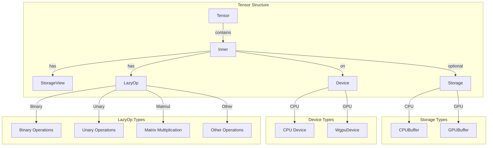
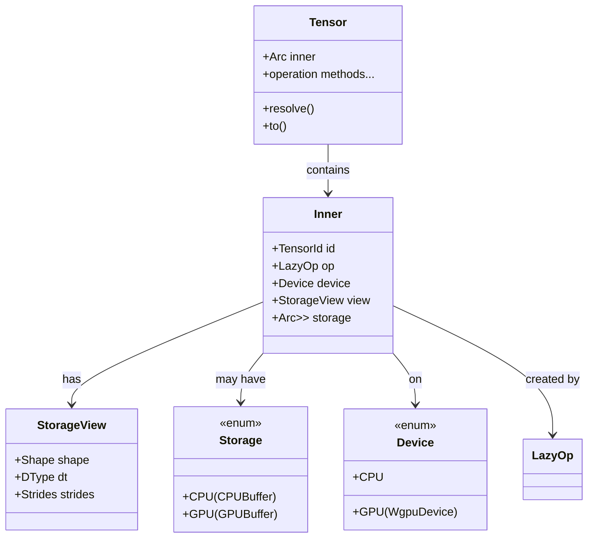
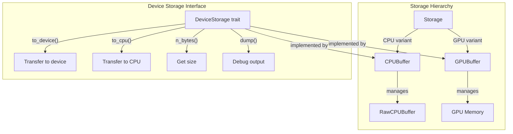
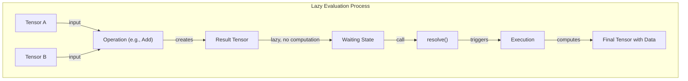
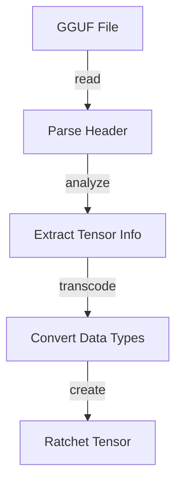

<!-- source: DeepWiki mcp.deepwiki.com · repo huggingface/ratchet · page 2.1 Tensor Representation · fetched 2026-10-26 -->

# Tensor Representation

<details>
<summary>Relevant source files</summary>

The following files were used as context for generating this wiki page:

- [crates/ratchet-core/src/dtype/blocks.rs](crates/ratchet-core/src/dtype/blocks.rs)
- [crates/ratchet-core/src/dtype/mod.rs](crates/ratchet-core/src/dtype/mod.rs)
- [crates/ratchet-core/src/gpu/align.rs](crates/ratchet-core/src/gpu/align.rs)
- [crates/ratchet-core/src/op.rs](crates/ratchet-core/src/op.rs)
- [crates/ratchet-core/src/ops/binary.rs](crates/ratchet-core/src/ops/binary.rs)
- [crates/ratchet-core/src/ops/unary.rs](crates/ratchet-core/src/ops/unary.rs)
- [crates/ratchet-core/src/quant.rs](crates/ratchet-core/src/quant.rs)
- [crates/ratchet-core/src/storage/cpu_buffer.rs](crates/ratchet-core/src/storage/cpu_buffer.rs)
- [crates/ratchet-core/src/storage/mod.rs](crates/ratchet-core/src/storage/mod.rs)
- [crates/ratchet-core/src/tensor.rs](crates/ratchet-core/src/tensor.rs)
- [crates/ratchet-loader/src/gguf/dtype.rs](crates/ratchet-loader/src/gguf/dtype.rs)
- [crates/ratchet-loader/src/lib.rs](crates/ratchet-loader/src/lib.rs)
- [crates/ratchet-nn/src/embedding.rs](crates/ratchet-nn/src/embedding.rs)

</details>


This page explains how tensors are represented in Ratchet, including their internal structure, shape and data type management, storage mechanisms, and memory layout. For information about operations that can be performed on tensors, see [Tensor Operations](#2.2).

## Overview

In Ratchet, a `Tensor` is a multi-dimensional array with a lazy evaluation system. Tensors form the foundation of the machine learning library, representing both model parameters and activations. Tensors are created either directly from data or as a result of operations on other tensors, but actual computation is deferred until explicitly requested.



Sources: [crates/ratchet-core/src/tensor.rs:44-127](), [crates/ratchet-core/src/op.rs:12-31]()

## Core Components

A `Tensor` in Ratchet comprises several core components that work together to represent and manage multi-dimensional data efficiently.

### Tensor Structure

The `Tensor` struct contains an `Arc<Inner>` which represents the actual tensor data and metadata:



Sources: [crates/ratchet-core/src/tensor.rs:44-47](), [crates/ratchet-core/src/tensor.rs:144-151](), [crates/ratchet-core/src/tensor.rs:131-142](), [crates/ratchet-core/src/storage/mod.rs:14-19]()

The key components are:

1. **Tensor**: The public-facing struct that users interact with, implementing operations like addition, matrix multiplication, etc.

2. **Inner**: Contains the actual tensor data and metadata, including:
   - `id`: A unique identifier for the tensor
   - `op`: The lazy operation that created this tensor
   - `device`: The device (CPU or GPU) where the tensor resides
   - `view`: Metadata about shape, dtype, and memory layout
   - `storage`: Optional actual data storage

3. **StorageView**: Contains metadata about the tensor's shape and memory layout:
   - `shape`: The dimensions of the tensor
   - `dt`: The data type of the tensor elements
   - `strides`: How to navigate through memory to access elements

4. **Storage**: An enum that can be either `CPU(CPUBuffer)` or `GPU(GPUBuffer)`, representing where the tensor's data is stored.

5. **Device**: An enum that can be either `CPU` or `GPU(WgpuDevice)`, representing where operations on the tensor will be executed.

Sources: [crates/ratchet-core/src/tensor.rs:44-183](), [crates/ratchet-core/src/storage/mod.rs:14-19]()

## Data Types

Ratchet supports a variety of data types through the `DType` enum, including both standard floating-point types and quantized types for memory-efficient storage.

```mermaid
classDiagram
    class DType {
        <<enum>>
        +F16
        +BF16
        +F32
        +I32
        +U32
        +Q8_0H(Q8_0H)
        +Q8_0F(Q8_0F)
        +Q4_KH(Q4_KH)
        +Q4_KF(Q4_KF)
        +size_of()
        +is_quantized()
        +segments()
    }
    
    class TensorDType {
        <<trait>>
        +dt() DType
        +one() Self
    }
    
    class Quantized {
        <<trait>>
        +FP: TensorDType
        +PACK_SIZE: usize
        +GROUP_SIZE: usize
        +SF: Self::FP
        +dt() DType
    }
    
    TensorDType <|-- "f32"
    TensorDType <|-- "f16"
    TensorDType <|-- "i32"
    TensorDType <|-- "u32"
    
    Quantized <|-- "Q8_0F"
    Quantized <|-- "Q8_0H"
    Quantized <|-- "Q4_KF"
    Quantized <|-- "Q4_KH"
```

Sources: [crates/ratchet-core/src/dtype/mod.rs:12-23](), [crates/ratchet-core/src/dtype/mod.rs:177-182](), [crates/ratchet-core/src/dtype/blocks.rs:168-219]()

### Basic Data Types

The basic data types supported by Ratchet include:

- **F32**: 32-bit floating point
- **F16**: 16-bit floating point
- **BF16**: 16-bit brain floating point
- **I32**: 32-bit signed integer 
- **U32**: 32-bit unsigned integer

### Quantized Data Types

Ratchet supports quantized data types for memory-efficient storage:

- **Q8_0F/H**: 8-bit quantization with 32-bit (F) or 16-bit (H) scales
- **Q4_KF/H**: 4-bit quantization with 32-bit (F) or 16-bit (H) scales in K format

Quantized types implement the `Quantized` trait, which provides information about:
- `PACK_SIZE`: Number of values packed into each storage element
- `GROUP_SIZE`: Number of values sharing a scale factor
- `SF`: Scale factor for quantization

Sources: [crates/ratchet-core/src/dtype/mod.rs:12-132](), [crates/ratchet-core/src/dtype/blocks.rs:168-219](), [crates/ratchet-core/src/quant.rs:1-164]()

## Storage Mechanisms

Tensors in Ratchet can store their data on either CPU or GPU, using specialized buffer types for each.



Sources: [crates/ratchet-core/src/storage/mod.rs:14-132](), [crates/ratchet-core/src/storage/cpu_buffer.rs:8-146]()

### Storage Types

1. **Storage**: An enum with two variants:
   - `CPU(CPUBuffer)`: For data stored in CPU memory
   - `GPU(GPUBuffer)`: For data stored in GPU memory

2. **CPUBuffer**: Manages CPU memory through an `Arc<RawCPUBuffer>`.
   - Provides methods for creating buffers from data and accessing the data
   - Handles memory allocation and deallocation

3. **GPUBuffer**: Manages GPU memory through WebGPU buffers.
   - Provides methods for transferring data between CPU and GPU
   - Handles GPU memory allocation

The `DeviceStorage` trait defines common operations for both storage types:
- `to_device()`: Transfer data to a specific device
- `to_cpu()`: Transfer data to CPU
- `n_bytes()`: Get the size of the buffer in bytes
- `dump()`: Generate a debug string representation

Sources: [crates/ratchet-core/src/storage/mod.rs:14-132](), [crates/ratchet-core/src/storage/cpu_buffer.rs:64-194]()

### Memory Alignment

Ratchet enforces strict memory alignment rules for efficient GPU operations:

- **Copy Buffer Alignment**: 4 bytes, required for all buffers
- **Storage Buffer Alignment**: 256 bytes, required for GPU storage buffer offsets

These alignments are particularly important for quantized tensors, where different components of the quantized data (e.g., quantized values, scales) are stored in separate memory segments.

Sources: [crates/ratchet-core/src/gpu/align.rs:1-76]()

## Tensor Creation and Management

Tensors can be created in several ways:

### Creating Tensors

1. **From data**:
   ```rust
   Tensor::from_data(data, shape, device)
   ```

2. **Zeros initialization**:
   ```rust
   Tensor::zeros::<T>(shape, device)
   ```

3. **Random initialization**:
   ```rust
   Tensor::randn::<T>(shape, device)
   ```

4. **Range of values**:
   ```rust
   Tensor::range::<T>(shape, device)
   ```

5. **From quantized data**:
   ```rust
   Tensor::from_quantized(data, dt, shape, device)
   ```

Sources: [crates/ratchet-core/src/tensor.rs:513-586](), [crates/ratchet-core/src/tensor.rs:618-628]()

### Memory Management

Tensors use reference counting (`Arc`) to manage memory. When a tensor is no longer needed, its memory is automatically freed. Key aspects of memory management include:

1. **Reference Counting**: Using `Arc` for shared ownership
2. **Lazy Allocation**: Storage is only allocated when needed
3. **Device Transfer**: Methods to move tensors between CPU and GPU

```rust
// Get a tensor on GPU
let gpu_tensor = cpu_tensor.to(&Device::GPU)?;

// Move back to CPU
let cpu_tensor = gpu_tensor.to(&Device::CPU)?;
```

Sources: [crates/ratchet-core/src/tensor.rs:933-955]()

## Lazy Evaluation

One of the key features of Ratchet is lazy evaluation. Operations on tensors don't immediately compute results; instead, they build an operation graph that is executed when `resolve()` is called.



Sources: [crates/ratchet-core/src/tensor.rs:861-874](), [crates/ratchet-core/src/op.rs:14-122]()

### Operation Graph

Operations on tensors create new tensors with `LazyOp` instances that describe the operation:

```rust
// Creates a new tensor with a Binary operation
let c = a.add(b)?;
```

The `LazyOp` enum includes various operation types:
- `Binary`: Binary operations like add, subtract, multiply, divide
- `Unary`: Unary operations like tanh, exp, log
- `Matmul`: Matrix multiplication
- `Reindex`: Operations that change the index pattern (slice, permute, broadcast)
- And many more

Sources: [crates/ratchet-core/src/op.rs:14-31](), [crates/ratchet-core/src/tensor.rs:294-312]()

### Execution Process

When `resolve()` is called, Ratchet:

1. Determines the execution order by analyzing dependencies
2. For each unresolved tensor in the execution order:
   - Allocates storage for the tensor
   - Compiles the operation into a GPU kernel (if on GPU)
   - Executes the operation
3. Returns the resolved tensor with computed data

This lazy evaluation approach allows Ratchet to:
- Optimize the execution graph
- Minimize memory usage
- Batch operations for efficient execution

Sources: [crates/ratchet-core/src/tensor.rs:696-740](), [crates/ratchet-core/src/tensor.rs:772-862]()

## Quantization Support

Ratchet provides robust support for quantized tensors to reduce memory usage and improve performance.

### Quantization Process

The quantization process converts floating-point tensors to quantized formats:

1. **Quantization**: Convert a floating-point tensor to a quantized format
   ```rust
   let quantized = quantize::<Q8_0F>(&tensor);
   ```

2. **Dequantization**: Convert a quantized tensor back to floating-point
   ```rust
   let dequantized = dequantize(quantized);
   ```

Quantized tensors have special memory layouts that optimize storage and computation. For example, the Q8_0 format:

```
| Quantized values (qs) | Scale factors (d) |
```

Each value in the tensor is computed as: `actual_value = quantized_value * scale_factor`

Sources: [crates/ratchet-core/src/quant.rs:19-49](), [crates/ratchet-core/src/quant.rs:101-130](), [crates/ratchet-core/src/dtype/blocks.rs:52-102]()

### Quantized Data Types

The quantized types supported by Ratchet include:

| Type | Description | Precision | Scale Type |
|------|-------------|-----------|------------|
| Q8_0F | 8-bit quantization | 8-bit integers | 32-bit float |
| Q8_0H | 8-bit quantization | 8-bit integers | 16-bit float |
| Q4_KF | 4-bit K-quantization | 4-bit integers | 32-bit float |
| Q4_KH | 4-bit K-quantization | 4-bit integers | 16-bit float |

Each quantized type has parameters that control its behavior:
- `PACK_SIZE`: Number of values packed into each storage element
- `GROUP_SIZE`: Number of values sharing a scale factor
- `SF`: Scale factor for quantization

Sources: [crates/ratchet-core/src/dtype/blocks.rs:168-219](), [crates/ratchet-loader/src/gguf/dtype.rs:16-198]()

## Loading from External Formats

Ratchet supports loading tensors from external formats, particularly GGUF (GPT-Generated Unified Format) used by models like Llama.

### GGUF Support

The `ratchet-loader` crate provides utilities for loading tensors from GGUF files:



Sources: [crates/ratchet-loader/src/lib.rs:1-142](), [crates/ratchet-loader/src/gguf/dtype.rs:21-240]()

### Data Type Conversion

When loading from GGUF, Ratchet maps GGUF data types to its own internal types:

| GGUF Type | Ratchet Type |
|-----------|--------------|
| F32 | DType::F32 |
| F16 | DType::F16 |
| Q8_0 | DType::Q8_0F/H |
| Q4_K | DType::Q4_KF/H |

This conversion process is handled by the `GGUFInterop` trait, which defines methods for transcoding between formats.

Sources: [crates/ratchet-loader/src/lib.rs:46-55](), [crates/ratchet-loader/src/gguf/dtype.rs:21-240]()

## Summary

Ratchet's tensor representation system provides a flexible and efficient foundation for machine learning operations:

1. **Unified Interface**: The `Tensor` struct provides a consistent interface regardless of the underlying data type or storage location.

2. **Lazy Evaluation**: Operations build a computation graph that is evaluated only when needed, enabling optimizations.

3. **Multiple Data Types**: Support for standard floating-point types and memory-efficient quantized types.

4. **Cross-Device Support**: Tensors can seamlessly move between CPU and GPU, with appropriate storage management.

5. **Quantization Support**: Built-in support for quantized formats, including loading from external model files.

This architecture allows Ratchet to efficiently represent and manipulate tensors for machine learning models, balancing performance with memory efficiency.

---

