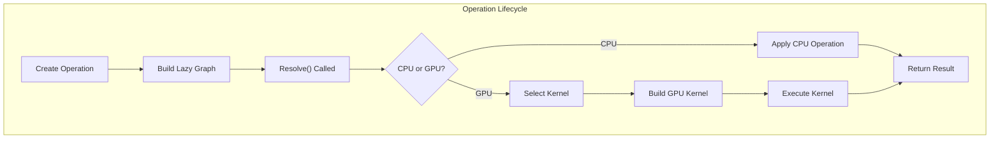
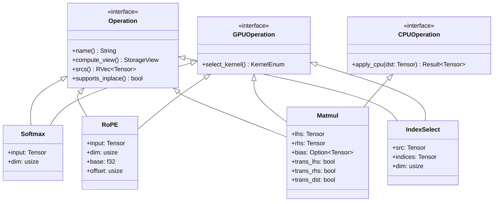
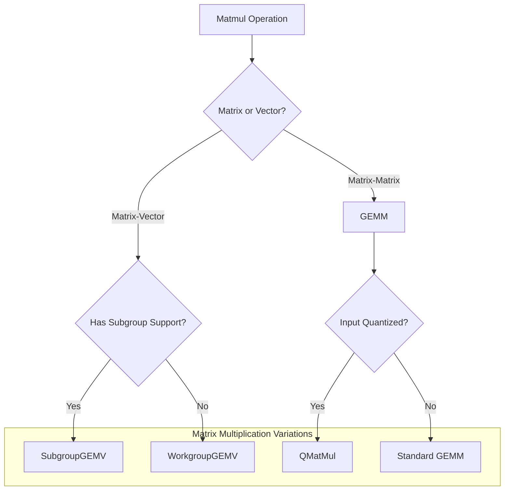
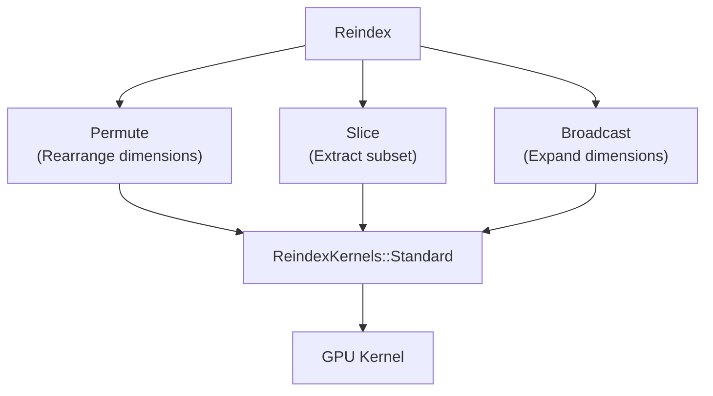
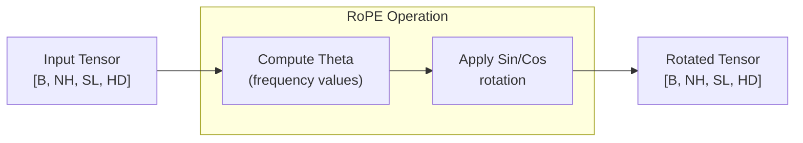
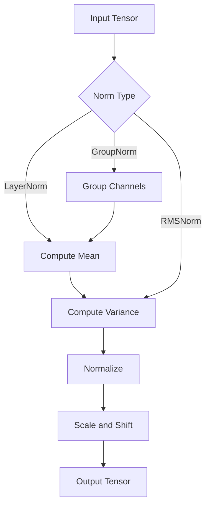
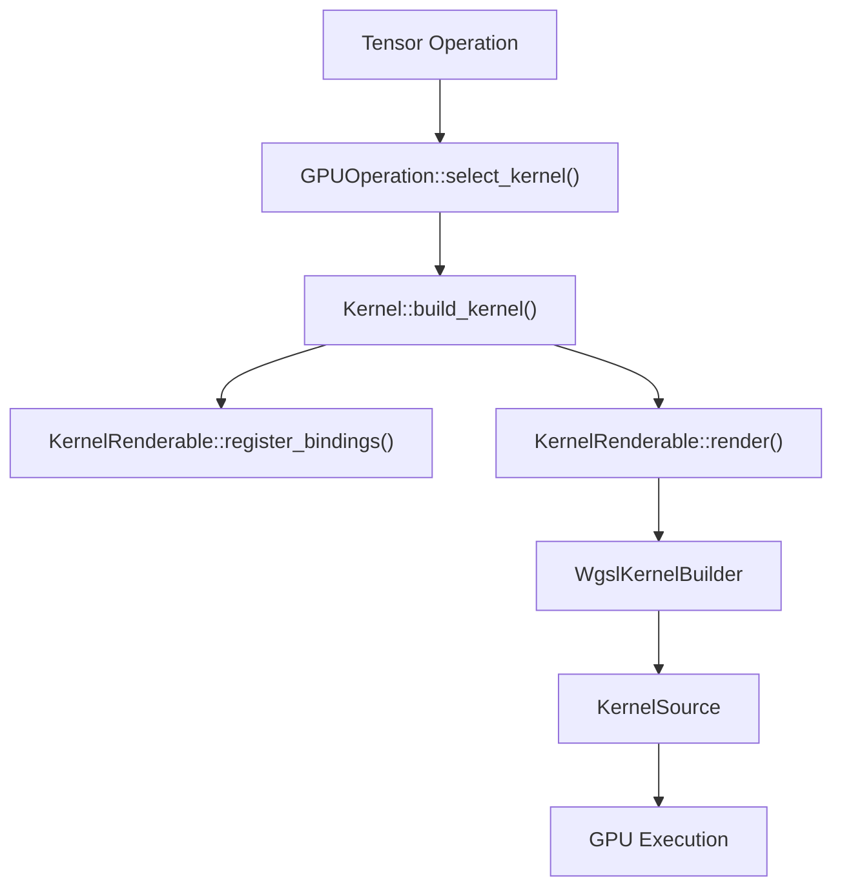

<!-- source: DeepWiki mcp.deepwiki.com · repo huggingface/ratchet · page 2.2 Tensor Operations · fetched 2026-10-26 -->

# Tensor Operations

<details>
<summary>Relevant source files</summary>

The following files were used as context for generating this wiki page:

- [crates/ratchet-core/src/cpu/gemm.rs](crates/ratchet-core/src/cpu/gemm.rs)
- [crates/ratchet-core/src/cpu/mod.rs](crates/ratchet-core/src/cpu/mod.rs)
- [crates/ratchet-core/src/cpu/rope.rs](crates/ratchet-core/src/cpu/rope.rs)
- [crates/ratchet-core/src/gpu/wgsl/kernel.rs](crates/ratchet-core/src/gpu/wgsl/kernel.rs)
- [crates/ratchet-core/src/gpu/wgsl/kernel_builder.rs](crates/ratchet-core/src/gpu/wgsl/kernel_builder.rs)
- [crates/ratchet-core/src/ops/cache.rs](crates/ratchet-core/src/ops/cache.rs)
- [crates/ratchet-core/src/ops/cast.rs](crates/ratchet-core/src/ops/cast.rs)
- [crates/ratchet-core/src/ops/concat.rs](crates/ratchet-core/src/ops/concat.rs)
- [crates/ratchet-core/src/ops/conv.rs](crates/ratchet-core/src/ops/conv.rs)
- [crates/ratchet-core/src/ops/index_write.rs](crates/ratchet-core/src/ops/index_write.rs)
- [crates/ratchet-core/src/ops/matmul/gemm.rs](crates/ratchet-core/src/ops/matmul/gemm.rs)
- [crates/ratchet-core/src/ops/matmul/mod.rs](crates/ratchet-core/src/ops/matmul/mod.rs)
- [crates/ratchet-core/src/ops/matmul/quantized.rs](crates/ratchet-core/src/ops/matmul/quantized.rs)
- [crates/ratchet-core/src/ops/matmul/subgroup_gemv.rs](crates/ratchet-core/src/ops/matmul/subgroup_gemv.rs)
- [crates/ratchet-core/src/ops/matmul/workgroup_gemv.rs](crates/ratchet-core/src/ops/matmul/workgroup_gemv.rs)
- [crates/ratchet-core/src/ops/norm/mod.rs](crates/ratchet-core/src/ops/norm/mod.rs)
- [crates/ratchet-core/src/ops/reindex/broadcast.rs](crates/ratchet-core/src/ops/reindex/broadcast.rs)
- [crates/ratchet-core/src/ops/reindex/mod.rs](crates/ratchet-core/src/ops/reindex/mod.rs)
- [crates/ratchet-core/src/ops/reindex/permute.rs](crates/ratchet-core/src/ops/reindex/permute.rs)
- [crates/ratchet-core/src/ops/reindex/slice.rs](crates/ratchet-core/src/ops/reindex/slice.rs)
- [crates/ratchet-core/src/ops/rope.rs](crates/ratchet-core/src/ops/rope.rs)
- [crates/ratchet-core/src/ops/select.rs](crates/ratchet-core/src/ops/select.rs)
- [crates/ratchet-core/src/ops/softmax.rs](crates/ratchet-core/src/ops/softmax.rs)
- [crates/ratchet-core/src/shape.rs](crates/ratchet-core/src/shape.rs)
- [crates/ratchet-macros/src/lib.rs](crates/ratchet-macros/src/lib.rs)
- [crates/ratchet-macros/src/wgsl_metadata.rs](crates/ratchet-macros/src/wgsl_metadata.rs)

</details>


This page documents the core tensor operations in the Ratchet library. Tensor operations form the computational foundation of the framework, enabling efficient manipulation of multi-dimensional arrays for deep learning. For information about how tensors are represented in memory, see [Tensor Representation](#2.1).

## Overview of Tensor Operations

Ratchet implements a lazy computation model where operations create a computation graph that is only executed when explicitly resolved. This approach enables optimizations like operation fusion and efficient memory management.



Sources: [crates/ratchet-core/src/cpu/mod.rs:20-38](), [crates/ratchet-core/src/ops/matmul/mod.rs:713-749]()

## Core Operation Types

Ratchet supports several categories of tensor operations:

| Category | Description | Examples |
|----------|-------------|----------|
| Mathematical | Basic math operations | Add, Subtract, Multiply, MatMul |
| Reindexing | Change tensor shape/organization | Permute, Slice, Broadcast |
| Neural Network | Operations for neural networks | Softmax, RoPE, Normalization |
| Memory | Memory manipulation | Concat, IndexSelect, Indexing |
| Type | Type conversions | Cast |

All operations implement the `Operation` trait, which defines methods for shape calculation, identifying source tensors, and operation name.



Sources: [crates/ratchet-core/src/ops/softmax.rs:14-22](), [crates/ratchet-core/src/ops/rope.rs:16-22](), [crates/ratchet-core/src/ops/matmul/mod.rs:381-389](), [crates/ratchet-core/src/ops/select.rs:14-19]()

## Mathematical Operations

### Matrix Multiplication

Matrix multiplication is a fundamental operation for deep learning models. Ratchet implements several specialized kernels with optimizations for different shapes and data types.



The matrix multiplication system adapts to different tensor shapes and hardware capabilities:
- For matrix-matrix multiplication, it uses GEMM (General Matrix Multiplication)
- For matrix-vector multiplication, it uses specialized GEMV implementations
- For quantized inputs, it uses dedicated quantized multiplication kernels

Sources: [crates/ratchet-core/src/ops/matmul/mod.rs:713-749](), [crates/ratchet-core/src/ops/matmul/gemm.rs:14-46]()

### Softmax

The softmax operation normalizes values by applying the exponential function and dividing by the sum. It's commonly used as the final activation in classification models and in attention mechanisms.

The implementation involves:
1. Finding the maximum value for numerical stability
2. Subtracting the maximum and applying the exponential function
3. Dividing by the sum of exponentials

Sources: [crates/ratchet-core/src/ops/softmax.rs:14-306]()

## Reindexing Operations

Reindexing operations change the organization of tensor data without modifying values.



Sources: [crates/ratchet-core/src/ops/reindex/mod.rs:24-29](), [crates/ratchet-core/src/ops/reindex/permute.rs:23-27](), [crates/ratchet-core/src/ops/reindex/slice.rs:22-27](), [crates/ratchet-core/src/ops/reindex/broadcast.rs:17-22]()

### Permute

Permute rearranges the dimensions of a tensor according to a specified order.

```
// Example: Permuting a [batch, height, width, channels] tensor to [batch, channels, height, width]
tensor.permute(&[0, 3, 1, 2])
```

Sources: [crates/ratchet-core/src/ops/reindex/permute.rs:23-39]()

### Slice

Slice extracts a subset of a tensor along specified dimensions.

```
// Example: Extracting a slice from a tensor
tensor.slice(&[0..1, 10..20, 5..25])
```

Sources: [crates/ratchet-core/src/ops/reindex/slice.rs:22-27]()

### Broadcast

Broadcast expands a tensor to a larger shape by repeating data along specified dimensions, following NumPy-style broadcasting rules.

```
// Example: Broadcasting a [1, 10] tensor to [5, 10]
tensor.broadcast(&shape![5, 10])
```

Sources: [crates/ratchet-core/src/ops/reindex/broadcast.rs:17-22]()

## Specialized Neural Network Operations

### Rotary Position Embedding (RoPE)

RoPE is a method for encoding positional information in transformer models by applying a rotation to each token embedding based on its position.



The implementation:
1. Computes frequency values based on the position and dimension
2. Applies sine and cosine functions to create rotation values
3. Applies the rotation to pairs of values in the embedding

Sources: [crates/ratchet-core/src/ops/rope.rs:16-267](), [crates/ratchet-core/src/cpu/rope.rs:7-143]()

### Normalization Operations

Ratchet supports several normalization techniques:

- **Layer Normalization**: Normalizes across the feature dimension
- **RMS Normalization**: Similar to Layer Norm but without mean subtraction
- **Group Normalization**: Normalizes across groups of channels



Sources: [crates/ratchet-core/src/ops/norm/mod.rs:17-23]()

## Memory Operations

### Concatenation

The `Concat` operation joins tensors along a specified dimension.

```
// Example: Concatenating tensors along dimension 0
let result = Tensor::cat(rvec![tensor1, tensor2, tensor3], 0)
```

Sources: [crates/ratchet-core/src/ops/concat.rs:14-17]()

### Index Select

The `IndexSelect` operation gathers values from a tensor based on indices along a specified dimension.

```
// Example: Selecting specific indices along dimension 0
let result = tensor.index_select(indices, 0)
```

Sources: [crates/ratchet-core/src/ops/select.rs:14-19]()

### Index Write

The `IndexWrite` operation writes values to specific indices in a tensor.

```
// Example: Writing values at specific indices
let result = tensor.index_write(values, rvec![2, 0])
```

Sources: [crates/ratchet-core/src/ops/index_write.rs:14-19]()

## GPU Implementation

Ratchet implements tensor operations on the GPU using WebGPU via WGSL (WebGPU Shading Language). This architecture enables cross-platform GPU acceleration, including web browsers.



### Kernel System

The kernel system has several components:

1. **Kernel Metadata**: Contains information like tensor shapes, strides, and operation-specific parameters
2. **Kernel Builder**: Generates the WGSL shader code dynamically
3. **Workload Calculation**: Determines how to distribute work across GPU cores

Sources: [crates/ratchet-core/src/gpu/wgsl/kernel_builder.rs:73-296]()

### WGSL Code Generation

Operations dynamically generate WGSL code based on:
- Input tensor shapes and data types
- Operation-specific parameters
- Hardware capabilities

For example, the softmax operation generates code that:
1. Computes the maximum value for numerical stability
2. Applies the exponential function
3. Computes the sum of exponentials
4. Normalizes each value by dividing by the sum

Sources: [crates/ratchet-core/src/ops/softmax.rs:41-181]()

## CPU Implementation

For devices without GPU support, Ratchet provides CPU implementations of all tensor operations. These implementations serve as fallbacks and are useful for debugging.

The CPU implementation system:
1. Maps the `LazyOp` to the corresponding CPU implementation
2. Executes the operation directly on the CPU
3. Stores the result in the destination tensor

Sources: [crates/ratchet-core/src/cpu/mod.rs:20-38](), [crates/ratchet-core/src/cpu/gemm.rs:59-189]()

## Performance Considerations

Tensor operations include several optimizations for performance:

1. **Lazy Evaluation**: Operations are only executed when results are needed
2. **Kernel Selection**: Different kernel implementations are selected based on tensor shapes and hardware
3. **Inplace Operations**: Some operations can be performed in-place to reduce memory usage
4. **Vectorization**: Operations can use SIMD-style vectorization for both CPU and GPU
5. **Quantization Support**: Operations work with quantized tensors for reduced memory and computation

Sources: [crates/ratchet-core/src/ops/matmul/mod.rs:713-749]()

---

