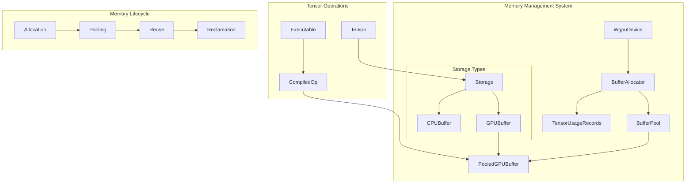
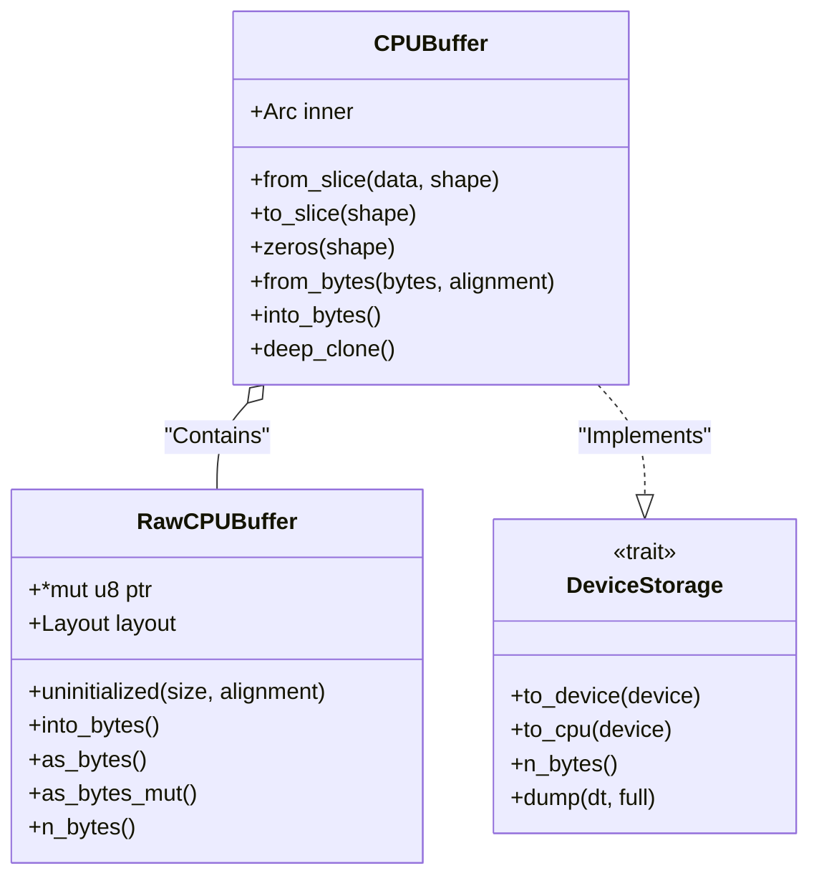
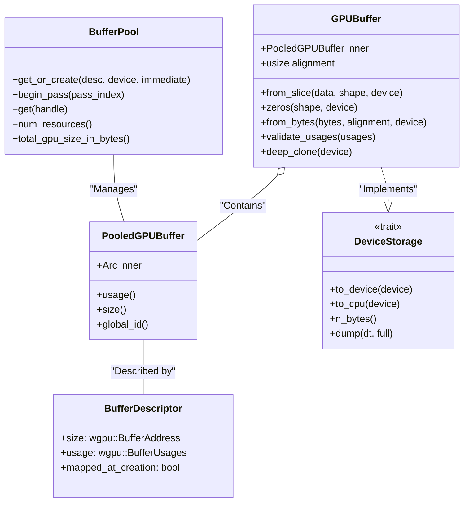
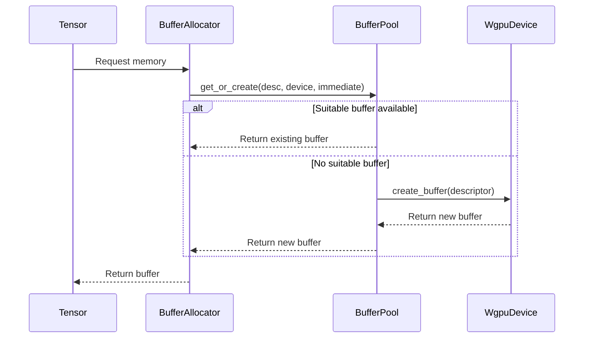
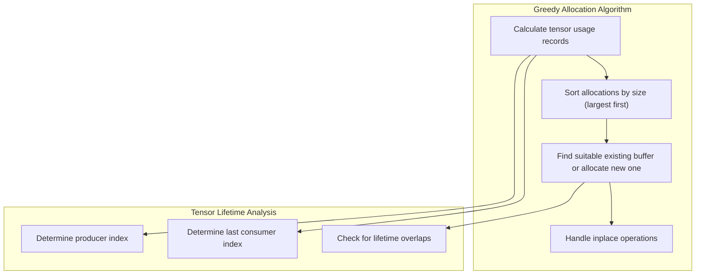
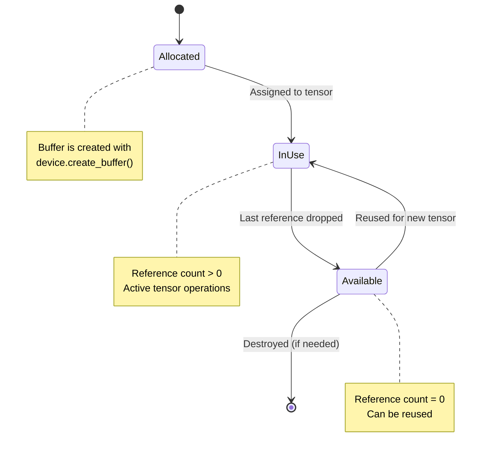
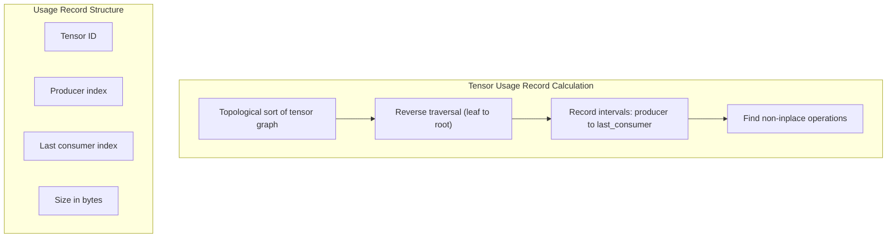
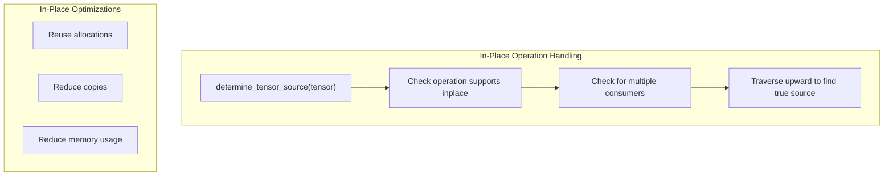
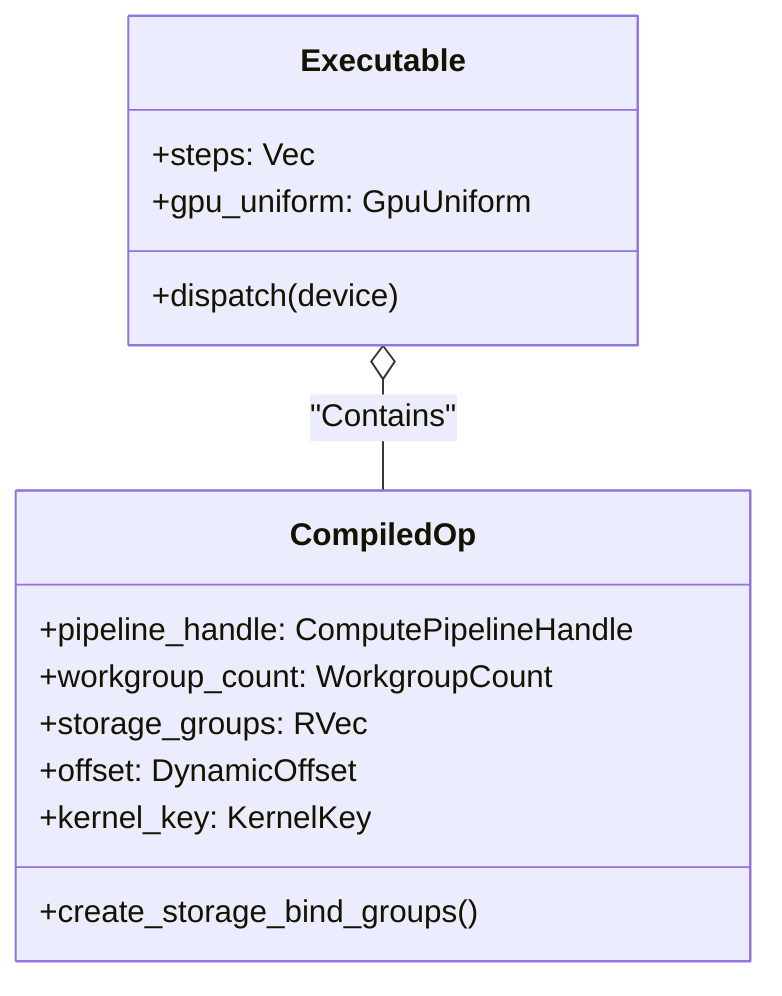
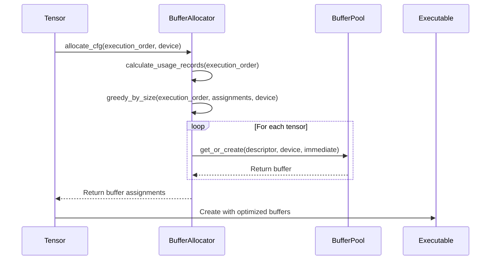

<!-- source: DeepWiki mcp.deepwiki.com · repo huggingface/ratchet · page 2.3 Memory Management · fetched 2026-10-26 -->

# Memory Management

<details>
<summary>Relevant source files</summary>

The following files were used as context for generating this wiki page:

- [Cargo.toml](Cargo.toml)
- [crates/ratchet-core/src/compiled_op.rs](crates/ratchet-core/src/compiled_op.rs)
- [crates/ratchet-core/src/executable.rs](crates/ratchet-core/src/executable.rs)
- [crates/ratchet-core/src/gpu/buffer_allocator/allocator.rs](crates/ratchet-core/src/gpu/buffer_allocator/allocator.rs)
- [crates/ratchet-core/src/gpu/buffer_allocator/tensor_usage_record.rs](crates/ratchet-core/src/gpu/buffer_allocator/tensor_usage_record.rs)
- [crates/ratchet-core/src/gpu/device.rs](crates/ratchet-core/src/gpu/device.rs)
- [crates/ratchet-core/src/gpu/pools/buffer_pool.rs](crates/ratchet-core/src/gpu/pools/buffer_pool.rs)
- [crates/ratchet-core/src/gpu/pools/pipeline_pool.rs](crates/ratchet-core/src/gpu/pools/pipeline_pool.rs)
- [crates/ratchet-core/src/storage/cpu_buffer.rs](crates/ratchet-core/src/storage/cpu_buffer.rs)
- [crates/ratchet-core/src/storage/gpu_buffer.rs](crates/ratchet-core/src/storage/gpu_buffer.rs)
- [crates/ratchet-core/src/storage/mod.rs](crates/ratchet-core/src/storage/mod.rs)

</details>


This document explains how memory is managed within the Ratchet tensor library, including buffer allocation, pooling mechanisms, and optimization strategies. It focuses on how both CPU and GPU memory resources are efficiently allocated, tracked, and reused throughout the tensor computation lifecycle. For information about specific tensor operations, see [Tensor Operations](#2.2), and for GPU-specific acceleration details, see [GPU Acceleration](#2.4).

## Memory Architecture Overview

Ratchet implements a sophisticated memory management system that efficiently handles both CPU and GPU memory resources. The system is designed to minimize allocations, maximize memory reuse, and optimize tensor lifetimes during computation.



Sources: [crates/ratchet-core/src/gpu/buffer_allocator/allocator.rs:20-30](), [crates/ratchet-core/src/storage/mod.rs:14-18](), [crates/ratchet-core/src/gpu/pools/buffer_pool.rs:59-62]()

## Memory Representation

### CPU Memory

CPU memory is managed through two main classes:

1. `RawCPUBuffer`: A low-level buffer representation that directly manages memory allocation and deallocation.
2. `CPUBuffer`: A higher-level wrapper that uses reference counting (`Arc`) to manage the lifecycle of a `RawCPUBuffer`.



The `RawCPUBuffer` handles direct memory allocation using Rust's allocator, while `CPUBuffer` provides a safe, reference-counted interface with methods for creating, manipulating, and copying CPU memory.

Sources: [crates/ratchet-core/src/storage/cpu_buffer.rs:8-146]()

### GPU Memory

GPU memory management is more complex, involving several components:

1. `GPUBuffer`: A wrapper around a pooled GPU buffer with methods for creation and manipulation.
2. `PooledGPUBuffer`: A reference-counted buffer that is automatically returned to the pool when no longer needed.
3. `BufferPool`: Manages a collection of GPU buffers that can be reused.



GPU buffers are managed through a pooling system that allows for efficient reuse of memory. The `BufferPool` keeps track of all allocated buffers and provides methods to obtain either new or previously allocated but unused buffers.

Sources: [crates/ratchet-core/src/storage/gpu_buffer.rs:13-171](), [crates/ratchet-core/src/gpu/pools/buffer_pool.rs:29-141]()

## Buffer Allocation Strategies

### Direct Allocation

When a tensor operation requires memory, the system first attempts to find an existing buffer from the pool. If no suitable buffer is available, a new one is allocated directly from the GPU:



The `BufferAllocator` provides methods for both immediate and deferred allocation. Immediate allocation creates the buffer and submits the queue immediately, ensuring the buffer is ready for use. Deferred allocation defers submission until explicitly requested, allowing for batching of allocations.

Sources: [crates/ratchet-core/src/gpu/buffer_allocator/allocator.rs:44-73](), [crates/ratchet-core/src/gpu/pools/buffer_pool.rs:76-115]()

### Greedy Allocation Strategy

For efficient memory usage during tensor graph execution, Ratchet implements a greedy allocation algorithm that analyzes tensor lifetimes to maximize memory reuse:



The greedy allocation algorithm, implemented in `greedy_by_size`, takes the following steps:

1. Calculate tensor usage records, which track when each tensor is produced and last consumed
2. Sort tensors by size (largest first) to optimize allocation of large buffers
3. For each tensor, find an existing buffer or create a new one
4. Handle inplace operations by reusing the buffer of their source

Sources: [crates/ratchet-core/src/gpu/buffer_allocator/allocator.rs:209-271](), [crates/ratchet-core/src/gpu/buffer_allocator/tensor_usage_record.rs:7-39]()

## Memory Pooling and Reuse

### Buffer Pool Mechanism

The `BufferPool` manages a collection of GPU buffers, tracking which ones are in use and which can be reused. It employs a pass-based system where buffers are marked for reclamation at the end of a pass:



When a buffer is requested, the pool first checks if there's an available buffer that meets the requirements (size and usage flags). If found, that buffer is reused; otherwise, a new buffer is allocated.

Sources: [crates/ratchet-core/src/gpu/pools/buffer_pool.rs:59-141]()

### Reference Counting and Reclamation

Ratchet uses Rust's `Arc` (Atomic Reference Counting) to track when buffers can be reclaimed. The `PooledGPUBuffer` is wrapped in an `Arc`, so when all references to a buffer are dropped, it's automatically marked as available for reuse:

```
Buffer Lifecycle:
1. Buffer is allocated and wrapped in Arc
2. Multiple tensors may hold references to the same buffer
3. As tensor operations complete, references are dropped
4. When reference count reaches zero, buffer becomes available for reuse
5. During the next pass, available buffers can be reassigned
```

The system calls `begin_pass` on the `BufferPool` to mark the start of a new execution pass, which triggers reclamation of unused buffers.

Sources: [crates/ratchet-core/src/gpu/pools/buffer_pool.rs:29-37](), [crates/ratchet-core/src/gpu/buffer_allocator/allocator.rs:37-39]()

## Tensor Lifetime Analysis

### Calculating Tensor Usage Records

A key optimization in Ratchet's memory management is tracking when each tensor is created and when it's last used. This information allows for efficient memory reuse:



The system tracks tensor lifetimes by recording:
- When a tensor is produced (created by an operation)
- When a tensor is last consumed (used as an input to another operation)
- The size of the tensor (to optimize allocation)

This information is used to determine which tensors have non-overlapping lifetimes, allowing their buffers to be shared.

Sources: [crates/ratchet-core/src/gpu/buffer_allocator/allocator.rs:168-205](), [crates/ratchet-core/src/gpu/buffer_allocator/tensor_usage_record.rs:7-15]()

### In-Place Operations

Ratchet optimizes memory usage by identifying operations that can be performed in-place (modifying their input buffer directly instead of allocating a new output buffer):



The `determine_tensor_source` method traverses the operation graph upward to find the first non-inplace operation or operation with multiple consumers. This allows the system to identify which buffer should be reused for an operation.

Sources: [crates/ratchet-core/src/gpu/buffer_allocator/allocator.rs:141-162](), [crates/ratchet-core/src/compiled_op.rs:26-52]()

## Execution and Buffer Management

### Compiled Operations

When operations are compiled for execution, they are associated with the appropriate buffers and bind groups:



Each `CompiledOp` represents a single kernel invocation and contains references to the storage buffers it uses. The `Executable` contains a sequence of these operations and manages their execution.

Sources: [crates/ratchet-core/src/compiled_op.rs:12-26](), [crates/ratchet-core/src/executable.rs:12-20]()

### Buffer Allocation for Execution

When preparing to execute a tensor graph, Ratchet analyzes the entire computation and allocates memory optimally:



The `allocate_cfg` method analyzes the execution order, calculates tensor usage records, and uses the greedy allocation strategy to assign buffers efficiently.

Sources: [crates/ratchet-core/src/gpu/buffer_allocator/allocator.rs:283-339](), [crates/ratchet-core/src/executable.rs:32-59]()

## Memory Management Optimizations

### Size Rounding and Alignment

Ratchet implements several optimizations for buffer allocation:

- Buffers are rounded to minimum sizes to meet WebGPU requirements
- Alignments are maintained for proper data access
- Buffers are padded to meet copy requirements

```
Buffer Size Optimization:
1. Apply minimum size (MIN_STORAGE_BUFFER_SIZE)
2. Round to COPY_BUFFER_ALIGNMENT boundaries
3. Apply appropriate type alignment for the data
```

These optimizations ensure efficient memory usage while maintaining compatibility with WebGPU requirements.

Sources: [crates/ratchet-core/src/gpu/pools/buffer_pool.rs:82-92](), [crates/ratchet-core/src/gpu/device.rs:8]()

### Debug Mode Considerations

The memory management system has special handling for debug mode:

- In debug mode, buffer reuse is disabled to make debugging easier
- Debug builds create separate buffers for each operation
- Debug operations can track and display intermediate tensor values

This allows for easier tracing and debugging of tensor operations, at the cost of higher memory usage.

Sources: [crates/ratchet-core/src/gpu/pools/buffer_pool.rs:50-56](), [crates/ratchet-core/src/executable.rs:61-138]()

## Conclusion

Ratchet's memory management system provides efficient allocation, pooling, and reuse of both CPU and GPU memory for tensor operations. The system uses sophisticated algorithms to track tensor lifetimes and optimize memory usage, including in-place operations and buffer sharing. The greedy allocation strategy and buffer pooling mechanisms minimize memory fragmentation and allocation overhead, enabling efficient execution of complex tensor computations.

The memory management system is a critical component that supports the entire tensor computation framework, working hand-in-hand with the tensor operations ([Tensor Operations](#2.2)) and GPU acceleration ([GPU Acceleration](#2.4)) subsystems to enable high-performance machine learning model inference.

---

