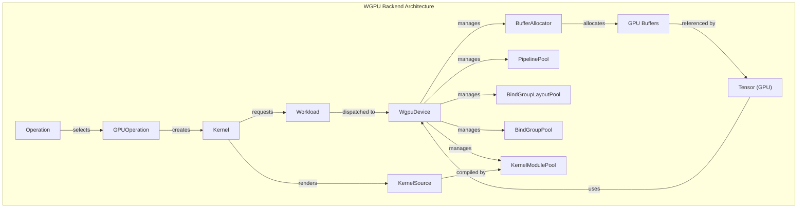
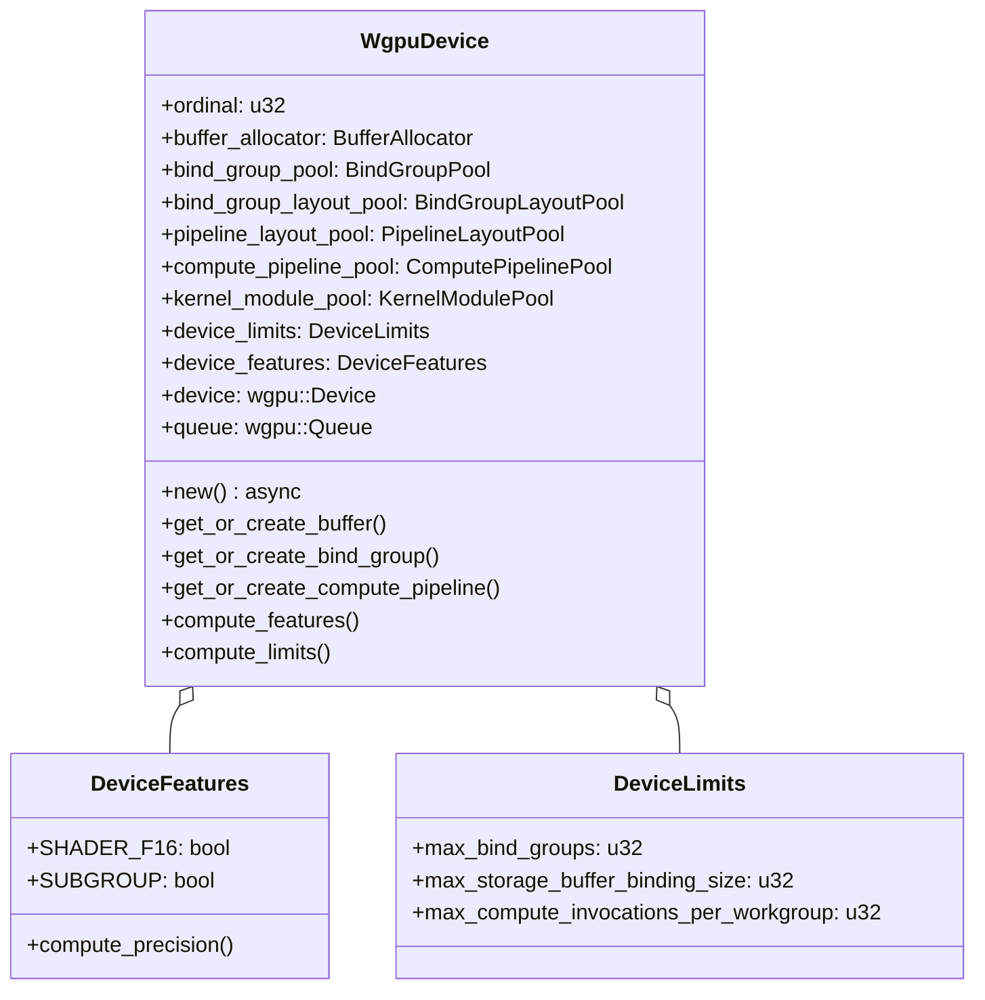
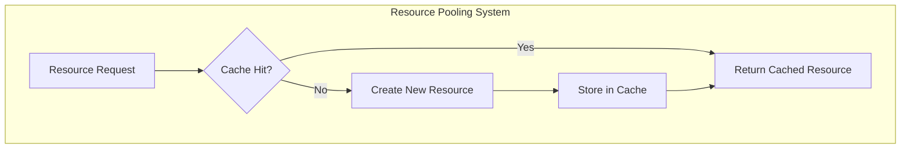
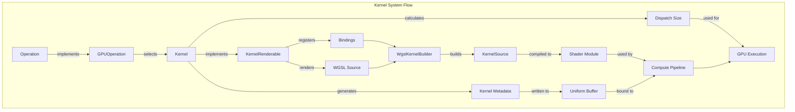
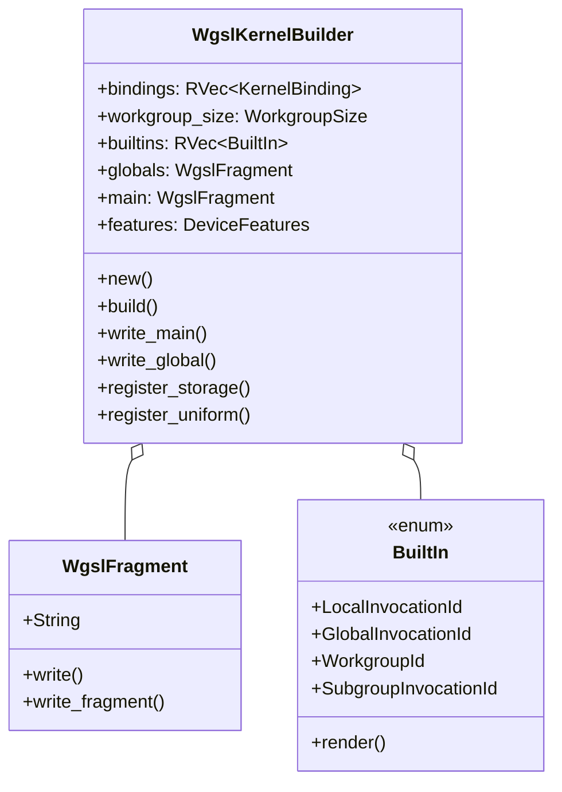
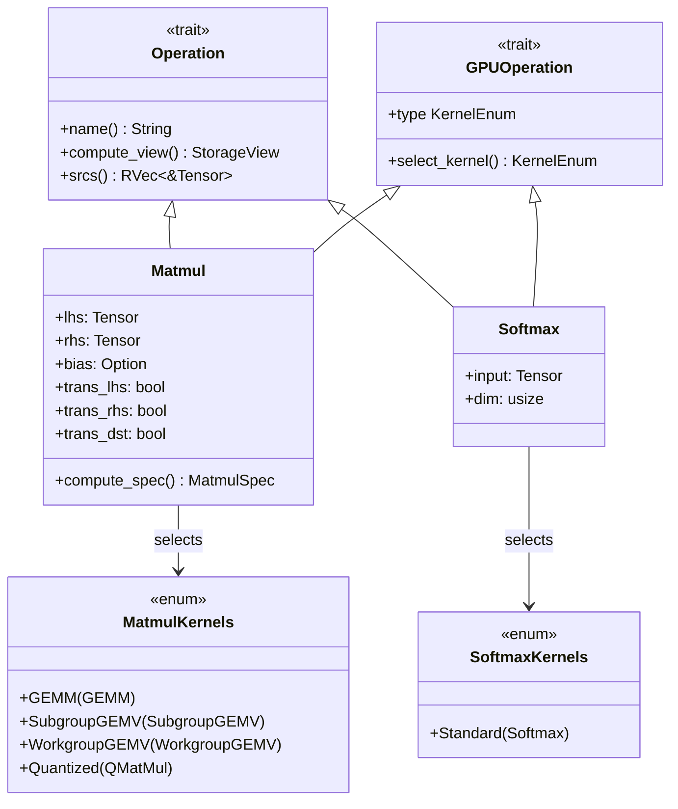
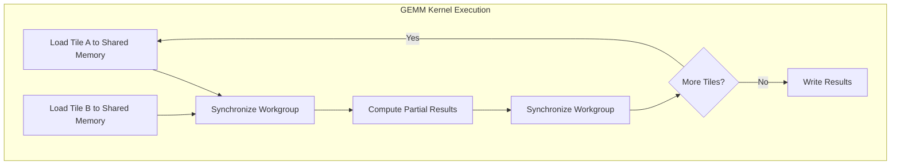
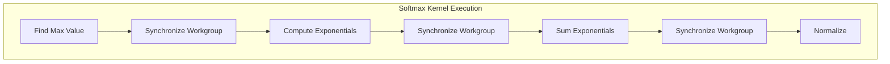
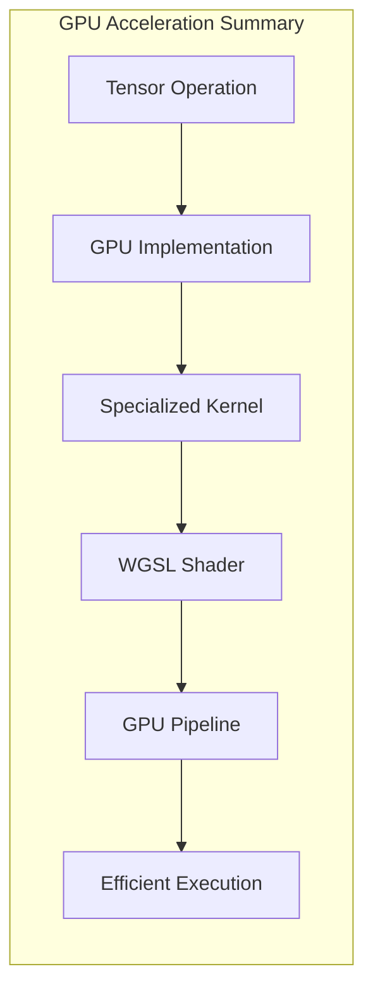

<!-- source: DeepWiki mcp.deepwiki.com · repo huggingface/ratchet · page 2.4 GPU Acceleration · fetched 2026-10-26 -->

# GPU Acceleration

<details>
<summary>Relevant source files</summary>

The following files were used as context for generating this wiki page:

- [Cargo.toml](Cargo.toml)
- [crates/ratchet-core/src/gpu/device.rs](crates/ratchet-core/src/gpu/device.rs)
- [crates/ratchet-core/src/gpu/pools/pipeline_pool.rs](crates/ratchet-core/src/gpu/pools/pipeline_pool.rs)
- [crates/ratchet-core/src/gpu/wgsl/kernel.rs](crates/ratchet-core/src/gpu/wgsl/kernel.rs)
- [crates/ratchet-core/src/gpu/wgsl/kernel_builder.rs](crates/ratchet-core/src/gpu/wgsl/kernel_builder.rs)
- [crates/ratchet-core/src/ops/matmul/gemm.rs](crates/ratchet-core/src/ops/matmul/gemm.rs)
- [crates/ratchet-core/src/ops/matmul/mod.rs](crates/ratchet-core/src/ops/matmul/mod.rs)
- [crates/ratchet-core/src/ops/matmul/quantized.rs](crates/ratchet-core/src/ops/matmul/quantized.rs)
- [crates/ratchet-core/src/ops/matmul/subgroup_gemv.rs](crates/ratchet-core/src/ops/matmul/subgroup_gemv.rs)
- [crates/ratchet-core/src/ops/matmul/workgroup_gemv.rs](crates/ratchet-core/src/ops/matmul/workgroup_gemv.rs)
- [crates/ratchet-core/src/ops/softmax.rs](crates/ratchet-core/src/ops/softmax.rs)
- [crates/ratchet-macros/src/lib.rs](crates/ratchet-macros/src/lib.rs)
- [crates/ratchet-macros/src/wgsl_metadata.rs](crates/ratchet-macros/src/wgsl_metadata.rs)
- [scripts/understanding_matmul.py](scripts/understanding_matmul.py)

</details>


This document explains how Ratchet leverages GPU acceleration to efficiently execute tensor operations. GPU acceleration is a critical component of Ratchet's performance, enabling it to run complex neural network models with high throughput. The implementation uses WebGPU (via wgpu) as the backend, making it compatible with various GPU platforms and the web via WebAssembly.

For information about memory management strategies used alongside GPU acceleration, see [Memory Management](#2.3).

## 1. WebGPU Backend Architecture

Ratchet's GPU acceleration is built on the WebGPU API, which provides a modern, cross-platform interface to GPU hardware. The WebGPU backend is implemented in the `ratchet-core` crate and consists of several components that work together to provide efficient GPU computation.



### 1.1 Device Management

The `WgpuDevice` class serves as the central coordinator for all GPU operations. It manages the lifecycle of GPU resources and provides methods to create and access these resources efficiently.



The device is initialized with optimal features for GPU computation:

- `SHADER_F16`: Enables half-precision floating-point computation
- `SUBGROUP`: Enables efficient subgroup operations for optimized workgroup communication

The device uses a "request device" pattern, where it attempts to acquire the best available GPU with the requested features:

```rust
// First try with optimal features
let device_request = adapter.request_device(&device_descriptor, None).await;
// If that fails, fall back to adapter limits
if let Err(e) = device_request {
    device_descriptor.required_limits = adapter.limits();
    device_descriptor.required_features = adapter.features();
    adapter.request_device(&device_descriptor, None).await
}
```

Sources: [crates/ratchet-core/src/gpu/device.rs:53-90]()

### 1.2 Resource Pooling and Caching

To minimize GPU resource allocation overhead, Ratchet implements resource pooling for various GPU resources:

- Buffer pools for managing GPU memory
- Bind group pools for efficient descriptor binding
- Pipeline pools for caching compiled shaders
- Kernel module pools for reusing shader modules



One example is the compute pipeline pool, which caches compiled pipelines based on a pipeline descriptor:

```rust
pub fn get_or_create(
    &self,
    desc: &ComputePipelineDescriptor,
    device: &WgpuDevice,
) -> ComputePipelineHandle {
    self.inner.get_or_create(desc, |desc| {
        let label = Some(desc.kernel_key.as_str());
        let kernel_resources = device.kernel_module_resources();
        let module = kernel_resources.get(desc.kernel_module).unwrap();
        let pipeline_layouts = device.pipeline_layout_resources();
        let pipeline_layout = pipeline_layouts.get(desc.pipeline_layout).unwrap();
        
        device.create_compute_pipeline(&wgpu::ComputePipelineDescriptor {
            label,
            layout: Some(pipeline_layout),
            module,
            entry_point: Some("main"),
            compilation_options: wgpu::PipelineCompilationOptions {
                zero_initialize_workgroup_memory: false,
                ..Default::default()
            },
            cache: None,
        })
    })
}
```

Sources: [crates/ratchet-core/src/gpu/pools/pipeline_pool.rs:35-62]()

## 2. Kernel System

Ratchet's kernel system provides a flexible way to generate and execute WGSL shaders for various tensor operations.



### 2.1 Kernel Interface

The `Kernel` trait defines the interface for GPU kernels:

```rust
pub trait Kernel: KernelRenderable {
    type Metadata: KernelMetadata + 'static;

    fn kernel_name(&self) -> String;
    
    fn storage_bind_group_layout(
        &self,
        inplace: bool,
    ) -> Result<BindGroupLayoutDescriptor, OperationError>;

    fn metadata(
        &self,
        dst: &Tensor,
        kernel_element: &KernelElement,
    ) -> Result<Self::Metadata, OperationError>;

    fn calculate_dispatch(&self, dst: &Tensor) -> Result<Workload, OperationError>;
    
    fn kernel_element(&self, dst: &Tensor) -> KernelElement;
    
    fn build_kernel(
        &self,
        inplace: bool,
        dst: &Tensor,
        workgroup_size: &WorkgroupSize,
    ) -> Result<KernelSource, OperationError>;
}
```

The `KernelRenderable` trait focuses on generating the WGSL source code:

```rust
pub trait KernelRenderable {
    fn register_bindings<P: WgslPrimitive>(
        &self,
        builder: &mut WgslKernelBuilder,
        inplace: bool,
    ) -> Result<(), OperationError>;

    fn render<P: WgslPrimitive>(
        &self,
        inplace: bool,
        dst: &Tensor,
        workgroup_size: &WorkgroupSize,
    ) -> Result<KernelSource, OperationError>;
}
```

Sources: [crates/ratchet-core/src/gpu/wgsl/kernel.rs:113-212]()

### 2.2 WGSL Kernel Generation

Ratchet uses a builder pattern to generate WGSL shaders. The `WgslKernelBuilder` class provides methods to construct a complete WGSL compute shader:



The builder handles various aspects of WGSL generation:

1. Workgroup size configuration
2. Built-in variable registration
3. Storage and uniform binding registration
4. Global and main function code generation
5. Feature enabling (e.g., half-precision floating point)

```rust
pub fn build(mut self) -> Result<KernelSource, KernelBuildError> {
    self.main.write("}\n");
    let mut source = self.globals;
    for binding in self.bindings.iter() {
        source.write(binding.render().0.as_str());
    }
    source.write(self.main.0.as_str());
    if std::env::var("RATCHET_DUMP_KERNELS").is_ok() {
        log::warn!("\n{}", source.0);
    }
    Ok(source.into())
}
```

Sources: [crates/ratchet-core/src/gpu/wgsl/kernel_builder.rs:90-123]()

### 2.3 Kernel Metadata

Kernel metadata provides configuration data to shaders through uniform buffers. Ratchet supports two types of metadata:

1. **Static Metadata**: Structure known at compile time, uses derive macro `WgslMetadata`
2. **Dynamic Metadata**: Structure determined at runtime

The `WgslMetadata` derive macro automatically generates the WGSL struct definition for static metadata:

```rust
#[derive(Debug, Clone, ShaderType, WgslMetadata)]
pub struct GEMMMeta {
    lhs_shape: IVec3,
    lhs_strides: IVec3,
    rhs_shape: IVec3,
    rhs_strides: IVec3,
    dst_shape: IVec3,
    dst_strides: IVec3,
    dim_lhs_outer: i32,
    dim_rhs_outer: i32,
    dim_inner: i32,
}
```

This generates the corresponding WGSL struct:

```wgsl
struct Meta {
    lhs_shape: vec3<i32>,
    lhs_strides: vec3<i32>,
    rhs_shape: vec3<i32>,
    rhs_strides: vec3<i32>,
    dst_shape: vec3<i32>,
    dst_strides: vec3<i32>,
    dim_lhs_outer: i32,
    dim_rhs_outer: i32,
    dim_inner: i32,
}
```

Sources: [crates/ratchet-macros/src/wgsl_metadata.rs:5-69](), [crates/ratchet-core/src/gpu/wgsl/kernel.rs:90-112]()

## 3. GPU Operations Implementation

Ratchet implements various tensor operations with GPU acceleration. Each operation implements the `GPUOperation` trait, which selects the appropriate kernel implementation based on the operation's parameters.



### 3.1 Matrix Multiplication

Matrix multiplication is a core operation in neural networks. Ratchet implements several specialized kernels for matrix multiplication:

1. **GEMM**: General matrix-matrix multiplication
2. **SubgroupGEMV**: Matrix-vector multiplication using GPU subgroups
3. **WorkgroupGEMV**: Matrix-vector multiplication using workgroups
4. **QMatMul**: Quantized matrix multiplication

The appropriate kernel is selected based on the operation parameters:

```rust
impl GPUOperation for Matmul {
    type KernelEnum = MatmulKernels;

    fn select_kernel(&self) -> Self::KernelEnum {
        if !self.bias.as_ref().map_or(true, |b| b.shape().is_vector()) {
            panic!("Bias must be a vector: {:?}", self.bias);
        }

        if self.lhs.dt().is_quantized() && self.trans_lhs {
            panic!("Transposed quantized inputs are not supported");
        }

        let is_gemv = self.rhs.shape().is_vector() && !self.trans_lhs;
        let is_q4 = self.lhs.dt().is_q4();
        let supports_subgroup = self
            .lhs
            .device()
            .try_gpu()
            .unwrap()
            .compute_features()
            .SUBGROUP;

        let spec = self.compute_spec();

        match (is_gemv, is_q4, supports_subgroup) {
            (true, false, true) => {
                MatmulKernels::SubgroupGEMV(SubgroupGEMV::from_matmul(self, spec))
            }
            (true, false, false) => {
                MatmulKernels::WorkgroupGEMV(WorkgroupGEMV::from_matmul(self, spec))
            }
            (false, true, _) => MatmulKernels::Quantized(QMatMul::from_matmul(self, spec)),
            (false, false, _) => MatmulKernels::GEMM(GEMM::from_matmul(self, spec)),
            _ => todo!(),
        }
    }
}
```

Sources: [crates/ratchet-core/src/ops/matmul/mod.rs:713-749]()

#### GEMM Implementation

The GEMM (General Matrix-Matrix Multiplication) kernel implements a tiled matrix multiplication algorithm optimized for GPU execution. It uses workgroup shared memory to improve memory access patterns and reduce global memory bandwidth requirements.



The implementation uses workgroup shared memory to store tiles of the input matrices:

```wgsl
var<workgroup> mm_Asub: array<array<accessor, TILE_W>, TILE_DIM>;
var<workgroup> mm_Bsub: array<array<accessor, TILE_W>, TILE_DIM>;
```

Sources: [crates/ratchet-core/src/ops/matmul/gemm.rs:474-476]()

#### SubgroupGEMV Implementation

For matrix-vector multiplication, Ratchet uses a specialized kernel that leverages GPU subgroups (also known as warps or waves) for efficient computation. This is more efficient than general GEMM for this specific case.

```rust
impl Kernel for SubgroupGEMV {
    // ...
    
    fn calculate_dispatch(&self, _: &Tensor) -> Result<Workload, OperationError> {
        let tile_size = 32;
        Ok(Workload {
            workgroup_count: wgc![
                ((self.spec.new_dim_lhs_outer() / tile_size) + 1) as _,
                1,
                self.spec.stacks() as _
            ],
            workgroup_size: wgs![tile_size as _, 8, 1],
        })
    }
    
    // ...
}
```

Sources: [crates/ratchet-core/src/ops/matmul/subgroup_gemv.rs:312-368]()

### 3.2 Softmax Implementation

The softmax operation is another critical function in neural networks. Ratchet's GPU implementation uses a two-pass algorithm:

1. First pass: Find the maximum value in each row
2. Second pass: Compute exponentials and sum
3. Third pass: Normalize by the sum



The implementation uses workgroup shared memory and reduction operations to efficiently compute the maximum and sum:

```rust
kernel_builder.write_main(wgsl! {
    smem[index] = accessor(minFloat);
    for (var i: u32 = index; i < reduce_var; i += BLOCK_SIZE) {
        smem[index] = max(smem[index], X[row_start + i]);
    }
    workgroupBarrier();
});

// Reduction to find maximum
for i in (0..=steps).rev().map(|x| 2u32.pow(x)) {
    let v = i.render();
    kernel_builder.write_main(wgsl! { block_max(index, v); });
}
```

Sources: [crates/ratchet-core/src/ops/softmax.rs:120-132]()

## 4. Performance Optimization Techniques

Ratchet employs various optimization techniques to maximize GPU performance.

### 4.1 Workgroup Size Optimization

The workgroup size is optimized based on the operation type and tensor dimensions. For example, matrix-vector multiplication uses different workgroup sizes depending on the matrix dimensions:

```rust
impl GEMVHeuristic {
    pub fn new(arows: usize, acols: usize) -> Self {
        match (arows, acols) {
            (arows, acols) if arows > acols * 4 => GEMVHeuristic::VeryTall,
            (arows, acols) if arows > acols * 2 => GEMVHeuristic::Tall,
            (arows, acols) if acols > arows * 2 => GEMVHeuristic::Fat,
            _ => GEMVHeuristic::Square,
        }
    }

    pub fn as_workgroup_size(&self) -> (usize, usize) {
        match self {
            GEMVHeuristic::Fat => (4, 256),
            _ => (8, 8),
        }
    }
}
```

Sources: [crates/ratchet-core/src/ops/matmul/mod.rs:22-45]()

### 4.2 Subgroup Operations

For platforms that support it, Ratchet uses GPU subgroups to optimize communication between threads in a workgroup. This is particularly effective for reduction operations, such as those in softmax and matrix-vector multiplication:

```rust
for (var tm = 0; tm < TM; tm++) {
    result[tm] = subgroupAdd(result[tm]);
}
```

Sources: [crates/ratchet-core/src/ops/matmul/subgroup_gemv.rs:295-297]()

### 4.3 Memory Access Patterns

Ratchet optimizes memory access patterns to maximize GPU memory bandwidth utilization. For example, in matrix multiplication, the implementation considers whether to transpose the inputs based on their shapes to improve memory coalescing:

```rust
pub fn select_kernel_element(&self) -> KernelElement {
    if self.trans_lhs || self.trans_rhs || self.trans_dst || self.rhs_shape.is_vector() {
        //We cannot support transposed with vectorized kernels
        //If GEMV we use Scalar
        return KernelElement::Scalar;
    }

    let checks = [
        self.dim_inner(),
        self.dst_shape[1],
        self.lhs_shape.numel(),
        self.rhs_shape.numel(),
        self.dst_shape.numel(),
    ];

    if checks.iter().all(|&x| x % 4 == 0) {
        KernelElement::Vec4
    } else {
        KernelElement::Scalar
    }
}
```

Sources: [crates/ratchet-core/src/ops/matmul/mod.rs:188-208]()

### 4.4 Quantized Computation

For quantized models, Ratchet implements specialized kernels that efficiently handle quantized weights. These kernels dequantize the weights on-the-fly during computation:

```rust
kernel_builder.write_main(wgsl! {
    let matIdx = matOffset + tm * metadata.IVL + bn;
    inter = unpack(mat[matIdx / 4]) * scale[matIdx / 32];

    // Accumulate results
    accumulate
});
```

Sources: [crates/ratchet-core/src/ops/matmul/subgroup_gemv.rs:257-265]()

## 5. Summary

Ratchet's GPU acceleration system provides efficient execution of tensor operations on GPU hardware using the WebGPU API. The system is designed to be:

1. **Flexible**: Supports various operation types with specialized implementations
2. **Efficient**: Uses advanced GPU features like subgroups and shared memory
3. **Portable**: Works across different GPU platforms and in the browser via WebAssembly
4. **Optimized**: Employs various techniques to maximize performance

The GPU acceleration system is a key component that enables Ratchet to efficiently run neural network models across a wide range of devices.



---

