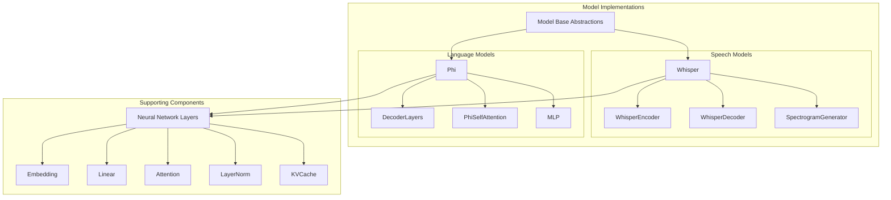
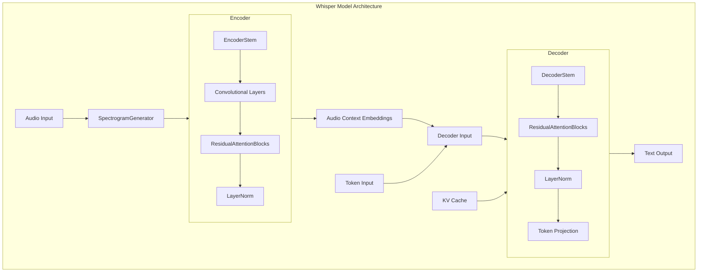
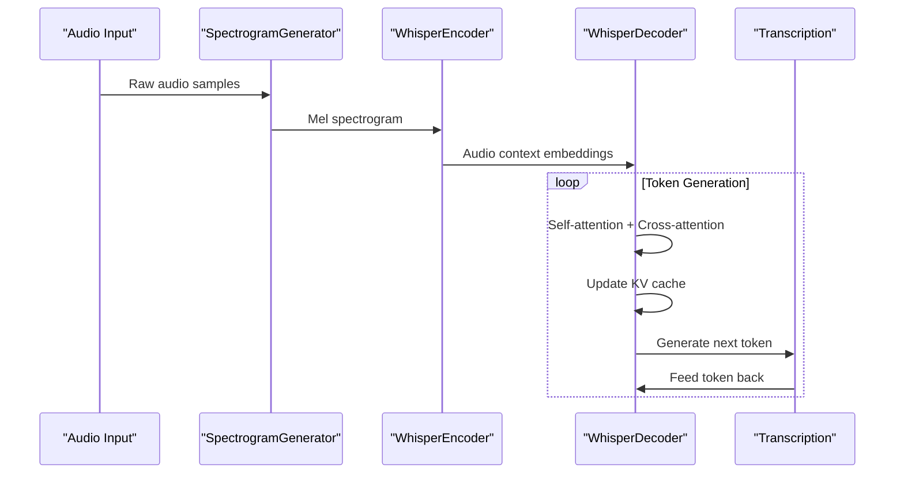
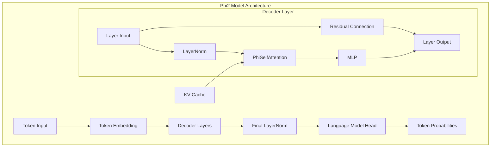
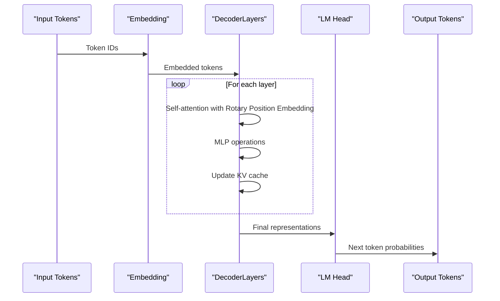
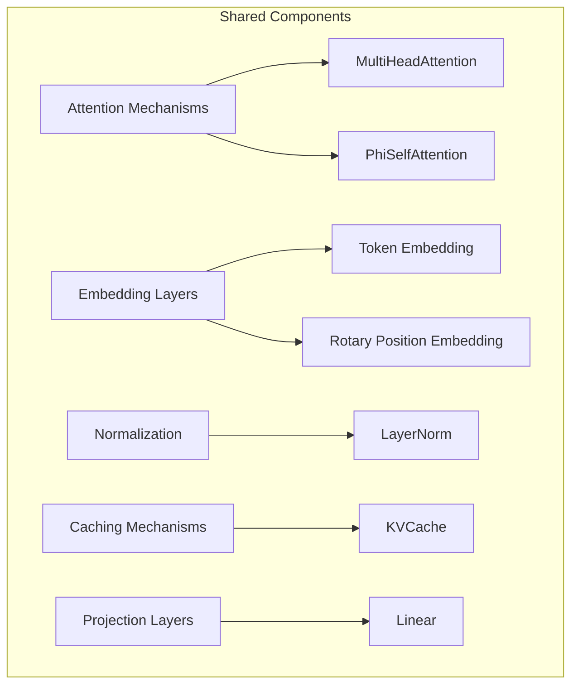
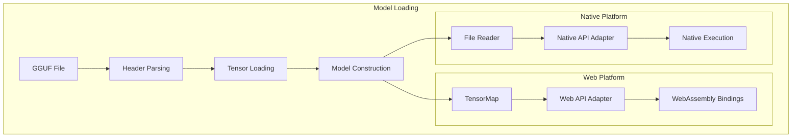
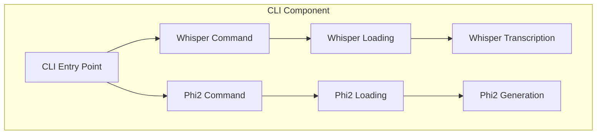

<!-- source: DeepWiki mcp.deepwiki.com · repo huggingface/ratchet · page 3 Model Implementations · fetched 2026-10-26 -->

# Model Implementations

<details>
<summary>Relevant source files</summary>

The following files were used as context for generating this wiki page:

- [crates/ratchet-cli/src/bin/cli.rs](crates/ratchet-cli/src/bin/cli.rs)
- [crates/ratchet-models/Cargo.toml](crates/ratchet-models/Cargo.toml)
- [crates/ratchet-models/src/phi2/attn.rs](crates/ratchet-models/src/phi2/attn.rs)
- [crates/ratchet-models/src/phi2/model.rs](crates/ratchet-models/src/phi2/model.rs)
- [crates/ratchet-models/src/whisper/decoder.rs](crates/ratchet-models/src/whisper/decoder.rs)
- [crates/ratchet-models/src/whisper/encoder.rs](crates/ratchet-models/src/whisper/encoder.rs)
- [crates/ratchet-models/src/whisper/mha.rs](crates/ratchet-models/src/whisper/mha.rs)
- [crates/ratchet-models/src/whisper/mod.rs](crates/ratchet-models/src/whisper/mod.rs)
- [crates/ratchet-models/src/whisper/model.rs](crates/ratchet-models/src/whisper/model.rs)
- [crates/ratchet-models/src/whisper/options.rs](crates/ratchet-models/src/whisper/options.rs)
- [crates/ratchet-models/src/whisper/residual_block.rs](crates/ratchet-models/src/whisper/residual_block.rs)
- [crates/ratchet-models/src/whisper/tokenizer.rs](crates/ratchet-models/src/whisper/tokenizer.rs)
- [crates/ratchet-nn/src/linear.rs](crates/ratchet-nn/src/linear.rs)

</details>


This page provides an overview of the machine learning models implemented in the Ratchet framework. It covers the architecture, components, and execution flows of different models. For information about the core tensor system that powers these models, see [Core Tensor System](#2).

## Overview of Model Implementations

Ratchet currently implements several state-of-the-art AI models, focusing on efficient execution across different platforms and hardware. The models are built on top of the core tensor system and neural network components, with specialized architectures for different tasks.



Sources:
- [crates/ratchet-models/src/whisper/mod.rs]()
- [crates/ratchet-models/src/phi2/model.rs]()
- [crates/ratchet-models/Cargo.toml]()

## Whisper Speech Recognition Model

The Whisper model is an implementation of OpenAI's speech recognition model, designed for efficient transcription and translation of audio.

### Architecture

The Whisper model consists of three main components:
1. **Spectrogram Generator** - Converts raw audio into mel spectrogram representations
2. **Encoder** - Processes the spectrogram into audio context embeddings
3. **Decoder** - Generates text from the audio context using a transformer decoder



Sources:
- [crates/ratchet-models/src/whisper/model.rs:25-32]()
- [crates/ratchet-models/src/whisper/encoder.rs:98-124]()
- [crates/ratchet-models/src/whisper/decoder.rs:82-90]()

### Encoder

The Whisper encoder processes mel spectrograms into audio context embeddings using a series of residual attention blocks.

```rust
pub struct WhisperEncoder {
    stem: EncoderStem,
    blocks: Vec<ResidualAttentionBlock>,
    ln_post: LayerNorm,
    activation_dt: DType,
}
```

The encoder stem contains convolutional layers that process the spectrogram:

```rust
pub(crate) struct EncoderStem {
    conv1: ConvBlock,
    conv2: ConvBlock,
    pos_embed: Tensor,
}
```

Sources:
- [crates/ratchet-models/src/whisper/encoder.rs:39-45]()
- [crates/ratchet-models/src/whisper/encoder.rs:98-103]()

### Decoder

The Whisper decoder generates text tokens from the audio context embeddings using cross-attention and self-attention mechanisms:

```rust
pub struct WhisperDecoder {
    stem: DecoderStem,
    blocks: Vec<ResidualAttentionBlock>,
    mask: Tensor,
    ln_post: LayerNorm,
    cache: KVCache,
    device: Device,
}
```

The decoder stem embeds tokens and adds positional encoding:

```rust
pub(crate) struct DecoderStem {
    pub token_embed: Embedding,
    pub pos_embed: Tensor,
}
```

Sources:
- [crates/ratchet-models/src/whisper/decoder.rs:13-16]()
- [crates/ratchet-models/src/whisper/decoder.rs:82-90]()

### Inference Flow

The Whisper model follows this inference flow:

1. Audio input is converted to a mel spectrogram by the `SpectrogramGenerator`
2. The spectrogram is processed by the `WhisperEncoder` to create audio context embeddings
3. The `WhisperDecoder` generates text tokens autoregressively:
   - It uses the audio context via cross-attention
   - It uses previously generated tokens via self-attention
   - The KV cache stores past key/value pairs for efficiency



Sources:
- [crates/ratchet-models/src/whisper/model.rs:125-170]()
- [crates/ratchet-models/src/whisper/decoder.rs:92-121]()

## Phi2 Language Model

The Phi2 model is an implementation of Microsoft's Phi-2 language model, designed for efficient text generation.

### Architecture

The Phi2 model uses a decoder-only transformer architecture:



Sources:
- [crates/ratchet-models/src/phi2/model.rs:92-100]()
- [crates/ratchet-models/src/phi2/model.rs:14-19]()

### Key Components

The main components of the Phi2 model are:

#### Phi2 Main Model

```rust
pub struct Phi2 {
    pub embedding: Embedding,
    pub layers: Vec<DecoderLayer>,
    pub ln_post: LayerNorm,
    pub lm_head: Linear,
    pub kv_cache: KVCache,
    pub device: Device,
}
```

#### Decoder Layer

```rust
pub struct DecoderLayer {
    ln: LayerNorm,
    self_attn: PhiSelfAttention,
    mlp: MLP,
}
```

#### Self-Attention

```rust
pub struct PhiSelfAttention {
    q: Linear,
    k: Linear,
    v: Linear,
    o: Linear,
    rope: RotaryEmbedding,
    n_heads: u32,
    softmax_scale: Tensor,
    n_kv_heads: u32,
}
```

Sources:
- [crates/ratchet-models/src/phi2/model.rs:92-100]()
- [crates/ratchet-models/src/phi2/model.rs:14-19]()
- [crates/ratchet-models/src/phi2/attn.rs:11-21]()

### Inference Flow

The Phi2 model follows this inference flow for text generation:

1. Input tokens are embedded via the `Embedding` layer
2. The embedded tokens pass through a series of `DecoderLayer`s:
   - Each layer applies self-attention and MLP operations
   - Residual connections and layer normalization are used
3. The final representation is projected through the `lm_head` to get token probabilities
4. The KV cache stores key/value pairs for efficient autoregressive generation



Sources:
- [crates/ratchet-models/src/phi2/model.rs:102-127]()
- [crates/ratchet-models/src/phi2/attn.rs:98-154]()

## Common Components and Patterns

Despite the different purposes of these models, they share several common components and patterns:

### Shared Neural Network Components



Sources:
- [crates/ratchet-models/src/whisper/mha.rs:6-42]()
- [crates/ratchet-nn/src/linear.rs:9-14]()
- [crates/ratchet-models/src/phi2/attn.rs:11-21]()

### Model Loading

Both models support loading from GGUF model files, with specialized code paths for different platforms:

- Native platform loading using direct file I/O
- WebAssembly loading with web-specific APIs



Sources:
- [crates/ratchet-models/src/whisper/model.rs:34-100]()
- [crates/ratchet-models/src/phi2/model.rs:133-228]()

### Execution Interface

Both models implement a common `Module` trait from the `ratchet-nn` crate, providing a consistent interface for execution:

```rust
impl Module for Whisper {
    type Input = Tensor;
    
    fn schedule(&self, input: Self::Input) -> anyhow::Result<Tensor> {
        // Model-specific implementation
    }
}
```

```rust
impl Module for Phi2 {
    type Input = Tensor;
    
    fn schedule(&self, input: Self::Input) -> anyhow::Result<Tensor> {
        // Model-specific implementation
    }
}
```

Sources:
- [crates/ratchet-models/src/phi2/model.rs:102-127]()
- [crates/ratchet-models/src/whisper/encoder.rs:105-122]()
- [crates/ratchet-models/src/whisper/decoder.rs:92-121]()

## Command Line Interface

The models can be used through a command-line interface provided by the `ratchet-cli` crate:



The CLI provides commands for running both Whisper for speech transcription and Phi2 for text generation with various configuration options.

Sources:
- [crates/ratchet-cli/src/bin/cli.rs:79-107]()
- [crates/ratchet-cli/src/bin/cli.rs:109-167]()

## Conclusion

The model implementations in Ratchet provide efficient, cross-platform implementations of popular AI models. They share common architectural patterns and components, while being specialized for their specific tasks. The models leverage the core tensor system and neural network components to achieve high performance across different platforms and hardware.

---

