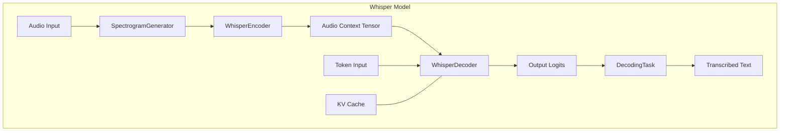
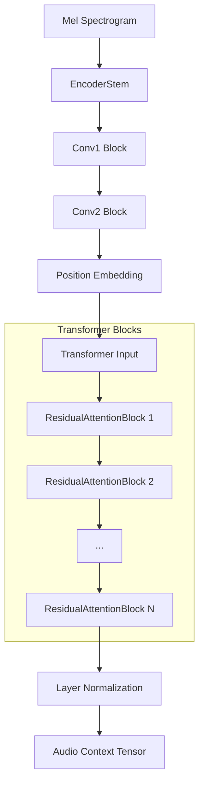
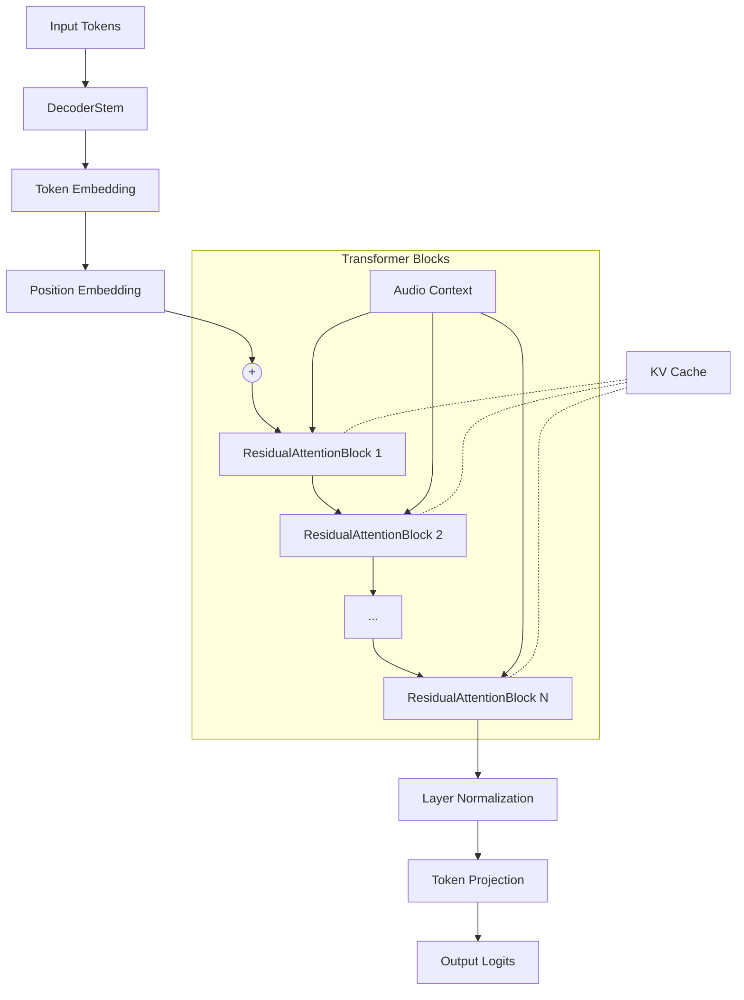
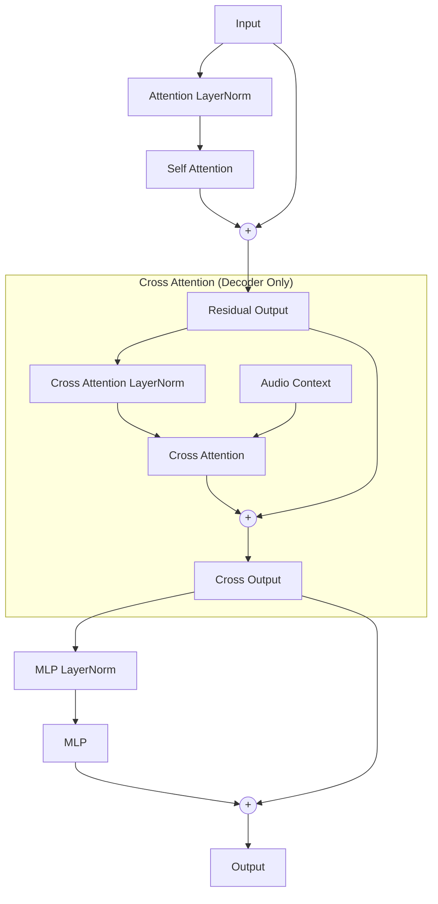
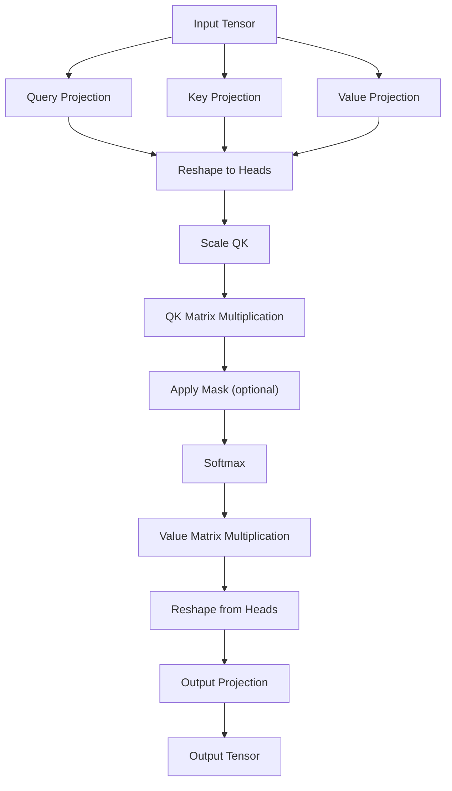
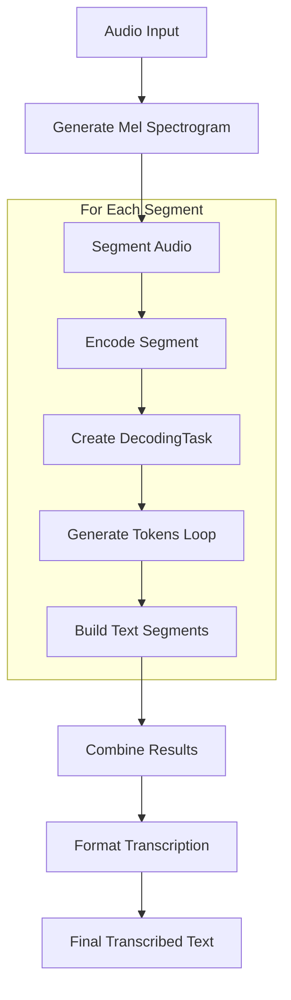
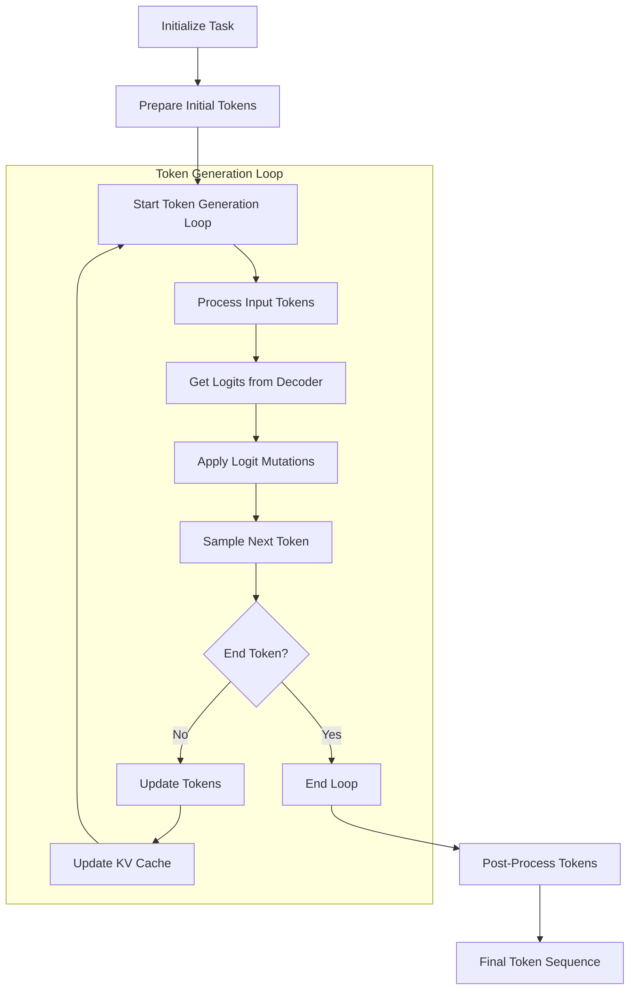
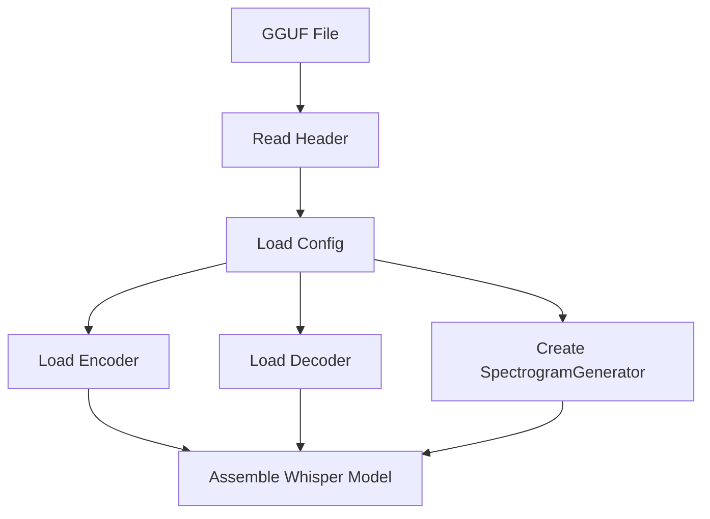
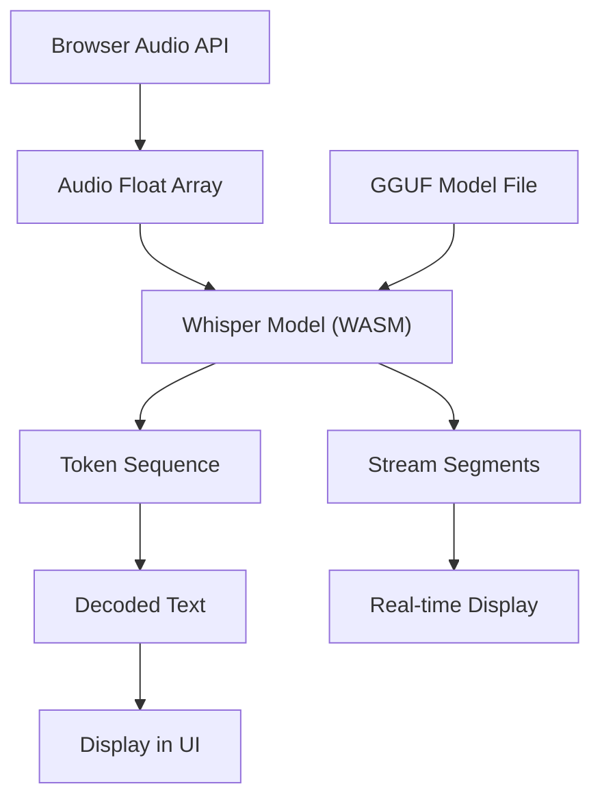

<!-- source: DeepWiki mcp.deepwiki.com · repo huggingface/ratchet · page 3.1 Whisper Speech Recognition · fetched 2026-10-26 -->

# Whisper Speech Recognition

Relevant source files

The following files were used as context for generating this wiki page:

- [crates/ratchet-models/src/whisper/decoder.rs](crates/ratchet-models/src/whisper/decoder.rs)
- [crates/ratchet-models/src/whisper/encoder.rs](crates/ratchet-models/src/whisper/encoder.rs)
- [crates/ratchet-models/src/whisper/mha.rs](crates/ratchet-models/src/whisper/mha.rs)
- [crates/ratchet-models/src/whisper/model.rs](crates/ratchet-models/src/whisper/model.rs)
- [crates/ratchet-models/src/whisper/residual_block.rs](crates/ratchet-models/src/whisper/residual_block.rs)
- [crates/ratchet-models/src/whisper/task.rs](crates/ratchet-models/src/whisper/task.rs)
- [crates/ratchet-models/src/whisper/transcribe.rs](crates/ratchet-models/src/whisper/transcribe.rs)
- [crates/ratchet-nn/src/linear.rs](crates/ratchet-nn/src/linear.rs)

This document details the Ratchet implementation of OpenAI's Whisper model for automatic speech recognition (ASR). It covers the model architecture, transcription process, and key components responsible for converting audio input to text output. For information on other models in the Ratchet framework, see [Model Implementations](#3).

## Architecture Overview

The Whisper implementation follows a standard encoder-decoder transformer architecture optimized for audio transcription.

Sources: 
- [crates/ratchet-models/src/whisper/model.rs:24-32]()
- [crates/ratchet-models/src/whisper/transcribe.rs:9-14]()

### Key Components

1. **SpectrogramGenerator**: Converts raw audio waveforms into mel spectrograms
2. **WhisperEncoder**: Transforms spectrograms into audio context embeddings
3. **WhisperDecoder**: Generates text tokens based on the audio context
4. **KV Cache**: Stores key-value pairs for efficient inference
5. **DecodingTask**: Manages the token generation process

## Encoder Architecture

The encoder processes mel spectrograms through convolutional layers followed by transformer blocks.

Sources:
- [crates/ratchet-models/src/whisper/encoder.rs:97-122]()
- [crates/ratchet-models/src/whisper/encoder.rs:40-56]()

The `WhisperEncoder` contains:
- **EncoderStem**: Initial convolutional processing with two layers
- **Transformer Blocks**: A series of `ResidualAttentionBlock` instances
- **Layer Normalization**: Final normalization before output

## Decoder Architecture

The decoder generates text tokens based on the audio context from the encoder.

Sources:
- [crates/ratchet-models/src/whisper/decoder.rs:82-120]()
- [crates/ratchet-models/src/whisper/decoder.rs:13-78]()

The `WhisperDecoder` includes:
- **DecoderStem**: Combines token embeddings with positional encodings
- **Transformer Blocks**: Residual blocks with both self-attention and cross-attention
- **KV Cache**: Stores key-value pairs for efficient inference
- **Layer Normalization**: Normalizes outputs before projection
- **Token Projection**: Projects to logits over the vocabulary

## Residual Attention Block

Both encoder and decoder use residual attention blocks as their fundamental building blocks.

Sources:
- [crates/ratchet-models/src/whisper/residual_block.rs:10-51]()

This structure includes:
- **Self-Attention**: Standard transformer self-attention
- **Cross-Attention**: Attention between decoder and encoder outputs (decoder only)
- **MLP**: Feed-forward network for further processing
- **Residual Connections**: To help with gradient flow and training stability

## Multi-Head Attention

The attention mechanism is a critical component of both encoder and decoder blocks.

Sources:
- [crates/ratchet-models/src/whisper/mha.rs:6-128]()

The implementation includes:
- Four linear projections (Q, K, V, and output)
- Support for masking (causal in decoder)
- Scaling by the inverse square root of the attention dimension
- Integration with KV cache for efficient inference

## Transcription Process

The complete transcription process takes raw audio and produces text output.

Sources:
- [crates/ratchet-models/src/whisper/transcribe.rs:9-83]()
- [crates/ratchet-models/src/whisper/task.rs:31-330]()

The process involves:
1. **Spectrogram Generation**: Converting audio to a spectrogram representation
2. **Segmentation**: Processing long audio in manageable chunks
3. **Encoding**: Running the encoder on each segment
4. **Decoding**: Generating tokens with the decoder
5. **Post-Processing**: Converting tokens to text with timing information

## Decoding Task

The `DecodingTask` manages the iterative token generation process.

Sources:
- [crates/ratchet-models/src/whisper/task.rs:82-129]()
- [crates/ratchet-models/src/whisper/task.rs:208-295]()

Key features include:
- **Initial Token Preparation**: Setting up special tokens (SOT, language tokens)
- **Logit Mutation**: Applying rules to modify token probabilities
- **Sampling**: Selecting the next token (currently greedy sampling)
- **Segment Building**: Creating text segments with timing information

## Implementation Details

### Model Loading

Whisper models are loaded from GGUF format files, which contain the model weights and configuration.

Sources:
- [crates/ratchet-models/src/whisper/model.rs:34-66]()

The loading process includes:
- Reading model configuration and metadata
- Loading mel filter banks for spectrogram generation
- Constructing encoder and decoder components with weights from the GGUF file

### Linear Layers

Linear projections are fundamental building blocks used throughout the model.

| Component | Linear Layers |
|-----------|---------------|
| Encoder | Query, Key, Value, Output projections in attention; MLP projections |
| Decoder | Token embedding, Query, Key, Value, Output projections; MLP projections |
| Stem | Convolutional weight matrices |

Sources:
- [crates/ratchet-nn/src/linear.rs:9-24]()

## Web Integration

The Whisper model includes special support for running in web browsers via WebAssembly.

Sources:
- [crates/ratchet-models/src/whisper/model.rs:69-114]()
- [crates/ratchet-models/src/whisper/transcribe.rs:86-174]()

Key web-specific features:
- Asynchronous execution to prevent UI blocking
- Segment streaming for real-time feedback
- In-browser model loading and execution

## Example Usage

A typical usage pattern for the Whisper model involves:

1. Loading the model from a GGUF file
2. Creating decoding options (language, task, etc.)
3. Calling the transcribe function with audio data
4. Processing the resulting transcription

## Performance Considerations

- **KV Cache**: Significantly improves performance for autoregressive generation
- **Segmented Processing**: Allows for transcribing long audio with bounded memory usage
- **GPU Acceleration**: All tensor operations support GPU execution for better performance

Sources:
- [crates/ratchet-models/src/whisper/decoder.rs:123-143]()

## Limitations

- Processing long audio requires segmentation
- Accuracy varies by language and audio quality
- Model size affects both accuracy and performance

---

