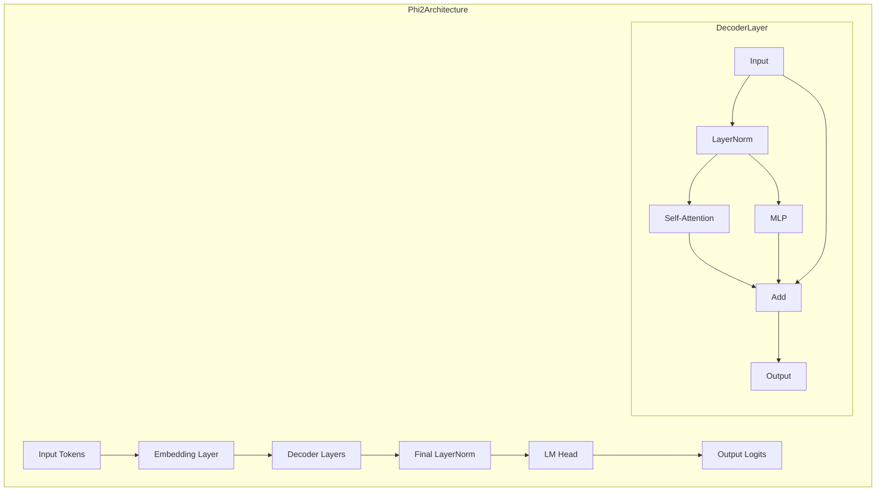
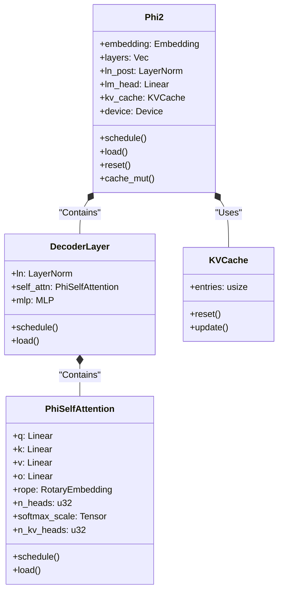
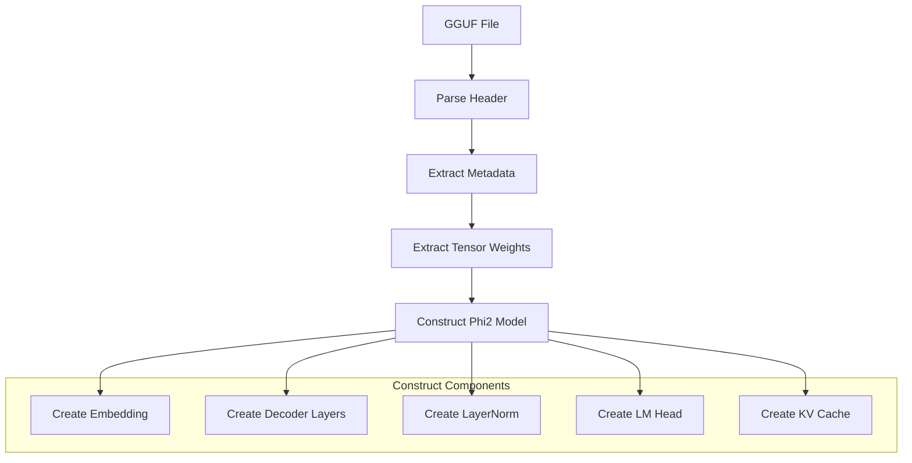
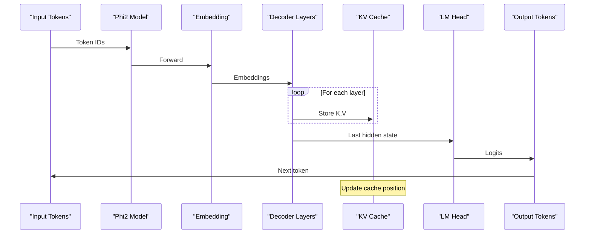

<!-- source: DeepWiki mcp.deepwiki.com · repo huggingface/ratchet · page 3.2 Phi Language Model · fetched 2026-10-26 -->

# Phi Language Model

<details>
<summary>Relevant source files</summary>

The following files were used as context for generating this wiki page:

- [crates/ratchet-cli/src/bin/cli.rs](crates/ratchet-cli/src/bin/cli.rs)
- [crates/ratchet-models/src/phi2/attn.rs](crates/ratchet-models/src/phi2/attn.rs)
- [crates/ratchet-models/src/phi2/model.rs](crates/ratchet-models/src/phi2/model.rs)

</details>


## Purpose and Scope

This document details the implementation of Microsoft's Phi-2 language model within the Ratchet framework. It covers the model architecture, implementation details, and usage. The Phi-2 model is a decoder-only transformer language model designed for text generation tasks. 

For information about other models in the Ratchet framework, see [Model Implementations](#3).

## Architectural Overview

Phi-2 is implemented as a decoder-only transformer with multiple attention layers. The model follows a standard transformer architecture with several key components.



Sources: [crates/ratchet-models/src/phi2/model.rs:92-128]()

The Phi-2 implementation consists of:

1. **Token Embedding Layer**: Converts input token IDs to embeddings
2. **Decoder Layers**: A stack of transformer decoder layers
3. **Layer Normalization**: Applied after the decoder layers
4. **LM Head**: Linear projection to vocabulary logits for next token prediction

Each decoder layer contains:
- Layer normalization
- Self-attention mechanism with rotary position embeddings
- MLP (feedforward neural network)
- Residual connections

Sources: [crates/ratchet-models/src/phi2/model.rs:14-90]()

## Code Implementation Structure

The Phi-2 implementation in Ratchet is organized as follows:



Sources: 
- [crates/ratchet-models/src/phi2/model.rs:92-249]()
- [crates/ratchet-models/src/phi2/attn.rs:10-154]()

## Key Components

### Phi2 Main Model

The `Phi2` struct serves as the main container for the entire model:

- `embedding`: Token embedding layer
- `layers`: Vector of decoder layers
- `ln_post`: Final layer normalization
- `lm_head`: Linear projection for token prediction
- `kv_cache`: Key-value cache for efficient generation
- `device`: Computation device (CPU/GPU)

Sources: [crates/ratchet-models/src/phi2/model.rs:92-99]()

### Decoder Layer

Each `DecoderLayer` contains:

- `ln`: Layer normalization
- `self_attn`: Self-attention mechanism
- `mlp`: Multi-layer perceptron (feedforward network)

The `schedule` method of the decoder layer performs the forward pass with residual connections.

Sources: [crates/ratchet-models/src/phi2/model.rs:14-90]()

### Attention Mechanism

The `PhiSelfAttention` struct implements multi-head attention with:

- Query, key, and value projections (`q`, `k`, `v`)
- Output projection (`o`)
- Rotary position embeddings (`rope`)
- Configured number of attention heads

The attention implementation includes handling of KV caching for efficient inference.

Sources: [crates/ratchet-models/src/phi2/attn.rs:10-89]()

## Model Loading and Initialization

The Phi-2 model is loaded from GGUF format files, which contain the model weights and configuration parameters.



The loading process involves:

1. Reading the GGUF header to get metadata
2. Extracting configuration parameters like number of layers and attention heads
3. Loading each component's weights from the file
4. Constructing the model structure

Key configuration parameters:
- `phi2.block_count`: Number of decoder layers
- `phi2.attention.head_count`: Number of attention heads
- `phi2.attention.head_count_kv`: Number of key-value heads

Sources: 
- [crates/ratchet-models/src/phi2/model.rs:133-174]()
- [crates/ratchet-models/src/phi2/attn.rs:53-89]()

## Inference Process

The text generation process with Phi-2 involves:



The main steps are:

1. Convert input text to token IDs
2. Process tokens through the embedding layer
3. Pass through each decoder layer, which includes:
   - Layer normalization
   - Self-attention with KV caching
   - MLP processing
   - Residual connections
4. Final layer normalization
5. Project to vocabulary logits with LM head
6. Select next token (typically using argmax or sampling)
7. Append predicted token to input sequence
8. Update KV cache position
9. Repeat until end token or maximum length is reached

Sources: 
- [crates/ratchet-models/src/phi2/model.rs:102-128]()
- [crates/ratchet-cli/src/bin/cli.rs:141-158]()

### KV Caching Mechanism

For efficient text generation, Phi-2 uses KV caching to avoid recomputing attention keys and values for previously processed tokens:

- The model initializes a cache with maximum size (1024 tokens by default)
- During generation, new keys and values are stored in the cache
- The cache position is updated after each token generation
- This significantly speeds up the generation process

Sources: [crates/ratchet-models/src/phi2/model.rs:131-244]()

## Usage Examples

### Command Line Interface

Phi-2 can be used from the command line:

```
ratchet phi2 --prompt "def print_prime(n):" --max-tokens 256
```

This will:
1. Load the Phi-2 model from GGUF format
2. Process the provided prompt
3. Generate up to 256 tokens of completion
4. Print the generated text

Sources: [crates/ratchet-cli/src/bin/cli.rs:109-167]()

### Generation Process

The token generation process in the CLI:

1. Tokenize the input prompt
2. Convert tokens to tensor input
3. Process through the model to get logits
4. Find the most probable next token
5. Update the KV cache position
6. Add the new token to the sequence
7. Repeat until completion

Sources: [crates/ratchet-cli/src/bin/cli.rs:141-158]()

## Performance Considerations

- The model uses GPU acceleration when available
- KV caching provides significant speedup for generation
- Memory usage scales with the model size and maximum sequence length
- The CLI reports generation speed in tokens per second

Sources: [crates/ratchet-cli/src/bin/cli.rs:160-165]()

---

