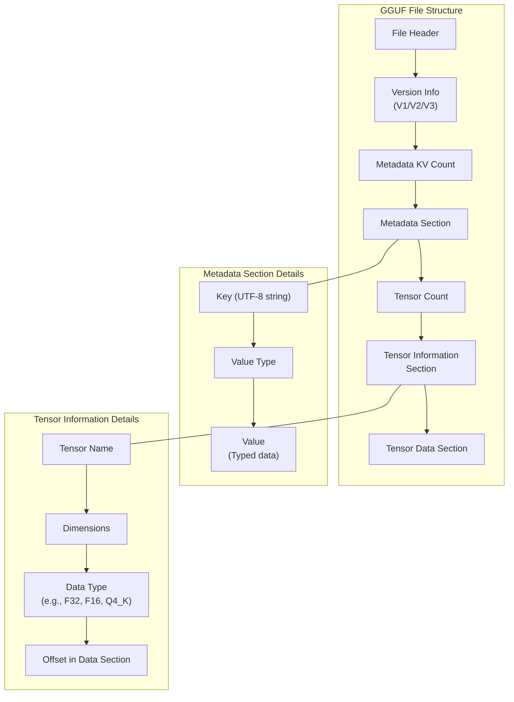
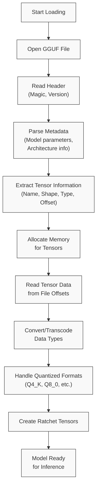
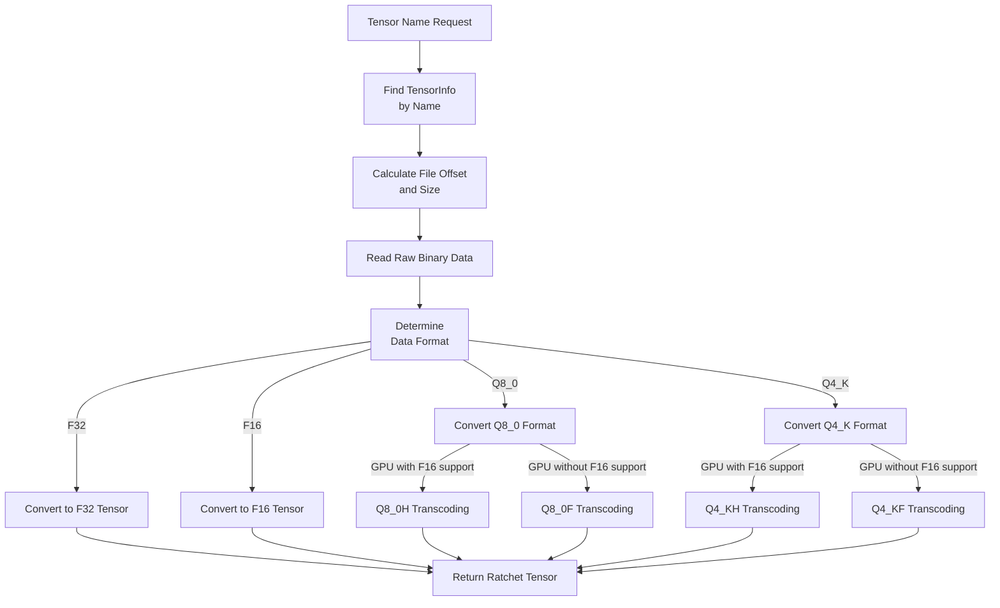
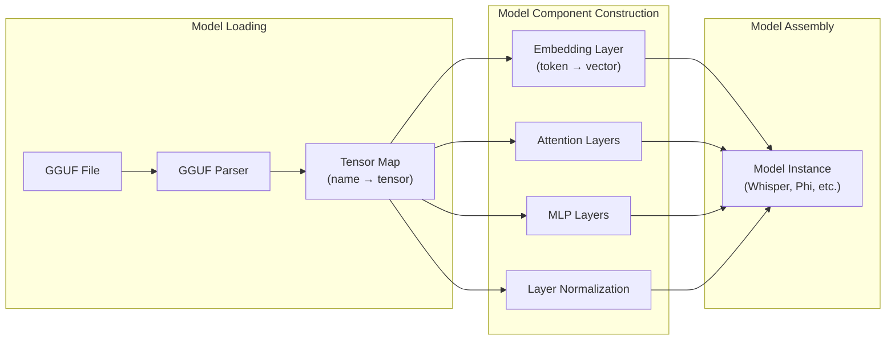

<!-- source: DeepWiki mcp.deepwiki.com · repo huggingface/ratchet · page 4 Model Loading · fetched 2026-10-26 -->

# Model Loading

Relevant source files

The following files were used as context for generating this wiki page:

- [crates/ratchet-core/src/quant.rs](crates/ratchet-core/src/quant.rs)
- [crates/ratchet-loader/src/gguf/gguf.rs](crates/ratchet-loader/src/gguf/gguf.rs)
- [crates/ratchet-loader/src/gguf/mod.rs](crates/ratchet-loader/src/gguf/mod.rs)
- [crates/ratchet-loader/src/gguf/utils.rs](crates/ratchet-loader/src/gguf/utils.rs)
- [crates/ratchet-loader/src/lib.rs](crates/ratchet-loader/src/lib.rs)
- [crates/ratchet-nn/src/embedding.rs](crates/ratchet-nn/src/embedding.rs)

This page documents Ratchet's model loading system, which primarily focuses on loading pre-trained machine learning models from the GGUF file format into Ratchet's tensor representation. It explains how model weights are read, processed, and converted into usable tensors, with particular attention to handling quantized weights.

For information about how to deploy and use loaded models, see [Deployment](#5).

## GGUF Format Overview

The GGUF (GPT-Generated Unified Format) is a file format designed for storing machine learning models and their weights. Ratchet implements a parser for this format, supporting versions 1-3 of the specification.

Sources: [crates/ratchet-loader/src/gguf/gguf.rs:15-510]()

## Model Loading Process

Loading a model in Ratchet follows a multi-step process, from file reading to tensor creation:

Sources: [crates/ratchet-loader/src/gguf/gguf.rs:422-509]()

### Header Parsing

The `Header` struct encapsulates the metadata and tensor information from a GGUF file. It provides methods to:

1. Read the file format version (V1, V2, or V3)
2. Parse metadata key-value pairs
3. Extract information about tensors (name, dimensions, data type, and offset)
4. Calculate the tensor data offset within the file

The header parsing process handles version-specific differences in how lengths and offsets are encoded.

Sources: [crates/ratchet-loader/src/gguf/gguf.rs:421-494]()

### Tensor Information Extraction

The `TensorInfo` struct contains details about each tensor in the model:

- `ggml_dtype`: Data type (F32, F16, Q8_0, Q4_K, etc.)
- `shape`: Tensor dimensions
- `offset`: Position in the file's data section

This information is used to locate and load tensor data from the file.

Sources: [crates/ratchet-loader/src/gguf/gguf.rs:54-99]()

## Tensor Loading and Conversion

When loading tensors from a GGUF file, Ratchet performs several operations:

1. **Locating data**: Using the offset and size information to read the raw bytes
2. **Type conversion**: Converting from GGML types to Ratchet's internal tensor representation
3. **Device placement**: Placing the tensor on the appropriate device (CPU or GPU)
4. **Quantization handling**: Special processing for quantized tensor formats

The `tensor` method of the `Header` struct orchestrates this process:

Sources: [crates/ratchet-loader/src/gguf/gguf.rs:495-509](), [crates/ratchet-loader/src/gguf/gguf.rs:62-85](), [crates/ratchet-loader/src/gguf/gguf.rs:113-156]()

## Quantization Support

Ratchet supports several quantization formats for efficient model storage and inference. When loading quantized tensors from GGUF files, the system handles the details of:

1. Recognizing the quantization format from the GGML type
2. Understanding the block structure (block size, number of elements per block)
3. Properly transcoding the quantized data to Ratchet's internal representation

### Quantized Format Characteristics

| Format | Description | Use Case | Block Size |
|--------|-------------|----------|------------|
| Q8_0   | 8-bit quantization | Balance of quality and size | Variable |
| Q4_K   | 4-bit k-quantization | Smaller size, more compression | Variable |
| F16    | 16-bit floating point | Good quality, moderate size | 1 |
| F32    | 32-bit floating point | Best quality, largest size | 1 |

The system automatically selects the appropriate implementation based on device capabilities:

- For GPU with F16 support: Uses the more efficient F16-based quantization handlers
- For GPU without F16 support: Falls back to F32-based handlers

Sources: [crates/ratchet-loader/src/lib.rs:29-142](), [crates/ratchet-core/src/quant.rs:1-164](), [crates/ratchet-loader/src/gguf/gguf.rs:127-153]()

## Integration with Model Components

The model loading system works in conjunction with other Ratchet components, particularly the embedding and neural network modules. The loaded tensors are used to initialize model parameters such as embedding weights.

Sources: [crates/ratchet-nn/src/embedding.rs:1-26](), [crates/ratchet-loader/src/gguf/gguf.rs:495-509]()

## API Reference

### Key Components

- **Header**: Main class for parsing and accessing GGUF files
  - `read`: Parses a GGUF file header
  - `tensor`: Loads a specific tensor by name

- **TensorInfo**: Contains metadata about a tensor in the GGUF file
  - `read`: Reads the tensor data and converts it to a Ratchet tensor
  - `byte_range`: Determines the memory range for a tensor
  - `size_in_bytes`: Calculates the size of the tensor in bytes

- **GgmlDType**: Enum representing GGML data types
  - Provides methods for type size, block size, and conversion

### Core Functions

- **ratchet_from_gguf**: Converts raw GGUF tensor data to a Ratchet tensor
- **from_raw_data**: Transcodes tensor data from one format to another
- **quantize/dequantize**: Functions for handling quantized tensor formats

Sources: [crates/ratchet-loader/src/gguf/gguf.rs:421-510](), [crates/ratchet-loader/src/gguf/gguf.rs:54-99](), [crates/ratchet-loader/src/lib.rs:29-142](), [crates/ratchet-core/src/quant.rs:19-164]()

## Handling Different GGUF Versions

Ratchet supports multiple versions of the GGUF format (V1, V2, V3) with logic to handle version-specific differences in:

- String length encoding (32-bit in V1, 64-bit in V2/V3)
- Array length encoding (32-bit in V1, 64-bit in V2/V3)
- Dimension encoding (32-bit in V1, 64-bit in V2/V3)

The `VersionedMagic` enum represents the supported file format versions and guides the parsing process.

Sources: [crates/ratchet-loader/src/gguf/gguf.rs:32-51](), [crates/ratchet-loader/src/gguf/gguf.rs:179-193](), [crates/ratchet-loader/src/gguf/gguf.rs:382-386](), [crates/ratchet-loader/src/gguf/gguf.rs:425-436](), [crates/ratchet-loader/src/gguf/gguf.rs:451-462]()

---

