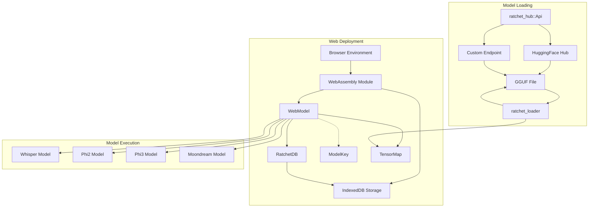
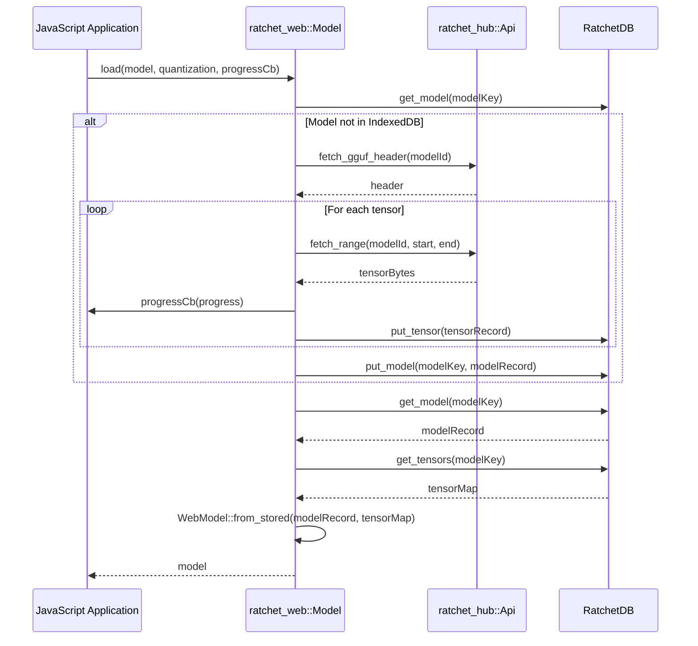
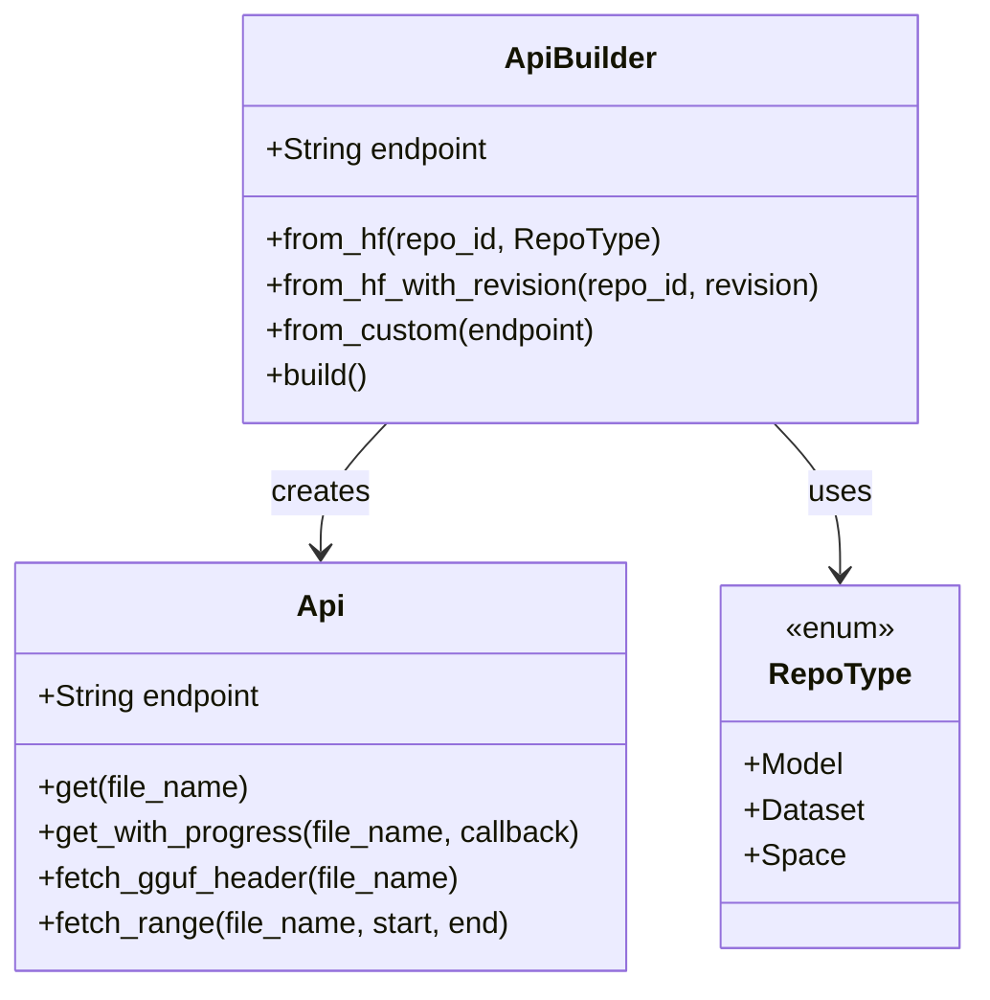
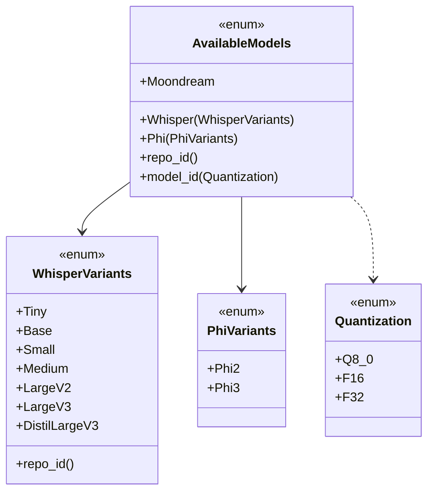

<!-- source: DeepWiki mcp.deepwiki.com · repo huggingface/ratchet · page 5 Deployment · fetched 2026-10-26 -->

# Deployment

<details>
<summary>Relevant source files</summary>

The following files were used as context for generating this wiki page:

- [.cargo/config.toml](.cargo/config.toml)
- [.github/workflows/rust.yml](.github/workflows/rust.yml)
- [crates/ratchet-hub/Cargo.toml](crates/ratchet-hub/Cargo.toml)
- [crates/ratchet-hub/src/lib.rs](crates/ratchet-hub/src/lib.rs)
- [crates/ratchet-loader/Cargo.toml](crates/ratchet-loader/Cargo.toml)
- [crates/ratchet-models/src/registry.rs](crates/ratchet-models/src/registry.rs)
- [crates/ratchet-web/src/model.rs](crates/ratchet-web/src/model.rs)
- [justfile](justfile)
- [pnpm-workspace.yaml](pnpm-workspace.yaml)

</details>


This document explains how to deploy and use Ratchet models in different environments. It covers the architecture of the deployment subsystems, the process of loading models, and how to run inference in web browsers via WebAssembly and through the command-line interface. For details on specific model implementations, see [Model Implementations](#3).

## 1. Deployment Architecture

Ratchet provides multiple ways to deploy and run models, with a strong focus on web-first deployment via WebAssembly.



Sources: [crates/ratchet-web/src/model.rs:16-128](), [crates/ratchet-hub/src/lib.rs:101-254]()

The deployment system consists of several key components:

1. **Model Loading**: Handles fetching model files from HuggingFace Hub or custom endpoints
2. **Storage Management**: Stores models in IndexedDB for browser environments
3. **WebAssembly Integration**: Enables model execution in web browsers
4. **Model Registry**: Provides a unified interface for accessing different models

## 2. Web Deployment

Ratchet prioritizes web deployment through WebAssembly, allowing models to run directly in the browser without server-side processing.

### 2.1 WebAssembly Interface

The web interface is built around the `Model` class, which provides methods for loading and running different model types.

```mermaid
classDiagram
    class Model {
        +WebModel inner
        +load(AvailableModels, Quantization, callback)
        +load_custom(endpoint, AvailableModels, Quantization, callback)
        +run(input)
    }
    
    class WebModel {
        <<enum>>
        +Whisper(Whisper)
        +Phi2(Phi2)
        +Phi3(Phi3)
        +Moondream(Moondream)
        +run(input)
        +from_stored(ModelRecord, TensorMap)
    }
    
    class RatchetDB {
        +open()
        +get_model(ModelKey)
        +put_model(ModelKey, ModelRecord)
        +get_tensors(ModelKey)
    }
    
    class ModelKey {
        +from_available(AvailableModels, Quantization)
        +repo_id()
        +model_id()
    }
    
    class AvailableModels {
        <<enum>>
        +Whisper(WhisperVariants)
        +Phi(PhiVariants)
        +Moondream
        +repo_id()
        +model_id(Quantization)
    }
    
    Model o-- WebModel
    WebModel --> RatchetDB
    RatchetDB --> "IndexedDB" 
    WebModel ..> ModelKey
    Model ..> AvailableModels
```

Sources: [crates/ratchet-web/src/model.rs:154-226](), [crates/ratchet-models/src/registry.rs:55-107]()

### 2.2 Model Loading Process

When loading a model in the browser environment, Ratchet follows these steps:

1. Check if the model is already available in IndexedDB
2. If not, fetch the model from HuggingFace Hub or a custom endpoint
3. Parse the GGUF header to identify tensor information
4. Fetch tensor data in parallel with progress reporting
5. Store tensors in IndexedDB for future use
6. Construct the appropriate model instance



Sources: [crates/ratchet-web/src/model.rs:166-226](), [crates/ratchet-hub/src/lib.rs:107-182]()

### 2.3 Running Models in the Browser

Once loaded, models can be run directly in the browser. Each model type has specific input requirements and callback mechanisms:

| Model | Input Type | Description |
|-------|------------|-------------|
| Whisper | `WhisperInputs` | Audio data (as f32 array), decode options, and callback function |
| Phi2/Phi3 | `PhiInputs` | Text prompt and callback function for streaming output |
| Moondream | `MoondreamInputs` | Image bytes, text question, and callback function |

Models provide streaming output through JavaScript callback functions, allowing for real-time display of results.

Sources: [crates/ratchet-web/src/model.rs:25-97](), [crates/ratchet-web/src/model.rs:130-152]()

## 3. HuggingFace Hub Integration

Ratchet provides seamless integration with HuggingFace Hub for accessing models and datasets.

### 3.1 Hub API

The `ratchet_hub::Api` class provides methods for fetching files from HuggingFace repositories:



Sources: [crates/ratchet-hub/src/lib.rs:37-254]()

The `Api` class handles:

1. Fetching complete files with optional progress reporting
2. Extracting GGUF headers for model inspection
3. Retrieving specific byte ranges for efficient tensor loading
4. Supporting custom endpoints for private or self-hosted models

## 4. Model Registry

Ratchet uses a registry system to provide a consistent interface for accessing different model variants and quantization levels.

### 4.1 Available Models



Sources: [crates/ratchet-models/src/registry.rs:9-116]()

The registry system allows for:

1. Typesafe selection of models with autocompletion in IDEs
2. Standardized file naming and repository access
3. Support for multiple quantization formats (F16, F32, Q8_0)

## 5. Build and Deployment Workflows

Ratchet includes tools and scripts for building and deploying to different environments.

### 5.1 WebAssembly Build Process

The project uses `wasm-pack` to build WebAssembly targets, with various scripts in the `justfile` to streamline the process:

```
just wasm ratchet-web      # Build ratchet-web for production
just wasm-dbg ratchet-web  # Build ratchet-web for debugging
just wasm-test ratchet-web chrome  # Run wasm tests in Chrome
just wasm-publish-pr ratchet-web   # Publish a new version
```

Sources: [justfile:7-16]()

### 5.2 Continuous Integration

The project's CI pipeline includes:

1. Building and testing on multiple platforms (Windows, Linux, macOS)
2. Running WebAssembly tests in browsers
3. Building and publishing WebAssembly packages

The CI configuration specifies important environment variables like `RUSTFLAGS="--cfg=web_sys_unstable_apis"` that enable WebGPU support.

Sources: [.github/workflows/rust.yml:9-97]()

## 6. Summary

Ratchet's deployment system provides a flexible, web-first approach to running ML models across different environments. The key components work together to enable:

1. Efficient model loading from HuggingFace Hub or custom sources
2. Browser-based execution through WebAssembly
3. Persistent storage using IndexedDB
4. Support for multiple model architectures and quantization formats
5. Streaming output for real-time display of results

This architecture aligns with Ratchet's mission of making ML models accessible across platforms, with a particular focus on browser-based deployment.

---

