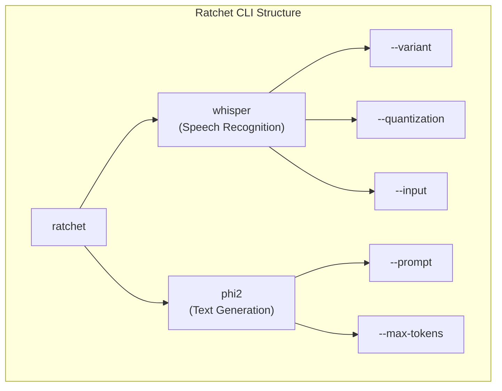
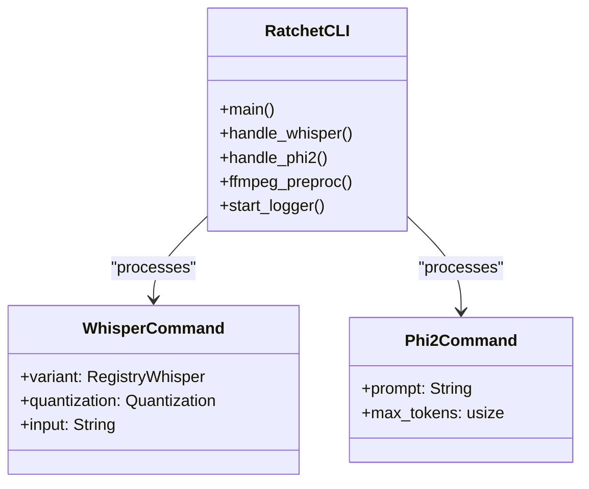
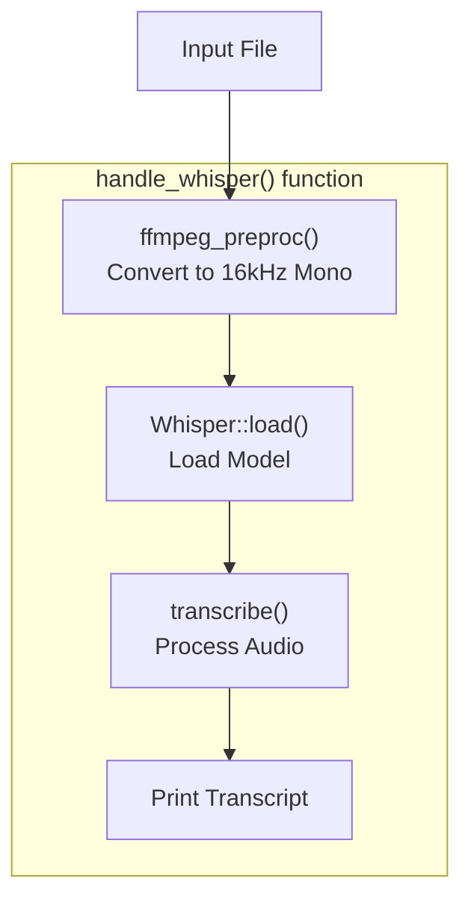
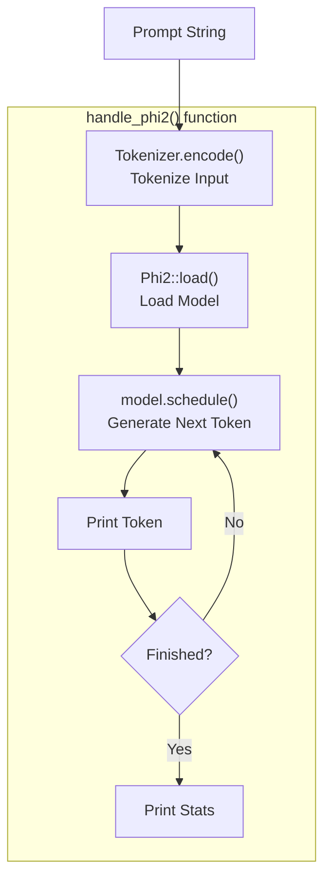
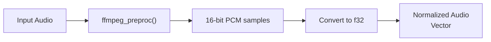

<!-- source: DeepWiki mcp.deepwiki.com · repo huggingface/ratchet · page 5.2 Command Line Interface · fetched 2026-10-26 -->

# Command Line Interface

<details>
<summary>Relevant source files</summary>

The following files were used as context for generating this wiki page:

- [.github/workflows/rust.yml](.github/workflows/rust.yml)
- [crates/ratchet-cli/src/bin/cli.rs](crates/ratchet-cli/src/bin/cli.rs)
- [crates/ratchet-models/src/phi2/attn.rs](crates/ratchet-models/src/phi2/attn.rs)
- [crates/ratchet-models/src/phi2/model.rs](crates/ratchet-models/src/phi2/model.rs)
- [justfile](justfile)
- [pnpm-workspace.yaml](pnpm-workspace.yaml)

</details>


This document provides a comprehensive guide to the Ratchet command line interface, which allows users to run various machine learning models directly from the terminal without writing code. The CLI currently supports two primary models: Whisper for speech recognition and Phi2 for text generation.

## Overview

The Ratchet CLI provides a simple way to interact with GPU-accelerated machine learning models. It's designed to be easy to use while offering powerful functionality for tasks such as speech transcription and text generation.



Sources: [crates/ratchet-cli/src/bin/cli.rs:169-236]()

## Installation

The Ratchet CLI is built as part of the Ratchet project. You can build it from source using Rust's cargo build system.

## Command Structure

The CLI uses the [clap](https://crates.io/crates/clap) crate for argument parsing and follows a subcommand structure where each model type has its own subcommand.



Sources: [crates/ratchet-cli/src/bin/cli.rs:169-236](), [crates/ratchet-cli/src/bin/cli.rs:79-107](), [crates/ratchet-cli/src/bin/cli.rs:109-167]()

## Whisper Command

The `whisper` command allows you to transcribe audio files using OpenAI's Whisper model.

### Options

| Option | Short | Description | Default | Notes |
|--------|-------|-------------|---------|-------|
| `--variant` | `-v` | Whisper model variant | `"small"` | Options: tiny, base, small, medium, large |
| `--quantization` | `-q` | Model quantization | `"f32"` | Options: f32, f16, q8_0, q4_0, q4_1 |
| `--input` | `-i` | Path to input audio file | *Required* | Most audio formats supported |

### Example

```bash
ratchet whisper --input recording.mp3 --variant medium --quantization q8_0
```

### Workflow



Sources: [crates/ratchet-cli/src/bin/cli.rs:17-57](), [crates/ratchet-cli/src/bin/cli.rs:79-107]()

## Phi2 Command

The `phi2` command allows you to generate text using Microsoft's Phi2 language model.

### Options

| Option | Short | Description | Default | Notes |
|--------|-------|-------------|---------|-------|
| `--prompt` | `-p` | Input prompt for text generation | *Required* | String to start generation |
| `--max-tokens` | `-m` | Maximum tokens to generate | `256` | Controls output length |

### Example

```bash
ratchet phi2 --prompt "def print_prime(n):" --max-tokens 100
```

### Workflow



Sources: [crates/ratchet-cli/src/bin/cli.rs:109-167](), [crates/ratchet-models/src/phi2/model.rs:102-128]()

## Implementation Details

### Model Loading

The CLI loads models from GGUF files, which are efficient model storage formats. It uses the Hugging Face Hub API to download models if they aren't already available locally.

For Whisper:
```rust
let model = AvailableModels::Whisper(variant.clone());
let repo = api.model(model.repo_id());
let model_path = repo.get(&model.model_id(quantization.clone())).unwrap();
let mut reader = std::io::BufReader::new(std::fs::File::open(model_path).unwrap());
let device = Device::request_device(DeviceRequest::GPU).unwrap();
let header = gguf::Header::read(&mut reader).unwrap();
Whisper::load(header, variant.clone(), &mut reader, device).unwrap()
```

For Phi2:
```rust
let model_repo = api.model("FL33TW00D-HF/phi2".to_string());
let model_path = model_repo.get("phi2-q8_0.gguf").unwrap();
let mut reader = std::io::BufReader::new(std::fs::File::open(model_path)?);
let device = Device::request_device(DeviceRequest::GPU)?;
let content = Header::read(&mut reader)?;
let mut model = Phi2::load(content, &mut reader, &device)?;
```

Sources: [crates/ratchet-cli/src/bin/cli.rs:84-96](), [crates/ratchet-cli/src/bin/cli.rs:110-117]()

### Audio Processing

For the Whisper command, audio files are processed using FFmpeg to convert them to the required format (16kHz mono PCM):



The implementation uses FFmpeg as an external dependency to handle audio conversion:

```rust
let output = TermCommand::new("ffmpeg")
    .args([
        "-nostdin",
        "-threads", "0",
        "-i", path.to_str().unwrap(),
        "-f", "s16le",
        "-ac", "1",
        "-acodec", "pcm_s16le",
        "-loglevel", "error",
        "-ar", "16000",
        "-",
    ])
    .output()
    .expect("Failed to execute ffmpeg command");
```

Sources: [crates/ratchet-cli/src/bin/cli.rs:17-57]()

### Text Generation

For the Phi2 command, text generation is performed iteratively, with each step:
1. Converting current tokens to a tensor
2. Running the model on this tensor to get logits
3. Finding the highest probability token
4. Adding this token to the output
5. Repeating until completion or max tokens reached

```rust
while tokens[tokens.len() - 1] != 50256 && loop_cnt < *max_tokens {
    let input = Tensor::from_data(tokens.clone(), shape![1, tokens.len()], device.clone());
    let result = model.schedule(input)?.full()?.resolve()?;
    let logits = result.to(&Device::CPU)?;
    model.cache_mut().update(tokens.len());

    tokens = logits
        .to_ndarray_view::<f32>()
        .map_axis(Axis(2), |row| row.argmax_skipnan().unwrap())
        .iter()
        .map(|&x| x as i32)
        .collect::<Vec<_>>();
    
    // Print and continue
}
```

Sources: [crates/ratchet-cli/src/bin/cli.rs:142-159]()

## Performance Metrics

The CLI outputs performance metrics after completion:

- For Whisper, it reports the processing time for the entire transcription.
- For Phi2, it shows elapsed time and tokens per second:

```rust
let elapsed = start_time.elapsed();
println!("\nElapsed time: {:?}", elapsed);
println!(
    "tok/sec: {}",
    all_tokens.len() as f64 / elapsed.as_secs_f64()
);
```

Sources: [crates/ratchet-cli/src/bin/cli.rs:160-165]()

## GPU Acceleration

Ratchet CLI automatically uses GPU acceleration when available by default, utilizing the `Device::request_device(DeviceRequest::GPU)` call when loading models.

Sources: [crates/ratchet-cli/src/bin/cli.rs:91](), [crates/ratchet-cli/src/bin/cli.rs:115]()