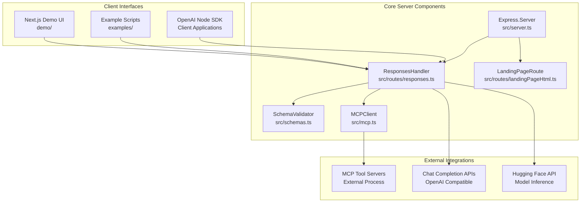
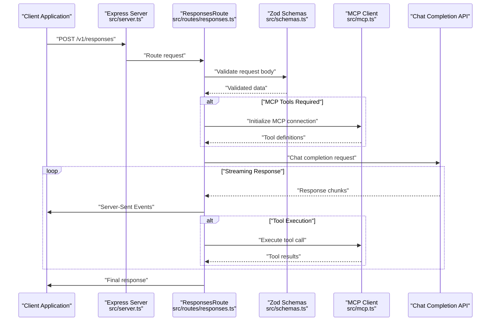
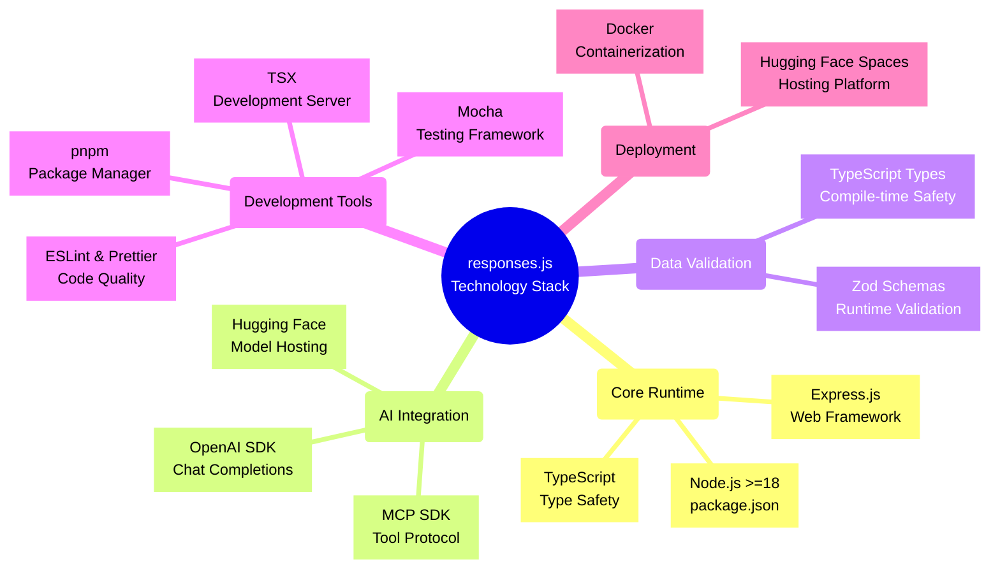
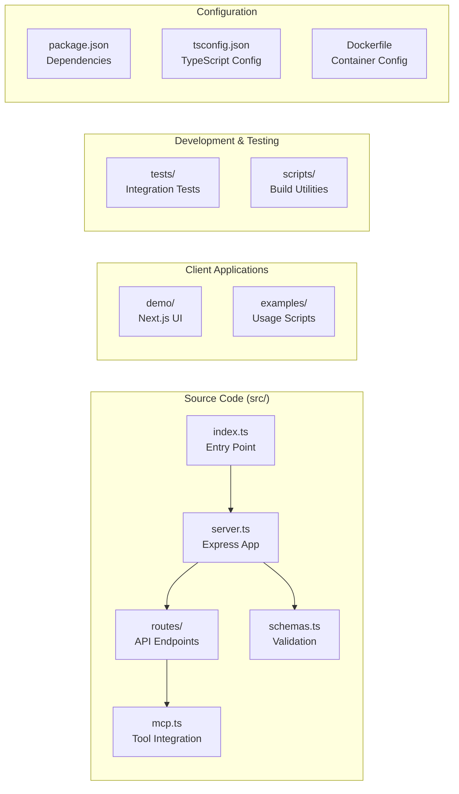

<!-- source: DeepWiki mcp.deepwiki.com · repo huggingface/responses.js · page 1 Overview · fetched 2026-10-26 -->

# Overview

Relevant source files

The following files were used as context for generating this wiki page:

- [README.md](README.md)
- [demo/package.json](demo/package.json)
- [package.json](package.json)

## Purpose and Scope

The responses.js system is a lightweight Express.js server that implements a translation layer between OpenAI's Responses API and Chat Completion APIs. This documentation covers the core architecture, API endpoints, tool integration capabilities, and deployment options for the responses.js system.

For detailed setup instructions, see [Getting Started](#2). For API specifications, see [API Reference](#4). For tool integration patterns, see [Tool Integration](#5).

**Sources:** [README.md:1-21](), [package.json:1-10]()

## System Architecture

The responses.js system consists of several interconnected components that work together to provide a complete AI response generation service:

**Sources:** [README.md:145-160](), [package.json:60-64]()

## Core Capabilities

The responses.js system provides several key capabilities that bridge the gap between different AI API standards:

| Capability | Implementation | Code Location |
|------------|----------------|---------------|
| **Responses API Translation** | Converts Responses API calls to Chat Completion format | `src/routes/responses.ts` |
| **Provider Agnostic** | Works with any OpenAI-compatible Chat Completion API | `src/routes/responses.ts` |
| **Streaming Support** | Real-time Server-Sent Events for response streaming | `src/routes/responses.ts` |
| **Structured Output** | JSON schema validation using Zod schemas | `src/schemas.ts` |
| **Function Calling** | Tool and function execution capabilities | `src/routes/responses.ts` |
| **Multi-modal Input** | Text and image input processing | `src/schemas.ts` |
| **MCP Integration** | Model Context Protocol for external tool execution | `src/mcp.ts` |
| **Demo Interface** | Interactive web UI for testing and demonstration | `demo/` |

**Sources:** [README.md:9-20](), [package.json:60-64]()

## Request Processing Flow

The system processes requests through a coordinated flow between multiple components:

**Sources:** [README.md:9-20](), [package.json:60-64]()

## Technology Stack

The responses.js system is built on a modern Node.js technology stack:

**Sources:** [package.json:21-80](), [README.md:24-28]()

## Project Structure

The codebase is organized into distinct functional areas:

The core server components are located in the `src/` directory, with the main entry point at [src/index.ts]() and the Express application configuration in [src/server.ts](). The primary API logic resides in [src/routes/responses.ts](), which handles the translation between Responses API and Chat Completion formats.

**Sources:** [README.md:145-160](), [package.json:46-49]()

---

