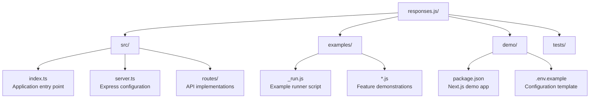
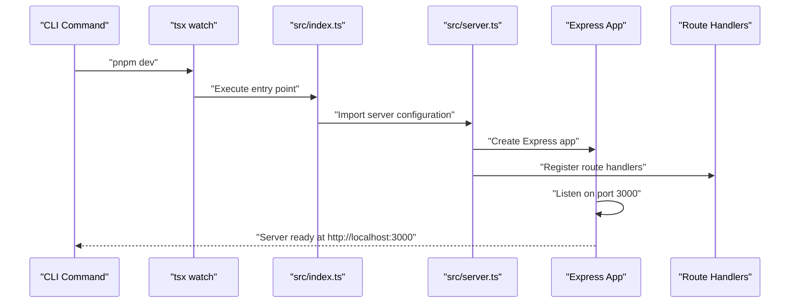
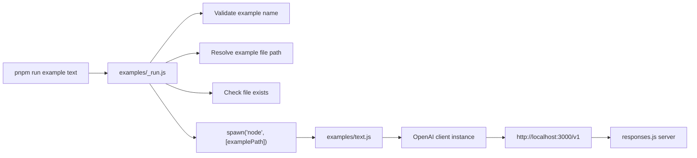
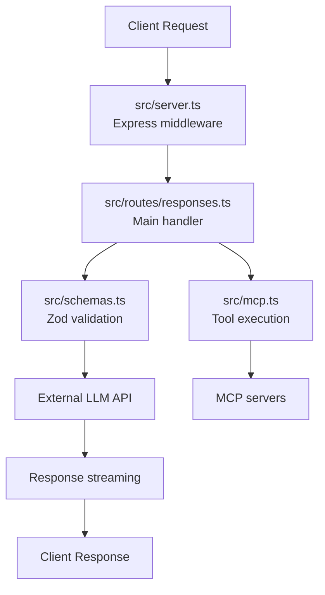

<!-- source: DeepWiki mcp.deepwiki.com · repo huggingface/responses.js · page 2 Getting Started · fetched 2026-10-26 -->

# Getting Started

<details>
<summary>Relevant source files</summary>

The following files were used as context for generating this wiki page:

- [README.md](README.md)
- [demo/.env.example](demo/.env.example)
- [demo/package.json](demo/package.json)
- [examples/_run.js](examples/_run.js)
- [package.json](package.json)

</details>


This page guides you through installing, configuring, and running responses.js for the first time. It covers basic setup, environment configuration, and running your first examples to verify the system is working correctly.

For detailed API documentation, see [API Reference](#4). For advanced tool integration patterns, see [Tool Integration](#5). For production deployment considerations, see [Deployment](#7.3).

## Prerequisites

responses.js requires specific software versions and external service access to function properly.

### System Requirements

| Requirement | Version | Purpose |
|-------------|---------|---------|
| Node.js | ≥18.0 | Runtime environment |
| Package Manager | pnpm (recommended) or npm | Dependency management |
| Hugging Face Token | With inference permissions | LLM API access |

The Node.js version requirement is enforced in [package.json:22-24]().

### External Service Access

responses.js requires access to LLM providers through Chat Completion APIs. The most common setup uses Hugging Face's hosted models, but any OpenAI-compatible API will work.

**Sources:** [package.json:22-24](), [README.md:24-28]()

## Installation

### Repository Setup

Clone the repository and install dependencies:

```bash
git clone https://github.com/huggingface/responses.js.git
cd responses.js
pnpm install
```

The project uses pnpm workspaces as defined in [package.json:3]() with the package manager specification.

### Project Structure Overview

After installation, the key directories are:



**Sources:** [README.md:147-160](), [examples/_run.js:1-31](), [demo/package.json:1-54]()

## Configuration

### Environment Variables

responses.js requires minimal configuration. The primary requirement is access to an LLM provider API.

#### Basic Configuration

For Hugging Face hosted models (recommended for getting started):

```bash
export HF_TOKEN="your-hugging-face-token-here"
```

Create your token at [Hugging Face Settings](https://huggingface.co/settings/tokens) with inference permissions enabled.

#### Alternative Provider Configuration

For other OpenAI-compatible APIs:

```bash
export API_KEY="your-api-key"
export OPENAI_BASE_URL="https://your-provider-api-url"
```

### Demo Application Configuration

To run the interactive demo UI, create a configuration file:

```bash
cat > demo/.env << EOF
MODEL="CohereLabs/c4ai-command-a-03-2025"
OPENAI_BASE_URL=http://localhost:3000/v1
OPENAI_API_KEY=${HF_TOKEN}
EOF
```

The demo configuration template is available in [demo/.env.example:1-3]().

**Sources:** [README.md:28-29](), [README.md:102-111](), [demo/.env.example:1-3]()

## Running the Server

### Development Mode

Start the development server with automatic reloading:

```bash
pnpm dev
```

This command executes the script defined in [package.json:28]() using `tsx watch src/index.ts`.

### Server Startup Process



The server will be available at `http://localhost:3000` once startup is complete.

### Production Mode

For production deployment:

```bash
pnpm build
pnpm start
```

This builds the TypeScript code and runs the compiled JavaScript from `dist/index.js` as defined in [package.json:35]().

**Sources:** [package.json:28](), [package.json:35](), [README.md:40-44]()

## Testing the Setup

### Running Example Scripts

Verify your installation by running the provided examples:

```bash
# Basic text generation
pnpm run example text

# Multi-turn conversation
pnpm run example multi_turn

# Streaming responses
pnpm run example streaming

# Structured output
pnpm run example structured_output
```

### Example Execution Flow



The example runner is implemented in [examples/_run.js:15-29]() and validates the example name before execution.

### Available Examples

| Example | Command | Purpose |
|---------|---------|---------|
| `text` | `pnpm run example text` | Basic text generation |
| `multi_turn` | `pnpm run example multi_turn` | Conversation handling |
| `image` | `pnpm run example image` | Multi-modal input |
| `streaming` | `pnpm run example streaming` | Real-time responses |
| `structured_output` | `pnmp run example structured_output` | JSON schema output |
| `function` | `pnpm run example function` | Tool calling |

**Sources:** [examples/_run.js:15-29](), [README.md:48-70]()

## Basic API Usage

### Making Your First Request

Once the server is running, you can make requests using any OpenAI-compatible client:

```bash
curl -X POST http://localhost:3000/v1/responses \
  -H "Content-Type: application/json" \
  -H "Authorization: Bearer your-token" \
  -d '{
    "model": "CohereLabs/c4ai-command-a-03-2025",
    "messages": [{"role": "user", "content": "Hello, world!"}]
  }'
```

### Request Processing Architecture



The main response handling logic is implemented in the routes directory, with schema validation ensuring request correctness before processing.

**Sources:** [README.md:151-156]()

## Interactive Demo

### Setting Up the Demo UI

Install and run the Next.js demo application:

```bash
pnpm demo:install
pnpm demo:dev
```

The demo will be available at `http://localhost:3001` and provides an interactive interface for testing all features.

### Demo Dependencies

The demo is a separate Next.js application with its own dependencies defined in [demo/package.json:12-40](), including React components for chat interfaces and OpenAI client integration.

**Sources:** [README.md:114-125](), [demo/package.json:12-40]()

## Next Steps

After completing the basic setup:

1. **Explore Advanced Features**: Try examples with function calling and structured output
2. **Review API Documentation**: See [API Reference](#4) for complete endpoint specifications  
3. **Configure Tool Integration**: See [Tool Integration](#5) for MCP server setup
4. **Production Deployment**: See [Deployment](#7.3) for Docker and hosting options

For troubleshooting common setup issues, check that:
- The server is running on port 3000
- Your API token has proper permissions
- Network connectivity to LLM providers is available

**Sources:** [README.md:22-70](), [README.md:127-144]()

---

