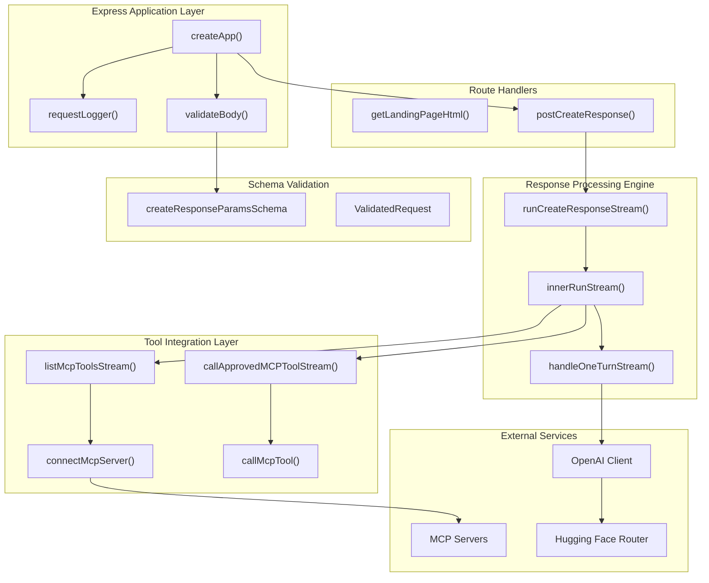
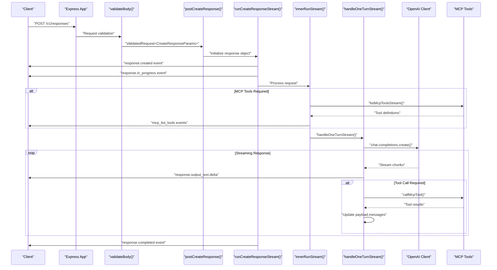
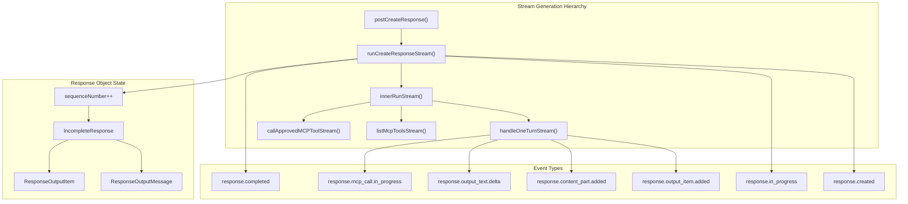
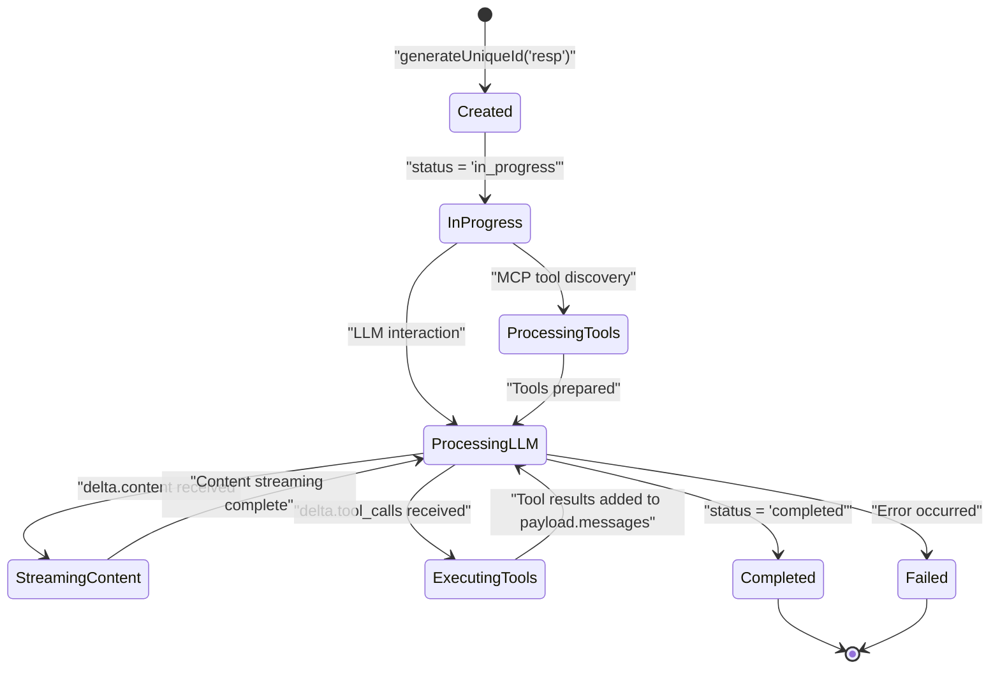
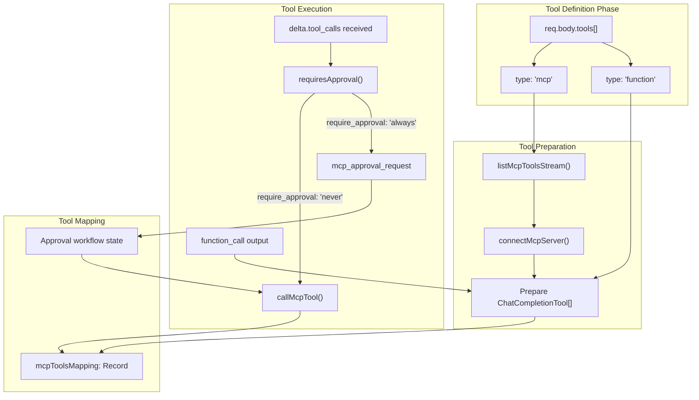

<!-- source: DeepWiki mcp.deepwiki.com · repo huggingface/responses.js · page 3 Core Architecture · fetched 2026-10-26 -->

# Core Architecture

Relevant source files

The following files were used as context for generating this wiki page:

- [src/routes/index.ts](src/routes/index.ts)
- [src/routes/responses.ts](src/routes/responses.ts)
- [src/server.ts](src/server.ts)

This document provides an in-depth technical overview of responses.js's core architectural components and their interactions. It covers the system design patterns, data flow, and key abstractions that enable the translation layer between OpenAI's Responses API and Chat Completion APIs.

For specific implementation details of response generation, see [Response Handler](#3.1). For data validation and type definitions, see [Schema System](#3.2). For external tool integration, see [MCP Integration](#3.3). For server setup and routing, see [Server Configuration](#3.4).

## System Components Overview

The responses.js architecture is built around four primary components that work together to process requests and generate streaming responses:

### Core Components Diagram

**Sources:** [src/server.ts:1-21](), [src/routes/responses.ts:32-58](), [src/routes/responses.ts:66-144](), [src/routes/responses.ts:146-415]()

## Request Processing Flow

The system processes requests through a multi-stage pipeline that handles validation, tool preparation, LLM interaction, and response streaming:

### Request Lifecycle Diagram

**Sources:** [src/routes/responses.ts:32-58](), [src/routes/responses.ts:66-144](), [src/routes/responses.ts:146-415](), [src/routes/responses.ts:474-769]()

## Streaming Architecture

The system implements a sophisticated streaming architecture using async generators to provide real-time response updates:

### Streaming Data Flow

**Sources:** [src/routes/responses.ts:66-144](), [src/routes/responses.ts:474-769](), [src/routes/responses.ts:29-30]()

## Core Data Structures

The system operates on several key data structures that maintain state throughout the request lifecycle:

### Key Type Definitions

| Type | Purpose | Location | Key Fields |
|------|---------|----------|------------|
| `IncompleteResponse` | Core response state container | [src/routes/responses.ts:29]() | `id`, `status`, `output[]`, `usage` |
| `ValidatedRequest<CreateResponseParams>` | Validated input parameters | Middleware validation | `body.model`, `body.messages`, `body.tools` |
| `ResponseStreamEvent` | Streaming event wrapper | OpenAI types | `type`, `sequence_number`, `response` |
| `ChatCompletionCreateParamsStreaming` | LLM API payload | OpenAI types | `model`, `messages`, `tools`, `stream: true` |
| `McpServerParams` | MCP server configuration | Schema definitions | `server_label`, `require_approval`, `allowed_tools` |

### Response State Management

The `IncompleteResponse` object serves as the central state container that gets progressively populated:

**Sources:** [src/routes/responses.ts:72-96](), [src/routes/responses.ts:137-143](), [src/routes/responses.ts:124-135]()

## Tool Integration Architecture

The system supports both simple function calls and sophisticated MCP (Model Context Protocol) tool integration with approval workflows:

### Tool Processing Pipeline

**Sources:** [src/routes/responses.ts:162-227](), [src/routes/responses.ts:417-469](), [src/routes/responses.ts:859-870](), [src/routes/responses.ts:706-756]()

## Error Handling and Recovery

The system implements comprehensive error handling through the streaming pipeline using a custom `StreamingError` class and structured error responses:

### Error Flow Management

| Error Type | Handler Location | Recovery Strategy |
|------------|------------------|-------------------|
| Validation errors | `validateBody()` middleware | Return 400 with validation details |
| Authentication errors | [src/routes/responses.ts:152-159]() | Return 401 unauthorized |
| MCP connection errors | [src/routes/responses.ts:460-468]() | Emit `mcp_list_tools.failed` event |
| LLM API errors | `handleOneTurnStream()` | Propagate to stream error handler |
| Tool execution errors | [src/routes/responses.ts:708-720]() | Set `error` field, emit `mcp_call.failed` |
| Stream processing errors | [src/routes/responses.ts:117-135]() | Emit `response.failed` event |

**Sources:** [src/routes/responses.ts:22-27](), [src/routes/responses.ts:117-135](), [src/routes/responses.ts:460-468]()

The architecture ensures graceful degradation and comprehensive error reporting while maintaining the streaming interface contract with clients.

---

