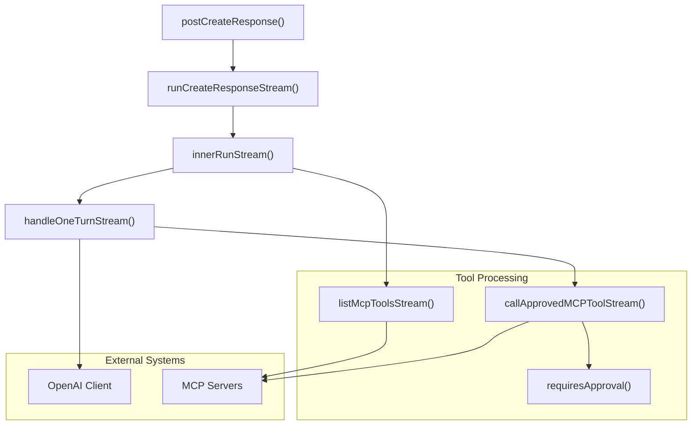
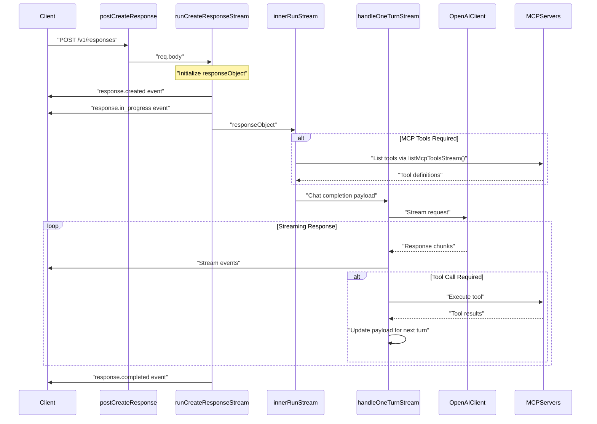
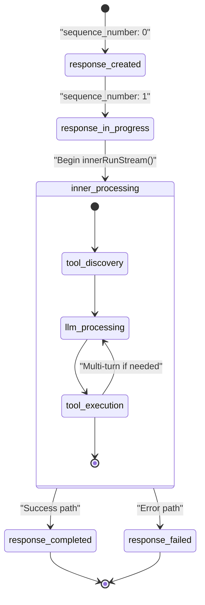
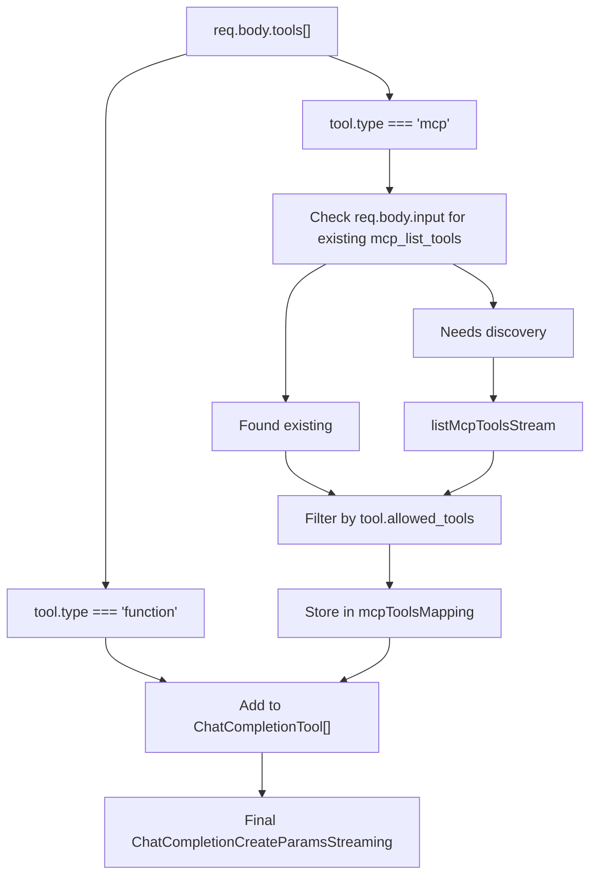
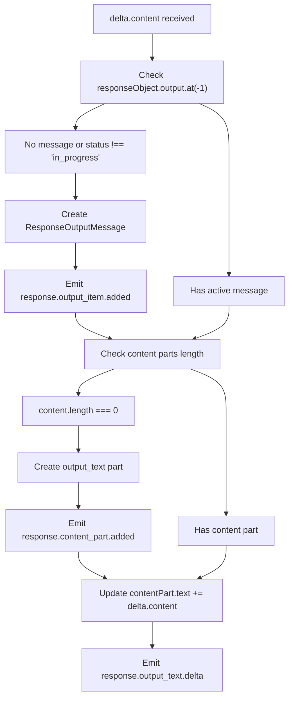
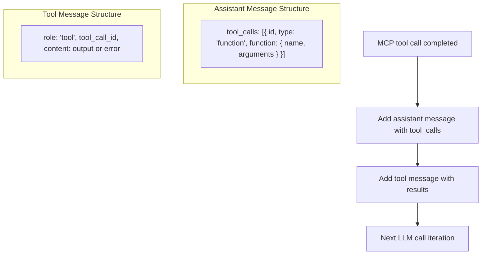

<!-- source: DeepWiki mcp.deepwiki.com · repo huggingface/responses.js · page 3.1 Response Handler · fetched 2026-10-26 -->

# Response Handler

<details>
<summary>Relevant source files</summary>

The following files were used as context for generating this wiki page:

- [src/routes/responses.ts](src/routes/responses.ts)

</details>


The Response Handler is the core orchestration system in responses.js that manages the complete lifecycle of AI response generation. It serves as the primary interface between client requests and LLM providers, handling streaming responses, tool execution, approval workflows, and multi-turn conversations. This component bridges OpenAI's Responses API format with Chat Completion APIs while adding support for external tools through the Model Context Protocol (MCP).

For information about data validation and request schemas, see [Schema System](#3.2). For details on MCP server connections and tool execution, see [MCP Integration](#3.3). For API endpoint documentation, see [Endpoints](#4.2).

## Architecture Overview

The Response Handler implements a multi-layered streaming architecture that transforms incoming requests through several processing stages before generating responses.

**Response Handler Core Architecture**


Sources: [src/routes/responses.ts:32-58](), [src/routes/responses.ts:66-144](), [src/routes/responses.ts:146-415]()

## Request Processing Flow

The response handler processes requests through a structured pipeline that handles both streaming and non-streaming scenarios uniformly by treating all requests as streams internally.

**Request Processing Pipeline**


Sources: [src/routes/responses.ts:32-58](), [src/routes/responses.ts:146-415](), [src/routes/responses.ts:474-769]()

## Response Lifecycle Management

The `runCreateResponseStream` function manages the complete response lifecycle using an `IncompleteResponse` object that is progressively populated throughout the process.

### Response Object Structure

The response handler maintains a central response object that tracks the current state:

| Field | Type | Purpose |
|-------|------|---------|
| `id` | string | Unique identifier generated by `generateUniqueId("resp")` |
| `status` | string | Current status: "in_progress", "completed", or "failed" |
| `output` | array | Collection of output items (messages, tool calls, MCP operations) |
| `usage` | object | Token usage statistics updated during LLM calls |
| `error` | object | Error details if the response fails |

### Event Sequence

The response handler emits events in a specific sequence managed by the `sequenceNumber` counter:

**Response Lifecycle Events**


Sources: [src/routes/responses.ts:70-143](), [src/routes/responses.ts:29-30](), [src/routes/responses.ts:72-96]()

## Tool Integration Processing  

The response handler supports two types of tools: standard function calls and MCP (Model Context Protocol) tools. Tool processing occurs in the `innerRunStream` function before LLM calls.

### Tool Discovery and Preparation

**Tool Processing Flow**


Sources: [src/routes/responses.ts:161-227](), [src/routes/responses.ts:417-469]()

### MCP Tool Discovery

The `listMcpToolsStream` function connects to MCP servers and retrieves available tools:

```typescript
// Key components in listMcpToolsStream
const outputObject: ResponseOutputItem.McpListTools = {
    id: generateUniqueId("mcpl"),
    type: "mcp_list_tools", 
    server_label: tool.server_label,
    tools: []
};
```

The function emits specific events during tool discovery:
- `response.mcp_list_tools.in_progress`
- `response.mcp_list_tools.completed` or `response.mcp_list_tools.failed`
- `response.output_item.added` and `response.output_item.done`

Sources: [src/routes/responses.ts:417-469](), [src/routes/responses.ts:421-426]()

## Streaming Implementation

The streaming system processes LLM responses chunk by chunk in `handleOneTurnStream`, managing different types of content and tool calls.

### Content Streaming

**Content Processing Flow**


Sources: [src/routes/responses.ts:503-563](), [src/routes/responses.ts:507-524](), [src/routes/responses.ts:527-545]()

### Tool Call Streaming

When the LLM initiates tool calls, the handler determines whether they are standard functions or MCP tools:

```typescript
// Tool call detection in handleOneTurnStream
if (delta.tool_calls && delta.tool_calls.length > 0) {
    const functionName = delta.tool_calls[0].function.name;
    
    if (functionName in mcpToolsMapping) {
        if (requiresApproval(functionName, mcpToolsMapping)) {
            // Create mcp_approval_request
        } else {
            // Create mcp_call
        }
    } else {
        // Create function_call
    }
}
```

Sources: [src/routes/responses.ts:564-643](), [src/routes/responses.ts:577-603](), [src/routes/responses.ts:859-870]()

## Multi-Turn Conversation Handling

The response handler supports multi-turn conversations through an iteration loop in `innerRunStream` that continues calling the LLM until no new messages are added to the payload.

### Iteration Control

The system uses a controlled loop with safety limits:

```typescript
// Multi-turn loop control
let previousMessageCount: number;
let currentMessageCount = payload.messages.length;
const MAX_ITERATIONS = 5; // hard-coded
let iterations = 0;

do {
    previousMessageCount = currentMessageCount;
    
    for await (const event of handleOneTurnStream(apiKey, payload, responseObject, mcpToolsMapping)) {
        yield event;
    }
    
    currentMessageCount = payload.messages.length;
    iterations++;
} while (currentMessageCount > previousMessageCount && iterations < MAX_ITERATIONS);
```

### Message Payload Updates

After MCP tool execution, the handler updates the chat completion payload for subsequent LLM calls:

**Payload Update Flow**


Sources: [src/routes/responses.ts:398-414](), [src/routes/responses.ts:729-755](), [src/routes/responses.ts:834-856]()

## Error Handling and Recovery

The response handler implements comprehensive error handling throughout the streaming process using try-catch blocks and specific error types.

### Streaming Error Management

The system defines a custom `StreamingError` class for stream-specific issues and handles errors at multiple levels:

```typescript
class StreamingError extends Error {
    constructor(message: string) {
        super(message);
        this.name = "StreamingError";
    }
}
```

When errors occur during streaming, the handler:
1. Sets `responseObject.status = "failed"`
2. Populates `responseObject.error` with error details
3. Emits a `response.failed` event
4. Terminates the stream gracefully

### MCP Error Handling

MCP operations include specific error handling for connection and execution failures:

```typescript
// Example from listMcpToolsStream
try {
    const mcp = await connectMcpServer(tool);
    const mcpTools = await mcp.listTools();
    // ... success handling
} catch (error) {
    const errorMessage = `Failed to list tools from MCP server '${tool.server_label}': ${error instanceof Error ? error.message : "Unknown error"}`;
    yield { type: "response.mcp_list_tools.failed", sequence_number: SEQUENCE_NUMBER_PLACEHOLDER };
    throw new Error(errorMessage);
}
```

Sources: [src/routes/responses.ts:22-27](), [src/routes/responses.ts:117-135](), [src/routes/responses.ts:460-468]()

---

