<!-- source: DeepWiki mcp.deepwiki.com · repo huggingface/responses.js · page 3.2 Schema System · fetched 2026-10-26 -->

# Schema System

Relevant source files

The following files were used as context for generating this wiki page:

- [demo/components/tools-panel.tsx](demo/components/tools-panel.tsx)
- [src/schemas.ts](src/schemas.ts)

The Schema System provides comprehensive data validation, type safety, and structure definition for all requests and responses in responses.js. It uses Zod schemas to validate incoming API requests, generate TypeScript types, and ensure data integrity throughout the request processing pipeline.

This document covers the validation schemas, data structures, and type definitions. For information about how these schemas are used in request processing, see [Response Handler](#3.1). For details about the actual API endpoints that use these schemas, see [Endpoints](#4.2).

## Schema Architecture Overview

The schema system is built around a single comprehensive schema called `createResponseParamsSchema` that validates the entire request structure for the `/v1/responses` endpoint. This schema supports multi-modal inputs, conversation history, tool integration, and structured output formatting.

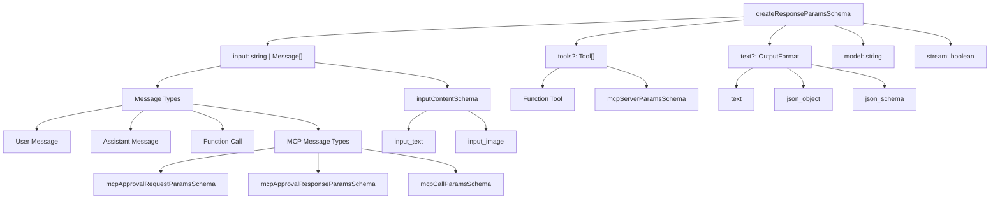

**Schema Validation Flow**
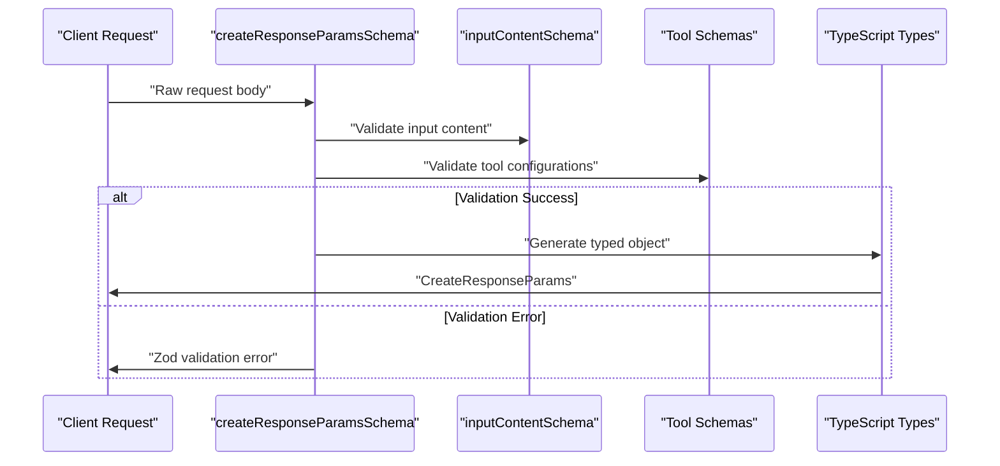

Sources: [src/schemas.ts:76-220]()

## Input Content Schema

The `inputContentSchema` defines the structure for multi-modal content that can be included in messages. It supports text and image inputs with extensible design for future content types.

| Content Type | Schema Structure | Purpose |
|--------------|------------------|---------|
| `input_text` | `{ type: "input_text", text: string }` | Plain text content |
| `input_image` | `{ type: "input_image", image_url: string }` | Image content via URL |

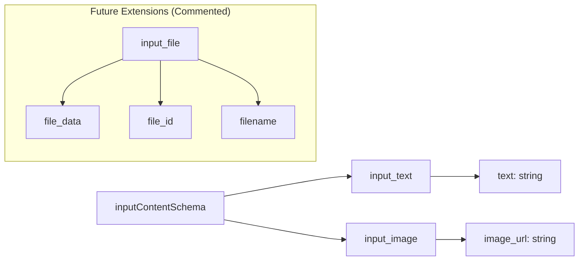

The schema uses Zod's `z.union()` to create a discriminated union based on the `type` field, enabling type-safe content handling throughout the system.

Sources: [src/schemas.ts:8-27]()

## Message Schema Structure

The input field accepts either a simple string or an array of structured message objects. The message array supports conversation history with different roles and content types.

**Message Role Types**
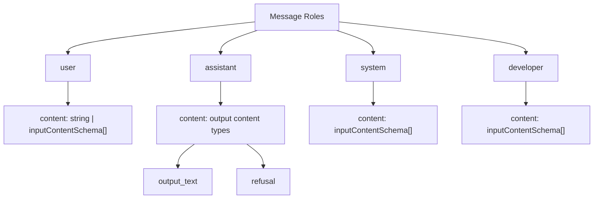

**Message Type Categories**
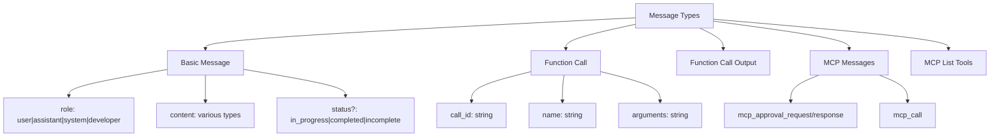

Sources: [src/schemas.ts:79-148]()

## Tool Integration Schemas  

The schema system supports two main categories of tools: basic function tools and MCP (Model Context Protocol) server integrations.

### Function Tool Schema

Function tools are defined inline with the request and provide basic tool calling capabilities.

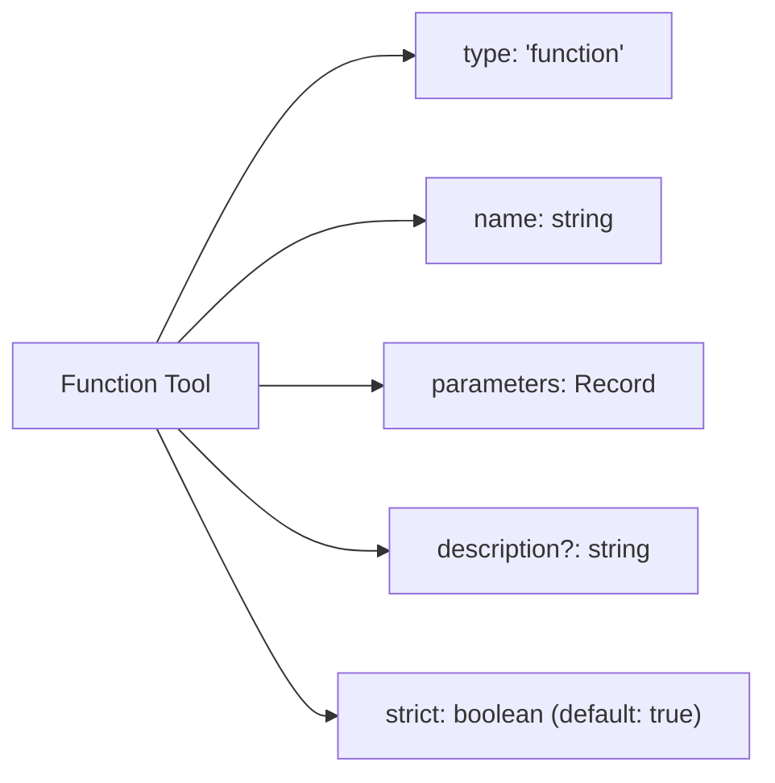

### MCP Server Schema

The `mcpServerParamsSchema` defines configuration for external MCP servers that provide advanced tool capabilities with approval workflows.

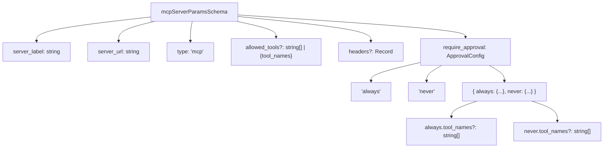

**MCP Message Flow Schemas** 
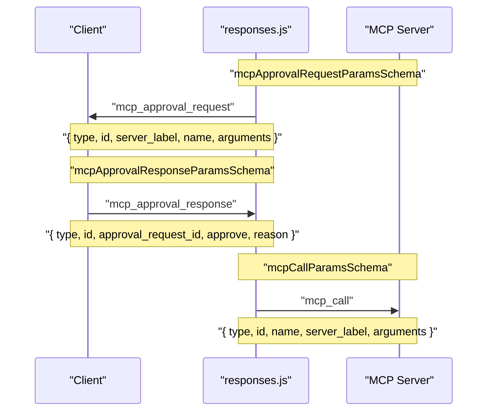

Sources: [src/schemas.ts:29-52](), [src/schemas.ts:54-74](), [src/schemas.ts:202-215]()

## Output Format Configuration

The `text` field in the schema configures structured output formatting using three distinct formats.

| Format Type | Configuration | Purpose |
|-------------|---------------|---------|
| `text` | `{ type: "text" }` | Plain text responses |
| `json_object` | `{ type: "json_object" }` | Valid JSON object output |
| `json_schema` | `{ type: "json_schema", name, schema, strict? }` | Structured data extraction |

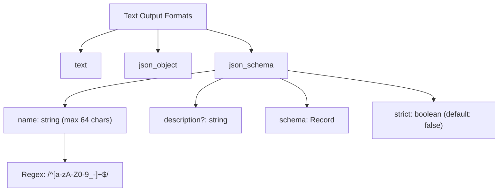

The `json_schema` format enables precise data extraction by providing a JSON Schema definition that the LLM must conform to in its response.

Sources: [src/schemas.ts:170-191]()

## Type System Integration

The schema system generates comprehensive TypeScript types that provide compile-time safety throughout the codebase.

**Exported Types**
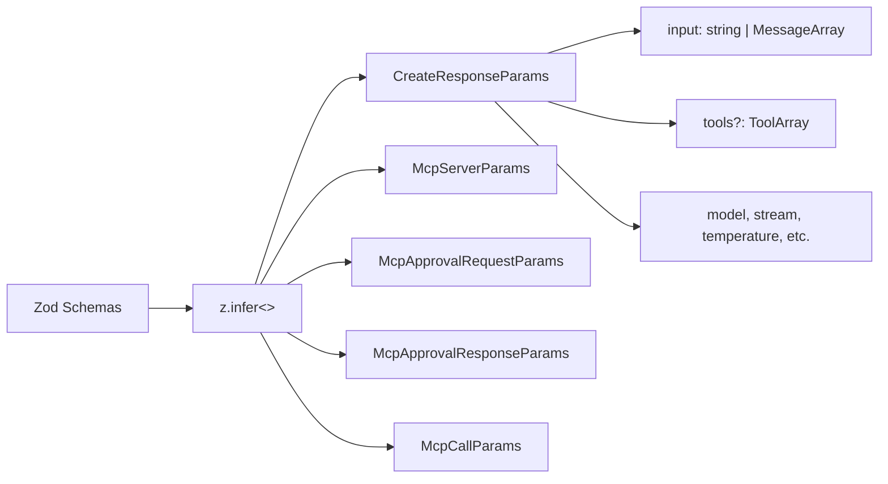

**Schema-to-Type Mapping**
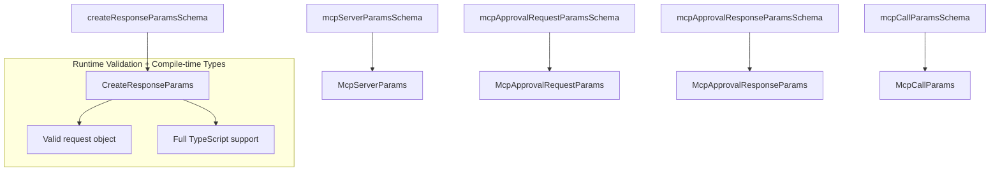

These types are used throughout the system to ensure type safety in request processing, tool integration, and response generation.

Sources: [src/schemas.ts:222-226]()

---

