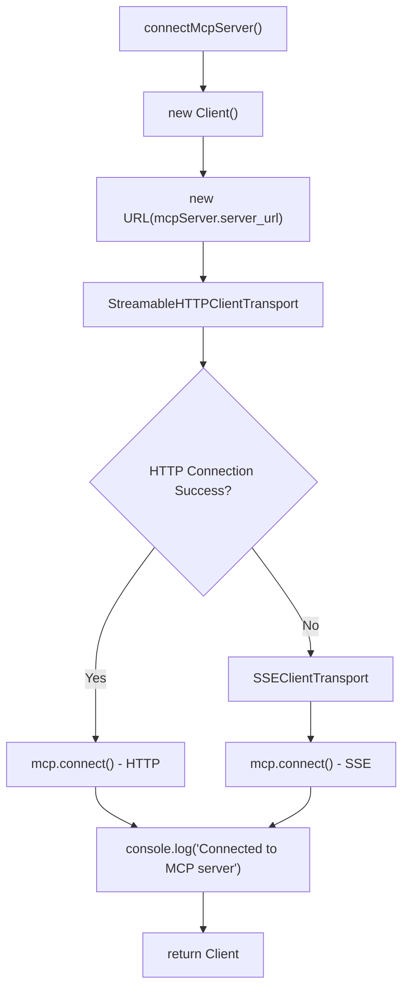
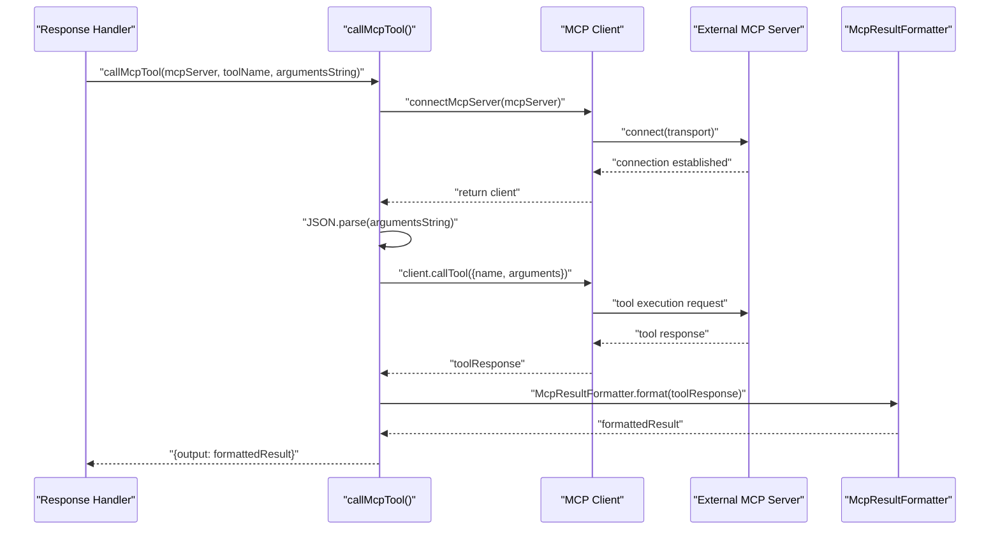
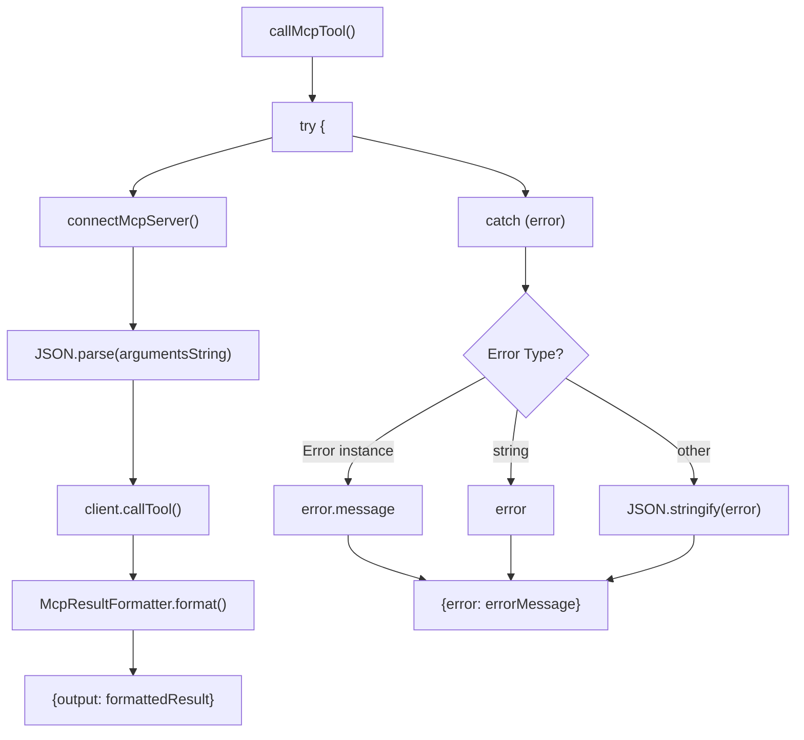
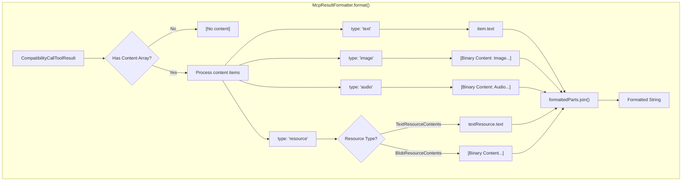
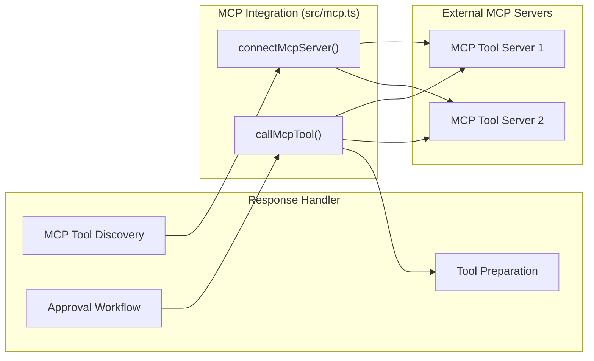

<!-- source: DeepWiki mcp.deepwiki.com · repo huggingface/responses.js · page 3.3 MCP Integration · fetched 2026-10-26 -->

# MCP Integration

Relevant source files

The following files were used as context for generating this wiki page:

- [src/lib/McpResultFormatter.ts](src/lib/McpResultFormatter.ts)
- [src/mcp.ts](src/mcp.ts)

This document covers the Model Context Protocol (MCP) integration system in responses.js, which enables external tool execution through MCP-compatible servers. The MCP integration allows responses.js to extend LLM capabilities by connecting to external tools and services while maintaining security through approval workflows.

For information about tool calling and function definitions, see [Function Calling](#5.1). For details about approval mechanisms, see [Approval Workflows](#5.3).

## Overview

The MCP integration system provides a bridge between the responses.js server and external MCP-compatible tool servers. This integration enables the system to execute tools hosted on remote servers, handle various content types, and maintain secure communication channels with proper error handling.

The integration consists of two main components:
- **Connection Management**: Establishing and maintaining connections to MCP servers
- **Tool Execution**: Calling tools on remote servers and formatting their results

## Connection Architecture

### MCP Client Setup

The `connectMcpServer` function establishes connections to MCP servers using a fallback mechanism between HTTP and Server-Sent Events (SSE) transports.

**MCP Connection Establishment**

Sources: [src/mcp.ts:10-33]()

### Transport Layer Handling

The system supports two transport mechanisms with automatic fallback:

| Transport Type | Primary Use Case | Fallback Scenario |
|----------------|------------------|-------------------|
| `StreamableHTTPClientTransport` | Standard HTTP communication | First attempt |
| `SSEClientTransport` | Server-Sent Events | When HTTP fails |

Both transports support custom headers through the `McpServerParams.headers` configuration.

Sources: [src/mcp.ts:13-28]()

## Tool Execution Flow

### Tool Calling Process

The `callMcpTool` function orchestrates the complete tool execution lifecycle:

**MCP Tool Execution Sequence**

Sources: [src/mcp.ts:35-56]()

### Error Handling

The tool execution system implements comprehensive error handling:

**MCP Error Handling Flow**

Sources: [src/mcp.ts:49-55]()

## Result Formatting System

### Content Type Processing

The `McpResultFormatter` class handles multiple content types returned by MCP tools:

**MCP Result Content Processing**

Sources: [src/lib/McpResultFormatter.ts:26-79]()

### Binary Content Handling

The formatter provides intelligent handling of binary content types:

| Content Type | Processing Method | Output Format |
|--------------|-------------------|---------------|
| Text | Direct extraction | `item.text` |
| Image | Size calculation + summary | `[Binary Content: Image {mimeType}, {size} bytes]` |
| Audio | Size calculation + summary | `[Binary Content: Audio {mimeType}, {size} bytes]` |
| Text Resource | Text extraction | `textResource.text` |
| Blob Resource | Size + metadata summary | `[Binary Content{uri}: {mimeType}, {size} bytes]` |

The `getBase64Size` method calculates approximate byte sizes for base64-encoded binary data by accounting for encoding overhead and padding.

Sources: [src/lib/McpResultFormatter.ts:34-92]()

## Integration with Response System

### Tool Discovery and Execution

The MCP integration connects with the broader response handling system through several key integration points:

**MCP System Integration Points**

Sources: [src/mcp.ts:10-56]()

### Client Configuration

The MCP client is configured with responses.js package metadata for proper identification:

- **Client Name**: `@huggingface/responses.js`
- **Version**: Extracted from `package.json`
- **Transport Options**: Configurable headers and connection parameters

This configuration ensures proper server identification and enables authentication mechanisms when required by external MCP servers.

Sources: [src/mcp.ts:1-11]()

---

