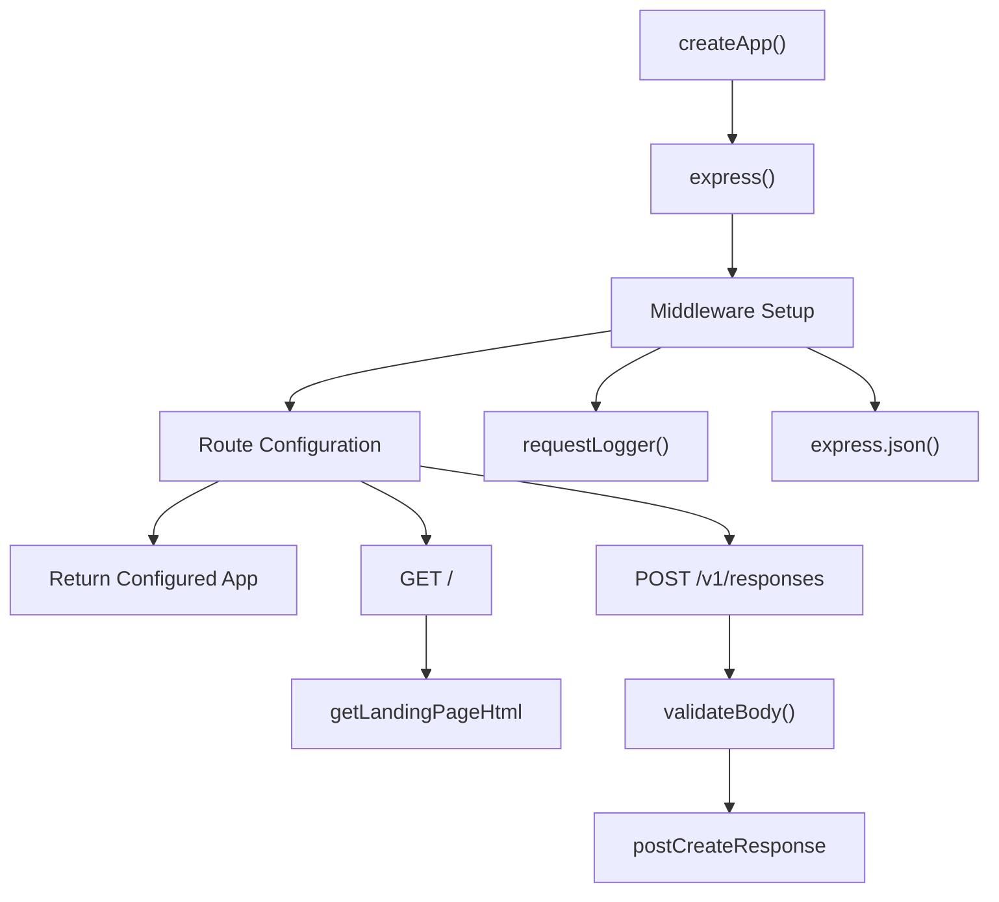
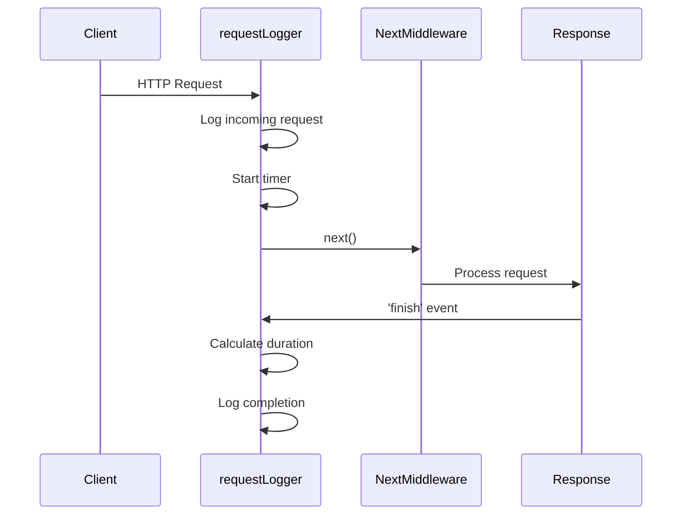
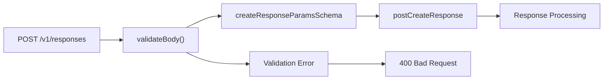
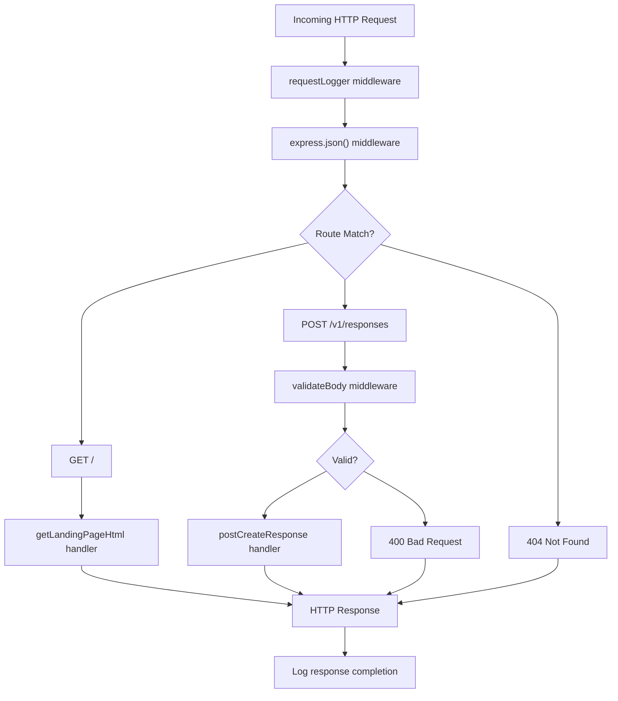

<!-- source: DeepWiki mcp.deepwiki.com · repo huggingface/responses.js · page 3.4 Server Configuration · fetched 2026-10-26 -->

# Server Configuration

<details>
<summary>Relevant source files</summary>

The following files were used as context for generating this wiki page:

- [.github/workflows/lint.yml](.github/workflows/lint.yml)
- [src/middleware/logging.ts](src/middleware/logging.ts)
- [src/routes/index.ts](src/routes/index.ts)
- [src/server.ts](src/server.ts)

</details>


This page documents the Express server setup, middleware configuration, and routing system that forms the foundation of the responses.js API server. It covers the server initialization process, request processing pipeline, and endpoint configuration.

For detailed information about the API endpoints themselves, see [API Reference](#4). For the core response processing logic, see [Response Handler](#3.1).

## Express Server Architecture

The responses.js server is built on Express.js and follows a modular architecture with clear separation between middleware, routing, and business logic. The server configuration is centralized in the `createApp()` function which returns a fully configured Express application.

### Server Factory Function

The main server configuration is handled by the `createApp()` function in [src/server.ts:7-20](), which creates and configures an Express application instance:

```typescript
export const createApp = (): Express => {
	const app: Express = express();

	// Middleware
	app.use(requestLogger());
	app.use(express.json());

	// Routes
	app.get("/", getLandingPageHtml);
	app.post("/v1/responses", validateBody(createResponseParamsSchema), postCreateResponse);

	return app;
};
```

**Server Initialization Flow**



*Sources: [src/server.ts:7-20]()*

## Middleware Configuration

The server uses two primary middleware components that process all incoming requests in sequence.

### Request Logging Middleware

The `requestLogger()` middleware provides comprehensive HTTP request and response logging with timing information. It logs both incoming requests and completed responses with status codes and duration metrics.

| Log Event | Format | Example |
|-----------|--------|---------|
| Incoming Request | `📥 METHOD URL` | `📥 POST /v1/responses` |
| Completed Response | `STATUS_EMOJI STATUS METHOD URL (DURATION)` | `✅ 200 POST /v1/responses (1250ms)` |

The middleware uses different emojis to indicate response status categories:
- ✅ Success (200-299)
- ⚠️ Client Error (400-499) 
- ❌ Server Error (500+)
- ℹ️ Other status codes

**Request Logging Pipeline**



*Sources: [src/middleware/logging.ts:37-68](), [src/server.ts:11]()*

### JSON Body Parsing

The server uses Express's built-in JSON parser middleware to handle request body parsing for POST requests. This middleware automatically parses JSON request bodies and makes them available via `req.body`.

*Sources: [src/server.ts:12]()*

## Route Configuration

The server defines two primary routes with specific middleware chains and handlers.

### Root Route (GET /)

The root route serves the landing page HTML content through the `getLandingPageHtml` handler.

```
GET / → getLandingPageHtml
```

### Responses API Route (POST /v1/responses)

The main API endpoint includes request validation middleware before processing:

```
POST /v1/responses → validateBody(createResponseParamsSchema) → postCreateResponse
```

**Route Handler Chain**



*Sources: [src/server.ts:15-17](), [src/routes/index.ts:1-2]()*

## Middleware Stack Analysis

The middleware processing order is critical for proper request handling:

| Order | Middleware | Purpose | Applied To |
|-------|------------|---------|------------|
| 1 | `requestLogger()` | Request/response logging | All routes |
| 2 | `express.json()` | JSON body parsing | All routes |
| 3 | `validateBody()` | Request validation | POST /v1/responses only |

**Complete Request Processing Flow**



*Sources: [src/server.ts:7-20](), [src/middleware/logging.ts:37-68]()*

## Configuration Dependencies

The server configuration relies on several imported modules and schemas:

- **Route Handlers**: Imported from [src/routes/index.ts:1-2]()
- **Validation Schema**: `createResponseParamsSchema` from [src/schemas.js:2]()
- **Middleware**: Custom logging and validation middleware
- **Express Framework**: Core web server functionality

The modular design allows for easy testing, maintenance, and extension of server functionality while maintaining clear separation of concerns between routing, validation, and business logic.

*Sources: [src/server.ts:1-5]()*

---

