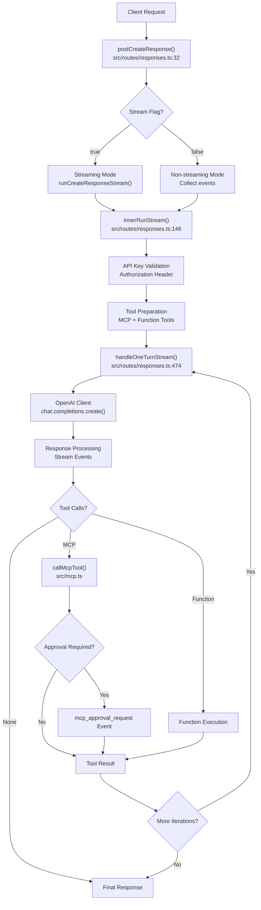
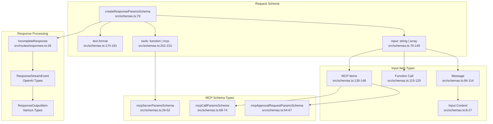
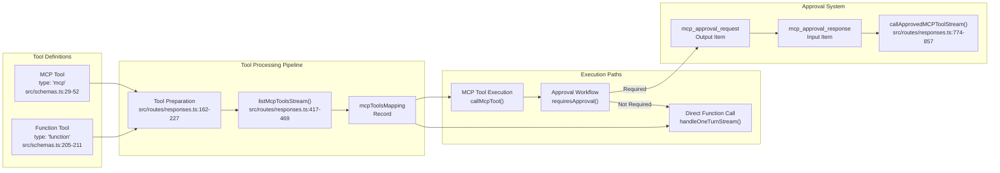

<!-- source: DeepWiki mcp.deepwiki.com · repo huggingface/responses.js · page 4 API Reference · fetched 2026-10-26 -->

# API Reference

<details>
<summary>Relevant source files</summary>

The following files were used as context for generating this wiki page:

- [demo/components/tools-panel.tsx](demo/components/tools-panel.tsx)
- [src/routes/responses.ts](src/routes/responses.ts)
- [src/schemas.ts](src/schemas.ts)

</details>


This document provides complete API documentation for responses.js, including all available endpoints, request/response formats, data types, and integration patterns. The API implements OpenAI's Responses API specification while providing a translation layer to various Chat Completion providers with enhanced capabilities for tool integration and streaming.

For detailed request and response format specifications, see [Request and Response Format](#4.1). For endpoint-specific documentation, see [Endpoints](#4.2). For streaming implementation details, see [Streaming Protocol](#4.3).

## API Overview

The responses.js API provides a single primary endpoint that handles all response generation requests. The system supports both streaming and non-streaming modes, with comprehensive tool integration through function calling and MCP (Model Context Protocol) servers.

### API Request Flow



Sources: [src/routes/responses.ts:32-58](), [src/routes/responses.ts:146-415](), [src/routes/responses.ts:474-769]()

## Authentication

API requests require authentication via the `Authorization` header using Bearer token format:

```
Authorization: Bearer <api-key>
```

The API key is extracted and used to authenticate with the underlying LLM provider. The system supports configurable base URLs through the `OPENAI_BASE_URL` environment variable, defaulting to Hugging Face's router endpoint.

Sources: [src/routes/responses.ts:152-159]()

## Core Endpoint

### POST /v1/responses

The primary endpoint for creating responses. Accepts requests in OpenAI Responses API format and returns either streaming events or complete response objects.

**Request Body**: `CreateResponseParams` object containing:
- `input`: String or array of input items (messages, tool calls, etc.)
- `model`: Model identifier for the LLM provider
- `instructions`: Optional system instructions
- `tools`: Optional array of function or MCP tool definitions
- `stream`: Boolean flag for streaming vs non-streaming response
- Additional parameters for temperature, max tokens, tool choice, etc.

**Response**: Either Server-Sent Events stream or JSON response object depending on `stream` parameter.

Sources: [src/routes/responses.ts:32-58](), [src/schemas.ts:76-220]()

## Data Type Architecture

The API uses Zod schemas for comprehensive request validation and type safety. The core data structures follow OpenAI's specification with extensions for MCP integration.

### Schema Hierarchy



Sources: [src/schemas.ts:1-227](), [src/routes/responses.ts:29-30]()

## Request Processing Modes

### Streaming Mode (`stream: true`)

Returns Server-Sent Events with real-time updates during response generation. Events include:
- `response.created`: Initial response object
- `response.in_progress`: Processing started
- `response.output_item.added`: New output items (messages, tool calls)
- `response.content_part.added`: New content parts within messages
- `response.output_text.delta`: Text streaming deltas
- Tool-specific events for MCP and function calls
- `response.completed` or `response.failed`: Final status

### Non-streaming Mode (`stream: false`)

Processes the complete request and returns the final response object once generation is complete. Internally uses the same streaming pipeline but collects all events before returning.

Sources: [src/routes/responses.ts:40-57](), [src/routes/responses.ts:66-144]()

## Tool Integration Architecture

The system supports multiple tool integration patterns through a unified interface:

### Tool Types and Processing



Sources: [src/routes/responses.ts:162-227](), [src/routes/responses.ts:417-469](), [src/routes/responses.ts:774-857](), [src/routes/responses.ts:859-870]()

## Response Generation Lifecycle

The system implements a sophisticated multi-turn conversation pattern with automatic tool execution:

| Phase | Description | Key Functions |
|-------|-------------|---------------|
| **Initialization** | Create response object, validate request | `runCreateResponseStream()` |
| **Tool Preparation** | List MCP tools, prepare tool mappings | `listMcpToolsStream()`, tool preparation logic |
| **Message Formatting** | Convert input to Chat Completion format | Input processing in `innerRunStream()` |
| **LLM Iteration** | Call LLM, process streaming response | `handleOneTurnStream()` |
| **Tool Execution** | Execute function/MCP tools as needed | `callMcpTool()`, function execution |
| **Approval Handling** | Process approval requests/responses | `callApprovedMCPToolStream()` |
| **Iteration Control** | Continue until no new tool calls | MAX_ITERATIONS limit |
| **Completion** | Finalize response object | Response completion events |

The system supports up to 5 iterations per request to handle complex multi-tool scenarios while preventing infinite loops.

Sources: [src/routes/responses.ts:66-144](), [src/routes/responses.ts:401-414]()

## Error Handling

The API implements comprehensive error handling with specific error types:

- **Authentication Errors**: 401 Unauthorized for missing/invalid API keys
- **Validation Errors**: Schema validation failures from Zod
- **Streaming Errors**: `StreamingError` class for streaming-specific issues
- **MCP Errors**: Tool execution failures with detailed error messages
- **Server Errors**: General server errors with `response.failed` events in streaming mode

All errors in streaming mode are delivered as `response.failed` events with structured error objects containing error codes and descriptive messages.

Sources: [src/routes/responses.ts:22-27](), [src/routes/responses.ts:117-135](), [src/routes/responses.ts:460-468]()

---

