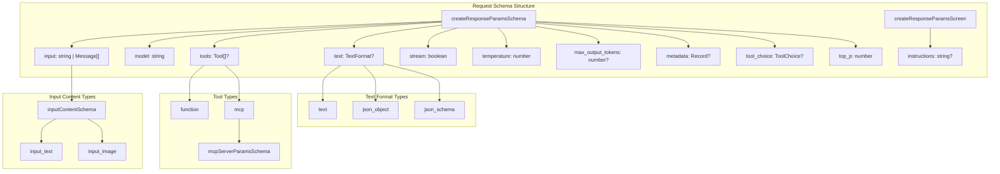
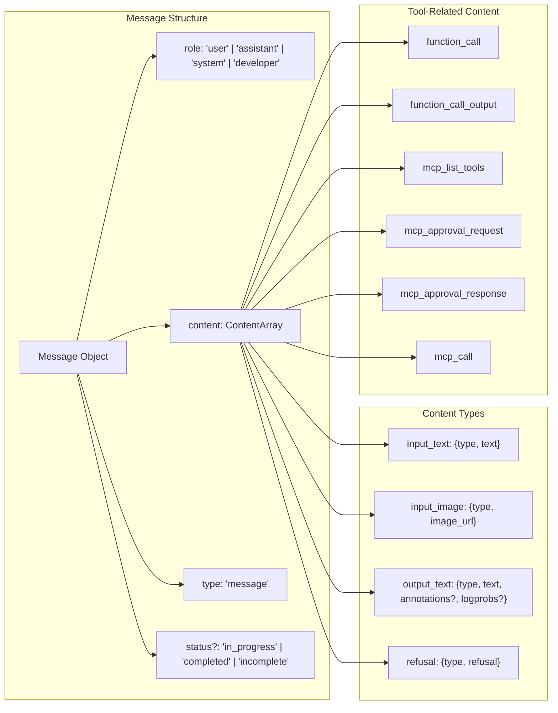
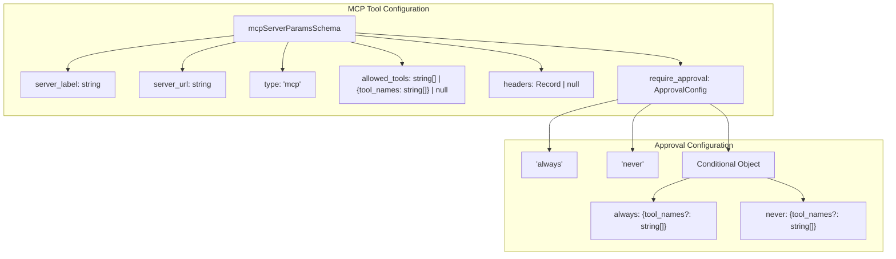
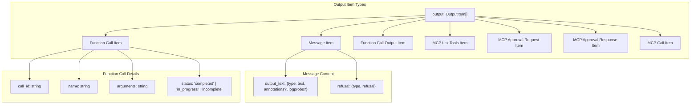
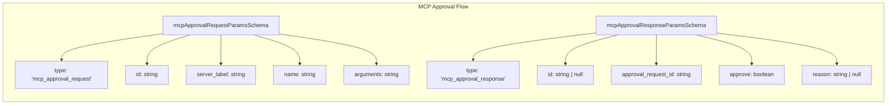
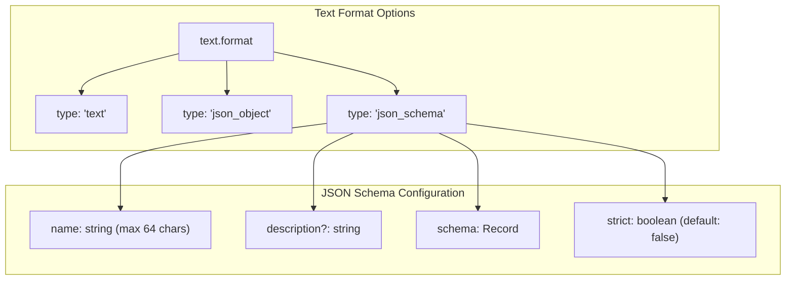

<!-- source: DeepWiki mcp.deepwiki.com · repo huggingface/responses.js · page 4.1 Request and Response Format · fetched 2026-10-26 -->

# Request and Response Format

<details>
<summary>Relevant source files</summary>

The following files were used as context for generating this wiki page:

- [demo/components/tools-panel.tsx](demo/components/tools-panel.tsx)
- [src/schemas.ts](src/schemas.ts)
- [tests/responses.test.js](tests/responses.test.js)

</details>


This document provides the detailed specification of request parameters, response structures, and data types used by the responses.js API. It covers the schema definitions, validation rules, and format requirements for interacting with the system.

For information about the actual API endpoints and their usage, see [Endpoints](#4.2). For details about real-time streaming mechanics, see [Streaming Protocol](#4.3).

## Request Schema Overview

The primary request format is defined by the `createResponseParamsSchema` in [src/schemas.ts:76-220](). This schema validates all incoming requests to ensure they conform to the expected OpenAI Responses API format while supporting additional features like MCP tool integration.



**Sources:** [src/schemas.ts:76-220]()

## Input Content Format

The system supports multiple input content types through the `inputContentSchema`, enabling both text-only and multi-modal interactions.

### Text Input

Simple string input is automatically converted to a single message:

| Field | Type | Description |
|-------|------|-------------|
| `input` | `string` | Plain text input converted to user message |

### Multi-Modal Input

Complex input uses an array of message objects with structured content:



**Sources:** [src/schemas.ts:8-27](), [src/schemas.ts:79-149]()

### Input Content Schema Details

The `inputContentSchema` defines two primary content types:

- **Text Content**: `{type: "input_text", text: string}`
- **Image Content**: `{type: "input_image", image_url: string}`

**Sources:** [src/schemas.ts:8-27]()

## Tool Configuration

The system supports two types of tools: function tools and MCP (Model Context Protocol) tools.

### Function Tools

Function tools are defined inline with JSON Schema parameters:

| Field | Type | Required | Description |
|-------|------|----------|-------------|
| `type` | `"function"` | Yes | Tool type identifier |
| `name` | `string` | Yes | Function name |
| `parameters` | `Record<string, any>` | Yes | JSON Schema for parameters |
| `description` | `string` | No | Function description |
| `strict` | `boolean` | No | Strict mode (default: true) |

### MCP Tools

MCP tools connect to external servers via the Model Context Protocol:



**Sources:** [src/schemas.ts:29-52]()

## Response Format

Responses follow the OpenAI Responses API format with extensions for MCP integration and enhanced tool calling.

### Non-Streaming Response

For non-streaming requests (`stream: false`), the response contains:

| Field | Type | Description |
|-------|------|-------------|
| `id` | `string` | Response identifier |
| `object` | `"response"` | Object type |
| `created` | `number` | Unix timestamp |
| `model` | `string` | Model used |
| `output` | `OutputItem[]` | Response content array |
| `usage` | `UsageStats` | Token usage information |

### Output Item Types

The `output` array can contain various item types:



**Sources:** [src/schemas.ts:94-147](), [tests/responses.test.js:103-108]()

## MCP Integration Schema

The MCP (Model Context Protocol) integration introduces several specialized schema types for handling external tool servers.

### MCP Approval Request



### MCP Tool Call

The `mcpCallParamsSchema` defines the structure for executing MCP tools:

| Field | Type | Description |
|-------|------|-------------|
| `type` | `"mcp_call"` | Schema type identifier |
| `id` | `string` | Unique call identifier |
| `name` | `string` | Tool name to execute |
| `server_label` | `string` | MCP server identifier |
| `arguments` | `string` | JSON-encoded tool arguments |

**Sources:** [src/schemas.ts:54-74](), [tests/responses.test.js:465-524]()

## Structured Output Configuration

The `text` field in requests enables structured output through different format types:

### Format Types



### Schema Name Validation

The schema name must follow specific validation rules defined in [src/schemas.ts:181-184]():

- Maximum 64 characters
- Only letters, numbers, underscores, and dashes allowed
- Regex pattern: `/^[a-zA-Z0-9_-]+$/`

**Sources:** [src/schemas.ts:170-191](), [tests/responses.test.js:110-130]()

## Validation and Error Handling

The schema system uses Zod for runtime validation with specific constraints:

### Metadata Constraints

The `metadata` field has strict validation rules:

- Maximum 16 key-value pairs
- Keys: maximum 64 characters each
- Values: maximum 512 characters each
- Must be a record of strings

### Parameter Ranges

| Parameter | Range | Default |
|-----------|-------|---------|
| `temperature` | 0.0 - 2.0 | 1.0 |
| `top_p` | 0.0 - 1.0 | 1.0 |
| `max_output_tokens` | ≥ 0 | null |

**Sources:** [src/schemas.ts:153-159](), [src/schemas.ts:169](), [src/schemas.ts:217]()

## Type Exports

The schema file exports TypeScript types for use throughout the codebase:

```typescript
export type CreateResponseParams = z.infer<typeof createResponseParamsSchema>;
export type McpServerParams = z.infer<typeof mcpServerParamsSchema>;
export type McpApprovalRequestParams = z.infer<typeof mcpApprovalRequestParamsSchema>;
export type McpApprovalResponseParams = z.infer<typeof mcpApprovalResponseParamsSchema>;
export type McpCallParams = z.infer<typeof mcpCallParamsSchema>;
```

These types provide compile-time safety and IDE support for request/response handling throughout the system.

**Sources:** [src/schemas.ts:222-226]()

---

