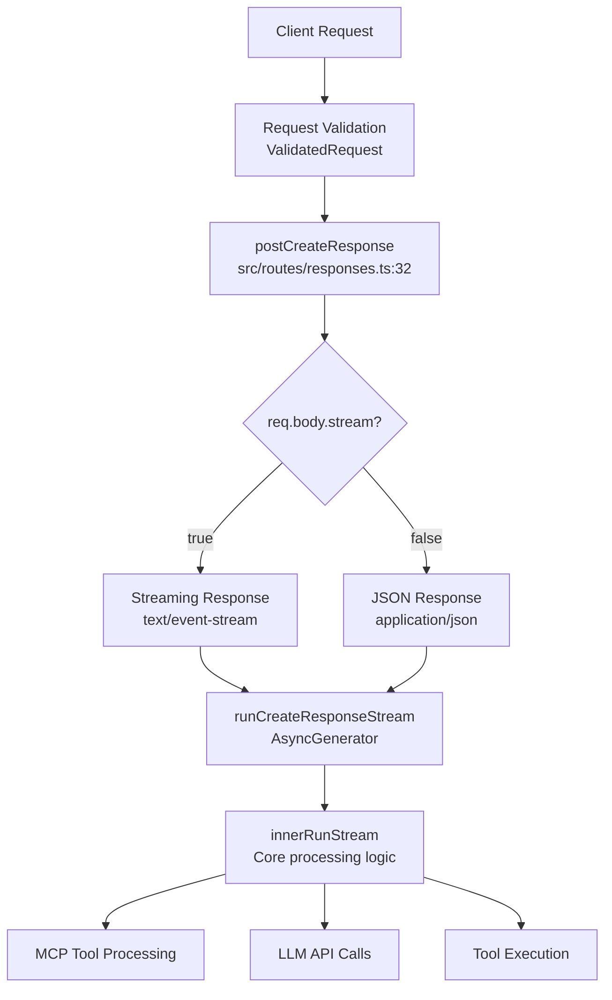
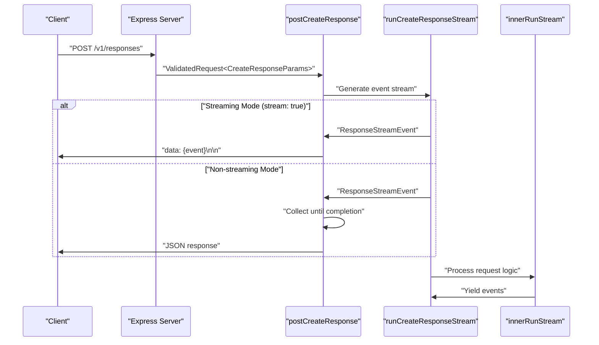
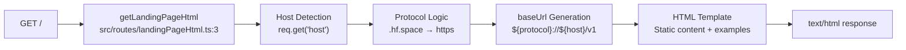
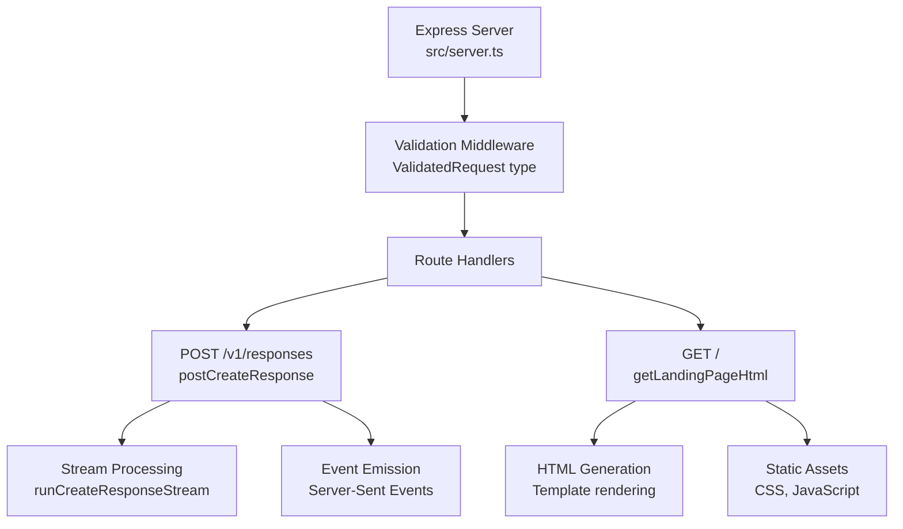

<!-- source: DeepWiki mcp.deepwiki.com · repo huggingface/responses.js · page 4.2 Endpoints · fetched 2026-10-26 -->

# Endpoints

Relevant source files

The following files were used as context for generating this wiki page:

- [src/routes/landingPageHtml.ts](src/routes/landingPageHtml.ts)
- [src/routes/responses.ts](src/routes/responses.ts)

This page documents all available API endpoints in responses.js and their implementation details. It covers the HTTP routes, request handlers, and routing configuration that make up the server's API surface.

For detailed information about request and response formats, see [Request and Response Format](#4.1). For streaming protocol specifics, see [Streaming Protocol](#4.3).

## Available Endpoints

The responses.js server exposes two primary endpoints:

| Endpoint | Method | Handler Function | Purpose |
|----------|---------|------------------|---------|
| `/v1/responses` | POST | `postCreateResponse` | Main API endpoint for creating responses |
| `/` | GET | `getLandingPageHtml` | Landing page with documentation and examples |

## Response Creation Endpoint

### POST /v1/responses

The primary API endpoint handles response creation with support for both streaming and non-streaming modes. The endpoint is implemented in the `postCreateResponse` function.

**Sources:** [src/routes/responses.ts:32-58]()

The endpoint processes requests through several key phases:

#### Request Processing Flow

1. **Validation**: Request body is validated against `CreateResponseParams` schema
2. **Stream Detection**: Checks `req.body.stream` flag to determine response format
3. **Event Generation**: All requests are processed as streams internally via `runCreateResponseStream`
4. **Response Formatting**: Streams are either sent as Server-Sent Events or collected into JSON

**Sources:** [src/routes/responses.ts:36-57](), [src/routes/responses.ts:66-144]()

#### Core Processing Components

The `innerRunStream` function handles the main request processing logic:

- **Authentication**: Extracts API key from `Authorization` header
- **Tool Preparation**: Processes `function` and `mcp` type tools from request
- **MCP Integration**: Lists tools from MCP servers and handles approval workflows  
- **LLM Communication**: Formats requests for Chat Completion APIs
- **Response Streaming**: Manages real-time event emission

**Sources:** [src/routes/responses.ts:146-415]()

## Landing Page Endpoint  

### GET /

The root endpoint serves an interactive HTML landing page with API documentation and examples.

**Sources:** [src/routes/landingPageHtml.ts:3-8]()

The landing page includes:

- **Dynamic Base URL**: Automatically detects host and protocol for API endpoint display
- **Interactive Examples**: Tabbed interface with code samples for different use cases
- **Copy Functionality**: JavaScript-powered code and URL copying
- **Responsive Design**: Mobile-optimized layout with CSS media queries

**Sources:** [src/routes/landingPageHtml.ts:4-6](), [src/routes/landingPageHtml.ts:408-448]()

## Request Routing Architecture

The server uses Express.js routing with middleware for request validation and processing:

**Sources:** [src/routes/responses.ts:1-3](), [src/routes/landingPageHtml.ts:1]()

### Request Validation

The `/v1/responses` endpoint uses typed request validation through the `ValidatedRequest<CreateResponseParams>` interface, ensuring type safety and schema compliance before processing.

**Sources:** [src/routes/responses.ts:2-3](), [src/routes/responses.ts:33]()

### Error Handling

Both endpoints implement error handling appropriate to their function:

- **Responses endpoint**: Returns structured error responses with proper HTTP status codes
- **Landing page**: Serves static content with minimal error scenarios

The response endpoint includes comprehensive error handling for streaming scenarios, with proper cleanup and error event emission.

**Sources:** [src/routes/responses.ts:117-135](), [src/routes/responses.ts:460-468]()

---

