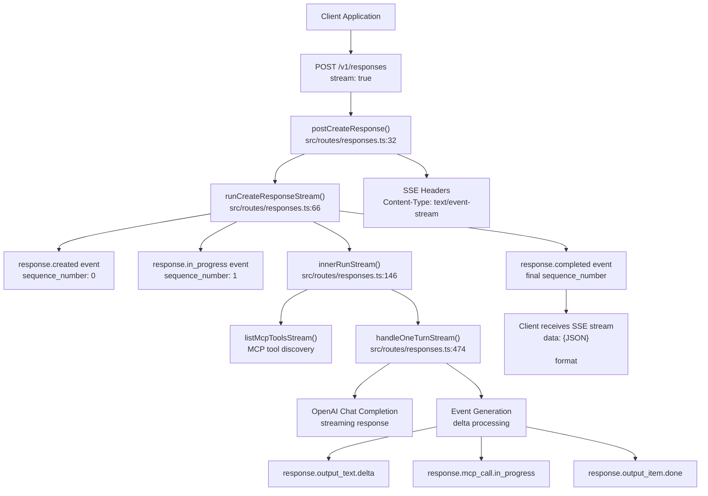
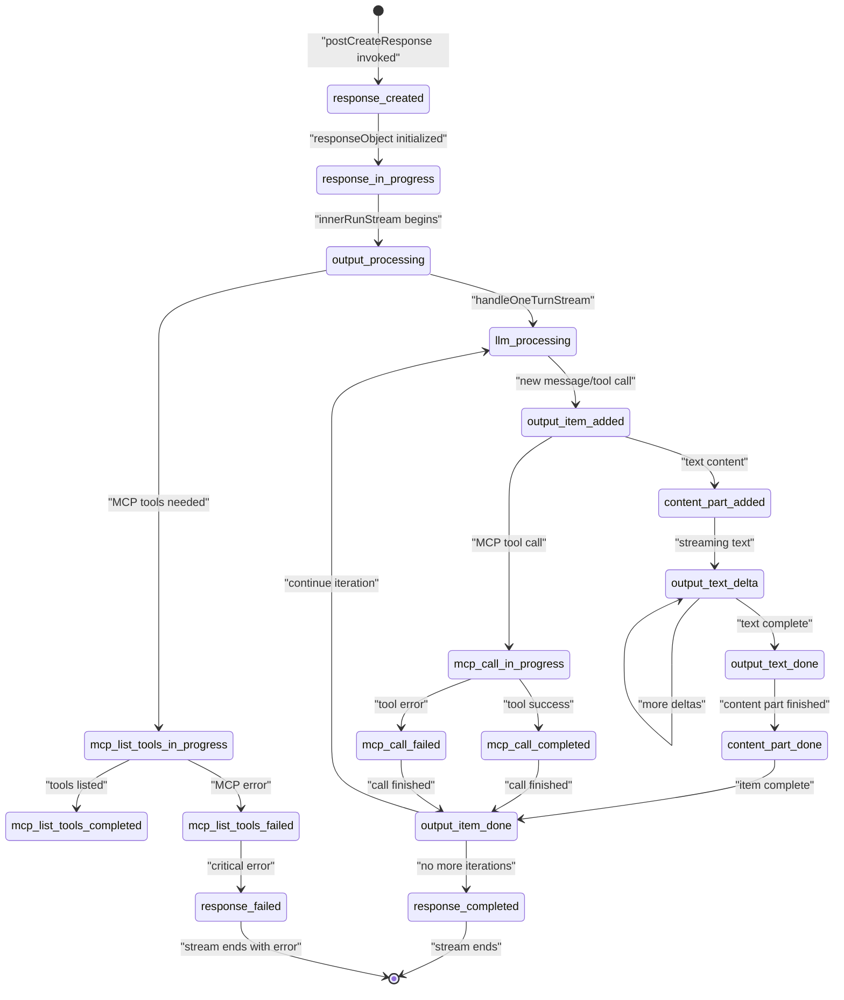
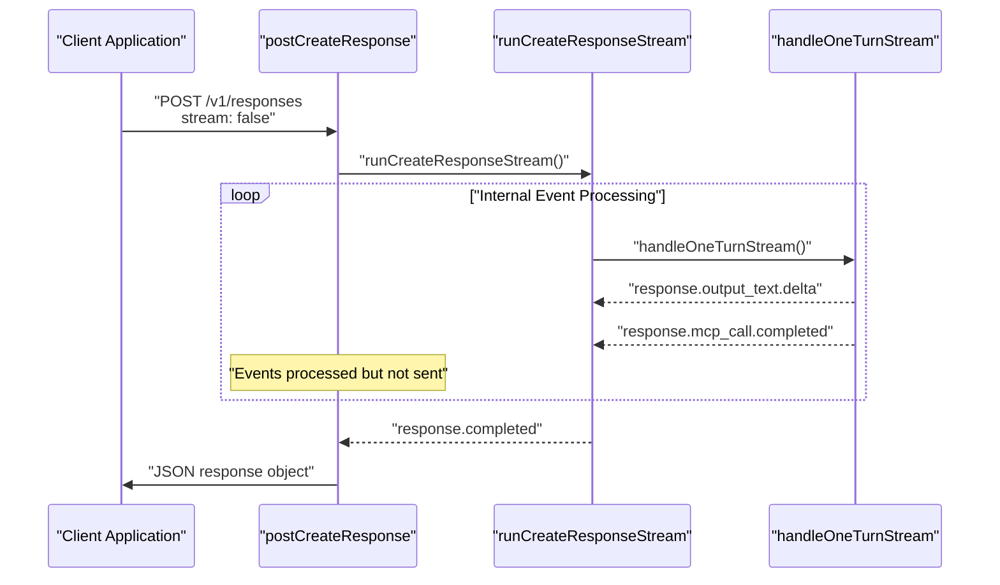
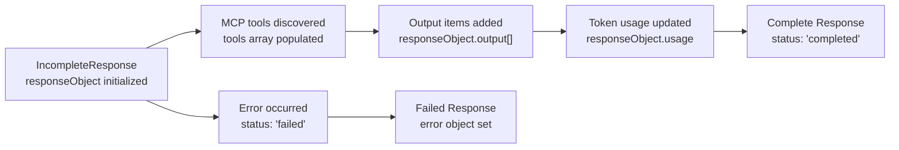

<!-- source: DeepWiki mcp.deepwiki.com · repo huggingface/responses.js · page 4.3 Streaming Protocol · fetched 2026-10-26 -->

# Streaming Protocol

<details>
<summary>Relevant source files</summary>

The following files were used as context for generating this wiki page:

- [examples/streaming.js](examples/streaming.js)
- [src/routes/responses.ts](src/routes/responses.ts)

</details>


This document describes the real-time streaming protocol used by responses.js to deliver Server-Sent Events (SSE) for response generation. The streaming protocol enables clients to receive incremental updates as responses are generated, including text deltas, tool calls, and status changes.

For information about request and response formats, see [Request and Response Format](#4.1). For details about specific API endpoints, see [Endpoints](#4.2).

## Protocol Overview

The streaming protocol is implemented as Server-Sent Events over HTTP, allowing clients to receive real-time updates during response generation. The system supports both streaming and non-streaming modes, with all requests internally processed as streams for consistency.

### Streaming Architecture



Sources: [src/routes/responses.ts:32-58](), [src/routes/responses.ts:66-144]()

## Event Types and Lifecycle

The streaming protocol defines a comprehensive set of event types that track the complete lifecycle of response generation, from initialization through completion.

### Core Response Events



Sources: [src/routes/responses.ts:98-143](), [src/routes/responses.ts:474-769]()

### Event Type Specifications

| Event Type | Purpose | Key Fields | Source Location |
|------------|---------|------------|----------------|
| `response.created` | Initial response object created | `response`, `sequence_number` | [src/routes/responses.ts:99-103]() |
| `response.in_progress` | Response generation started | `response`, `sequence_number` | [src/routes/responses.ts:106-110]() |
| `response.completed` | Response generation finished | `response`, `sequence_number` | [src/routes/responses.ts:138-143]() |
| `response.failed` | Response generation failed | `response`, `sequence_number` | [src/routes/responses.ts:129-134]() |
| `response.output_item.added` | New output item created | `output_index`, `item` | [src/routes/responses.ts:518-523]() |
| `response.output_item.done` | Output item completed | `output_index`, `item` | [src/routes/responses.ts:674-679]() |
| `response.content_part.added` | New content part in message | `item_id`, `content_index`, `part` | [src/routes/responses.ts:537-544]() |
| `response.content_part.done` | Content part completed | `item_id`, `content_index`, `part` | [src/routes/responses.ts:660-667]() |
| `response.output_text.delta` | Incremental text content | `item_id`, `delta` | [src/routes/responses.ts:556-563]() |
| `response.output_text.done` | Text content completed | `item_id`, `text` | [src/routes/responses.ts:651-658]() |

Sources: [src/routes/responses.ts:556-563](), [src/routes/responses.ts:651-667](), [src/routes/responses.ts:674-679]()

### Tool Call Events

| Event Type | Purpose | Key Fields | Source Location |
|------------|---------|------------|----------------|
| `response.function_call_arguments.delta` | Function call arguments streaming | `item_id`, `delta` | [src/routes/responses.ts:635-640]() |
| `response.function_call_arguments.done` | Function call arguments complete | `item_id`, `arguments` | [src/routes/responses.ts:681-687]() |
| `response.mcp_call.in_progress` | MCP tool call started | `item_id`, `output_index` | [src/routes/responses.ts:614-620]() |
| `response.mcp_call.completed` | MCP tool call succeeded | `sequence_number` | [src/routes/responses.ts:716-720]() |
| `response.mcp_call.failed` | MCP tool call failed | `sequence_number` | [src/routes/responses.ts:710-714]() |
| `response.mcp_call_arguments.delta` | MCP call arguments streaming | `item_id`, `delta` | [src/routes/responses.ts:631-641]() |
| `response.mcp_call_arguments.done` | MCP call arguments complete | `item_id`, `arguments` | [src/routes/responses.ts:697-703]() |

Sources: [src/routes/responses.ts:614-620](), [src/routes/responses.ts:631-641](), [src/routes/responses.ts:697-720]()

## Stream Consumption Patterns

### Basic Streaming Client

The simplest way to consume the streaming protocol is using the OpenAI SDK with streaming enabled:

```javascript
// From examples/streaming.js
const stream = await openai.responses.create({
    model: "Qwen/Qwen2.5-VL-7B-Instruct:hyperbolic",
    input: [{ role: "user", content: "What's the capital of France?" }],
    stream: true,
});

for await (const event of stream) {
    console.log(event);
}
```

Sources: [examples/streaming.js:4-17]()

### Server-Sent Events Format

When `stream: true` is specified, the server responds with `Content-Type: text/event-stream` and sends events in SSE format:

```
data: {"type":"response.created","response":{...},"sequence_number":0}

data: {"type":"response.in_progress","response":{...},"sequence_number":1}

data: {"type":"response.output_item.added","output_index":0,"item":{...},"sequence_number":2}

data: {"type":"response.output_text.delta","item_id":"msg_abc123","delta":"Hello","sequence_number":3}

```

Sources: [src/routes/responses.ts:41-47]()

### Non-Streaming Mode

For non-streaming requests (`stream: false` or omitted), the same internal streaming logic runs but only the final `response.completed` or `response.failed` event is returned:



Sources: [src/routes/responses.ts:49-57]()

## Implementation Details

### Sequence Number Management

Each event includes a `sequence_number` field that increments monotonically. The top-level `runCreateResponseStream` function manages sequence numbering by overwriting placeholder values:

```typescript
// From src/routes/responses.ts
let sequenceNumber = 0;
for await (const event of innerRunStream(req, res, responseObject)) {
    yield { ...event, sequence_number: sequenceNumber++ };
}
```

Internal event generators use `SEQUENCE_NUMBER_PLACEHOLDER = -1` which gets replaced by the actual sequence number.

Sources: [src/routes/responses.ts:70](), [src/routes/responses.ts:30](), [src/routes/responses.ts:115]()

### Response Object Evolution

The `responseObject` is incrementally built throughout the streaming process:



Sources: [src/routes/responses.ts:72-96](), [src/routes/responses.ts:124-128](), [src/routes/responses.ts:138]()

### Multi-Turn Conversation Handling

The system supports automatic multi-turn conversations when MCP tools are called. After a tool execution, the conversation continues with updated messages:

```typescript
// From src/routes/responses.ts:729-755
payload.messages.push(
    {
        role: "assistant",
        tool_calls: [{ 
            id: lastOutputItem.id,
            type: "function",
            function: { name: lastOutputItem.name, arguments: lastOutputItem.arguments }
        }],
    },
    {
        role: "tool",
        tool_call_id: lastOutputItem.id,
        content: lastOutputItem.output || `Error: ${lastOutputItem.error}`
    }
);
```

The system continues iterating until no new messages are added or `MAX_ITERATIONS = 5` is reached.

Sources: [src/routes/responses.ts:401-414](), [src/routes/responses.ts:729-755]()

### Error Handling in Streams

Stream errors are caught at the top level and converted to `response.failed` events:

```typescript
// From src/routes/responses.ts:117-135
try {
    for await (const event of innerRunStream(req, res, responseObject)) {
        yield { ...event, sequence_number: sequenceNumber++ };
    }
} catch (error) {
    responseObject.status = "failed";
    responseObject.error = { code: "server_error", message };
    yield { type: "response.failed", response: responseObject, sequence_number: sequenceNumber++ };
}
```

Sources: [src/routes/responses.ts:117-135]()

---

