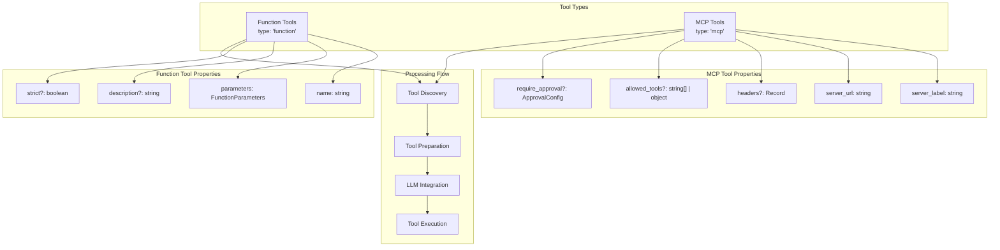
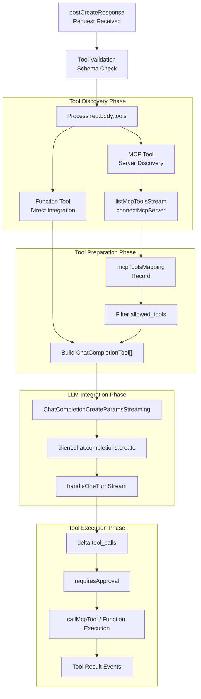
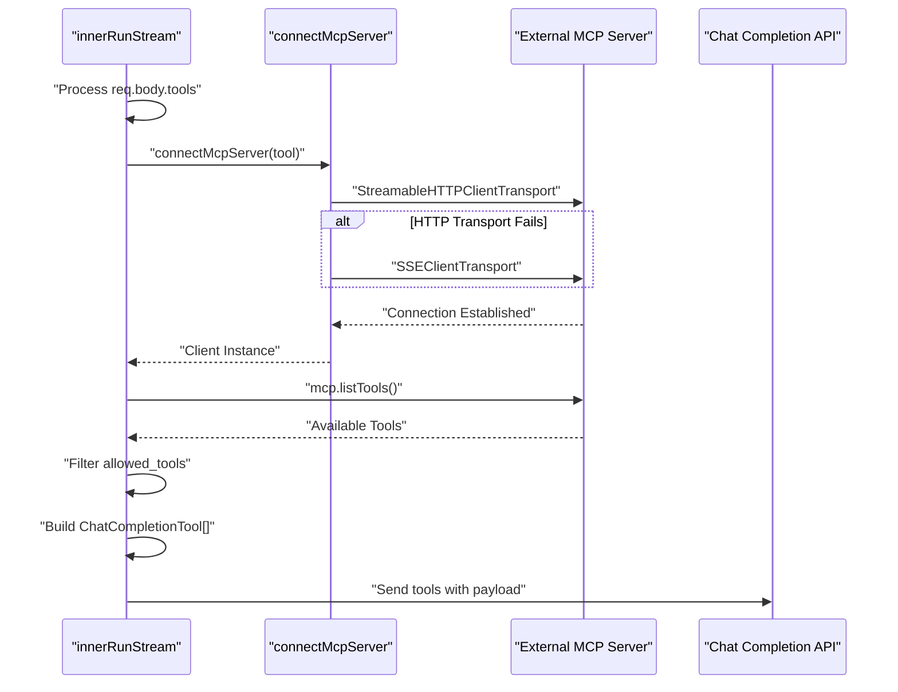
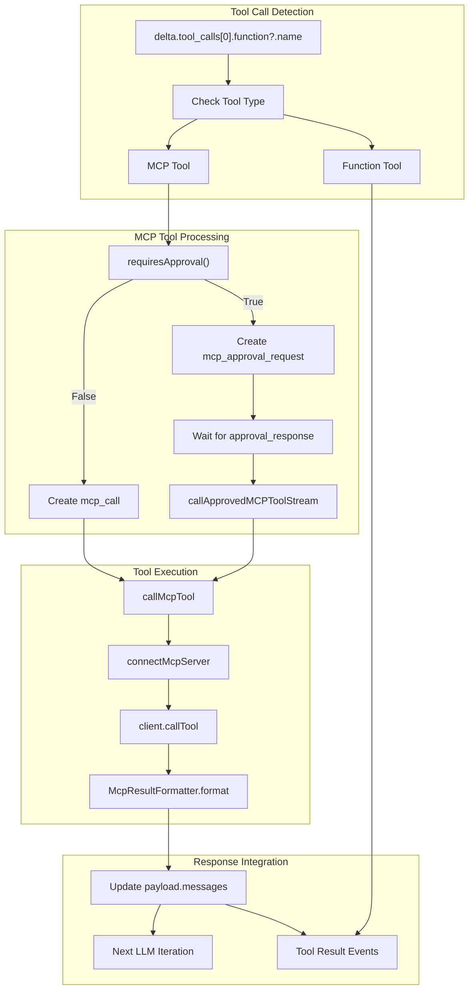
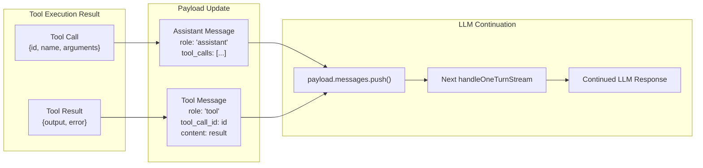
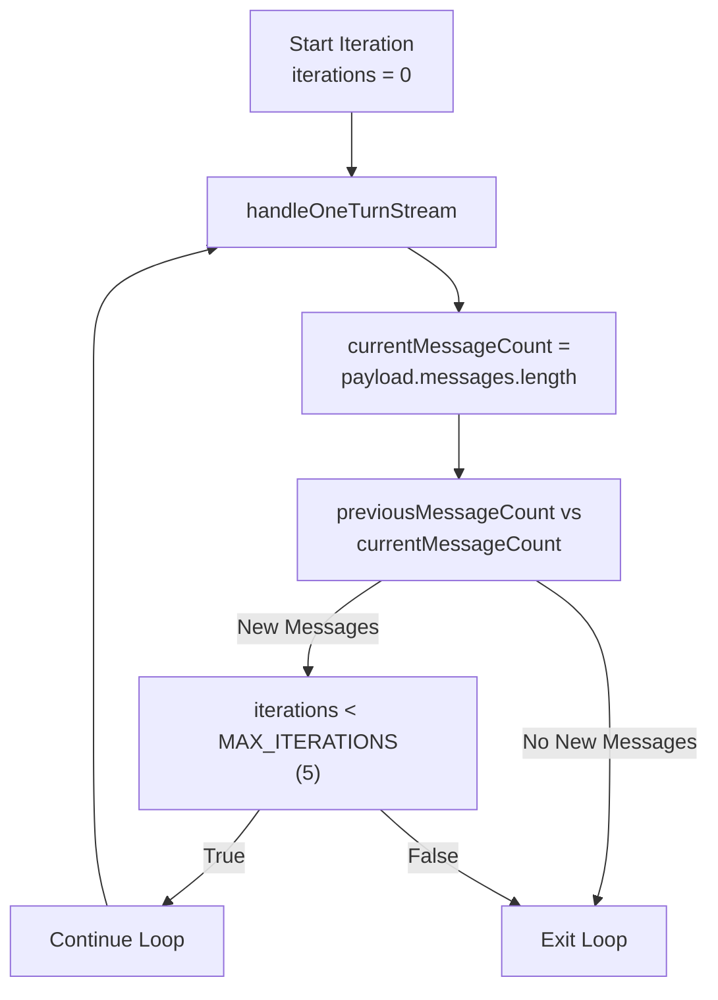

<!-- source: DeepWiki mcp.deepwiki.com · repo huggingface/responses.js · page 5 Tool Integration · fetched 2026-10-26 -->

# Tool Integration

Relevant source files

The following files were used as context for generating this wiki page:

- [src/mcp.ts](src/mcp.ts)
- [src/routes/responses.ts](src/routes/responses.ts)

This document provides a comprehensive guide to integrating and using external tools with responses.js. Tool integration enables LLMs to extend their capabilities by executing functions, accessing external systems, and performing actions beyond text generation. The system supports two primary tool types: basic function calls and MCP (Model Context Protocol) servers with sophisticated approval workflows.

For specific implementation details of function calling, see [Function Calling](#5.1). For MCP server integration, see [MCP Tools](#5.2). For approval mechanism configuration, see [Approval Workflows](#5.3).

## Tool Types Overview

The responses.js system supports two distinct tool integration approaches, each serving different use cases and complexity requirements.

Sources: [src/routes/responses.ts:164-227](), [src/schemas.ts]()

## Tool Processing Architecture

The tool integration system operates through a multi-stage pipeline that handles tool discovery, preparation, execution, and result streaming. The architecture seamlessly integrates with the response generation process.

**Tool Processing Pipeline**

Sources: [src/routes/responses.ts:32-58](), [src/routes/responses.ts:146-415](), [src/routes/responses.ts:164-227]()

## Tool Discovery and Preparation

Tool discovery involves processing the `tools` array from the request and preparing them for LLM integration. The system handles both immediate function tools and dynamic MCP tool discovery.

**MCP Tool Discovery Process**

The tool preparation process transforms both function and MCP tools into a unified format for the LLM:

| Tool Type | Source | Transformation | Storage |
|-----------|--------|---------------|---------|
| Function | `req.body.tools` | Direct mapping to `ChatCompletionTool` | `tools` array |
| MCP | External server | `listTools()` → `ChatCompletionTool` | `mcpToolsMapping` record |

Sources: [src/routes/responses.ts:164-227](), [src/mcp.ts:10-33]()

## Tool Execution Flow

Tool execution occurs during LLM response streaming when the model generates tool calls. The system handles different execution paths based on tool type and approval requirements.

**Tool Call Processing**

Sources: [src/routes/responses.ts:564-768](), [src/routes/responses.ts:696-728](), [src/mcp.ts:35-56]()

## Integration with Response Generation

Tools are deeply integrated into the response streaming architecture, with specific event types for different tool operations and states.

**Tool-Related Stream Events**

| Event Type | Purpose | Data Fields |
|------------|---------|-------------|
| `response.mcp_list_tools.in_progress` | MCP tool discovery started | `sequence_number` |
| `response.mcp_list_tools.completed` | MCP tool discovery finished | `sequence_number` |
| `response.mcp_call.in_progress` | MCP tool execution started | `item_id`, `output_index` |
| `response.mcp_call.completed` | MCP tool execution finished | `sequence_number` |
| `response.function_call_arguments.delta` | Function call args streaming | `item_id`, `delta` |
| `response.mcp_call_arguments.delta` | MCP call args streaming | `item_id`, `delta` |

**Tool Result Integration**

The system maintains conversation continuity by updating the LLM payload with tool results:

The system implements iterative processing with a maximum of 5 iterations to handle tool chains while preventing infinite loops:

Sources: [src/routes/responses.ts:401-414](), [src/routes/responses.ts:729-755](), [src/routes/responses.ts:834-856]()

---

