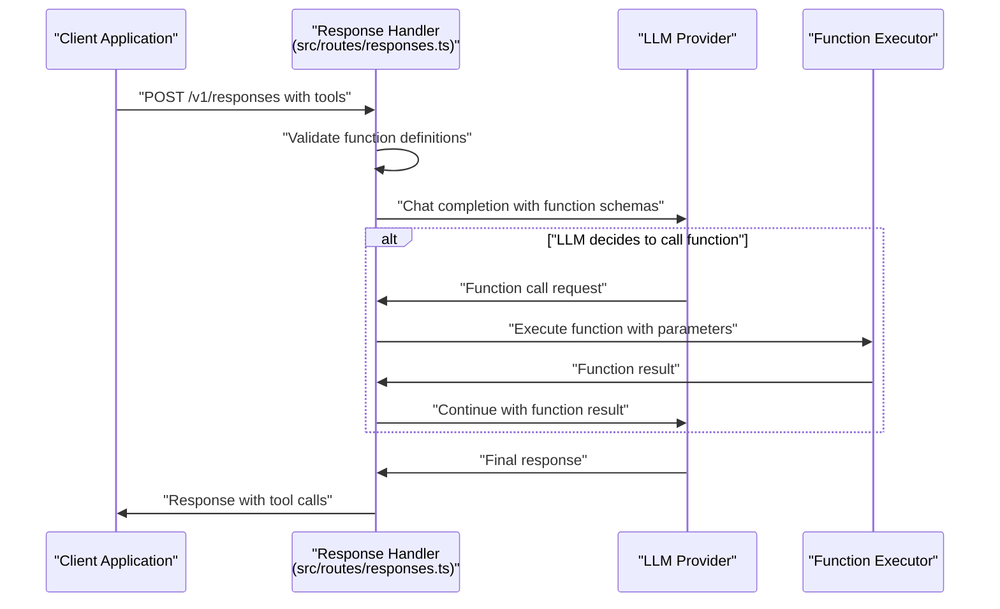
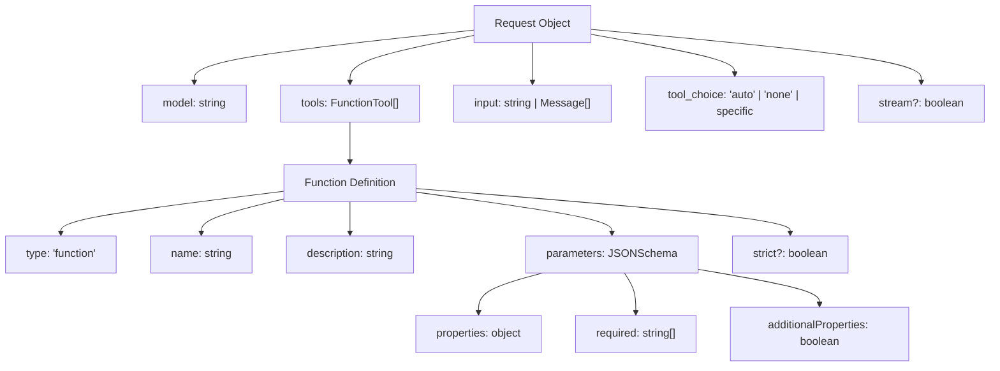
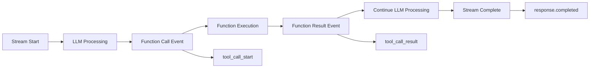
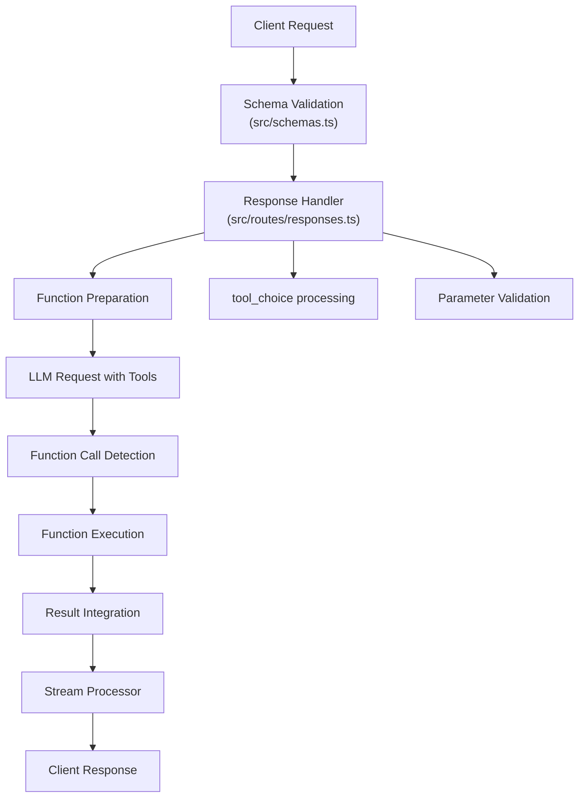

<!-- source: DeepWiki mcp.deepwiki.com · repo huggingface/responses.js · page 5.1 Function Calling · fetched 2026-10-26 -->

# Function Calling

Relevant source files

The following files were used as context for generating this wiki page:

- [examples/function.js](examples/function.js)
- [examples/function_streaming.js](examples/function_streaming.js)

This document covers basic function calling in responses.js, which allows Language Models to invoke predefined functions during response generation. Function calling extends LLM capabilities by enabling them to perform specific actions or retrieve external data based on user input.

For more advanced tool integration using external MCP servers, see [MCP Tools](#5.2). For implementing security controls around tool execution, see [Approval Workflows](#5.3).

## Function Definition Structure

Functions in responses.js follow the OpenAI function calling specification. Each function tool consists of a type identifier, name, description, and parameter schema defined using JSON Schema format.

| Property | Type | Required | Description |
|----------|------|----------|-------------|
| `type` | string | Yes | Must be "function" |
| `name` | string | Yes | Function identifier used by the LLM |
| `description` | string | Yes | Natural language description of function purpose |
| `parameters` | object | Yes | JSON Schema defining function parameters |
| `strict` | boolean | No | Enables strict parameter validation |

The parameter schema supports standard JSON Schema properties including `type`, `properties`, `required`, `enum`, and `additionalProperties`.

Sources: [examples/function.js:5-22](), [examples/function_streaming.js:5-21]()

## Function Call Processing Flow

Sources: [examples/function.js:24-29](), [examples/function_streaming.js:23-28]()

## Request Configuration

Function calling requests use the standard `openai.responses.create()` method with additional parameters:

Sources: [examples/function.js:24-29](), [examples/function_streaming.js:23-28]()

## Non-Streaming Function Calls

Basic function calling returns a complete response object after all processing is finished. The LLM analyzes the available functions and calls them as needed to fulfill the user's request.

The example demonstrates a weather function that accepts location and temperature unit parameters. The `tool_choice: "auto"` setting allows the LLM to decide whether to use the function based on the input context.

Sources: [examples/function.js:1-32]()

## Streaming Function Calls

Streaming function calls provide real-time updates during response generation, including function call events and results. The stream yields various event types as the LLM processes the request and executes functions.

The streaming approach is particularly useful for long-running functions or when providing immediate feedback to users about function execution progress.

Sources: [examples/function_streaming.js:1-33]()

## Parameter Validation

The `strict: true` parameter enables enhanced parameter validation, ensuring function calls conform exactly to the defined schema. This prevents the LLM from passing invalid or unexpected parameters to functions.

When strict mode is enabled, the system validates:
- Required parameters are present
- Parameter types match schema definitions  
- No additional properties are included (if `additionalProperties: false`)
- Enum values are from allowed sets

Sources: [examples/function_streaming.js:19]()

## Integration with Response Handler

Function calling integrates with the core response generation system through the Response Handler. The handler manages function discovery, parameter validation, execution coordination, and result integration back into the LLM conversation flow.

Sources: [examples/function.js:5-32](), [examples/function_streaming.js:5-33]()

---

