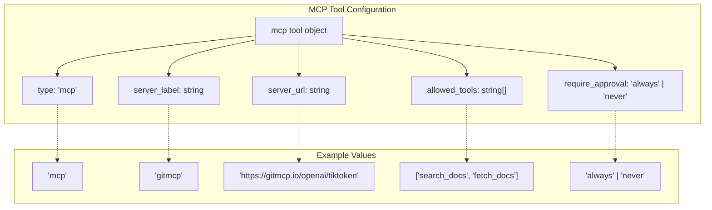
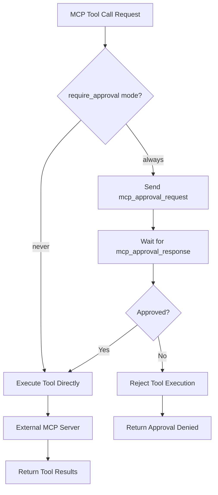
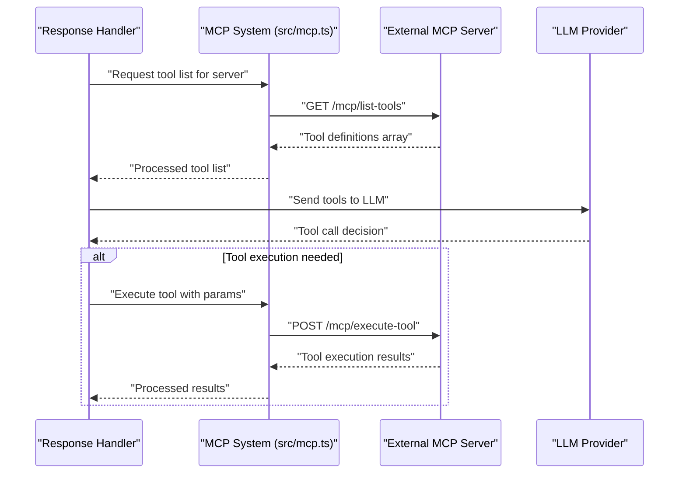
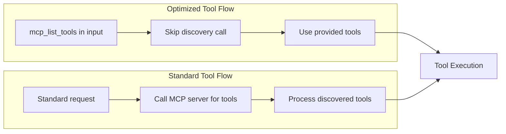
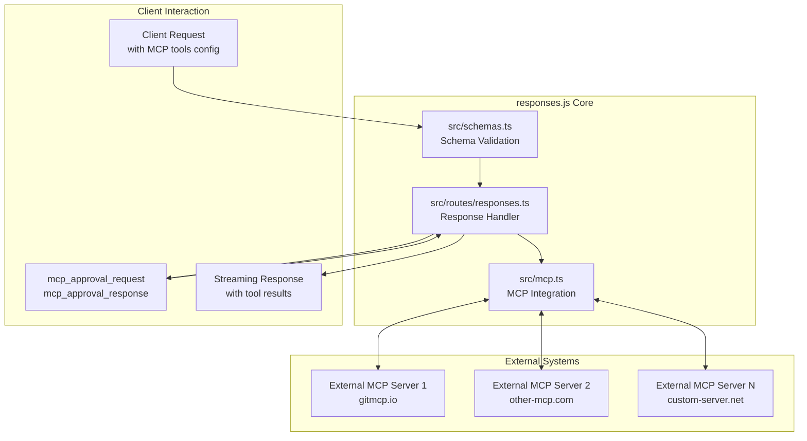

<!-- source: DeepWiki mcp.deepwiki.com · repo huggingface/responses.js · page 5.2 MCP Tools · fetched 2026-10-26 -->

# MCP Tools

<details>
<summary>Relevant source files</summary>

The following files were used as context for generating this wiki page:

- [examples/mcp_ask_approval.js](examples/mcp_ask_approval.js)
- [examples/mcp_auto_approval.js](examples/mcp_auto_approval.js)
- [examples/mcp_tools_in_input.js](examples/mcp_tools_in_input.js)

</details>


This document covers working with external MCP (Model Context Protocol) servers for advanced tool execution and integration. MCP Tools provide a way to connect responses.js to external tool servers that can execute complex operations beyond basic function calling. For information about basic function calling, see [Function Calling](#5.1). For detailed information about approval mechanisms, see [Approval Workflows](#5.3).

## Overview

MCP Tools enable responses.js to integrate with external MCP servers that provide specialized tool capabilities. Unlike basic function calling which executes tools locally within the responses.js process, MCP Tools communicate with external servers over HTTP to execute tools in remote environments.

The MCP integration supports automatic tool discovery, approval workflows for security, and efficient tool listing optimization. This allows for powerful integrations with external services while maintaining control over tool execution.

## MCP Tool Configuration

MCP Tools are configured in the `tools` array of a request using the `mcp` type. The configuration specifies the external server details and execution policies.

### Configuration Structure



Sources: [examples/mcp_ask_approval.js:8-16](), [examples/mcp_auto_approval.js:8-16](), [examples/mcp_tools_in_input.js:133-141]()

### Configuration Parameters

| Parameter | Type | Description |
|-----------|------|-------------|
| `type` | `"mcp"` | Identifies this as an MCP tool configuration |
| `server_label` | `string` | Human-readable identifier for the MCP server |
| `server_url` | `string` | URL of the external MCP server |
| `allowed_tools` | `string[]` | Array of tool names that are permitted for execution |
| `require_approval` | `"always" \| "never"` | Approval policy for tool execution |

Sources: [examples/mcp_ask_approval.js:8-16](), [examples/mcp_auto_approval.js:8-16]()

## Approval Workflow Integration

MCP Tools integrate with the approval workflow system to provide security controls over external tool execution. The `require_approval` parameter controls when approval is required.

### Approval Modes



Sources: [examples/mcp_ask_approval.js:14](), [examples/mcp_auto_approval.js:14]()

When `require_approval` is set to `"always"`, the system will emit approval request events that clients must respond to before tool execution proceeds. When set to `"never"`, tools execute automatically without approval.

## Tool Discovery and Listing

MCP Tools support automatic tool discovery from external servers. The system can either discover tools dynamically or use pre-provided tool definitions for optimization.

### Dynamic Tool Discovery



Sources: [examples/mcp_ask_approval.js](), [examples/mcp_auto_approval.js]()

### Pre-provided Tool Definitions

For optimization, tool definitions can be included directly in the request input to avoid repeated tool discovery calls. This is particularly useful for repeated interactions with the same MCP server.



Sources: [examples/mcp_tools_in_input.js:17-26](), [examples/mcp_tools_in_input.js:1-8]()

The optimized approach uses an `mcp_list_tools` input item containing pre-fetched tool definitions, allowing the system to log "Using MCP list tools from input for server 'gitmcp'" instead of making discovery calls.

## Integration Architecture

The MCP integration involves several key components working together to provide seamless external tool execution.

### Component Interaction



Sources: [examples/mcp_ask_approval.js](), [examples/mcp_auto_approval.js](), [examples/mcp_tools_in_input.js]()

### Tool Execution Flow

The MCP tool execution follows a specific flow that integrates with the overall response generation process:

1. **Configuration Validation**: MCP tool configurations are validated against the request schema
2. **Tool Discovery**: External servers are queried for available tools (unless pre-provided)
3. **LLM Integration**: Discovered tools are provided to the LLM for decision making
4. **Approval Processing**: Tool execution requests go through the approval workflow if required
5. **External Execution**: Approved tools are executed on external MCP servers
6. **Result Integration**: Tool results are integrated back into the response stream

Sources: [src/mcp.ts](), [src/routes/responses.ts](), [src/schemas.ts]()

## Usage Examples

### Basic MCP Tool Usage

The simplest MCP tool configuration connects to an external server with automatic approval:

```javascript
// From examples/mcp_auto_approval.js
{
  type: "mcp",
  server_label: "gitmcp",
  server_url: "https://gitmcp.io/openai/tiktoken",
  allowed_tools: ["search_tiktoken_documentation", "fetch_tiktoken_documentation"],
  require_approval: "never"
}
```

Sources: [examples/mcp_auto_approval.js:8-16]()

### MCP Tool with Approval Required

For security-sensitive operations, approval can be required for every tool execution:

```javascript
// From examples/mcp_ask_approval.js
{
  type: "mcp",
  server_label: "gitmcp", 
  server_url: "https://gitmcp.io/openai/tiktoken",
  allowed_tools: ["search_tiktoken_documentation", "fetch_tiktoken_documentation"],
  require_approval: "always"
}
```

Sources: [examples/mcp_ask_approval.js:8-16]()

### Optimized Tool Usage with Pre-provided Definitions

For repeated interactions, tool definitions can be included in the input to avoid discovery overhead:

The input includes an `mcp_list_tools` item with the complete tool definitions, followed by the regular user message. This optimization allows the system to skip the external tool discovery call and use the provided definitions directly.

Sources: [examples/mcp_tools_in_input.js:16-26](), [examples/mcp_tools_in_input.js:127-141]()

---

