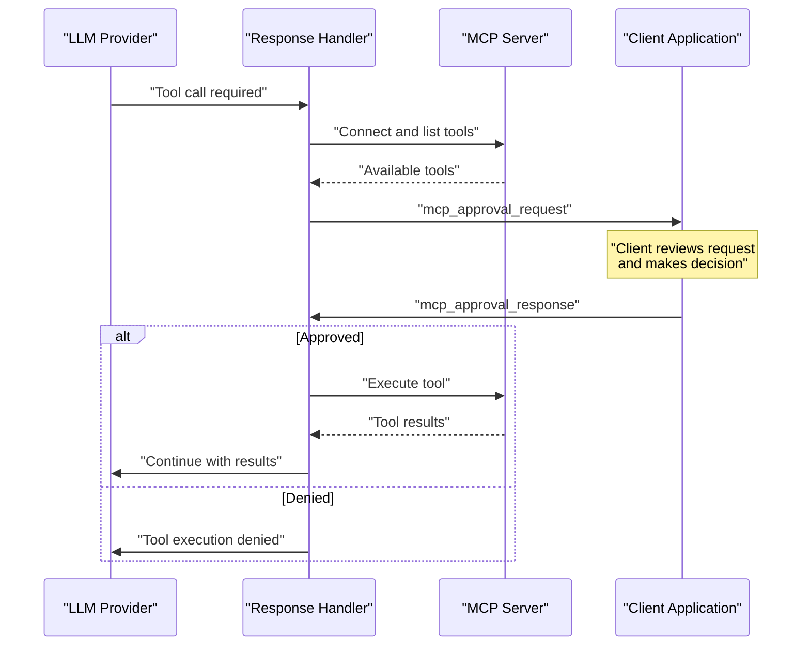
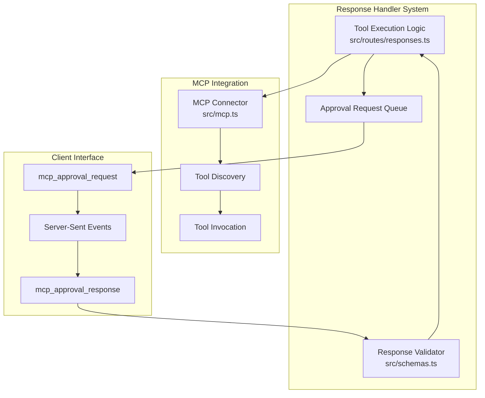

<!-- source: DeepWiki mcp.deepwiki.com · repo huggingface/responses.js · page 5.3 Approval Workflows · fetched 2026-10-26 -->

# Approval Workflows

<details>
<summary>Relevant source files</summary>

The following files were used as context for generating this wiki page:

- [examples/mcp_approved.js](examples/mcp_approved.js)
- [examples/mcp_approved_no_request.js](examples/mcp_approved_no_request.js)
- [examples/mcp_auto_approval_streaming.js](examples/mcp_auto_approval_streaming.js)

</details>


Approval workflows provide security controls for external tool execution in responses.js, specifically for MCP (Model Context Protocol) server interactions. This system allows applications to review and approve tool calls before they are executed, preventing unauthorized actions or providing audit trails for sensitive operations.

For information about basic MCP tool configuration and usage, see [MCP Tools](#5.2). For general function calling concepts, see [Function Calling](#5.1).

## Purpose and Security Model

Approval workflows address the security concern of allowing LLMs to execute external tools autonomously. When an MCP server provides tools that could modify external systems, read sensitive data, or incur costs, the approval system ensures human oversight before execution.

The approval mechanism operates through a request-response pattern where the responses.js server pauses tool execution to request approval from the client application, which can then choose to approve or deny the action.

**Sources:** [examples/mcp_approved.js:1-54](), [examples/mcp_auto_approval_streaming.js:1-23]()

## Approval Modes

MCP tools support different approval requirements through the `require_approval` configuration parameter:

| Mode | Behavior | Use Case |
|------|----------|----------|
| `"never"` | Auto-approve all tool calls | Safe, read-only tools or trusted environments |
| `"always"` | Request approval for every tool call | Sensitive operations requiring human oversight |

The approval mode is configured per MCP server in the `tools` array of the request:

```javascript
{
  type: "mcp",
  server_label: "gitmcp",
  server_url: "https://gitmcp.io/openai/tiktoken",
  allowed_tools: ["search_tiktoken_documentation"],
  require_approval: "always"  // or "never"
}
```

**Sources:** [examples/mcp_auto_approval_streaming.js:14](), [examples/mcp_approved.js:32]()

## Approval Request-Response Cycle

When `require_approval: "always"` is configured, the following workflow occurs:

### Approval Request Flow Diagram



### Message Types and Structure

The approval system uses two specific message types in the request `input` array:

#### MCP Approval Request
```typescript
{
  type: "mcp_approval_request",
  id: "mcp_approval_request_123",
  server_label: "gitmcp",
  name: "fetch_tiktoken_documentation", 
  arguments: "{}"
}
```

#### MCP Approval Response  
```typescript
{
  type: "mcp_approval_response",
  id: "mcp_approval_response_123",
  approval_request_id: "mcp_approval_request_123",
  approve: true
}
```

The `approval_request_id` in the response must match the `id` of the corresponding request.

**Sources:** [examples/mcp_approved.js:26-37](), [examples/mcp_approved_no_request.js:20-24]()

## Implementation Architecture

### Approval Workflow Components



The approval workflow integrates with the core response handling system through request validation and MCP server communication.

**Sources:** [src/routes/responses.ts](), [src/mcp.ts](), [src/schemas.ts]()

## Error Handling

### Common Approval Errors

| Error Condition | Error Code | Description |
|----------------|------------|-------------|
| Missing approval request | `server_error` | Approval response sent without corresponding request |
| Invalid approval request ID | `server_error` | Response references non-existent request ID |
| Malformed approval response | `validation_error` | Response doesn't match required schema |

### Error Example

When an approval response is sent without a prior approval request:

```javascript
{
  code: 'server_error',
  message: "MCP approval response for approval request 'mcp_approval_request_123' not found"
}
```

This error occurs when the client sends an `mcp_approval_response` message that references an `approval_request_id` that doesn't exist in the server's approval queue.

**Sources:** [examples/mcp_approved_no_request.js:38-41]()

## Usage Patterns

### Auto-Approval for Safe Operations

For read-only tools or trusted environments, disable approval requirements:

```javascript
tools: [{
  type: "mcp",
  server_label: "gitmcp", 
  server_url: "https://gitmcp.io/openai/tiktoken",
  allowed_tools: ["search_tiktoken_documentation"],
  require_approval: "never"
}]
```

### Manual Approval for Sensitive Operations

For tools that modify external systems or access sensitive data:

```javascript
tools: [{
  type: "mcp",
  server_label: "file_server",
  server_url: "https://file-operations.example.com", 
  allowed_tools: ["write_file", "delete_file"],
  require_approval: "always"
}]
```

### Streaming with Approvals

Approval workflows work seamlessly with streaming responses. The server will emit approval request events that the client can handle in real-time:

```javascript
for await (const event of stream) {
  if (event.type === 'mcp_approval_request') {
    // Handle approval request
    // Send approval response in subsequent request
  }
}
```

**Sources:** [examples/mcp_auto_approval_streaming.js:5-22](), [examples/mcp_approved.js:17-47]()

---

